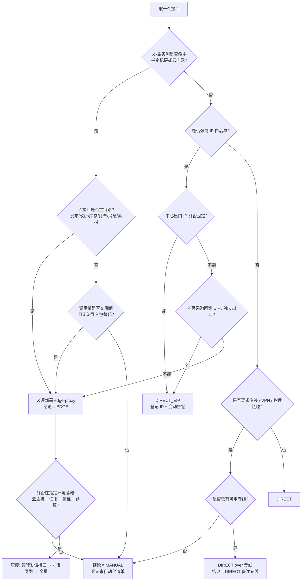

# 03 · 平台部署与网络约束核验

| 项 | 内容 |
|---|---|
| 编号 | 03（对应总纲 §8.3「部署与网络约束」/ §十五 M0 判据「部署约束表覆盖全部在用接口」） |
| 用途 | 建立一张**逐接口**的网络约束事实表，据此判定：接口能否中心直连、是否需固定出口 IP、是否必须部署 `edge-proxy`、是否进「未自动化接口清单」；并固定中心 ↔ edge 的通信协议与安全机制 |
| 读者 | 架构（主责）、运维/管理员（证书、云主机、EIP）、后端（中心侧客户端与 edge 服务）、测试（连通性与签名用例）、审批人（采购与降级决策） |
| 依赖 | `docs/00-方案总纲.md` §3.1、§8.3、§9.2、§19；`docs/01` §三、`docs/02` §三（平台侧线索）；平台开发者账号（看文档与白名单页）；云厂商账号（若需 EIP/云主机） |
| 状态 | 草案 v0.1（2026-10-20）。表模板与决策树、通信协议已定；**逐接口事实列全部为空缺，待 01/02 的核验回填**。未回填前不得采购云主机、不得预置 edge-proxy |
| 版本 | v0.1；回填后升 v1.0（M0 完成判据） |

> **本文件的边界**：这里只回答「调得通、怎么调、调不通怎么办」。不回答「接口字段是什么」（在 01/02），不回答「业务逻辑」（在 `docs/11`）。

---

## 0. 结论先行与判定口径

1. **结论先行**：目前**没有任何一个接口的部署约束被证实**。M0 的动作不是「先买一台云主机」，而是**先把逐接口表填成事实**，再按决策树决定是否采购。总纲 §二十 第 5 条已给定默认：未提供云主机 → 该接口进未自动化清单，其余模块照常交付。
2. **四类网络模式必须互斥标记**：公网直连 / IP 白名单 / 强制指定机房或云内网 / 需专线或隧道。一个接口可能同时命中两类（如「白名单 + 指定机房」），**取最严格的一类作为结论**，并在「备注」写明叠加项。
3. **「未知」不等于「安全」**：未核验的接口一律按**最严格**假设设计（预留 edge 客户端抽象、预留固定出口 IP 的部署位），但**不得**据此采购或阻塞其他模块——技术上预留，商务上不预支。
4. **中心 ↔ edge 不用 SSH 隧道**：SSH 隧道无法提供请求级签名、路径白名单、报文留档与逐跳审计（总纲 §8.3 已定）。方案见 §四：HTTPS + mTLS + HMAC + 时间窗防重放。
5. **人工兜底是一等公民**：进「未自动化接口清单」不是失败，是**显式登记的有意降级**，必须有兜底 SLA、一致性校验与退出条件（§五）。不允许「调不通就悄悄改成手工」而不登记。

### 0.1 术语与结论枚举（全表统一）

| 结论值 | 含义 | 工程表现 |
|---|---|---|
| `DIRECT` | 中心直连，无额外网络要求 | adapter 直接出网 |
| `DIRECT_EIP` | 中心直连，但出口 IP 必须固定并登记白名单 | 固定 EIP / NAT 网关 + 出口 IP 监控 |
| `EDGE` | 必须经 `edge-proxy`（部署在平台指定环境） | 中心 → edge（mTLS+HMAC）→ 平台 |
| `EDGE_OR_MANUAL` | 可上 edge，但收益不足或无法落地，允许人工 | 按工程量与调用量二选一，登记理由 |
| `MANUAL` | 不自动化，走导入包/人工/只读替代 | 进「未自动化接口清单」 |
| `UNKNOWN` | 未核验 | 默认按最严格设计，禁止上线自动写 |

---

## 一、核验方法与判定规则

### 1.1 核验顺序（不可乱序）

| 步 | 动作 | 证据（必须留档） | 产出 |
|---|---|---|---|
| 1 | 在官方文档逐接口读「请求地址/调用说明/权限说明」 | 文档页 URL + 抓取日期 + 截图 | 调用域名与路径 |
| 2 | 从请求示例中取域名，判断是否含「内网/指定/VPC/专有云」字样 | 原文引用 | 是否命中强制机房 |
| 3 | 在开发者后台看「IP 白名单」「安全设置」页 | 截图 + 页面字段 | 是否强制白名单 |
| 4 | 在后台看「回调/消息订阅」配置页 | 截图 | 回调是否要求公网 HTTPS/备案域名 |
| 5 | 实机探测：DNS、TLS、HTTP 状态、时间偏差 | 命令输出原文（§附录 A） | 可达性事实 |
| 6 | 用测试店铺真实调用 1 次只读接口，记录错误码 | 请求/响应（脱敏） | 是否触发地域/白名单拒绝 |
| 7 | 填表并给出结论值 | 本文件 §二 表 | 结论 + 备注 |

### 1.2 判定规则（硬规则，逐条可判）

| 编号 | 条件（可观测） | 结论 | 附加动作 |
|---|---|---|---|
| N1 | 公网可建连、无白名单要求、文档无内网字样 | `DIRECT` | 无 |
| N2 | 有 IP 白名单，且中心出口 IP 可固定（自建机房/固定 EIP） | `DIRECT_EIP` | 登记 IP、加出口 IP 变动告警 |
| N3 | 有 IP 白名单，但中心出口 IP 不可固定（托管环境/共享出口） | `EDGE` 或 `MANUAL` | 优先固定 EIP；不行则按 §三 决策 |
| N4 | 文档明确要求指定机房/云内网/VPC 内调用 | `EDGE`（核心链路）或 `MANUAL`（非核心） | 核心链路必须采购；非核心登记降级 |
| N5 | 要求专线/VPN/物理链路 | `MANUAL`（除非已有专线） | 登记，季度复核 |
| N6 | 需商家授权但网络无约束 | 按 N1/N2 处理 | 授权只影响令牌，不影响部署 |
| N7 | 无法判断（文档缺失/账号未到手） | `UNKNOWN` | 禁写；先按人工跑通；M0 末必须清零 |

**判定规则 N8（清零）**：M0 结束时，**主链路**（商品发布、改价、库存、订单只读、消息收发、素材上传）不得存在 `UNKNOWN`；非主链路允许 `UNKNOWN`，但必须进清单并写明复核日期。

### 1.3 结论矩阵（叠加项怎么取）

| 公网可达 | IP 白名单 | 指定机房 | 专线 | 结论 |
|---|---|---|---|---|
| 是 | 否 | 否 | 否 | `DIRECT` |
| 是 | 是 | 否 | 否 | `DIRECT_EIP`（IP 可固定）/ `EDGE`（不可固定） |
| 是 | 否 | 是 | 否 | `EDGE`（文档称公网可达但仍要求机房时，以文档为准） |
| 是 | 是 | 是 | 否 | `EDGE` + 白名单在 edge 侧登记 |
| 否 | 任意 | 任意 | 任意 | `EDGE` 或 `MANUAL` |
| 任意 | 任意 | 任意 | 是 | `MANUAL`（无专线时） |

---

## 二、逐接口核验表（模板 + 填法）

> 一个接口一行，**覆盖 01/02 中「结论=自动化」的全部接口**。此表是 M0 的验收物：`docs/01`、`docs/02` 的每条「自动化」结论都必须在这张表里有对应行，否则不算完成。

| # | 接口（平台 / 能力 / method） | 公网直连 | IP 白名单 | 强制指定机房或云内网 | 需专线或隧道 | 商家授权 | 限流 | 结论 | 证据（URL/截图/命令输出） | 核验日期 |
|---|---|---|---|---|---|---|---|---|---|---|
| 1 | 拼多多 / 商品发布 / 待填 | 待填：公网是否可建连（curl 结果） | 待填：是否强制、粒度 | 待填：文档是否要求指定机房/内网 | 待填：是否要求专线 | 待填：是否需店铺授权 | 待填：QPS/日上限 | `UNKNOWN` | 待填：文档 URL + 抓取日期 | — |
| 2 | 拼多多 / 改价 / 待填 | 待填 | 待填 | 待填 | 待填 | 待填 | 待填 | `UNKNOWN` | 待填 | — |
| 3 | 拼多多 / 库存更新 / 待填 | 待填 | 待填 | 待填 | 待填 | 待填 | 待填 | `UNKNOWN` | 待填 | — |
| 4 | 拼多多 / 订单详情 / 待填 | 待填 | 待填 | 待填 | 待填 | 待填 | 待填 | `UNKNOWN` | 待填 | — |
| 5 | 拼多多 / 消息发送 / 待填 | 待填 | 待填 | 待填 | 待填 | 待填 | 待填 | `UNKNOWN` | 待填 | — |
| 6 | 拼多多 / 消息推送回调（入站） | 待填：平台回调我方，需公网 HTTPS | 待填：是否要求固定来源 IP | 待填 | 待填 | 待填 | 待填 | `UNKNOWN` | 待填 | — |
| 7 | 拼多多 / 图片上传 / 待填 | 待填 | 待填 | 待填 | 待填 | 待填 | 待填 | `UNKNOWN` | 待填 | — |
| 8 | 拼多多 / 视频分片上传 / 待填 | 待填 | 待填 | 待填 | 待填 | 待填 | 待填 | `UNKNOWN` | 待填 | — |
| 9 | 1688 / 商品发布 / 待填 | 待填 | 待填 | 待填 | 待填 | 待填 | 待填 | `UNKNOWN` | 待填 | — |
| 10 | 1688 / 改价（含档位）/ 待填 | 待填 | 待填 | 待填 | 待填 | 待填 | 待填 | `UNKNOWN` | 待填 | — |
| 11 | 1688 / 库存 / 待填 | 待填 | 待填 | 待填 | 待填 | 待填 | 待填 | `UNKNOWN` | 待填 | — |
| 12 | 1688 / 订单（含代发）/ 待填 | 待填 | 待填 | 待填 | 待填 | 待填 | 待填 | `UNKNOWN` | 待填 | — |
| 13 | 1688 / 询盘拉取 / 待填 | 待填 | 待填 | 待填 | 待填 | 待填 | 待填 | `UNKNOWN` | 待填 | — |
| 14 | 1688 / 消息发送 / 待填 | 待填 | 待填 | 待填 | 待填 | 待填 | 待填 | `UNKNOWN` | 待填 | — |
| 15 | 1688 / 报价单 / 待填 | 待填 | 待填 | 待填 | 待填 | 待填 | 待填 | `UNKNOWN` | 待填 | — |
| 16 | 1688 / 图片与视频上传 / 待填 | 待填 | 待填 | 待填 | 待填 | 待填 | 待填 | `UNKNOWN` | 待填 | — |

**填表规则**

1. 「公网直连」只填三种值：`可达` / `不可达` / `未测`，并附 §附录 A 的命令输出摘要。
2. 「IP 白名单」填：`强制(粒度)/可选/无`；强制时必须在「证据」里给出后台页面截图路径。
3. 「强制指定机房或云内网」填：`是(原文词句)/否/未查`。`是` 必须带原文引用（例如文档中的「仅支持内网调用」字样），**不接受转述**。
4. 「需专线或隧道」填：`是/否/未查`。填「是」时结论只能是 `MANUAL`（除非已有专线，需注明线路编号）。
5. 「商家授权」填：`店铺授权/无需/未查`。它不影响部署结论，但影响令牌刷新与故障排查路径。
6. 「限流」填：`QPS`、`每分钟`、`每日上限`、`超限错误码` 四项中已知的部分，未知写 `待填`。
7. 「结论」只能取 §0.1 的枚举值；填 `MANUAL`/`EDGE_OR_MANUAL` 必须同时新增 §五 清单行。
8. 一行只对应一个 method；同一能力在沙箱与生产域名不同则拆两行。

**汇总统计（M0 验收用）**

| 指标 | 公式 | 目标 |
|---|---|---|
| 覆盖度 | 已填行数 / 01+02 中「自动化」接口数 | 100% |
| 未知率 | `UNKNOWN` 行数 / 已填行数（主链路） | 0 |
| edge 依赖度 | `EDGE` 行数 / 已填行数 | 记录，不设目标 |
| 人工降级率 | `MANUAL` 行数 / 已填行数 | 记录，需有理由 |
| 证据完整率 | 有证据路径的行数 / 已填行数 | 100% |

---

## 三、edge-proxy 决策树

### 3.1 决策图



### 3.2 必须部署 edge-proxy 的条件（任一命中）

| # | 条件 | 判据 | 备注 |
|---|---|---|---|
| E1 | 主链路接口明确要求指定机房/云内网调用 | 文档原文 + 实测公网不可达或返回地域拒绝 | 最常见的硬条件 |
| E2 | 平台强制 IP 白名单，且中心出口无法固定 | 托管环境共享出口 / 出口 IP 会漂移 | 也可通过采购固定 EIP 解决，优先便宜方案 |
| E3 | 同一平台对多个出口 IP 有白名单条数限制，而中心需多环境（测试/生产）共用 | 后台白名单条数上限 | 用 edge 统一出口 |
| E4 | 平台回调要求固定来源 IP 且我方入口在弹性环境中 | 回调白名单只能填少量 IP | 入站也可经 edge 反代 |
| E5 | 需要按请求做报文留档或二次签名，而平台不支持在中心完成 | 合规/审计要求 | 与总纲 §8.3 edge 职责一致 |

### 3.3 走人工兜底（不部署 edge）的条件（任一命中）

| # | 条件 | 判据 | 兜底形态 |
|---|---|---|---|
| M1 | 非主链路接口，且调用频率低（低于「值得运维一台机器」的阈值） | 频率待实测，阈值在 `docs/05` 定 | 导入包 / 人工 |
| M2 | 该能力可用导入包（CSV/Excel）等价完成 | 平台提供模板 | 生成导入包 + 回执解析 |
| M3 | 该能力可只读替代（拿不到写，但能读） | 只读接口公网可达 | 只读同步 + 人工执行写 |
| M4 | 需要专线/VPN，且无现成线路 | 采购成本 > 收益 | 人工 + 季度复核 |
| M5 | 无法在指定环境落地运维（无账号、无预算、无责任人） | 决策记录 | 人工 + 明确复核日期 |
| M6 | 平台规则禁止该自动化（合规红线） | 规则原文 | 人工，且不尝试规避 |

**判定规则 N9（采购门禁）**：部署 edge 需同时满足「≥ 1 个 E 类条件」+「非 M 类条件」+「有明确运维责任人」+「有预算来源」，四项缺一不可；决策写入 ADR（`docs/adr/`），不写在聊天里。

### 3.4 edge-proxy 的职责边界（防止长成第二套业务系统）

| 允许 | 禁止 |
|---|---|
| 转发白名单内的 path/method | 任何业务判断（价格、库存、审批） |
| 平台侧签名（如需在边缘完成） | 直连数据库、读写业务表 |
| 请求/响应脱敏留档 | 重试非幂等写操作 |
| 时间戳/防重放 | 缓存业务数据供中心读取 |
| 健康检查、限流、熔断（本机） | 承担队列、调度、重试编排（那是中心的事） |
| 证书与密钥的本机安全存储 | 暴露通用正向代理（可访问任意 host） |

---

## 四、中心 ↔ edge 通信方案

### 4.1 拓扑与信任边界

```
apps/api ──(1) HTTPS + mTLS + HMAC ──► edge-proxy ──(2) 平台要求的通道 ──► 平台
   │                                        │
   └─ 持客户端证书 + HMAC 密钥               └─ 持服务端证书 + 平台凭据（不出 edge）
```

- **信任边界**：平台 appSecret / access_token **只存在 edge**（若接口必须经 edge）；中心只持「调用 edge 的凭据」，不持平台密钥。这样即使中心被攻破，攻击者也拿不到平台密钥。
- 若接口可中心直连，则平台凭据在中心（与 01/02 的凭据方案一致），edge 不参与。
- 一条请求全程携带 `request_id`，中心生成，edge 透传并在日志与留档中使用同一值。

### 4.2 传输层：HTTPS + 双向证书（mTLS）

| 项 | 规定 |
|---|---|
| 协议版本 | TLS 1.2 起，优先 1.3；禁用 SSLv3/TLS1.0/1.1 |
| 证书体系 | 自建 CA（离线保管 CA 私钥），签发 edge 服务端证书与中心客户端证书 |
| 服务端证书 | `CN=edge-01.dssaas.internal`，SAN 含实际访问域名；有效期 ≤ 397 天 |
| 客户端证书 | `CN=center-api`（或按环境区分 `center-api-prod/staging`）；有效期 ≤ 397 天 |
| 校验 | edge 必须校验客户端证书链与 CN 白名单；中心必须校验服务端证书链与 SAN（禁止 `-k`/`NODE_TLS_REJECT_UNAUTHORIZED=0`） |
| 轮换 | 到期前 30 天告警；支持双证书并行（新旧同时受信）再切换，避免中断 |
| 吊销 | 用短有效期替代 CRL/OCSP；泄露时立即把该证书从 edge 的受信列表移除并轮换 |

**签发与校验命令（bash / WSL / Git Bash，openSSL 3.x）**

```bash
# 0) 目录
mkdir -p infra/certs && cd infra/certs

# 1) 自建 CA（私钥离线保管，权限 600）
openssl genrsa -out ca.key 4096 && chmod 600 ca.key
openssl req -x509 -new -nodes -key ca.key -sha256 -days 3650 \
  -subj "/CN=DSSAAS-Edge-CA/O=DSSAAS" -out ca.crt

# 2) edge 服务端证书
openssl genrsa -out edge.key 2048 && chmod 600 edge.key
openssl req -new -key edge.key -subj "/CN=edge-01.dssaas.internal" -out edge.csr
printf 'subjectAltName=DNS:edge-01.dssaas.internal\nbasicConstraints=CA:FALSE\nkeyUsage=digitalSignature,keyEncipherment\nextendedKeyUsage=serverAuth\n' > edge.ext
openssl x509 -req -in edge.csr -CA ca.crt -CAkey ca.key -CAcreateserial \
  -days 397 -sha256 -extfile edge.ext -out edge.crt

# 3) 中心客户端证书
openssl genrsa -out center.key 2048 && chmod 600 center.key
openssl req -new -key center.key -subj "/CN=center-api" -out center.csr
printf 'basicConstraints=CA:FALSE\nkeyUsage=digitalSignature\nextendedKeyUsage=clientAuth\n' > center.ext
openssl x509 -req -in center.csr -CA ca.crt -CAkey ca.key -CAcreateserial \
  -days 397 -sha256 -extfile center.ext -out center.crt

# 4) 校验有效期与用途
openssl verify -CAfile ca.crt edge.crt center.crt
openssl x509 -in edge.crt -noout -dates -ext subjectAltName
openssl x509 -in center.crt -noout -dates -ext extendedKeyUsage

# 5) 握手验证（含客户端证书）
openssl s_client -connect edge-01.dssaas.internal:443 \
  -servername edge-01.dssaas.internal \
  -cert center.crt -key center.key -CAfile ca.crt \
  -verify_return_error </dev/null 2>&1 | grep -E 'Verify return code|Protocol|Cipher'
```

### 4.3 应用层：HMAC 签名规范

| 项 | 规定 |
|---|---|
| 算法 | `HMAC-SHA256`，输出小写 hex（64 字符） |
| 密钥 | 每 `key_id` 一把 32 字节随机密钥（`openssl rand -hex 32`）；存 edge 的加密配置与中心的凭据存储；支持双密钥并行轮换 |
| 请求头 | `X-DSSAAS-Key-Id`、`X-DSSAAS-Timestamp`（Unix 秒）、`X-DSSAAS-Nonce`（16 字节随机 hex）、`X-DSSAAS-Body-Sha256`（原始 body 的 SHA256 hex，GET 用空串哈希）、`X-DSSAAS-Signature`、`X-DSSAAS-Request-Id` |
| 待签串 | 见下方公式，`\n` 分隔，字段顺序固定 |
| 查询串规范化 | 按 key ASCII 升序，`k=v` 用 `&` 连接，空值保留 `k=`，值做 RFC 3986 百分号编码（大写 hex） |
| 比较 | 常量时间比较（`crypto.timingSafeEqual`），长度不等直接失败 |
| 失败返回 | `401` + `{"code":"sig_invalid"}`；**不回显**期望值，不区分「key 不存在」与「签名错」（防枚举） |

待签串（canonical request）：

```
METHOD
PATH                      # 不含 query，含前导 /，不做大小写转换
CANONICAL_QUERY           # 见上，无 query 时为空串
BODY_SHA256_HEX
KEY_ID
TIMESTAMP
NONCE
```

签名：`SIGNATURE = hex(HMAC_SHA256(secret, canonical_request))`

**签名与调用示例**（示例中的 `/v1/pdd/goods/shelves` 是本系统 edge 的**内部路由**，不是平台 method 名；平台 method 以 01/02 的核验结果为准）

```bash
KEY_ID='key-01'; SECRET='<32字节hex>'
TS=$(date +%s); NONCE=$(openssl rand -hex 16)
BODY='{"goodsId":"T-001"}'
BODY_HASH=$(printf '%s' "$BODY" | openssl dgst -sha256 -hex | awk '{print $2}')
CANON=$(printf 'POST\n/v1/pdd/goods/shelves\n\n%s\n%s\n%s\n%s' "$BODY_HASH" "$KEY_ID" "$TS" "$NONCE")
SIG=$(printf '%s' "$CANON" | openssl dgst -sha256 -hmac "$SECRET" -hex | awk '{print $2}')

curl -sS --cert center.crt --key center.key --cacert ca.crt \
  -X POST 'https://edge-01.dssaas.internal/v1/pdd/goods/shelves' \
  -H "X-DSSAAS-Key-Id: $KEY_ID" \
  -H "X-DSSAAS-Timestamp: $TS" \
  -H "X-DSSAAS-Nonce: $NONCE" \
  -H "X-DSSAAS-Body-Sha256: $BODY_HASH" \
  -H "X-DSSAAS-Signature: $SIG" \
  -H "X-DSSAAS-Request-Id: $(uuidgen)" \
  -H 'Content-Type: application/json' \
  -d "$BODY" -w '\ncode=%{http_code}\n'
```

### 4.4 时间窗与防重放

| 项 | 规定 | 失败处理 |
|---|---|---|
| 时间窗 | `|now - X-DSSAAS-Timestamp| ≤ 300` 秒 | `401 ts_out_of_window`，提示校准时钟 |
| 时钟同步 | 中心与 edge 必须 NTP/chrony 同步；监控偏差 > 5 秒告警，> 60 秒熔断 | 告警 + 排障 |
| Nonce 去重 | Redis `SET edge:nonce:{key_id}:{nonce} NX EX 600`（窗口 2 倍） | 已存在 → `409 replay` |
| Nonce 长度 | 16 字节 hex（32 字符），不接受短 nonce | `401 nonce_invalid` |
| 请求体绑定 | 签名包含 body 哈希 → 改包即失效 | `401 sig_invalid` |
| 幂等键 | 业务幂等键 `Idempotency-Key` 由中心生成并透传，edge 不解释、只透传与留档 | 重复写由平台/写入门兜底（总纲 §9.2） |
| 序号回放 | 同一 `request_id` 重复到达：edge 记日志但不拦截（业务幂等由中心负责） | — |

### 4.5 转发白名单与 SSRF 防护

| 项 | 规定 |
|---|---|
| 目标 host | 仅允许配置中的平台域名列表（精确匹配，禁止通配、禁止 IP 直连） |
| 路径白名单 | 只允许 `/v1/{platform}/{action}` 形态且 `action` 在允许清单内；未命中直接 `403` |
| 方法 | 按接口配置允许的 HTTP 方法；未配置的方法 `403` |
| 禁止项 | 禁止绝对 URL 入参、禁止 `Host` 头来自客户端、禁止跟随 30x 到非白名单域、禁止 `file://`/`gopher://` |
| 请求头 | 丢弃客户端传入的 `Host`、`X-Forwarded-*`、`Cookie`；只补 edge 自己需要的头 |
| 响应 | 透传平台状态码与 body；只剥离平台特定敏感头；错误码映射见 §4.7 |

### 4.6 报文留档（审计要求）

| 项 | 规定 |
|---|---|
| 位置 | MinIO，bucket `edge-archive`，路径 `yyyy/mm/dd/{platform}/{action}/{request_id}.json` |
| 内容 | 请求（method、path、query 摘要、body 脱敏后）、响应（状态码、body 脱敏后）、耗时、key_id、timestamp、结论 |
| 脱敏 | `access_token`、`appSecret`、收件人姓名/电话/地址、买家 id、Cookie → 替换为 `***`；保留长度与前后 2 字符用于排障 |
| 保留 | 180 天（可配置），到期自动清理；涉及不可逆操作的请求保留 1 年（总纲 §6.2 审计口径） |
| 写入 | 异步写，不阻塞转发；写失败降级到本地磁盘队列并告警 |
| 用途 | 契约漂移取证（`docs/01` §6.4）、纠纷举证、限流复盘 |

### 4.7 超时、重试与错误语义

| 场景 | 规定 |
|---|---|
| 中心 → edge 超时 | 连接 3s、读 15s（写接口）/ 30s（视频分片按接口配） |
| edge → 平台 超时 | 按接口配置，默认 10s，上传类 60s |
| 重试 | **中心可重试**（带同一 `Idempotency-Key`），**edge 不重试非幂等写**；幂等只读可重试 1 次 |
| 错误映射 | `sig_invalid/replay/ts_out_of_window` → 中心按「不可重试」处理并告警；`edge_upstream_5xx` → 退避重试；`edge_upstream_timeout` → 按接口幂等性决定 |
| 熔断 | edge 对每个 `platform+action` 维护错误率；10 分钟内 5xx > 30% 或连续 5 次超时 → 半开熔断，返回 `503 edge_open_circuit` |
| 健康检查 | `GET /healthz` 返回 `{ok, version, upstream: [{platform, reachable}]}`；`/readyz` 含证书剩余天数与密钥数量 |

### 4.8 为什么不用 SSH 隧道（决策记录）

| 维度 | SSH 隧道 | 本方案（HTTPS + mTLS + HMAC） |
|---|---|---|
| 身份 | 依赖 sshd 账号/密钥，人机共用 | 请求级 key_id + 证书 CN，机器身份明确 |
| 授权粒度 | 端口级，太粗 | path/method 级白名单 |
| 审计 | 只能记连接，不能记报文 | 逐请求留档，可关联 `request_id` |
| 重放防护 | 无 | 时间窗 + nonce + body 哈希 |
| 运维 | 需在边缘开 sshd、管账号、跳板机 | 只需 443 出/入，无交互式登录 |
| 故障影响 | 连接断开影响在途写操作 | 无状态 HTTP，可重试、可熔断 |
| 泄露面 | 拿到 SSH 即拿到机器 | 拿到客户端证书仍受 HMAC + 白名单约束 |

**结论**：不使用 SSH 隧道（含 `ssh -L/-R`、`autossh`、跳板机转发）。任何「先开个隧道调一下」的临时做法都必须在 24h 内替换为正式通道，并登记。

### 4.9 部署形态与运维

| 项 | 规定 |
|---|---|
| 形态 | 单机 Docker Compose（与总纲 §四 一致），`edge-proxy` 独立镜像，只暴露 443 |
| 依赖 | 仅 Redis（nonce）+ MinIO（留档）；不连业务库 |
| 配置 | 目标 host/路径白名单、key_id 与密钥、证书、超时、限流，均走配置文件 + 环境变量，不硬编码 |
| 日志 | 结构化 JSON，含 `request_id`、`key_id`、`action`、`status`、`latency_ms`、`reject_reason` |
| 指标 | 请求量、5xx 率、签名失败率、时间偏移、证书剩余天数、nonce 冲突数、留档写失败数 |
| 备份 | 配置 + 证书私钥（加密）单独备份；**不进 Git** |
| 演练 | 证书轮换演练、密钥轮换演练、熔断演练，每季度一次，留记录 |

---

## 五、未自动化接口清单（模板）

> 登记不是认输，是**让降级可见**。清单进「平台连接」页面（总纲 §14.2 第 9 页）。

| # | 平台 | 接口（能力 / method） | 阻塞类型 | 证据 | 影响的功能 | 人工兜底路径 | 兜底 SLA / 频率 | 一致性校验方式 | 登记人 | 复核周期 | 退出条件 | 状态 |
|---|---|---|---|---|---|---|---|---|---|---|---|---|
| 1 | 待填 | 待填 | 待填：指定机房 / 专线 / 未授权 / 未开放 / 稳定性差 / 合规禁止 | 待填：文档 URL + 日期 + 截图 | 待填：如「1688 视频上传」 | 待填：导入包 / 工作台手工 / 剪贴板 | 待填：如「每日 1 次批量」 | 待填：数量对账 / 抽样比对 | 待填 | 季度 | 待填：如「平台开放公网调用或采购云主机」 | `open` |

**字段说明**

| 字段 | 必填 | 说明 |
|---|---|---|
| 阻塞类型 | 是 | 六选一，决定退出条件 |
| 影响的功能 | 是 | 写到页面/功能名，便于评估业务影响 |
| 人工兜底路径 | 是 | 必须可执行：谁、在哪、做什么、产出什么 |
| 兜底 SLA / 频率 | 是 | 无 SLA 的兜底等于没有兜底 |
| 一致性校验方式 | 是 | 至少一种：数量对账（本地 vs 平台）、抽样比对、金额对账 |
| 退出条件 | 是 | 可观测的客观条件（平台开放、采购完成、拿到权限） |
| 复核周期 | 是 | 默认季度；主链路相关月度 |

**清单治理规则**

| 编号 | 规则 |
|---|---|
| U1 | 任何 `MANUAL` 结论必须在 1 个工作日内登记，否则视为违规降级 |
| U2 | 每月统计「人工兜底工时」，回填 `docs/05` 的工时表；连续两月超阈值 → 重新评估是否采购 edge |
| U3 | 清单项对应的功能页面必须显性提示「该能力为人工处理，数据可能延迟」（禁止静默降级） |
| U4 | 退出时必须有回归证据（真实调用成功 + 契约用例），不能只凭「平台说开放了」 |
| U5 | 清单与 `docs/01`/`docs/02` 的结论列必须对得上（同一接口不能一处「自动化」一处「人工」） |

---

## 六、执行计划与证据留存

| 阶段 | 动作 | 产物 | 责任 | 时间盒 |
|---|---|---|---|---|
| S1 | 拿到双平台文档访问权，逐接口抄「调用地址/权限说明」 | 原始摘录 CSV | 平台接入负责人 | 账号到位后 3 工作日 |
| S2 | 填 §二 表（先主链路 16 行） | 核验表 v0.5 | 负责人 + 架构 | 5 工作日 |
| S3 | 实机探测（附录 A 命令全套），留输出原文 | 探测报告 | 运维 | 2 工作日 |
| S4 | 按 §三 决策树出结论，写 ADR（是否采购 edge） | ADR + 决策表 | 架构 | 2 工作日 |
| S5 | 若 `EDGE`：搭通道（§四）、跑通 1 个接口、留档验证 | 通道验证报告 | 后端 + 运维 | 5 工作日 |
| S6 | 若 `MANUAL`：登记 §五 清单 + 落地人工路径 | 清单 v1 + 页面提示 | 运营 + 前端 | 3 工作日 |
| S7 | M0 收口：清零主链路 `UNKNOWN`，出汇总统计 | 核验表 v1.0 + 统计 | 架构 | M0 末 |

**证据留存规范**

- 目录：`docs/evidence/{pdd|1688|network}/yyyy-mm-dd-<subject>.{png,json,txt}`
- 每个证据文件在表中以相对路径引用；截图必须含 URL 与时间（浏览器地址栏可见）
- 命令输出用 `tee` 落盘：`curl ... | tee docs/evidence/network/2026-10-20-eip.txt`
- 脱敏：证据中不得出现 appSecret、access_token、买家真实手机号；打码后留存原图到加密位置（不进 Git）

---

## 附录 A：核验命令集

```bash
# 1) 出口 IP（白名单登记用；需固定则记录 EIP）
curl -s https://ifconfig.me; echo
curl -s https://api.ipify.org; echo

# 2) DNS 与解析（判断是否 CDN/多 IP）
dig +short <api-host>
nslookup <api-host>

# 3) 连通性与分段耗时
curl -sS -o /dev/null \
  -w 'code=%{http_code} dns=%{time_namelookup} conn=%{time_connect} tls=%{time_appconnect} first=%{time_starttransfer} total=%{time_total}\n' \
  https://<api-host>/

# 4) 证书链与有效期
openssl s_client -connect <api-host>:443 -servername <api-host> -showcerts </dev/null 2>/dev/null \
  | openssl x509 -noout -subject -issuer -dates -ext subjectAltName

# 5) 时间偏差（防重放窗口）
curl -sI https://<api-host>/ | grep -i '^date'; date -u

# 6) 路由（判断是否绕行/专线；Windows 用 tracert）
mtr -rw -c 20 <api-host>   # 或: traceroute -T -p 443 <api-host>

# 7) 内网限定判定：公网直连应超时或 403
curl -sS -m 5 -o /dev/null -w 'public_code=%{http_code}\n' https://<api-host>/<doc-path>

# 8) mTLS 通道自测（§四）
openssl s_client -connect edge-01.dssaas.internal:443 -servername edge-01.dssaas.internal \
  -cert center.crt -key center.key -CAfile ca.crt -verify_return_error </dev/null 2>&1 \
  | grep -E 'Verify return code|Protocol|Cipher'

# 9) HMAC 签名自测（§4.3 脚本，期望 200；改 1 字节 body 期望 401）
# 10) 重放自测：同一 nonce 连发两次，第二次期望 409
```

## 附录 B：本文件待填空白项

| # | 空白 | 阻塞什么 | 谁去补 |
|---|---|---|---|
| 1 | 双平台各接口的调用域名与文档原文 | §二 全表 | 平台接入负责人 |
| 2 | 是否强制 IP 白名单及粒度 | `DIRECT_EIP` vs `EDGE` 判定 | 同上（后台截图） |
| 3 | 是否存在「指定机房/云内网」要求 | 是否必须采购 edge | 同上 |
| 4 | 回调是否要求公网 HTTPS + 备案域名 + 固定来源 IP | `apps/api` 公网入口形态 | 架构 + 运维 |
| 5 | 中心出口 IP 能否固定（现网环境） | 决策树 H 分支 | 运维 |
| 6 | 是否已有可用专线 | N5 判定 | 运维 |
| 7 | edge 云主机预算与运维责任人 | 采购门禁（N9） | 决策人 |
| 8 | 各接口限流数字 | 转发限流与退避配置 | 平台接入负责人 |
| 9 | 非主链路接口的调用频率 | M1 阈值与人工兜底频率 | 运营（`docs/05`） |
| 10 | 留档保留期与脱敏字段清单的最终口径 | §4.6 | 管理员 + 合规 |
