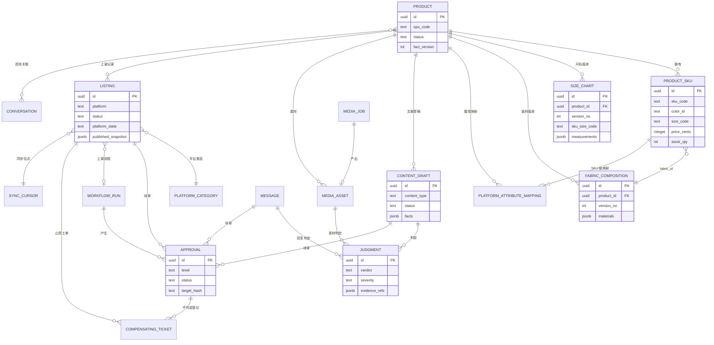
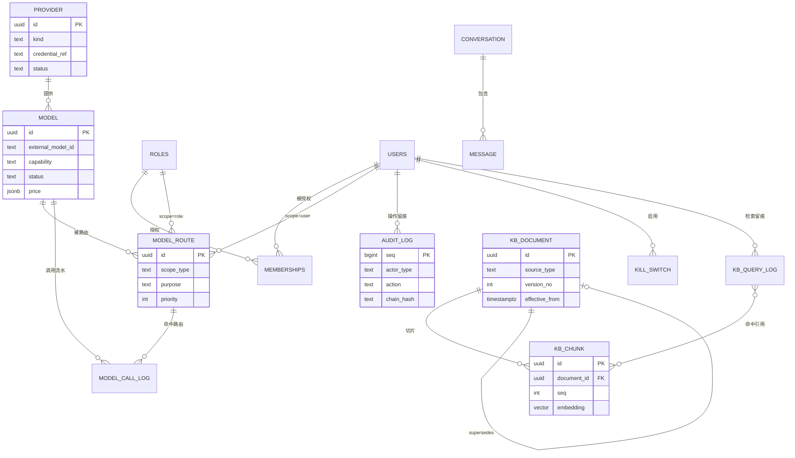
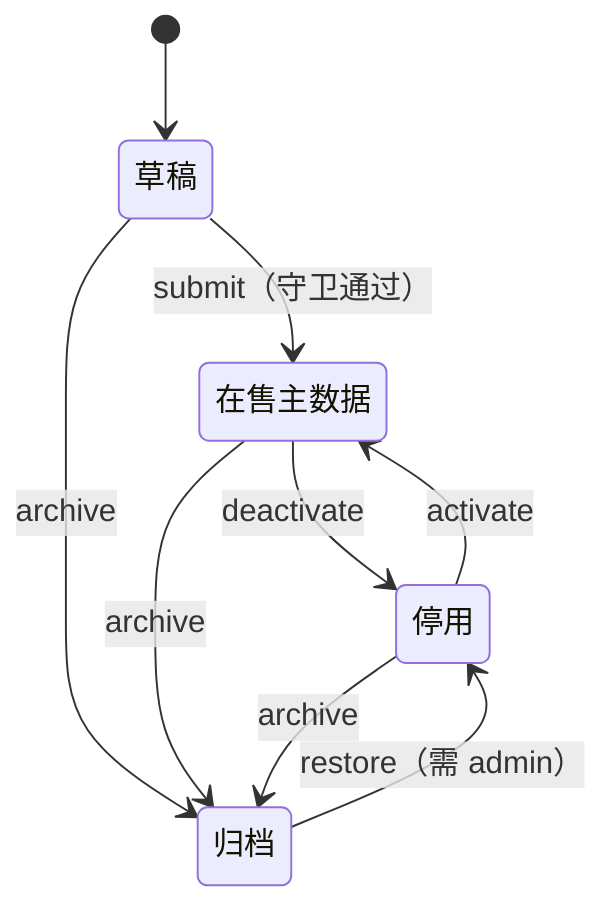
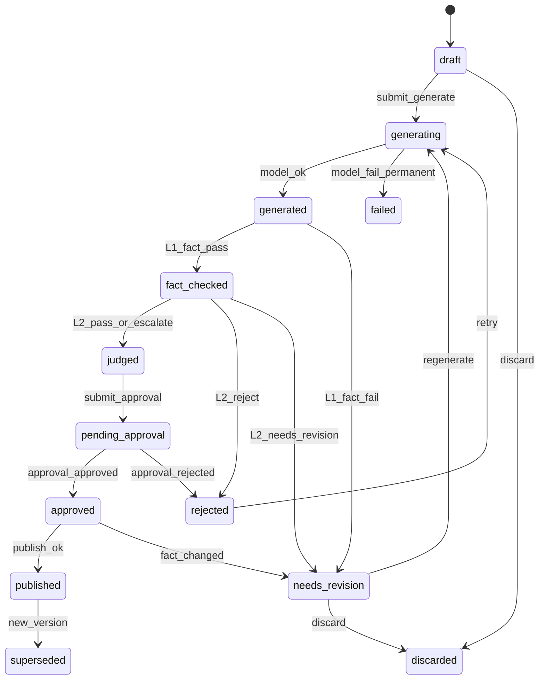
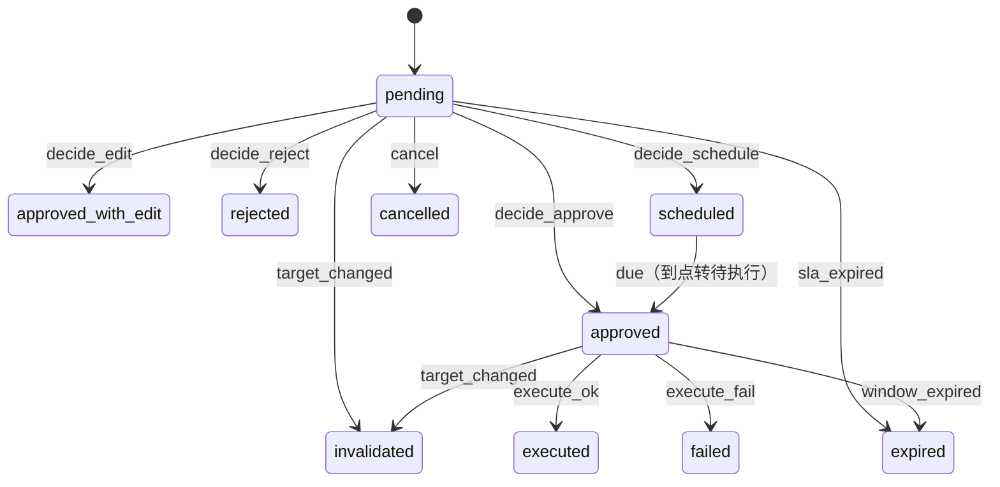
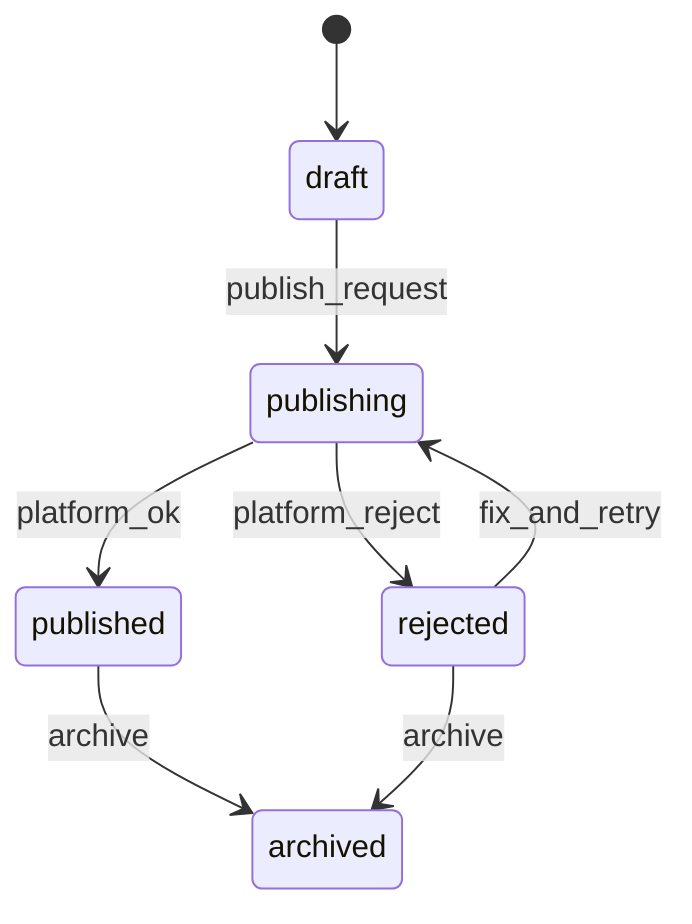
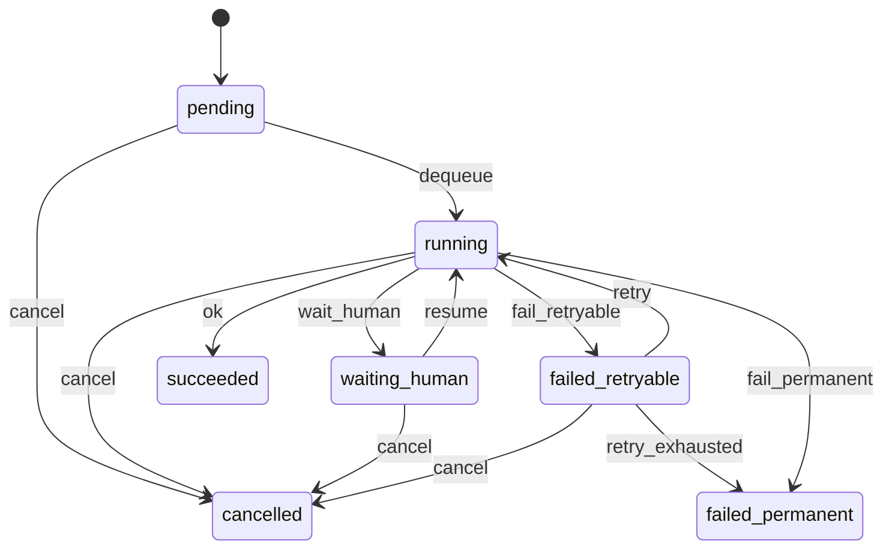
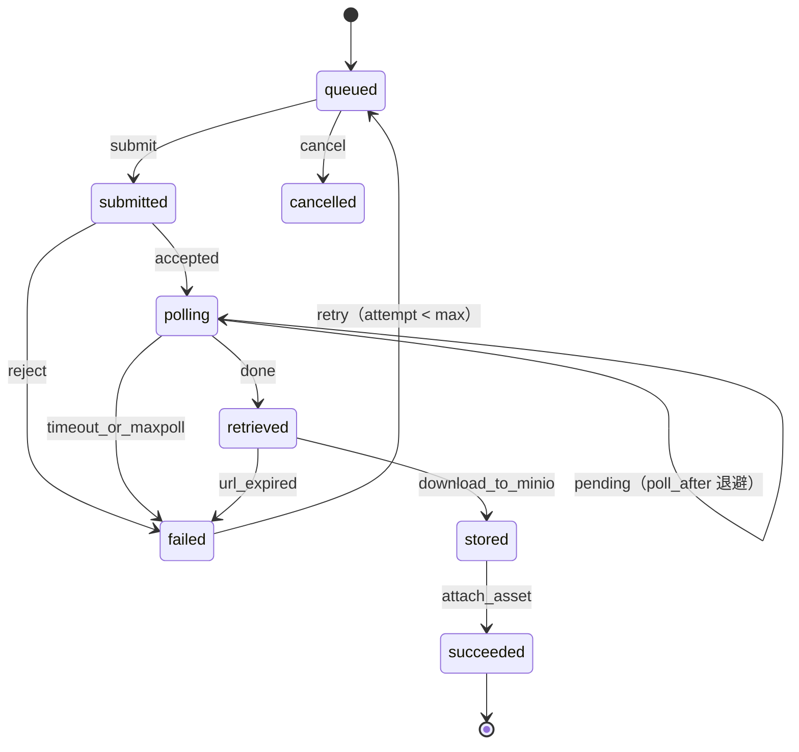

# 06 · 领域模型与数据字典

| 项 | 内容 |
|---|---|
| 编号 | 06 |
| 契约版本 | v4（对齐 schema t12/t13；8 张扩展表见 §4.10） |
| 用途 | 定义 Postgres 16 的物理模型：表、字段、类型、约束、枚举、状态机、索引、服装强类型 JSON Schema，以及「事实源单一化」的字段级落法。任何写库代码与迁移必须以此为准。 |
| 读者 | 后端、数据、测试、运维；`packages/db`、`packages/core`、`apps/api` 的实现者 |
| 依赖 | `00-方案总纲.md` §6/§9/§10/§11/§13；`19-服装属性与平台属性字典映射`（类目编码与属性词表）；`11-工作流与写入门规范`（状态机与幂等）；`12-接口契约与数据模型`（OpenAPI 对齐）；`20-存储边界与备份`（软删与保留期） |
| 状态 | 草案 v0.1 · 2026-10-20 · **待评审**；v4 已追平 schema t12/t13（§4.10 增补 8 张扩展表）。依赖未定稿处以 ⚠ 标注，不改核心表清单结构。 |

> 表清单对齐 `00` §13.1 的 30 张核心表：**不新增核心表**。扩展优先以「列 + CHECK + JSONB + 视图 + 迁移脚本」实现；例外是 `docs/12` §9.2 明文要求的 8 张扩展表（t12 已落库，见 §4.10），合计 30 + 8 = 38 张。术语（Provider / Model / Route / 写入门 / A·B·C 级 / 止损 / 契约漂移）沿用 `00` 附录 B。

---

## 0. 建模约定（全库强制）

### 0.1 命名

| 规则 | 要求 | 例 |
|---|---|---|
| 表名 | 单数 snake_case；`users` / `roles` / `memberships` 按 `00` 原文保留复数 | `content_draft`、`model_route` |
| 字段 | snake_case；主键恒为 `id`；外键 `<单数表名>_id` | `product_id`、`judge_id` |
| 时间 | `*_at` = `timestamptz`；`*_date` = `date`（业务日，Asia/Shanghai） | `published_at`、`launch_date` |
| 金额 | `*_cents` = `integer`（int4；整数分，**1 CNY = 100 分**；聚合金额在 SQL 中 `::numeric` 计算，不落 int8 列） | `price_cents` |
| 布尔 | `is_*` / `has_*` | `is_leaf`、`aigc_labeled` |
| 枚举 | `text` + CHECK；约束名 `ck_<表>_<列>` | `ck_model_status` |
| 唯一 | `uq_<表>_<列>`（落地为部分唯一索引）；外键 `fk_<表>_<列>`；索引 `ix_<表>_<列>`；触发器 `trg_<表>_<动作>` | `uq_product_spu_code` |
| JSONB | 结构固定者以 `_json` / `_snapshot` / `_meta` 结尾，必须附 JSON Schema 或结构示例 | `published_snapshot`、`risk_meta` |

### 0.2 类型基线

`uuid`、`text`、`citext`（仅 email）、`integer`、`bigint`、`smallint`、`numeric(12,3)`（仅秒数/度量）、`boolean`、`timestamptz`、`date`、`jsonb`、`text[]`、`vector(1024)`（仅 `kb_chunk`）、`tsvector`（仅 `kb_chunk`）、`inet`（仅 `audit_log`）。`bigint` 仅用于 `org_id` 与审计序列等标识/计数，**金额不用**。禁用 `float`/`double`（金额与度量皆不许浮点）、禁用 `serial`（一律 `uuid` 或 `bigint identity` 仅用于审计序列）。

### 0.3 金额单位与精度（硬规则）

- 全库金额为 `integer`（**int4**）**整数分（cent，1 CNY = 100 分）**，字段后缀统一 `_cents`，单位为 **CNY**，不设多币种。分是人民币最小流通单位，不必再缩放，避免多一层换算错误。金额不用 int8 的理由：**Prisma 的 `BigInt` 映射到 JS `BigInt`，`JSON.stringify` 会直接抛错**，每个 DTO 都要手写序列化；int4 上限 21.47 亿分（约 2147 万元），单条价格/单笔费用远不会触及。**聚合金额（月成本、余额汇总）在 SQL 中 `SUM(...)::numeric` 计算，不落 int8 列**。
- 写入平台的价格直接以整数分表达：`CHECK (price_cents > 0)`。adapter 侧 `toPlatformPrice()` 不做缩放、不做四舍五入；非整数分视为主数据错误，拒绝上架。
- 成本聚合规则：单笔 `cost_cents = Σ 分项`（各分项按整数分计，最后一步向上取整到分）；日报/月报用 `sum(cost_cents)::numeric`，不做逐笔舍入后累加，聚合值不落 int8 列。

### 0.4 时间语义

`timestamptz` 一律存 UTC，展示层按 `Asia/Shanghai` 渲染；业务日切分、SLA、日报以 `Asia/Shanghai` 为准；`date` 字段无时区（生效日期、账期、SLA 到期日）。

### 0.5 枚举实现方式（决策）

采用 **`text` + `CHECK (... IN (...))`**，不用 PostgreSQL 原生 `ENUM`。理由：原生 enum 增值需 `ALTER TYPE ... ADD VALUE`（历史版本不可回滚、大表加锁窗口不可控），而 CHECK 可 `NOT VALID` 平滑上线并在迁移中精确回滚。代价是字典校验依赖应用层——故所有枚举值**只在 §2 定义**，其他文档禁止自造取值。

### 0.6 公共字段（除 §0.7 例外表，每表默认具备）

| 字段 | 类型 | 空 | 默认 | 约束 | 说明 |
|---|---|---|---|---|---|
| `id` | uuid | N | `gen_random_uuid()` | PK | 主键；对外暴露，不可猜测性由 uuidv4 提供 |
| `org_id` | bigint | N | `1` | `CHECK (org_id > 0)` | 预留多组织边界；当前恒为 1，无 org 表（`00` 未列） |
| `created_at` | timestamptz | N | `now()` | — | 创建时间（UTC） |
| `updated_at` | timestamptz | N | `now()` | `trg_set_updated_at` | 任意 UPDATE 由触发器刷新 |
| `created_by` | uuid | Y | `NULL` | `FK users(id) ON DELETE SET NULL` | 系统/worker 写入时为 NULL，用 `audit_log.actor_type` 区分 |
| `version` | integer | N | `1` | `CHECK (version >= 1)` | 乐观锁；`trg_bump_version` 在 UPDATE 时 `version = version + 1` |
| `archived_at` | timestamptz | Y | `NULL` | — | 软删；所有唯一索引带 `WHERE archived_at IS NULL` |

乐观锁写法固定为：`UPDATE ... SET ... WHERE id = $1 AND version = $2 RETURNING version`；影响 0 行 → 返回 `409 conflict`（错误码见 `00` §14.1）。

### 0.7 例外表（公共字段裁剪）

| 表 | 缺省的公共字段 | 理由 |
|---|---|---|
| `audit_log` | 无 `updated_at` / `version` / `archived_at` / `created_at`（用 `occurred_at`） | 追加写、不可更新；`REVOKE UPDATE, DELETE` + 触发器 `trg_audit_no_update` 抛异常 |
| `model_call_log` | 无 `version` / `archived_at` | 日志；仅允许 5 分钟内补写 `finished_at`/`status`/`cost_cents`，由触发器限制可更新列白名单 |
| `kb_chunk` | 无 `version` / `updated_at`（业务版本用 `version_no`） | 切片不可变；重切片 = 新行 + 旧行 `status='superseded'` |
| `kb_query_log` | 无 `version` / `archived_at` / `updated_at` | 查询日志；仅允许回填 `feedback` |

### 0.8 软删与唯一性

- 业务表删除 = 置 `archived_at`；物理删除仅允许运维 runbook（见 `16`），且必须先有 `audit_log`。
- 唯一约束一律用**部分唯一索引** `... WHERE archived_at IS NULL`，否则软删后无法重建同名记录。
- 被引用表软删后，引用方读路径必须 `JOIN ... AND archived_at IS NULL`；`packages/db` 提供默认过滤的 Prisma extension，越权直查需代码评审。

### 0.9 迁移与校验分层

| 层 | 职责 | 不得替代 |
|---|---|---|
| DB 约束（CHECK / FK / 部分唯一 / 触发器） | 兜底不可表达为「约定」的规则；跨行规则用 `CONSTRAINT TRIGGER ... DEFERRABLE INITIALLY DEFERRED` | JSON Schema |
| API 层 JSON Schema | 请求校验、错误定位、可读报错 | DB 约束 |
| 判断层（`08`） | 语义与合规判定 | 前两层 |

迁移清单：`packages/db` 用 Prisma schema 管表结构，**CHECK / 触发器 / HNSW / 部分唯一索引 / `vector` 扩展必须以 raw SQL 迁移落库**；每个迁移提供 `up.sql` + `down.sql`，CI 跑 `prisma migrate diff --exit-code` 与「空库→全量迁移→回滚→再迁移」两次幂等校验。

---

## 1. 实体关系图

### 1.1 主域：商品 → 内容 → 素材 → 平台 → 流程



### 1.2 辅助域：模型 / 治理 / 客服 / 知识



> 说明：`approval` / `judgment` / `model_call_log` / `audit_log` 的 `subject_*` 是多态外键（无 FK 约束），完整性由应用层与日检 SQL 保证（§5.3）。

---

## 2. 枚举值清单（唯一来源）

| 枚举（CHECK 名） | 字段 | 允许值 | 说明 |
|---|---|---|---|
| `ck_provider_kind` | `provider.kind` | `text` `image` `video` `embedding` | 文本/图片/视频/嵌入四类账号，`00` §7.1 |
| `ck_provider_status` | `provider.status` | `configuring` `active` `degraded` `disabled` | `degraded` = 连通性失败但保留可读 |
| `ck_provider_connectivity` | `provider.connectivity` | `unknown` `ok` `failed` | 最近一次连通性测试结果 |
| `ck_provider_auth_scheme` | `provider.auth_scheme` | `bearer` `header` `query` `ak_sk` `none` | 密钥注入方式，由 adapter 解释 |
| `ck_provider_vendor` | `provider.vendor` | `deepseek` `volcengine` `aliyun` `openai_compatible` `other` | 仅分组展示，不参与路由 |
| `ck_model_capability` | `model.capability` | `text` `image` `video` `embedding` `rerank` | 与 `provider.kind` 需兼容（见 §7 兼容矩阵） |
| `ck_model_status` | `model.status` | `draft` `testing` `published` `suspended` `archived` | 前台只可见 `published` |
| `ck_purpose` | `model.purpose_support`、`model_route.purpose`、`model_call_log.purpose` | `copy` `judge` `image` `video` `embed` `rerank` | `00` §7.1 六用途，不增不减 |
| `ck_route_scope` | `model_route.scope_type` | `org` `role` `user` | 解析顺序 user > role > org |
| `ck_route_status` | `model_route.status` | `draft` `active` `paused` `retired` | `paused` 不参与解析，保留可恢复 |
| `ck_credential_backend` | `credential_ref.backend` | `dsh_credentials` `env_ref` `vault` | 默认 `dsh_credentials`（`00` §3.2） |
| `ck_credential_status` | `credential_ref.status` | `active` `rotating` `revoked` | `revoked` 不得被 provider 引用 |
| `ck_role_code` | `roles.code` | `viewer` `operator` `admin` | 三档，`00` §6.1 |
| `ck_user_status` | `users.status` | `active` `disabled` `locked` | `locked` = 连续失败自动锁 |
| `ck_membership_status` | `memberships.status` | `active` `revoked` `expired` | — |
| `ck_actor_type` | `audit_log.actor_type`、`model_call_log.actor_type` | `user` `agent` `worker` `system` | `agent` = DSH Host 发起 |
| `ck_product_status` | `product.status` | `draft` `active` `inactive` `archived` | 状态机 §3.1 |
| `ck_season` | `product.season` | `spring` `summer` `autumn` `winter` `all` | 场景文案匹配依据 |
| `ck_fit` | `product.fit` | `slim` `regular` `loose` `oversize` | 版型，影响尺码建议 |
| `ck_sku_status` | `product_sku.status` | `active` `inactive` `archived` | — |
| `ck_source_kind` | `product.data_source`、`product_sku.price_source`/`stock_source`、`size_chart.source`、`fabric_composition.source` | `import` `erp` `manual` `platform_sync` `supplier` | **刻意不含任何模型取值**：让「模型产生事实」在物理层不可表示 |
| `ck_size_system` | `size_chart.size_system` | `alpha` `numeric` `height_weight` `one_size` | 字母码/数字码/身高体重/均码 |
| `ck_chart_status` | `size_chart.status` | `draft` `effective` `superseded` | 同 product 仅一条 `effective` |
| `ck_fabric_role` | `fabric_composition.role` | `main` `lining` `trim` `accessory` | 主料/里料/辅料/装饰 |
| `ck_attr_type` | `platform_attribute_mapping.attr_type` | `enum` `text` `number` `bool` `range` `multi_enum` | 平台属性值类型 |
| `ck_mapping_status` | `platform_attribute_mapping.status` | `draft` `verified` `stale` | `stale` = 平台字典已变 |
| `ck_category_status` | `platform_category.status` | `active` `deprecated` `unknown` | `unknown` = 拉取失败沿用旧值 |
| `ck_content_type` | `content_draft.content_type`、`judgment.content_type` | `title` `selling_point` `detail` `faq` `reply` `quote` `video_script` `image_text` | 8 类，判定规则按此分派 |
| `ck_draft_status` | `content_draft.status` | `draft` `generating` `generated` `fact_checked` `judged` `pending_approval` `approved` `published` `rejected` `needs_revision` `discarded` `failed` `superseded` | 状态机 §3.2 |
| `ck_judgment_status` | `judgment.status` | `pending` `running` `passed` `needs_revision` `rejected` `escalated` `failed` `superseded` | 状态机见 `08` §10 |
| `ck_verdict` | `judgment.verdict` | `pass` `needs_revision` `reject` `escalate` | `00` §10 L2 输出值域 |
| `ck_severity` | `judgment.severity` | `info` `low` `medium` `high` `blocker` | `blocker` 强制短路（`08` §11） |
| `ck_appeal_status` | `judgment.appeal_status` | `none` `requested` `upheld` `overridden` `withdrawn` | 申诉流程见 `08` §10 |
| `ck_asset_kind` | `media_asset.kind` | `main` `white_bg` `detail` `scene` `model` `size_chart` `video` `short_video` `concept` `variant` | — |
| `ck_asset_source` | `media_asset.source` | `shoot` `ai_generated` `rendered` `uploaded` `platform_sync` | `ai_generated` 必带 AIGC 标识 |
| `ck_asset_status` | `media_asset.status` | `pending_review` `approved` `rejected` `archived` | 主图/模特图强制人审 |
| `ck_media_purpose` | `media_job.purpose` | `image` `video` | 与 `model_route.purpose` 的 `image`/`video` 对应 |
| `ck_media_job_status` | `media_job.status` | `queued` `submitted` `polling` `retrieved` `stored` `succeeded` `failed` `expired` `cancelled` | 状态机 §3.6 |
| `ck_error_class` | `media_job.error_class`、`workflow_run.error_class` | `retryable` `manual` `permanent` | `00` §9.1 失败三分 |
| `ck_listing_status` | `listing.status` | `draft` `publishing` `published` `rejected` `archived` | 我方业务态（docs/21 §2）；平台回传原始态见 `platform_state` |
| `ck_approval_level` | `approval.level` | `A` `B` `C` | 操作级别（`00` §9.3；docs/21 §2；仅此一处，listing 不冗余） |
| `ck_approval_status` | `approval.status` | `pending` `approved` `approved_with_edit` `rejected` `scheduled` `executed` `failed` `expired` `cancelled` `invalidated` | 状态机 §3.3 |
| `ck_approval_decision` | `approval.decision` | `approve` `approve_with_edit` `reject` `schedule` | `00` §9.4 四种动作 |
| `ck_approval_action` | `approval.action` | `publish` `update_price` `update_stock` `replace_main_image` `change_category` `send_reply` `send_quote` `upload_video` `batch_offline` | 写操作动作白名单 |
| `ck_workflow_type` | `workflow_run.type` | `publish` `price_change` `stock_sync` `media_generate` `reply` `quote` `reconcile` `kb_reindex` `batch_offline` | — |
| `ck_workflow_state` | `workflow_run.state` | `pending` `running` `waiting_human` `succeeded` `failed_retryable` `failed_permanent` `cancelled` | 状态机唯一真相（docs/21 §2；§3.5） |
| `ck_sync_resource` | `sync_cursor.resource` | `orders` `products` `messages` `after_sale` `stock` | — |
| `ck_sync_status` | `sync_cursor.status` | `active` `paused` `error` | — |
| `ck_conversation_kind` | `conversation.kind` | `pre_sale` `after_sale` `logistics` `inquiry` `quote` `complaint` | 1688 询盘/报价走 `inquiry`/`quote` |
| `ck_conversation_status` | `conversation.status` | `open` `pending` `closed` `archived` | — |
| `ck_msg_direction` | `message.direction` | `inbound` `outbound` | — |
| `ck_msg_content_type` | `message.content_type` | `text` `image` `video` `order_card` `product_card` `system` | — |
| `ck_msg_status` | `message.status` | `received` `drafted` `pending_approval` `queued` `sending` `sent` `failed` `blocked` `deduped` | 发送去重见 §5.2 |
| `ck_ticket_status` | `compensating_ticket.status` | `open` `in_progress` `resolved` `wontfix` `escalated` | 止损工单 |
| `ck_ticket_source` | `compensating_ticket.source` | `irreversible_action` `incident` `platform_reject` `manual` `drill` | — |
| `ck_switch_scope` | `kill_switch.scope_type` | `global` `platform` `category` `task_type` | `00` §9.3 三维开关 |
| `ck_switch_action` | `kill_switch.action` | `block_writes` `block_replies` `block_media` `block_model` `readonly` | — |
| `ck_switch_mode` | `kill_switch.mode` | `block` `drain` | `action` 决定「停什么」，`mode` 决定「怎么停」；`action='readonly'` 时只能为 `block`（CHECK 兜底） |
| `ck_kb_source` | `kb_document.source_type` | `product` `size_chart` `fabric` `policy` `faq` `platform_rule` `copy_sample` `care` `manual` | `00` §11 文档源 |
| `ck_kb_domain` | `kb_document.domain`、`kb_chunk` 继承 | `product` `size` `fabric` `policy` `platform` `copy` `service` | 分域权限矩阵见 `09` §12 |
| `ck_kb_doc_status` | `kb_document.status` | `draft` `active` `superseded` `expired` `archived` | — |
| `ck_kb_index_status` | `kb_document.index_status` | `pending` `indexed` `failed` `stale` | `stale` = 源数据已变待重建 |
| `ck_kb_chunk_type` | `kb_chunk.chunk_type` | `text` `table` `list` `qa` `snippet` | 表格切片单独标注 |
| `ck_kb_chunk_status` | `kb_chunk.status` | `active` `superseded` `disabled` | — |
| `ck_kb_query_mode` | `kb_query_log.mode` | `hybrid` `vector` `keyword` | 降级时记 `keyword` |
| `ck_call_status` | `model_call_log.status` | `succeeded` `failed` `timeout` `quota_rejected` `schema_invalid` `cancelled` | `schema_invalid` 计入 `08` 的升级触发 |
| `ck_tokens_source` | `model_call_log.tokens_source` | `provider_usage` `estimated` | 供应商未回传用量时按 tokenizer 估算并标记 |
| `ck_listing_snapshot_source` | `listing_snapshot.source` | `pre_write` `post_write` `platform_sync` `manual` | 快照时机；**冻结口径**（t13 定稿，不得改） |
| `ck_listing_write_log_level` | `listing_write_log.level` | `A` `B` `C` | 与 `ck_approval_level` 同值域（§3.3） |
| `ck_listing_write_log_action` | `listing_write_log.action` | `publish` `update_price` `update_stock` `replace_main_image` `change_category` `send_reply` `send_quote` `upload_video` `batch_offline` | 与 `ck_approval_action` 同值域，逐笔留痕 |
| `ck_listing_published_category` | `listing.status` + `listing.platform_category_id` | 行级交叉 CHECK（非枚举）：`CHECK (status NOT IN ('publishing','published') OR platform_category_id IS NOT NULL)` | t13 新增（迁移 `20261020150000_listing_published_category`）；草稿态允许为空，上架态由 DB 兜底，与 `trg_listing_category_platform` 构成「CHECK + 触发器双保险」（§4.5.1） |
| `ck_reply_draft_status` | `reply_draft.status` | `draft` `approved` `sent` `discarded` `failed` | **冻结口径**（t13 定稿，不得改）；与 `message.status` 独立，不做映射 |
| `ck_reply_template_platform` | `reply_template.platform` | `pdd` `1688` | 与 `listing.platform`、`sync_cursor.platform` 同值域 |
| `ck_reply_template_status` | `reply_template.status` | `draft` `approved` `retired` | 仅 `approved` 参与模板选择 |
| `ck_reply_template_intent` | `reply_template.intent` | 正则 `^[a-z][a-z0-9_]{1,31}$` | 开放词表（意图码），与 `18` 意图分类对齐 |
| `ck_idempotency_status` | `idempotency_key.status` | `in_flight` `succeeded` `failed` | 幂等键生命周期（`11` §5.3） |
| `ck_cost_ledger_kind` | `cost_ledger.kind` | `model` `media` | 模型成本 / 媒体成本 |
| `ck_cost_ledger_ref_type` | `cost_ledger.ref_type` | `model_call_log` `media_job` `media_asset` `listing` `approval` `content_draft` `judgment` | 多态引用，无 FK（日检见 §5.3） |
| `ck_events_outbox_topic` | `events_outbox.topic` | 正则 `^[a-z][a-z0-9_.]{1,63}$` | 开放词表，`<域>.<事件>`（如 `listing.published`） |

---

## 3. 状态机

约定：状态机由**应用层事务 + 行级条件更新**实现（`UPDATE ... WHERE status = $from`），DB 不建全量转移表；每条转移必须写 `audit_log`（`action = '<table>.<event>'`）。守卫失败返回 `409 conflict` 或 `422 invalid_fact`，不静默降级。

### 3.1 商品 `product.status`



| 起点 | 事件 | 终点 | 守卫 / 副作用 | 执行者 |
|---|---|---|---|---|
| — | create | `draft` | `spu_code` 唯一；`fact_version = 1` | operator |
| `draft` | submit | `active` | 至少 1 个 `active` SKU；1 个 `effective` 尺码表；面料 `materials` 合计 100；类目校验移至上架时（docs/21 §17-1）：`listing.platform_category_id` 非空，且指向 `platform_category` 中 `platform` 与 listing 平台一致的行；资质校验查该行的 `qualification_requirements` | operator |
| `active` | deactivate | `inactive` | 无 `published`/`publishing` listing（有则先走下架归档，禁止隐式下架） | operator |
| `inactive` | activate | `active` | 同 submit 守卫 | operator |
| `active`/`inactive` | archive | `archived` | 无 `published`/`publishing` listing；无 `pending` approval；无 `open` 工单 | admin |
| `archived` | restore | `inactive` | 写审计；`version+1` | admin |

副作用：任何触碰价格/库存/成分/尺码/政策引用的变更 → `fact_version = fact_version + 1`，并使所有 `pending` 审批的 `target_hash` 失效（`approval.status='invalidated'`）。

### 3.2 内容草稿 `content_draft.status`



| 起点 | 事件 | 终点 | 守卫 / 副作用 | 执行者 |
|---|---|---|---|---|
| `*` | create_manual | `draft` | 人工撰写不调模型；`facts` 必须已绑定来源 | operator |
| `draft` | submit_generate | `generating` | 提示词版本锁定；路由 `purpose=copy` 解析成功 | operator |
| `generating` | model_ok | `generated` | 落 `model_call_log`；`facts` 快照写入；字数/语言校验 | worker |
| `generating` | model_fail_permanent | `failed` | `error_class=permanent` 或重试耗尽 | worker |
| `generated` | fact_check | `fact_checked` / `needs_revision` | L1 硬事实全通过才前进；任一 `blocker` → 需修订 | system |
| `fact_checked` | judge | `judged` / `rejected` / `needs_revision` | L2 `pass`→judged；`reject`→rejected；`escalate`→judged 且标 `escalated` | system |
| `judged`/`fact_checked` | submit_approval | `pending_approval` | 生成 `approval`，`target_hash = sha256(canonical(payload))` | operator |
| `pending_approval` | approval_approved | `approved` | 审批状态 `approved`/`approved_with_edit` 且 `target_hash` 未变 | system |
| `pending_approval` | approval_rejected | `rejected` | 记录拒绝理由 | system |
| `approved` | publish_ok | `published` | 写入门返回成功；`listing` 更新 | system |
| `approved` | fact_changed | `needs_revision` | `product.fact_version` 或 `facts_hash` 变化 | system |
| `published` | new_version | `superseded` | 同名内容新版本发布 | system |
| 非终态 | discard | `discarded` | 有 `pending` 审批时先 `cancelled` | operator |

### 3.3 审批 `approval.status`



| 起点 | 事件 | 终点 | 守卫 / 副作用 | 执行者 |
|---|---|---|---|---|
| — | create | `pending` | 提供 `target_hash`、`fact_snapshot`、`risk_meta`、`level`；`C` 级必须带 `impact_meta` | system |
| `pending` | decide(approve) | `approved` | 审批人 ≠ 草稿作者（C 级强制双人）；`level=C` 需 `confirm_token`（二次确认留痕） | admin/operator |
| `pending` | decide(approve_with_edit) | `approved_with_edit` | 编辑后重新计算 `target_hash` 与 diff；编辑内容再过一遍 L1 | admin/operator |
| `pending` | decide(reject) | `rejected` | 必填 `decision_note` | admin/operator |
| `pending` | decide(schedule) | `scheduled` | `scheduled_at` 必填且在 `[now+5m, now+7d]` | admin/operator |
| `scheduled` | due | `approved` | 到点由 worker 转；仍受 `target_hash` 校验 | worker |
| `pending`/`approved` | target_changed | `invalidated` | 目标资源 `version`、`fact_version` 或 `target_hash` 变化；必须重新发起 | system |
| `approved` | execute | `executed` | 写入门硬校验（`approval_id`、`target_hash`、`idempotency_key`、kill switch 关闭） | 写入门 |
| `approved` | execute_fail | `failed` | `error_class=manual` 时同时开 `compensating_ticket` | 写入门 |
| `pending` | sla_timeout | `pending`（自环） | 置 `escalated_to`、发告警；不改 status（`00` §9.4 SLA 升级） | worker |
| 非终态 | cancel | `cancelled` | 发起人或 admin；写审计 | operator/admin |
| `pending`/`approved` | expire | `expired` | `expires_at` 到点（默认 72h） | worker |

`target_hash`：`sha256(platform + action + canonical_json(payload))`，规范化为键排序、UTF-8 无空白 JSON，长度 64，`CHECK (char_length(target_hash) = 64)`。

### 3.4 上架 `listing.status`



| 起点 | 事件 | 终点 | 守卫 / 副作用 | 执行者 |
|---|---|---|---|---|
| — | create | `draft` | 一个 `(org_id, platform, product_id)` 仅一条未归档 listing | system |
| `draft` | publish_request | `publishing` | 有效 `approval`（`action=publish`）；`sku_bindings` 非空；`price_cents > 0`；`platform_category_id` 非空且与 listing 平台一致，资质满足该行 `qualification_requirements`（DB 层由 `ck_listing_published_category` 与 `trg_listing_category_platform` 兜底） | 写入门 |
| `publishing` | platform_ok | `published` | 平台返回 itemId；写 `published_snapshot`（含 `pulled_at`、`payload_hash`、原值）；`platform_state` 写平台回传原始态 | 写入门 |
| `publishing` | platform_reject | `rejected` | `reject_meta` 记录平台错误码与可执行修复项；可恢复类转 `fix_and_retry` | 写入门 |
| `publishing` | risk_detected | `published` | 命中风控/资质告警：业务态仍 `published`，`platform_state` 记风险原始态；发告警并开 `compensating_ticket` | 写入门 |
| `published` | platform_offline | `published` | 同步发现平台侧下架/风控：只更新 `platform_state`，业务态不变；不可自动恢复 | 同步任务 |
| `published` | archive | `archived` | 主动下架并归档；无 `pending` approval、无 `open` 工单 | admin |
| `rejected` | fix_and_retry | `publishing` | 新 `approval`；旧快照保留 | 写入门 |
| `rejected` | archive | `archived` | 无 `pending` approval、无 `open` 工单 | admin |

停止规则（`00` §9.3）：`platform_state` 由在线转下线属可逆，只更新 `platform_state`；`published`（`platform_state='online'`）上改价/换主图属 `C` 级，**不得**用旧快照覆盖写回（禁止伪回滚），只能先下架或走止损。

### 3.5 工作流 `workflow_run`

`state` 是状态机唯一真相（7 态），`stage` 是可空的子步骤标签（自由文本、**不设枚举**；如 `fact_check`/`judge`/`media`/`publish`/`stop_loss`）。两者正交：同一 state 可出现在不同 stage。



| 起点 | 事件 | 终点 | 守卫 / 副作用 | 执行者 |
|---|---|---|---|---|
| — | enqueue | `pending` | `(org_id, type, idempotency_key)` 唯一；重复入队返回既有 run | api |
| `pending` | dequeue | `running` | 抢到 `locked_by`/`lock_until`（Redis 租约 + DB 双写）；`attempt+1` | worker |
| `running` | wait_human | `waiting_human` | 建 `approval`；`stage` 维持当前标签 | worker |
| `waiting_human` | resume | `running` | 审批完成或人工处置完成 | worker |
| `running` | ok | `succeeded` | 终态；`finished_at` | worker |
| `running` | fail_retryable | `failed_retryable` | `next_run_at = now + backoff(attempt)`；退避 1s/4s/16s/64s/256s 上限 5 次 | worker |
| `failed_retryable` | retry | `running` | 退避到期且 `attempt < max_attempts` | worker |
| `failed_retryable` | retry_exhausted | `failed_permanent` | 超 `max_attempts`（默认 5）；重放 = 新建 run（不改本行终态） | worker |
| `running` | fail_permanent | `failed_permanent` | `error_class=permanent`；开工作台待办 | worker |
| 终态前 | cancel | `cancelled` | kill switch 或人工；已产生平台副作用需开工单 | admin |

**上架链 `stage` 标签**（自由标签，示例取自 `00` §9.1；DB 不设枚举）：
`draft → fact_checked → judged → media_ready → approved → publishing → published / rejected → (stop_loss | rollback) → archived`

| stage | 进入条件 | 典型下一标签 |
|---|---|---|
| `draft` | 选品完成，listing 初始行建立 | `fact_checked` |
| `fact_checked` | L1 硬事实通过 + `facts_hash` 落库 | `judged` |
| `judged` | L2 verdict ∈ {pass, escalate} 且已升级项有人审 | `media_ready` |
| `media_ready` | 主图/尺码表图/AIGC 标识齐备且过审 | `approved` |
| `approved` | 有效审批（A/B/C 对应确认级别） | `publishing` |
| `publishing` | 写入门已受理并持幂等键 | `published` / `rejected` |
| `published` | 平台确认 itemId 且快照落库 | `archived`/`stop_loss` |
| `rejected` | 平台驳回；可修复项入队 | `publishing`（重试）/`archived` |
| `stop_loss` / `rollback` | 事故处理分支；`rollback` 仅用于 A 级 | `archived` |

### 3.6 素材任务 `media_job` 与素材 `media_asset`



| 起点 | 事件 | 终点 | 守卫 / 副作用 | 执行者 |
|---|---|---|---|---|
| — | create | `queued` | `(org_id, idempotency_key)` 唯一；估算成本落 `estimated_cost_cents`；查 `route.purpose∈{image,video}` 配额 | api |
| `queued` | submit | `submitted` | 路由解析 + 降级链可用；`external_job_id` 落库 | worker |
| `submitted` | accepted | `polling` | 供应商返回任务 id；`poll_after = now + 首轮间隔` | worker |
| `submitted` | reject | `failed` | 参数/内容审核失败；`error_class=permanent` | worker |
| `polling` | pending | `polling` | `poll_count+1`；`poll_after = now + min(2^n·5s, 60s)`；总时长上限按用途（图 10min / 视频 90min） | worker |
| `polling` | done | `retrieved` | 供应商返回 `result_url` + `result_expires_at` | worker |
| `polling` | timeout / max_poll | `failed` | `error_class=manual`；保留 `external_job_id` 便于人工核对 | worker |
| `retrieved` | download_ok | `stored` | 流式下载 → MinIO（`bucket=dssaas-media`）→ 算 `sha256`、宽高/时长 → 建 `media_asset` | worker |
| `retrieved` | url_expired | `failed` | 签约 URL 过期；`error_class=retryable` 仅当任务未过期，否则 `permanent` | worker |
| `stored` | attach | `succeeded` | `media_asset.status='pending_review'`（AIGC/模特图强制）或 `approved`（内部概念稿） | worker |
| `failed` | retry | `queued` | `attempt < max_attempts (3)`；幂等键复用，供应商侧不重复计费 | worker |
| 非终态 | cancel | `cancelled` | kill switch `block_media` 触发时批量取消 | admin |

`media_asset` 审核机（人审）：`pending_review → approved | rejected`；`approved → archived`。主图、模特图、含人物视频**不得**跳过 `pending_review`（`00` §12）。变体（尺寸/裁剪/水印/AIGC 标识）存 `media_asset.variants`，不单独建行。

---

## 4. 表定义（按 `00` §13.1 分组，共 38 表：30 核心 + 8 扩展）

字段表列含义：`空` = 可空（Y/N）；`默认` 列中的 `—` 表示无默认、必填。每表默认具备 §0.6 公共字段，仅在「公共字段」行中标注例外。

### 4.1 供应商与模型

#### 4.1.1 `provider` — 供应商账号

用途：一行 = 一个可调用账号（同厂商可多账号、多密钥、多区域）。**不含任何密钥列**。

| 字段 | 类型 | 空 | 默认 | 约束 | 说明 |
|---|---|---|---|---|---|
| `name` | text | N | — | `uq_provider_name (org_id, name)`；`CHECK (name ~ '^[a-z][a-z0-9_]{2,39}$')` | 内部稳定标识，如 `volc_image_prod` |
| `kind` | text | N | — | `ck_provider_kind` | 文本/图片/视频/嵌入 |
| `vendor` | text | N | `other` | `ck_provider_vendor` | 仅展示与分组，不参与路由 |
| `base_url` | text | Y | — | `CHECK (base_url ~ '^https://')` | 留空表示用 adapter 内置默认域名 |
| `credential_ref` | text | N | — | —（字符串；**不做数据库外键**） | DSH 凭据**名称**；一致性靠启动自检与巡检，禁止明文（`00` §7.1；docs/21 §9） |
| `auth_scheme` | text | N | `bearer` | `ck_provider_auth_scheme` | adapter 按此注入 |
| `timeout_ms` | integer | N | `60000` | `CHECK (timeout_ms BETWEEN 1000 AND 600000)` | 单请求超时；超过即降级 |
| `max_concurrency` | smallint | N | `8` | `CHECK (max_concurrency BETWEEN 1 AND 256)` | 信号量上限 |
| `rate_limit` | jsonb | N | `'{}'` | 结构见 `07` §7.2 | `{rpm,tpm,concurrency,daily_calls}`，与 `model.rate_limit` 取严 |
| `status` | text | N | `configuring` | `ck_provider_status` | 状态机见 `07` §3.2 |
| `connectivity` | text | N | `unknown` | `ck_provider_connectivity` | 最近连通性测试 |
| `last_check_at` | timestamptz | Y | — | — | 最近测试时间 |
| `last_check_latency_ms` | integer | Y | — | `CHECK (last_check_latency_ms >= 0)` | 测试延迟 |
| `last_error_code` | text | Y | — | — | `07` §12 错误码 |
| `balance_cents` | integer | Y | — | `CHECK (balance_cents >= 0)` | 供应商余额，仅当 API 提供 |
| `balance_checked_at` | timestamptz | Y | — | — | — |
| `region` | text | Y | — | — | 如 `cn-beijing`；用于部署约束备注 |
| `extra` | jsonb | N | `'{}'` | `CHECK (jsonb_typeof(extra) = 'object')` | adapter 私有配置 |

公共字段：§0.6 全量。约束/索引：`uq_provider_name`、`ix_provider_kind_status (kind, status)`。删除限制：被 `model` 引用时 `ON DELETE RESTRICT`。

#### 4.1.2 `model` — 模型与参数价格

| 字段 | 类型 | 空 | 默认 | 约束 | 说明 |
|---|---|---|---|---|---|
| `provider_id` | uuid | N | — | `FK provider(id) ON DELETE RESTRICT` | 归属账号 |
| `name` | text | N | — | `uq_model_name (org_id, name)`；`CHECK (name ~ '^[a-z0-9][a-z0-9._-]{1,63}$')` | 内部短名，如 `img.seedream.v3` |
| `external_model_id` | text | N | — | `CHECK (char_length(external_model_id) BETWEEN 1 AND 128)` | **供应商控制台原值，逐字符保真**（含 `/`、版本后缀） |
| `display_name` | text | N | — | — | 前台展示名 |
| `capability` | text | N | — | `ck_model_capability` | 能力类型 |
| `purpose_support` | text[] | N | `'{}'` | `CHECK (purpose_support <@ ARRAY['copy','judge','image','video','embed','rerank'])` | 可承接用途；路由只选兼容者 |
| `params_schema` | jsonb | N | — | `CHECK (jsonb_typeof(params_schema) = 'object')`；发布前过 meta-schema | 参数 JSON Schema（`07` §4.3） |
| `default_params` | jsonb | N | `'{}'` | 与 `params_schema` 联检 | 调用默认参数 |
| `price` | jsonb | N | — | 结构见 `07` §7.1；`price_version` 随变 | 计价单（唯一价格来源，历史成本存快照） |
| `price_version` | integer | N | `1` | `CHECK (price_version >= 1)` | 价格变更即 +1；写审计 |
| `rate_limit` | jsonb | N | `'{}'` | 同 provider | 模型级限流 |
| `context_tokens` | integer | Y | — | `CHECK (context_tokens > 0)` | 上下文窗口 |
| `max_output_tokens` | integer | Y | — | `CHECK (max_output_tokens > 0)` | 输出上限 |
| `embed_dim` | smallint | Y | — | `CHECK (embed_dim BETWEEN 1 AND 8192)` | `capability='embedding'` 必填 |
| `status` | text | N | `draft` | `ck_model_status` | 前台仅 `published` |
| `published_at` | timestamptz | Y | — | — | 发布时间（`00` §7.1） |
| `published_by` | uuid | Y | — | `FK users(id)` | 发布人 |
| `deprecated_at` | timestamptz | Y | — | — | 停止推荐时间 |
| `sunset_at` | timestamptz | Y | — | — | 计划下线时间，到期禁止新调用 |
| `docs_url` | text | Y | — | — | 供应商文档 |
| `notes` | text | Y | — | — | — |

公共字段：§0.6 全量。约束/索引：`CHECK (capability <> 'embedding' OR embed_dim IS NOT NULL)`；`CHECK (capability NOT IN ('text','rerank') OR context_tokens IS NOT NULL)`；`uq_model_provider_external (provider_id, external_model_id)`；`ix_model_capability_status (capability, status)`。

#### 4.1.3 `model_route` — 用途路由与降级链

| 字段 | 类型 | 空 | 默认 | 约束 | 说明 |
|---|---|---|---|---|---|
| `scope_type` | text | N | `org` | `ck_route_scope` | `00` 的 `scope` 在此拆为三列（见 §9 接口说明） |
| `scope_role_id` | uuid | Y | — | `FK roles(id)` | `scope_type='role'` 时必填 |
| `scope_user_id` | uuid | Y | — | `FK users(id)` | `scope_type='user'` 时必填 |
| `purpose` | text | N | — | `ck_purpose` | 六用途之一 |
| `model_id` | uuid | N | — | `FK model(id) ON DELETE RESTRICT` | 首选模型 |
| `fallback_ids` | uuid[] | N | `'{}'` | `CHECK (array_length(fallback_ids,1) IS NULL OR array_length(fallback_ids,1) <= 3)` | 降级链，顺序即优先级 |
| `priority` | integer | N | `100` | `CHECK (priority BETWEEN 1 AND 999)` | **数值越小越优先** |
| `quota` | jsonb | N | `'{}'` | 结构见 `07` §7.2 | 路由层配额：`rpm`/`tpm`/`concurrency`/`daily_calls`/`daily_cost_cents`/`monthly_cost_cents`；SKU 与媒体级配额不进本表 |
| `status` | text | N | `draft` | `ck_route_status` | 仅 `active` 参与解析 |
| `effective_from` | timestamptz | Y | — | — | 生效起点 |
| `effective_to` | timestamptz | Y | — | — | 生效终点 |
| `label` | text | Y | — | — | 备注名 |

公共字段：§0.6 全量。约束/索引：`CHECK ((scope_type='org' AND scope_role_id IS NULL AND scope_user_id IS NULL) OR (scope_type='role' AND scope_role_id IS NOT NULL AND scope_user_id IS NULL) OR (scope_type='user' AND scope_user_id IS NOT NULL AND scope_role_id IS NULL))`；`CHECK (NOT (model_id = ANY(fallback_ids)))`；`CHECK (effective_to IS NULL OR effective_from IS NULL OR effective_to > effective_from)`；三个部分唯一索引 `uq_route_org/role/user`；`ix_route_lookup (org_id, purpose, status, priority)`。

#### 4.1.4 `credential_ref` — 凭据元数据表（只存元数据，真值在 DSH 凭据存储）

| 字段 | 类型 | 空 | 默认 | 约束 | 说明 |
|---|---|---|---|---|---|
| `name` | text | N | — | `uq_credential_ref_name (org_id, name)`；`^[a-z][a-z0-9_]{2,63}$` | 被 `provider.credential_ref` 引用的稳定名（不做 FK，一致性靠启动自检） |
| `backend` | text | N | `dsh_credentials` | `ck_credential_backend` | 密钥真实存放位置（`00` §3.2） |
| `external_key` | text | N | — | `CHECK (external_key ~ '^[A-Za-z0-9_.:-]{2,128}$')` | DSH 凭据名或环境变量名 |
| `hint` | text | Y | — | `CHECK (char_length(hint) <= 12)` | 仅存不可逆提示（末 4 位/前缀 6 位） |
| `status` | text | N | `active` | `ck_credential_status` | `revoked` 不可被引用 |
| `last_verified_at` | timestamptz | Y | — | — | 最近一次验证通过时间 |
| `last_verified_provider_id` | uuid | Y | — | `FK provider(id) ON DELETE SET NULL` | 用哪个 provider 验证的 |
| `rotated_at` | timestamptz | Y | — | — | 最近轮换 |
| `rotation_due_at` | date | Y | — | — | 轮换提醒（`07` §10.4） |
| `notes` | text | Y | — | — | — |

公共字段：§0.6 全量。约束/索引：`ix_credential_ref_status (status, rotation_due_at)`。**定位**：本表只是**元数据表**（名称、backend、创建时间、最后轮换时间、状态），真值在 DSH 凭据存储；`provider.credential_ref` 是指向 DSH 凭据名的字符串，**不做数据库外键**，一致性靠启动自检与巡检（docs/21 §9）。**硬规则**：本表与全库不得出现密钥明文；`hint` 不得为密钥子串长度 > 6 的片段；备份策略见 `20`。

#### 4.1.5 `model_call_log` — 模型调用流水

| 字段 | 类型 | 空 | 默认 | 约束 | 说明 |
|---|---|---|---|---|---|
| `request_id` | text | N | — | `CHECK (char_length(request_id) <= 64)` | 贯穿 api/worker/平台（`00` §19.3） |
| `purpose` | text | N | — | `ck_purpose` | 调用用途 |
| `provider_id` | uuid | N | — | `FK provider(id)` | — |
| `model_id` | uuid | N | — | `FK model(id)` | **真实使用**模型 |
| `route_id` | uuid | Y | — | `FK model_route(id)` | 命中路由；直调时为空 |
| `fallback_from_model_id` | uuid | Y | — | `FK model(id)` | 因降级切换时的原模型 |
| `actor_type` | text | N | — | `ck_actor_type` | — |
| `actor_id` | uuid | Y | — | — | user 时为用户 id，agent 时为 session 引用 |
| `subject_type` | text | N | `other` | `CHECK (subject_type IN ('content_draft','judgment','media_job','workflow_run','kb_query','conversation','other'))` | 成本归集对象 |
| `subject_id` | uuid | Y | — | — | 多态，无 FK |
| `prompt_version` | text | Y | — | — | 如 `judge@1.3.0` |
| `input_tokens` | integer | N | `0` | `CHECK (input_tokens >= 0)` | — |
| `output_tokens` | integer | N | `0` | `CHECK (output_tokens >= 0)` | — |
| `cached_input_tokens` | integer | N | `0` | `CHECK (cached_input_tokens >= 0)` | 命中缓存部分 |
| `image_count` | integer | N | `0` | `CHECK (image_count >= 0)` | 图片计费单位「张」 |
| `image_pixels` | bigint | Y | — | `CHECK (image_pixels >= 0)` | 按像素计价时使用 |
| `video_seconds` | numeric(10,3) | N | `0` | `CHECK (video_seconds >= 0)` | 「秒」计费 |
| `latency_ms` | integer | N | `0` | `CHECK (latency_ms >= 0)` | 端到端 |
| `status` | text | N | — | `ck_call_status` | — |
| `error_code` | text | Y | — | — | — |
| `tokens_source` | text | N | `provider_usage` | `ck_tokens_source` | 估算时不可用于对外报价 |
| `cost_cents` | integer | N | `0` | `CHECK (cost_cents >= 0)` | §0.3 计算 |
| `price_snapshot` | jsonb | N | `'{}'` | — | **调用时价格快照**（当时生效的 `model.price`），历史成本不受改价影响（docs/21 §1） |
| `started_at` | timestamptz | N | `now()` | — | — |
| `finished_at` | timestamptz | Y | — | `CHECK (finished_at IS NULL OR finished_at >= started_at)` | — |

公共字段：仅 `id`/`org_id`/`created_at`/`created_by`（§0.7）。约束/索引：`ix_mcl_created (created_at)`、`ix_mcl_subject (subject_type, subject_id)`、`ix_mcl_model_created (model_id, created_at)`、`ix_mcl_purpose_created (purpose, created_at)`；触发器 `trg_mcl_immutable_cols` 只允许 5 分钟内更新 `finished_at/status/cost_cents/error_code`。

### 4.2 商品

#### 4.2.1 `product` — SPU 级主数据

| 字段 | 类型 | 空 | 默认 | 约束 | 说明 |
|---|---|---|---|---|---|
| `spu_code` | text | N | — | `uq_product_spu (org_id, spu_code)`；`^[A-Z0-9][A-Z0-9-]{3,39}$` | 内部货号，导入键 |
| `name` | text | N | — | `CHECK (char_length(name) BETWEEN 1 AND 120)` | 商品全名（非平台标题） |
| `brand` | text | Y | — | — | 品牌；自有品牌可为空串 |
| `season` | text | N | `all` | `ck_season` | 场景/季节文案依据 |
| `year` | smallint | Y | — | `CHECK (year BETWEEN 2000 AND 2100)` | 年份 |
| `fit` | text | Y | — | `ck_fit` | 版型，影响尺码建议话术 |
| `style_tags` | text[] | N | `'{}'` | `CHECK (array_length(style_tags,1) IS NULL OR array_length(style_tags,1) <= 12)` | 风格标签，来自受控词表 ⚠`19` |
| `category_code` | text | N | — | `CHECK (category_code ~ '^[A-Z][0-9]{4}(\.[0-9]{1,3})?$')` | 内部类目编码（不建类目表，编码规范见 `19`） |
| `status` | text | N | `draft` | `ck_product_status` | 状态机 §3.1 |
| `qualification` | jsonb | N | `'{}'` | 结构见 `19`；`CHECK (jsonb_typeof(qualification)='object')` | 类目资质（质检报告/授权/备案号 + 有效期 + 附件 asset_id） |
| `care_instructions` | jsonb | N | `'{}'` | 结构见 `19`（水洗/漂白/熨烫/干洗/干燥代码） | 洗护说明，客服口径与详情页同源 |
| `origin_country` | char(2) | Y | — | `CHECK (origin_country ~ '^[A-Z]{2}$')` | ISO 3166-1 alpha-2 |
| `launch_date` | date | Y | — | — | 上市日 |
| `main_asset_id` | uuid | Y | — | `FK media_asset(id) ON DELETE SET NULL` | 商品默认主图（实拍主图，**不得**指向 `source='ai_generated'`）；`listing.main_image_id` 为空时回落到此列 |
| `attributes` | jsonb | N | `'{}'` | 由 `19` 的类目属性 Schema 校验 | 非强类型扩展（领型/袖长/厚薄等） |
| `fact_version` | integer | N | `1` | `CHECK (fact_version >= 1)` | 事实版本；价格/库存/成分/尺码/政策引用变更即 +1 |
| `data_source` | text | N | `import` | `ck_source_kind` | 主数据来源 |
| `notes` | text | Y | — | — | — |

公共字段：§0.6 全量。约束/索引：`ix_product_status (status, updated_at)`；触发器 `trg_product_fact_version`（子表关键列变更时 +1）。平台类目不在 `product` 上：见 `listing.platform_category_id`（docs/21 §17-1）。

#### 4.2.2 `product_sku` — SKU 级主数据

| 字段 | 类型 | 空 | 默认 | 约束 | 说明 |
|---|---|---|---|---|---|
| `sku_code` | text | N | — | `uq_sku_code (org_id, sku_code)`；`^[A-Z0-9][A-Z0-9-]{3,59}$` | 外部导入/ERP 编码 |
| `product_id` | uuid | N | — | `FK product(id) ON DELETE RESTRICT` | — |
| `color_id` | text | N | — | `CHECK (color_id ~ '^[A-Z]{2}-?[0-9A-Z]{2,8}$')` | **内部统一色卡编码**（无颜色表，故为编码而非 FK） |
| `color_name` | text | N | — | — | 展示名，仅用于文案，不参与业务判断 |
| `size_code` | text | N | — | `CHECK (size_code ~ '^(XXXS\|XXS\|XS\|S\|M\|L\|XL\|XXL\|XXXL\|4XL\|5XL\|[0-9]{2,3}\|ONE)$')` | 与同 product 的 `effective` 尺码表词表一致（触发器校验） |
| `fabric_id` | uuid | N | — | `FK fabric_composition(id) ON DELETE RESTRICT` | `00` §13.2 的 SKU 主键组成 |
| `barcode` | text | Y | — | 部分唯一 `uq_sku_barcode (org_id, barcode) WHERE barcode IS NOT NULL` | 条码 |
| `price_cents` | integer | N | — | `CHECK (price_cents > 0)` | 售价（整数分） |
| `promo_price_cents` | integer | Y | — | `CHECK (promo_price_cents > 0)`；`CHECK (promo_price_cents <= price_cents)` | 促销价（整数分） |
| `price_tiers` | jsonb | N | `'[]'` | Schema 见 §6.4 | 1688 阶梯价 `[{min_qty, price_cents}]` |
| `price_source` | text | N | `import` | `ck_source_kind` | **禁止模型来源（物理层不可表示）** |
| `cost_cents` | integer | Y | — | `CHECK (cost_cents >= 0)` | 成本价，仅内部 |
| `stock_qty` | integer | N | `0` | `CHECK (stock_qty >= 0)` | 可售库存 |
| `safety_stock` | integer | N | `0` | `CHECK (safety_stock >= 0)` | 安全库存，低于则告警 |
| `stock_source` | text | N | `import` | `ck_source_kind` | 库存来源；`platform_sync` 表示以平台为准 |
| `min_order_qty` | integer | N | `1` | `CHECK (min_order_qty >= 1)` | 1688 起批量 |
| `lead_time_days` | smallint | Y | — | `CHECK (lead_time_days BETWEEN 0 AND 60)` | 承诺发货时效（天） |
| `weight_g` | integer | Y | — | `CHECK (weight_g > 0)` | 克重，影响运费 |
| `status` | text | N | `active` | `ck_sku_status` | — |

公共字段：§0.6 全量。约束/索引：`uq_sku_natural (product_id, color_id, size_code, fabric_id)`（`00` §13.2 的 SKU 主键）；`ix_sku_product_status (product_id, status)`；`ix_sku_low_stock (stock_qty) WHERE stock_qty <= safety_stock`。

#### 4.2.3 `size_chart` — 尺码表（一尺码一行，多版本）

| 字段 | 类型 | 空 | 默认 | 约束 | 说明 |
|---|---|---|---|---|---|
| `product_id` | uuid | N | — | `FK product(id) ON DELETE RESTRICT` | — |
| `version_no` | integer | N | `1` | `CHECK (version_no >= 1)` | 版本；`00` §11 要求与知识库同版本 |
| `status` | text | N | `draft` | `ck_chart_status` | 同 product 仅一个 `effective` |
| `size_system` | text | N | `alpha` | `ck_size_system` | 码制 |
| `sku_size_code` | text | N | — | 同 `product_sku.size_code` 正则 | 尺码编码；`sku_` 前缀为与 `product_sku.size_code` 对齐，不代表行属于某 SKU（docs/21 §17-2） |
| `size_order` | smallint | N | `0` | `CHECK (size_order BETWEEN 0 AND 99)` | 展示排序 |
| `measurements` | jsonb | N | — | Schema 见 §6.1；`CHECK (jsonb_typeof(measurements)='object')` | 部位尺寸（cm，0.5 步进） |
| `recommend_height_min` | smallint | Y | — | `CHECK (recommend_height_min BETWEEN 100 AND 230)` | 建议身高下限 |
| `recommend_height_max` | smallint | Y | — | 同上 | 上限；须 ≥ 下限（CHECK） |
| `recommend_weight_min` | smallint | Y | — | `CHECK (recommend_weight_min BETWEEN 25 AND 200)` | 建议体重下限 |
| `recommend_weight_max` | smallint | Y | — | 同上 | 上限；须 ≥ 下限（CHECK） |
| `fit_note` | text | Y | — | `CHECK (char_length(fit_note) <= 200)` | 「偏大一码」等提示 |
| `source` | text | N | `manual` | `ck_source_kind` | 来源，禁止模型 |
| `effective_from` | date | N | — | — | 生效日 |
| `effective_to` | date | Y | — | `CHECK (effective_to IS NULL OR effective_to > effective_from)` | 失效日 |
| `checksum` | text | N | — | `CHECK (char_length(checksum) = 64)` | 行内容指纹，用于图表一致性与去重 |

公共字段：§0.6 全量。约束/索引：`uq_size_chart (product_id, version_no, sku_size_code)`；部分唯一 `uq_size_chart_effective (product_id) WHERE status='effective' AND archived_at IS NULL`；`CHECK (recommend_height_max IS NULL OR recommend_height_min IS NULL OR recommend_height_max >= recommend_height_min)`（体重同理）。

#### 4.2.4 `fabric_composition` — 面料成分（一「面料」一行，含材料数组）

| 字段 | 类型 | 空 | 默认 | 约束 | 说明 |
|---|---|---|---|---|---|
| `product_id` | uuid | N | — | `FK product(id) ON DELETE RESTRICT` | — |
| `version_no` | integer | N | `1` | `CHECK (version_no >= 1)` | 版本 |
| `fabric_code` | text | N | — | `CHECK (fabric_code ~ '^[A-Z0-9-]{2,16}$')` | 面料编码，如 `MAIN-01` |
| `fabric_name` | text | N | — | `CHECK (char_length(fabric_name) BETWEEN 1 AND 60)` | 「主面料」等 |
| `role` | text | N | `main` | `ck_fabric_role` | 主料/里料/辅料/装饰 |
| `materials` | jsonb | N | — | Schema 见 §6.2；`CHECK (fabric_materials_valid(materials))` | `[{material,percent,note}]`，合计 100 |
| `status` | text | N | `draft` | `ck_chart_status` | 复用尺码表状态集 |
| `source` | text | N | `manual` | `ck_source_kind` | 禁止模型 |
| `effective_from` | date | N | — | — | — |
| `effective_to` | date | Y | — | `CHECK (effective_to IS NULL OR effective_to > effective_from)` | — |
| `checksum` | text | N | — | `CHECK (char_length(checksum) = 64)` | — |
| `notes` | text | Y | — | `CHECK (char_length(notes) <= 500)` | 供应商标注 |

公共字段：§0.6 全量。约束/索引：`uq_fabric (product_id, version_no, fabric_code)`；部分唯一 `uq_fabric_effective (product_id, fabric_code) WHERE status='effective' AND archived_at IS NULL`；函数 `fabric_materials_valid(jsonb) IMMUTABLE` 见 §6.2.2。

#### 4.2.5 `platform_category` — 平台类目字典（双平台分存）

| 字段 | 类型 | 空 | 默认 | 约束 | 说明 |
|---|---|---|---|---|---|
| `platform` | text | N | — | `CHECK (platform IN ('pdd','1688'))` | 平台 |
| `external_category_id` | text | N | — | `uq_category (org_id, platform, external_category_id)` | 平台类目 id |
| `name` | text | N | — | — | 类目名 |
| `path` | text[] | N | `'{}'` | — | 类目路径（面包屑） |
| `level` | smallint | N | `1` | `CHECK (level BETWEEN 1 AND 6)` | 层级 |
| `parent_external_id` | text | Y | — | — | 父类目 id |
| `is_leaf` | boolean | N | `true` | — | 仅叶子类目可发布 |
| `required_attrs` | jsonb | N | `'[]'` | 结构见 `19` | 必填属性清单（属性路径 + 类型 + 是否必填） |
| `qualification_requirements` | jsonb | N | `'[]'` | 结构见 `19` | 资质要求（类型/必填/有效期要求） |
| `fee_rules` | jsonb | N | `'{}'` | — | 佣金/保证金等只读信息 |
| `status` | text | N | `active` | `ck_category_status` | 拉取失败时置 `unknown` 并沿用旧值 |
| `fetched_at` | timestamptz | N | `now()` | — | 最近拉取 |
| `contract_version` | text | Y | — | — | 对应 adapter 契约版本 |
| `raw` | jsonb | Y | — | — | 原始报文留档（截断保护） |

公共字段：§0.6 全量。约束/索引：`ix_category_platform_leaf (platform, is_leaf, status)`；`ix_category_parent (platform, parent_external_id)`。

#### 4.2.6 `platform_attribute_mapping` — 内部值与平台属性值映射

| 字段 | 类型 | 空 | 默认 | 约束 | 说明 |
|---|---|---|---|---|---|
| `platform` | text | N | — | `CHECK (platform IN ('pdd','1688'))` | 平台 |
| `platform_category_id` | uuid | N | — | `FK platform_category(id) ON DELETE CASCADE` | 作用域类目 |
| `product_id` | uuid | Y | — | `FK product(id) ON DELETE CASCADE` | 商品级映射 |
| `sku_id` | uuid | Y | — | `FK product_sku(id) ON DELETE CASCADE` | SKU 级映射（颜色/尺码） |
| `attr_path` | text | N | — | `CHECK (attr_path ~ '^[a-z][a-z0-9_.]{1,63}$')` | 平台属性路径，如 `color`、`size`、`material` |
| `attr_type` | text | N | `enum` | `ck_attr_type` | 值类型 |
| `internal_field` | text | N | — | `CHECK (internal_field ~ '^(product\|product_sku\|size_chart\|fabric_composition)\.[a-z_]+$')` | 内部字段路径（**白名单前缀**，防止任意列映射） |
| `internal_value` | text | N | — | — | 内部值（色卡编码/尺码码/类目码） |
| `platform_value_id` | text | Y | — | — | 平台值 id（如拼多多标准色卡 ID） |
| `platform_value_name` | text | Y | — | — | 平台展示值 |
| `extra` | jsonb | N | `'{}'` | Schema 见 §6.3 | 平台特有附加（如 1688 建议体重区间） |
| `status` | text | N | `draft` | `ck_mapping_status` | `verified` 才可被写入门使用 |
| `source` | text | N | `manual` | `ck_source_kind` | 禁止模型生成映射 |
| `verified_at` | timestamptz | Y | — | — | 人工/字典校验时间 |
| `verified_by` | uuid | Y | — | `FK users(id)` | — |

公共字段：§0.6 全量。约束/索引：`CHECK (product_id IS NOT NULL OR sku_id IS NOT NULL)`；`uq_pam (platform, platform_category_id, attr_path, internal_field, internal_value) WHERE archived_at IS NULL`；`ix_pam_lookup (platform, internal_field, internal_value, status)`。

### 4.3 内容

#### 4.3.1 `content_draft` — 文案草稿

| 字段 | 类型 | 空 | 默认 | 约束 | 说明 |
|---|---|---|---|---|---|
| `product_id` | uuid | N | — | `FK product(id) ON DELETE RESTRICT` | 主体商品 |
| `sku_id` | uuid | Y | — | `FK product_sku(id)` | SKU 级文案（如单码卖点） |
| `platform` | text | N | — | `CHECK (platform IN ('pdd','1688'))` | 目标平台决定模板与规则集 |
| `content_type` | text | N | — | `ck_content_type` | 判定规则按此分派 |
| `title` | text | Y | — | `CHECK (char_length(title) <= 200)` | 标题/短文案 |
| `body` | text | N | — | `CHECK (char_length(body) BETWEEN 1 AND 20000)` | 正文/详情 |
| `structured` | jsonb | N | `'{}'` | 结构见 `13`（模块化详情） | 卖点数组、详情模块、FAQ 对 |
| `facts` | jsonb | N | — | **必填**；结构见 §6.5；`CHECK (fact_envelope_valid(facts))` | 事实信封：价格/库存/成分/尺码/政策引用 |
| `fact_check` | jsonb | N | `'{}'` | 由 L1 写入（`08` §6） | 硬事实校验结果与 `facts_hash` |
| `status` | text | N | `draft` | `ck_draft_status` | 状态机 §3.2 |
| `judge_id` | uuid | Y | — | `FK judgment(id) ON DELETE SET NULL` | 最近一次 L2 判定 |
| `approval_id` | uuid | Y | — | `FK approval(id) ON DELETE SET NULL` | 当前审批 |
| `model_call_id` | uuid | Y | — | `FK model_call_log(id)` | 生成调用 |
| `prompt_version` | text | Y | — | — | 如 `copy.pdd.detail@2.1.0` |
| `tone` | text | Y | — | `CHECK (tone IN ('专业','亲和','简洁','促销','批发'))` | 语气档位 |
| `locale` | text | N | `zh-CN` | — | 语言 |
| `word_count` | integer | N | `0` | `CHECK (word_count >= 0)` | 字数 |
| `risk_flags` | text[] | N | `'{}'` | — | 规则命中摘要（明细在 `judgment`） |
| `supersedes_id` | uuid | Y | — | `FK content_draft(id)` | 版本链 |

公共字段：§0.6 全量。约束/索引：`ix_draft_product_type (product_id, content_type, status)`、`ix_draft_status_updated (status, updated_at)`、`ix_draft_platform (platform, status)`。

#### 4.3.2 `judgment` — 判定记录（L1 + L2 + 申诉）

| 字段 | 类型 | 空 | 默认 | 约束 | 说明 |
|---|---|---|---|---|---|
| `subject_type` | text | N | — | `CHECK (subject_type IN ('content_draft','message','media_asset','listing','quote','kb_answer'))` | 多态判定对象 |
| `subject_id` | uuid | N | — | — | 无 FK |
| `platform` | text | N | — | `CHECK (platform IN ('pdd','1688'))` | — |
| `content_type` | text | N | — | `ck_content_type` | — |
| `status` | text | N | `pending` | `ck_judgment_status` | 状态机见 `08` §10 |
| `verdict` | text | Y | — | `ck_verdict` | L2/合并结论 |
| `severity` | text | Y | — | `ck_severity` | 取 L1/L2 最大值 |
| `l1_result` | jsonb | N | `'{}'` | 结构见 `08` §3.3 | 规则命中明细 |
| `l1_hit_rule_ids` | text[] | N | `'{}'` | — | 命中规则 ID 列表 |
| `l2_result` | jsonb | Y | — | `08` §7 JSON Schema | 模型原始裁决 |
| `evidence_refs` | jsonb | N | `'[]'` | `09` §10 结构；每项必含 `doc_id/chunk_id/doc_version/quote` | 证据引用（无引用即升级） |
| `reason` | text | Y | — | `CHECK (char_length(reason) <= 2000)` | 结论理由 |
| `repair_hint` | text | Y | — | `CHECK (char_length(repair_hint) <= 1000)` | 可执行修复建议 |
| `model_call_id` | uuid | Y | — | `FK model_call_log(id)` | L2 调用 |
| `rule_set_version` | text | N | — | — | 如 `rules@1.4.0` |
| `lexicon_version` | text | Y | — | — | 如 `lexicon@1.2.0` |
| `prompt_version` | text | Y | — | — | — |
| `facts_hash` | text | Y | — | `CHECK (facts_hash IS NULL OR char_length(facts_hash)=64)` | 输入事实指纹，事实变更即失效 |
| `cost_cents` | integer | N | `0` | `CHECK (cost_cents >= 0)` | 判定成本 |
| `latency_ms` | integer | Y | — | `CHECK (latency_ms >= 0)` | — |
| `appeal_status` | text | N | `none` | `ck_appeal_status` | 申诉状态 |
| `appeal_reason` | text | Y | — | — | 申诉理由 |
| `appealed_by` | uuid | Y | — | `FK users(id)` | — |
| `appealed_at` | timestamptz | Y | — | — | — |
| `reviewed_by` | uuid | Y | — | `FK users(id)` | 复核人 |
| `reviewed_at` | timestamptz | Y | — | — | — |
| `final_verdict` | text | Y | — | `ck_verdict` | 申诉后终值 |
| `escalated` | boolean | N | `false` | — | 是否升级 L3 |

公共字段：§0.6 全量。约束/索引：`ix_judgment_subject (subject_type, subject_id, created_at DESC)`、`ix_judgment_status (status, created_at)`、`ix_judgment_appeal (appeal_status) WHERE appeal_status <> 'none'`。

### 4.4 素材

#### 4.4.1 `media_asset` — 素材（MinIO 对象 + 变体 + 标识）

| 字段 | 类型 | 空 | 默认 | 约束 | 说明 |
|---|---|---|---|---|---|
| `product_id` | uuid | Y | — | `FK product(id)` | 概念稿可为空 |
| `sku_id` | uuid | Y | — | `FK product_sku(id)` | SKU 图 |
| `kind` | text | N | — | `ck_asset_kind` | 素材类型 |
| `source` | text | N | — | `ck_asset_source` | `ai_generated` 必须 `aigc_labeled` |
| `bucket` | text | N | `dssaas-media` | — | — |
| `object_key` | text | N | — | `uq_asset_object (bucket, object_key)` | 路径含 `org/yyyy/mm/sha256` 前缀 |
| `sha256` | text | N | — | `CHECK (char_length(sha256)=64)`；`ix_asset_sha` | 内容指纹，去重与一致性 |
| `mime` | text | N | — | `CHECK (mime IN ('image/jpeg','image/png','image/webp','video/mp4','video/quicktime'))` | — |
| `width` | integer | Y | — | `CHECK (width > 0)` | 图片/视频宽 |
| `height` | integer | Y | — | `CHECK (height > 0)` | 高 |
| `bytes` | bigint | N | — | `CHECK (bytes > 0)` | 大小 |
| `duration_ms` | integer | Y | — | `CHECK (duration_ms >= 0)` | 视频时长 |
| `variants` | jsonb | N | `'[]'` | 结构见 `10` | 尺寸/裁剪/水印/AIGC 标识变体 |
| `aigc_labeled` | boolean | N | `false` | `CHECK (source <> 'ai_generated' OR aigc_labeled)` | AIGC 标识硬约束（`00` §12） |
| `aigc_meta` | jsonb | Y | — | `{model_id, prompt_hash, job_id}` | 生成溯源 |
| `license` | jsonb | N | `'{}'` | 模特图必须含 `portrait_consent_ref` | 肖像授权/素材授权 |
| `status` | text | N | `pending_review` | `ck_asset_status` | 人审状态机 §3.6 |
| `review_note` | text | Y | — | — | — |
| `media_job_id` | uuid | Y | — | `FK media_job(id) ON DELETE SET NULL` | 来源任务 |
| `cost_cents` | integer | N | `0` | `CHECK (cost_cents >= 0)` | 单件媒体成本（`00` §16 指标） |
| `platform_asset_ids` | jsonb | N | `'{}'` | `{pdd: [..], '1688': [..]}` | 平台侧素材 id |

公共字段：§0.6 全量。约束/索引：`ix_asset_product_kind (product_id, kind, status)`、`ix_asset_pending (status) WHERE status='pending_review'`。

#### 4.4.2 `media_job` — 图片/视频异步任务

| 字段 | 类型 | 空 | 默认 | 约束 | 说明 |
|---|---|---|---|---|---|
| `purpose` | text | N | — | `ck_media_purpose` | image/video |
| `provider_id` | uuid | N | — | `FK provider(id)` | — |
| `model_id` | uuid | N | — | `FK model(id)` | 真实使用 |
| `route_id` | uuid | Y | — | `FK model_route(id)` | — |
| `params` | jsonb | N | `'{}'` | 由 `model.params_schema` 校验 | 尺寸/数量/时长/种子 |
| `prompt` | text | Y | — | `CHECK (char_length(prompt) <= 4000)` | 已过判断层的提示词 |
| `input_ref` | jsonb | N | `'{}'` | `{asset_ids:[], urls:[]}` | 源图/参考图 |
| `status` | text | N | `queued` | `ck_media_job_status` | 状态机 §3.6 |
| `idempotency_key` | text | N | — | `uq_media_job_idem (org_id, idempotency_key)` | 防重复计费 |
| `external_job_id` | text | Y | — | — | 供应商任务 id |
| `poll_after` | timestamptz | Y | — | — | 下次轮询时间（索引列） |
| `poll_count` | integer | N | `0` | `CHECK (poll_count >= 0)` | — |
| `result_url` | text | Y | — | — | 临时下载地址 |
| `result_expires_at` | timestamptz | Y | — | — | URL 过期时间 |
| `media_asset_id` | uuid | Y | — | `FK media_asset(id)` | 落库产物 |
| `estimated_cost_cents` | integer | N | `0` | `CHECK (estimated_cost_cents >= 0)` | 提交前估价（配额判定） |
| `cost_cents` | integer | N | `0` | `CHECK (cost_cents >= 0)` | 实际成本 |
| `attempt` | smallint | N | `0` | `CHECK (attempt BETWEEN 0 AND 3)` | 重试次数 |
| `max_attempts` | smallint | N | `3` | `CHECK (max_attempts BETWEEN 1 AND 5)` | — |
| `error_class` | text | Y | — | `ck_error_class` | — |
| `error_code` | text | Y | — | — | — |
| `subject_type` | text | N | `other` | 同 `model_call_log` | 成本归集 |
| `subject_id` | uuid | Y | — | — | — |
| `submitted_at` | timestamptz | Y | — | — | — |
| `finished_at` | timestamptz | Y | — | — | — |

公共字段：§0.6 全量。约束/索引：`ix_media_job_poll (status, poll_after) WHERE status IN ('submitted','polling')`（`00` §13.1）；`ix_media_job_product (subject_type, subject_id)`。

### 4.5 平台

#### 4.5.1 `listing` — 上架记录（含 `published_snapshot`）

| 字段 | 类型 | 空 | 默认 | 约束 | 说明 |
|---|---|---|---|---|---|
| `platform` | text | N | — | `CHECK (platform IN ('pdd','1688'))` | — |
| `product_id` | uuid | N | — | `FK product(id) ON DELETE RESTRICT` | — |
| `platform_category_id` | uuid | Y | — | `FK platform_category(id) ON DELETE RESTRICT`；须 `platform_category.platform = listing.platform`（`trg_listing_category_platform` 校验）；`ck_listing_published_category`（`CHECK (status NOT IN ('publishing','published') OR platform_category_id IS NOT NULL)`） | 本平台上架类目（同一商品在不同平台可不同）；草稿态可为空，进入 `publishing`/`published` 前必须非空（t13）；资质校验查该行 `qualification_requirements`（docs/21 §17-1） |
| `platform_item_id` | text | Y | — | 部分唯一 `uq_listing_item (org_id, platform, platform_item_id) WHERE platform_item_id IS NOT NULL` | 平台商品 id |
| `platform_shop_id` | text | Y | — | — | 店铺 id |
| `status` | text | N | `draft` | `ck_listing_status` | 我方业务态，状态机 §3.4 |
| `platform_state` | text | Y | — | `CHECK (platform_state IS NULL OR char_length(platform_state) <= 64)` | 平台回传原始态（如 `online`/`offline`/`risk_hold`），可空字符串，仅用于对账，**不参与本状态机** |
| `title` | text | Y | — | — | 已发布标题快照 |
| `category_external_id` | text | Y | — | — | 已发布类目 |
| `main_image_id` | uuid | Y | — | `FK media_asset(id) ON DELETE SET NULL` | 该平台链接当前使用的主图；为空时回落到 `product.main_asset_id` |
| `sku_bindings` | jsonb | N | `'[]'` | 结构见 `12`：`[{sku_id, platform_sku_id, price_cents, stock_qty}]` | SKU 与平台 skuId 绑定 |
| `price_tiers` | jsonb | N | `'[]'` | 1688 阶梯价快照 | — |
| `published_snapshot` | jsonb | N | `'{}'` | 写入前原值 + `pulled_at` + `payload_hash` + 平台返回 | `00` §9.2 写前快照 |
| `snapshot_at` | timestamptz | Y | — | — | 快照时间 |
| `published_at` | timestamptz | Y | — | — | 平台确认时间 |
| `last_synced_at` | timestamptz | Y | — | — | 只读同步对齐时间 |
| `reject_meta` | jsonb | N | `'{}'` | `{code, message, repair_items:[]}` | 驳回回写与修复项 |
| `last_error_code` | text | Y | — | — | — |
| `approval_id` | uuid | Y | — | `FK approval(id)` | 本次发布的审批 |
| `workflow_run_id` | uuid | Y | — | `FK workflow_run(id)` | 上架流程 |
| `contract_version` | text | Y | — | — | adapter 契约版本（漂移定位） |
| `stop_loss_at` | timestamptz | Y | — | — | 最近止损时间 |

公共字段：§0.6 全量。约束/索引：部分唯一 `uq_listing_product (org_id, platform, product_id) WHERE archived_at IS NULL`；`ix_listing_status (platform, status, updated_at)`；`ix_listing_published (platform, published_at)`；`ix_listing_main_image (main_image_id) WHERE main_image_id IS NOT NULL`（t12 主图回落判定）；`ix_listing_platform_category (platform_category_id)`（t12 追加类目反查）。

#### 4.5.2 `sync_cursor` — 同步位点

| 字段 | 类型 | 空 | 默认 | 约束 | 说明 |
|---|---|---|---|---|---|
| `platform` | text | N | — | `CHECK (platform IN ('pdd','1688'))` | — |
| `shop_id` | text | N | `default` | — | 店铺 |
| `resource` | text | N | — | `ck_sync_resource` | 同步对象 |
| `cursor` | text | Y | — | — | 平台游标/时间戳 |
| `watermark_at` | timestamptz | Y | — | — | 已消费水位 |
| `page_size` | smallint | N | `100` | `CHECK (page_size BETWEEN 1 AND 500)` | — |
| `last_run_at` | timestamptz | Y | — | — | — |
| `last_success_at` | timestamptz | Y | — | — | 对账口径 |
| `consecutive_failures` | smallint | N | `0` | `CHECK (consecutive_failures >= 0)` | ≥5 置 `error` 并告警 |
| `status` | text | N | `active` | `ck_sync_status` | — |
| `lease_owner` | text | Y | — | — | 单实例消费 |
| `lease_until` | timestamptz | Y | — | — | 租约到期可抢占 |
| `error_code` | text | Y | — | — | — |
| `stats` | jsonb | N | `'{}'` | `{pulled, created, updated, skipped}` | 增量统计 |

公共字段：§0.6 全量。约束/索引：`uq_sync_cursor (org_id, platform, shop_id, resource)`；`ix_sync_due (status, last_run_at)`。

### 4.6 客服

#### 4.6.1 `conversation` — 会话

| 字段 | 类型 | 空 | 默认 | 约束 | 说明 |
|---|---|---|---|---|---|
| `platform` | text | N | — | `CHECK (platform IN ('pdd','1688'))` | — |
| `shop_id` | text | N | `default` | — | — |
| `platform_conversation_id` | text | N | — | `uq_conv (org_id, platform, platform_conversation_id)` | 平台会话 id |
| `buyer_ref` | text | N | — | `CHECK (char_length(buyer_ref) <= 64)` | 平台买家标识（脱敏存储） |
| `buyer_nick` | text | Y | — | — | 昵称，仅展示 |
| `kind` | text | N | `pre_sale` | `ck_conversation_kind` | 售前/售后/物流/询盘/报价/投诉 |
| `status` | text | N | `open` | `ck_conversation_status` | — |
| `assigned_user_id` | uuid | Y | — | `FK users(id)` | 责任人 |
| `last_message_at` | timestamptz | N | `now()` | — | 索引列（`00` §13.1） |
| `last_inbound_at` | timestamptz | Y | — | — | 用于首响计时 |
| `first_response_at` | timestamptz | Y | — | — | 首次响应 |
| `first_response_due_at` | timestamptz | Y | — | — | 平台考核口径（`01`/`02` 复核） |
| `unread_count` | integer | N | `0` | `CHECK (unread_count >= 0)` | — |
| `priority` | smallint | N | `0` | `CHECK (priority BETWEEN 0 AND 9)` | 越大越优先 |
| `tags` | text[] | N | `'{}'` | — | 如 `退货`/`催发货` |
| `related_order_ref` | text | Y | — | — | 订单号（脱敏） |
| `related_product_id` | uuid | Y | — | `FK product(id)` | 咨询商品 |
| `risk_flags` | text[] | N | `'{}'` | — | 投诉/职业打假信号 |

公共字段：§0.6 全量。约束/索引：`ix_conv_platform_last (platform, last_message_at DESC)`（`00` §13.1）；`ix_conv_assigned (assigned_user_id, status)`；`ix_conv_due (first_response_due_at) WHERE first_response_at IS NULL AND status='open'`。

#### 4.6.2 `message` — 消息（含出站去重）

| 字段 | 类型 | 空 | 默认 | 约束 | 说明 |
|---|---|---|---|---|---|
| `conversation_id` | uuid | N | — | `FK conversation(id) ON DELETE CASCADE` | — |
| `direction` | text | N | — | `ck_msg_direction` | — |
| `platform_message_id` | text | Y | — | 部分唯一 `uq_msg_platform (org_id, platform_message_id) WHERE platform_message_id IS NOT NULL` | 入站去重 |
| `content_type` | text | N | `text` | `ck_msg_content_type` | — |
| `content` | text | N | `''` | `CHECK (char_length(content) <= 5000)` | 文本内容 |
| `attachments` | jsonb | N | `'[]'` | `[{url, asset_id, mime}]` | — |
| `sent_at` | timestamptz | Y | — | — | 平台时间/发送时间 |
| `status` | text | N | `received` | `ck_msg_status` | — |
| `outbound_idempotency_key` | text | Y | — | 部分唯一 `uq_msg_outbound (conversation_id, outbound_idempotency_key) WHERE outbound_idempotency_key IS NOT NULL` | `00` §9.3 消息去重 |
| `approval_id` | uuid | Y | — | `FK approval(id)` | 发送审批 |
| `judge_id` | uuid | Y | — | `FK judgment(id)` | 草稿判定 |
| `ai_generated` | boolean | N | `false` | — | 是否 AI 起草 |
| `error_code` | text | Y | — | — | 发送失败原因 |
| `latency_ms` | integer | Y | — | `CHECK (latency_ms >= 0)` | 入站→草稿可用耗时（5 秒降级指标） |

公共字段：§0.6 全量（`created_by` 为发送人）。约束/索引：`ix_msg_conv_time (conversation_id, sent_at)`；`ix_msg_sending (status) WHERE status IN ('queued','sending')`。

### 4.7 流程

#### 4.7.1 `workflow_run` — 工作流运行

| 字段 | 类型 | 空 | 默认 | 约束 | 说明 |
|---|---|---|---|---|---|
| `type` | text | N | — | `ck_workflow_type` | 流程类型 |
| `state` | text | N | `pending` | `ck_workflow_state` | 状态机唯一真相（7 态，§3.5） |
| `stage` | text | Y | — | — | 子步骤自由标签（**不设枚举**）；如 `fact_check`/`judge`/`media`/`publish`/`stop_loss` |
| `subject_type` | text | N | — | `CHECK (subject_type IN ('product','listing','content_draft','media_job','conversation','product_sku'))` | — |
| `subject_id` | uuid | Y | — | — | — |
| `idempotency_key` | text | N | — | `uq_wf_idem (org_id, type, idempotency_key)` | 幂等（`00` §9.1） |
| `attempt` | smallint | N | `0` | `CHECK (attempt >= 0)` | — |
| `max_attempts` | smallint | N | `5` | `CHECK (max_attempts BETWEEN 1 AND 10)` | — |
| `parent_run_id` | uuid | Y | — | `FK workflow_run(id)` | 子流程 |
| `next_run_at` | timestamptz | Y | — | — | 退避/延时 |
| `locked_by` | text | Y | — | — | worker 实例 |
| `lock_until` | timestamptz | Y | — | — | 租约 |
| `deadline_at` | timestamptz | Y | — | — | 超时进死信 |
| `payload` | jsonb | N | `'{}'` | — | 输入参数 |
| `result` | jsonb | N | `'{}'` | — | 输出摘要 |
| `error_class` | text | Y | — | `ck_error_class` | `00` §9.1 三分 |
| `error_code` | text | Y | — | — | — |
| `error_message` | text | Y | — | — | 截断 1000 字 |
| `request_id` | text | N | — | — | 贯穿追踪 |
| `started_at` | timestamptz | Y | — | — | — |
| `finished_at` | timestamptz | Y | — | — | — |

公共字段：§0.6 全量。约束/索引：`ix_wf_state (state)`（`00` §13.1）、`ix_wf_due (next_run_at) WHERE state IN ('pending','failed_retryable')`、`ix_wf_subject (subject_type, subject_id)`。

#### 4.7.2 `approval` — 审批

| 字段 | 类型 | 空 | 默认 | 约束 | 说明 |
|---|---|---|---|---|---|
| `subject_type` | text | N | — | `CHECK (subject_type IN ('content_draft','listing','message','quote','media_asset','price_change','batch_action'))` | — |
| `subject_id` | uuid | N | — | — | — |
| `action` | text | N | — | `ck_approval_action` | 写操作动作 |
| `platform` | text | N | — | `CHECK (platform IN ('pdd','1688'))` | — |
| `level` | text | N | `A` | `ck_approval_level` | 操作级别 A/B/C（`00` §9.3；docs/21 §2；listing 不冗余） |
| `status` | text | N | `pending` | `ck_approval_status` | 状态机 §3.3 |
| `decision` | text | Y | — | `ck_approval_decision` | 决定类型 |
| `decided_by` | uuid | Y | — | `FK users(id)` | — |
| `decided_at` | timestamptz | Y | — | — | — |
| `decision_note` | text | Y | — | — | 拒绝必填 |
| `target_hash` | text | N | — | `CHECK (char_length(target_hash)=64)` | 目标内容哈希（`00` §9.2） |
| `fact_snapshot` | jsonb | N | `'{}'` | §6.5 结构 | 事实来源快照（`00` §6.2） |
| `risk_meta` | jsonb | N | `'{}'` | `{level, items:[], impact_scope, window_hint}` | 风险点与影响面 |
| `diff` | jsonb | N | `'{}'` | `{before, after, changed_fields:[]}` | 与平台现值 diff |
| `judge_id` | uuid | Y | — | `FK judgment(id)` | 判定依据 |
| `sla_due_at` | timestamptz | Y | — | 索引列（`00` §13.1） | SLA 到期 |
| `escalated_to` | uuid | Y | — | `FK users(id)` | SLA 升级对象 |
| `scheduled_at` | timestamptz | Y | — | — | 预约执行时间 |
| `expires_at` | timestamptz | N | `now() + interval '72 hours'` | — | 超时失效 |
| `executed_at` | timestamptz | Y | — | — | 写入门执行完成 |
| `invalidated_at` | timestamptz | Y | — | — | 目标变更失效 |
| `invalid_reason` | text | Y | — | — | — |
| `request_id` | text | N | — | — | — |

公共字段：§0.6 全量。约束/索引：部分唯一 `uq_approval_open (subject_type, subject_id, action) WHERE status IN ('pending','scheduled','approved','approved_with_edit') AND archived_at IS NULL`；`ix_approval_sla (status, sla_due_at)`（`00` §13.1）；`ix_approval_level (level, status)`；`CHECK (level <> 'C' OR risk_meta ? 'impact_scope')`。

#### 4.7.3 `compensating_ticket` — 补偿/止损工单

| 字段 | 类型 | 空 | 默认 | 约束 | 说明 |
|---|---|---|---|---|---|
| `source` | text | N | — | `ck_ticket_source` | 来源 |
| `related_approval_id` | uuid | Y | — | `FK approval(id)` | 不可逆登记（`00` §9.3） |
| `related_listing_id` | uuid | Y | — | `FK listing(id)` | — |
| `platform` | text | Y | — | `CHECK (platform IS NULL OR platform IN ('pdd','1688'))` | — |
| `action_taken` | text | N | — | `CHECK (char_length(action_taken) <= 500)` | 已执行的止损动作 |
| `status` | text | N | `open` | `ck_ticket_status` | — |
| `severity` | text | N | `medium` | `ck_severity` | — |
| `owner_user_id` | uuid | Y | — | `FK users(id)` | 责任人 |
| `due_at` | timestamptz | Y | — | — | 处置时限 |
| `resolution` | text | Y | — | — | 结论 |
| `resolved_at` | timestamptz | Y | — | — | — |
| `audit_log_id` | uuid | Y | — | `FK audit_log(id)` | 关联审计 |
| `impact` | jsonb | N | `'{}'` | `{skus, orders, amount_cents, window}` | 影响面 |

公共字段：§0.6 全量。约束/索引：`ix_ticket_status_due (status, due_at)`；`CHECK (related_approval_id IS NOT NULL OR source IN ('incident','manual','drill'))`（不可逆动作必须关联审批）。

#### 4.7.4 `kill_switch` — 一键停写

| 字段 | 类型 | 空 | 默认 | 约束 | 说明 |
|---|---|---|---|---|---|
| `scope_type` | text | N | — | `ck_switch_scope` | 平台/类目/任务类型/全局 |
| `scope_key` | text | N | `*` | `CHECK (char_length(scope_key) <= 64)` | 具体值（`pdd`、类目码、`publish`） |
| `action` | text | N | — | `ck_switch_action` | 停什么：停用范围 |
| `mode` | text | N | `'block'` | `CHECK (mode IN ('block','drain'))`（`ck_switch_mode`）；`CHECK (action <> 'readonly' OR mode = 'block')`（`ck_switch_readonly_mode`） | 怎么停：block=立即中断；drain=等在途完成 |
| `enabled` | boolean | N | `true` | — | 是否生效 |
| `reason` | text | N | — | `CHECK (char_length(reason) BETWEEN 3 AND 500)` | 启用原因 |
| `enabled_by` | uuid | N | — | `FK users(id)` | — |
| `enabled_at` | timestamptz | N | `now()` | — | — |
| `disabled_by` | uuid | Y | — | `FK users(id)` | — |
| `disabled_at` | timestamptz | Y | — | — | — |
| `expires_at` | timestamptz | Y | — | — | 到期自动解除（演练用） |
| `drill` | boolean | N | `false` | — | 演练标记（`00` §9.3 演练留档） |

公共字段：§0.6 全量。约束/索引：部分唯一 `uq_switch_active (org_id, scope_type, scope_key, action) WHERE enabled AND archived_at IS NULL`。

组合语义：`action` 决定「停什么」，`mode` 决定「怎么停」；`readonly + drain` 为非法组合（由 `CHECK (action <> 'readonly' OR mode = 'block')` 兜底）。

### 4.8 治理

#### 4.8.1 `users` — 账号

| 字段 | 类型 | 空 | 默认 | 约束 | 说明 |
|---|---|---|---|---|---|
| `email` | citext | N | — | `uq_users_email (org_id, email)` | 登录名 |
| `display_name` | text | N | — | — | — |
| `password_hash` | text | N | — | `CHECK (password_hash ~ '^\$argon2id\$')` | **仅 argon2id**（`00` §4 自建账号层） |
| `totp_secret_ref` | text | Y | — | —（字符串；不做数据库外键） | TOTP 密钥只存 DSH 凭据名，真值在 DSH 凭据存储；一致性靠启动自检 |
| `totp_enabled` | boolean | N | `false` | — | — |
| `status` | text | N | `active` | `ck_user_status` | — |
| `last_login_at` | timestamptz | Y | — | — | — |
| `failed_attempts` | smallint | N | `0` | `CHECK (failed_attempts >= 0)` | ≥5 锁 15 分钟 |
| `locked_until` | timestamptz | Y | — | — | — |
| `locale` | text | N | `zh-CN` | — | — |
| `timezone` | text | N | `Asia/Shanghai` | — | 展示时区 |

公共字段：§0.6 全量（`created_by` 自引用，首个 admin 为 NULL）。

#### 4.8.2 `roles` — 角色

| 字段 | 类型 | 空 | 默认 | 约束 | 说明 |
|---|---|---|---|---|---|
| `code` | text | N | — | `uq_roles_code (org_id, code)`；`ck_role_code` | viewer/operator/admin |
| `name` | text | N | — | — | 中文名 |
| `permissions` | text[] | N | `'{}'` | 元素须在权限白名单（`14`） | 如 `product.write`、`approval.decide` |
| `is_system` | boolean | N | `true` | `CHECK (NOT is_system OR code IN ('viewer','operator','admin'))` | 系统角色不可删 |
| `description` | text | Y | — | — | — |

公共字段：§0.6 全量。约束/索引：初始数据 = 三行（viewer/operator/admin），由迁移插入（`ON CONFLICT DO NOTHING`）。

#### 4.8.3 `memberships` — 授权关系

| 字段 | 类型 | 空 | 默认 | 约束 | 说明 |
|---|---|---|---|---|---|
| `user_id` | uuid | N | — | `FK users(id) ON DELETE CASCADE` | — |
| `role_id` | uuid | N | — | `FK roles(id) ON DELETE RESTRICT` | — |
| `status` | text | N | `active` | `ck_membership_status` | — |
| `granted_by` | uuid | Y | — | `FK users(id)` | — |
| `granted_at` | timestamptz | N | `now()` | — | — |
| `expires_at` | timestamptz | Y | — | — | 代理审批/临时授权 |
| `revoked_at` | timestamptz | Y | — | — | — |

公共字段：`id`/`org_id`/`created_at`/`updated_at`/`version`/`archived_at`（无 `created_by`，用 `granted_by`）。约束/索引：部分唯一 `uq_membership_active (user_id, role_id) WHERE status='active' AND archived_at IS NULL`。

#### 4.8.4 `audit_log` — 审计（追加写、哈希链）

| 字段 | 类型 | 空 | 默认 | 约束 | 说明 |
|---|---|---|---|---|---|
| `seq` | bigint | N | identity | PK（另有 `id uuid` 唯一） | 单调序列，链式防篡改 |
| `occurred_at` | timestamptz | N | `now()` | — | 发生时间 |
| `actor_type` | text | N | — | `ck_actor_type` | — |
| `actor_id` | uuid | Y | — | — | — |
| `action` | text | N | — | `CHECK (action ~ '^[a-z_]+\.[a-z_]+$')` | 如 `listing.publish` |
| `resource_type` | text | N | — | — | 如 `listing` |
| `resource_id` | uuid | Y | — | — | — |
| `request_id` | text | N | — | — | — |
| `before` | jsonb | N | `'{}'` | — | 变更前 |
| `after` | jsonb | N | `'{}'` | — | 变更后 |
| `diff` | jsonb | N | `'{}'` | — | 字段级差异 |
| `irreversible` | boolean | N | `false` | `CHECK (NOT irreversible OR after ? 'level')` | 不可逆标记（`00` §6.2）；`after.level` 取自 `approval.level` |
| `ip` | inet | Y | — | — | — |
| `user_agent` | text | Y | — | — | — |
| `chain_prev` | text | Y | — | `CHECK (chain_prev IS NULL OR char_length(chain_prev)=64)` | 上一行 hash |
| `chain_hash` | text | N | — | `CHECK (char_length(chain_hash)=64)` | `sha256(concat(chain_prev, canonical(row)))` |
| `meta` | jsonb | N | `'{}'` | — | 扩展 |

公共字段：仅 `id`/`org_id`（§0.7）。约束/索引：`ix_audit_resource (resource_type, resource_id, occurred_at DESC)`、`ix_audit_actor (actor_id, occurred_at DESC)`、`ix_audit_request (request_id)`；`REVOKE UPDATE, DELETE`；触发器 `trg_audit_no_update`。

### 4.9 知识

#### 4.9.1 `kb_document` — 文档（版本化）

| 字段 | 类型 | 空 | 默认 | 约束 | 说明 |
|---|---|---|---|---|---|
| `source_type` | text | N | — | `ck_kb_source` | 文档源类型 |
| `source_id` | uuid | Y | — | — | 结构化源主键（product/size_chart/…） |
| `title` | text | N | — | `CHECK (char_length(title) BETWEEN 1 AND 200)` | — |
| `doc_type` | text | N | — | `CHECK (doc_type IN ('spec','table','policy','faq','rule','sample','guide'))` | — |
| `domain` | text | N | — | `ck_kb_domain` | 分域权限 |
| `owner_role_code` | text | N | `operator` | `ck_role_code` | 责任人角色（`09` §3） |
| `owner_user_id` | uuid | Y | — | `FK users(id)` | 具体责任人 |
| `acl_roles` | text[] | N | `'{viewer,operator,admin}'` | 元素 ⊂ 角色码；`domain='copy'` 时强制不含 `viewer` | 可见角色（`09` §12） |
| `version_no` | integer | N | `1` | `CHECK (version_no >= 1)` | 版本；尺码表须等于 `size_chart.version_no` |
| `status` | text | N | `draft` | `ck_kb_doc_status` | — |
| `effective_from` | timestamptz | N | `now()` | — | 生效起点 |
| `effective_to` | timestamptz | Y | — | `CHECK (effective_to IS NULL OR effective_to > effective_from)` | 失效 |
| `review_due_at` | timestamptz | Y | — | — | 复审到期（过期告警） |
| `checksum` | text | N | — | `CHECK (char_length(checksum)=64)` | 内容指纹，变更检测 |
| `uri` | text | Y | — | — | MinIO 源文件 |
| `mime` | text | Y | — | — | — |
| `bytes` | bigint | Y | — | `CHECK (bytes >= 0)` | — |
| `lang` | text | N | `zh-CN` | — | — |
| `parser_version` | text | N | `parser@1.0.0` | — | 解析器版本（切片可复现） |
| `index_status` | text | N | `pending` | `ck_kb_index_status` | 索引状态 |
| `indexed_at` | timestamptz | Y | — | — | — |
| `embed_model_id` | uuid | Y | — | `FK model(id)` | 切片使用的嵌入模型 |
| `chunk_count` | integer | N | `0` | `CHECK (chunk_count >= 0)` | 当前版本切片数 |
| `supersedes_id` | uuid | Y | — | `FK kb_document(id)` | 版本链 |

公共字段：§0.6 全量。约束/索引：`uq_kb_doc (org_id, source_type, source_id, version_no) WHERE archived_at IS NULL`（`source_id` 为空时用 `title` 兜底，见 `09`）；部分唯一 `uq_kb_doc_active (org_id, source_type, source_id) WHERE status='active'`；`ix_kb_doc_review (review_due_at) WHERE status='active'`；`ix_kb_doc_domain (domain, status)`。

#### 4.9.2 `kb_chunk` — 切片（含向量与关键词列）

| 字段 | 类型 | 空 | 默认 | 约束 | 说明 |
|---|---|---|---|---|---|
| `document_id` | uuid | N | — | `FK kb_document(id) ON DELETE CASCADE` | — |
| `version_no` | integer | N | — | — | 冗余文档版本，便于过滤 |
| `seq` | integer | N | — | `CHECK (seq >= 0)` | 文档内顺序 |
| `section_path` | text[] | N | `'{}'` | — | 小节路径（如 `尺码表/2XL`） |
| `chunk_type` | text | N | `text` | `ck_kb_chunk_type` | — |
| `content` | text | N | — | `CHECK (char_length(content) BETWEEN 1 AND 4000)` | 原文（含来源标注） |
| `content_hash` | text | N | — | `CHECK (char_length(content_hash)=64)` | 去重/幂等 |
| `content_tokens` | integer | N | `0` | `CHECK (content_tokens >= 0)` | 嵌入前 token 数 |
| `embedding` | vector(1024) | Y | — | 维度见 `09` §7.1 | 向量；降级时可为空 |
| `embedding_model_id` | uuid | Y | — | `FK model(id)` | 产生该向量的模型 |
| `embedding_dim` | smallint | Y | — | `CHECK (embedding_dim IS NULL OR embedding_dim = 1024)` | 维度守卫 |
| `tsv` | tsvector | Y | — | 由应用侧分词后写入 | 关键词召回 |
| `metadata` | jsonb | N | `'{}'` | 结构见 `09` §5.3 | sku/color/size/生效日期/来源 |
| `acl_roles` | text[] | N | — | 继承文档 | 检索过滤 |
| `effective_from` | timestamptz | N | — | 冗余，供召回过滤 | — |
| `effective_to` | timestamptz | Y | — | 冗余 | — |
| `status` | text | N | `active` | `ck_kb_chunk_status` | — |
| `superseded_by` | uuid | Y | — | `FK kb_chunk(id)` | 新版本切片 |

公共字段：仅 `id`/`org_id`/`created_at`/`archived_at`。约束/索引：`uq_chunk (document_id, version_no, seq)`；`ix_chunk_doc (document_id, version_no, seq)`；**HNSW** `ix_chunk_embedding USING hnsw (embedding vector_cosine_ops) WITH (m=16, ef_construction=64)`；`ix_chunk_tsv USING gin (tsv)`；`ix_chunk_meta USING gin (metadata jsonb_path_ops)`；部分索引 `ix_chunk_active (org_id, status) WHERE status='active'`。

#### 4.9.3 `kb_query_log` — 检索留痕

| 字段 | 类型 | 空 | 默认 | 约束 | 说明 |
|---|---|---|---|---|---|
| `request_id` | text | N | — | — | 追踪 |
| `actor_id` | uuid | Y | — | `FK users(id)` | 检索人 |
| `role_code` | text | N | — | `ck_role_code` | 检索时角色（权限矩阵依据） |
| `purpose` | text | N | `retrieval` | `CHECK (purpose IN ('retrieval','judge_evidence','reply_draft','quote','admin_test'))` | 用途 |
| `query` | text | N | — | `CHECK (char_length(query) BETWEEN 1 AND 500)` | 查询原文 |
| `mode` | text | N | `hybrid` | `ck_kb_query_mode` | 召回模式 |
| `top_k` | smallint | N | `8` | `CHECK (top_k BETWEEN 1 AND 50)` | — |
| `filters` | jsonb | N | `'{}'` | `{domain, sku_id, platform, effective_at}` | 过滤条件 |
| `hit_count` | integer | N | `0` | `CHECK (hit_count >= 0)` | — |
| `hits` | jsonb | N | `'[]'` | `[{chunk_id, score, vector_rank, keyword_rank}]` | 命中明细 |
| `citations` | jsonb | N | `'[]'` | `09` §10 结构 | 最终引用 |
| `degraded` | boolean | N | `false` | — | 是否降级 |
| `degrade_reason` | text | Y | — | `CHECK (degrade_reason IS NULL OR degrade_reason IN ('no_vector','embed_unavailable','timeout','no_citation'))` | — |
| `latency_ms` | integer | N | `0` | `CHECK (latency_ms >= 0)` | — |
| `rerank_used` | boolean | N | `false` | — | — |
| `rerank_cost_cents` | integer | N | `0` | `CHECK (rerank_cost_cents >= 0)` | — |
| `feedback` | text | N | `none` | `CHECK (feedback IN ('none','helpful','unhelpful'))` | 人工反馈（用于测试集扩充） |

公共字段：仅 `id`/`org_id`/`created_at`/`created_by`（§0.7）。约束/索引：`ix_kbq_created (created_at)`、`ix_kbq_actor (actor_id, created_at DESC)`、`ix_kbq_degraded (degraded, created_at) WHERE degraded`。

### 4.10 支撑表（t12 增补，8 张）

> 本节 8 张表由迁移 `20261020144000_t12_support_tables` 落库，对应 `docs/12` §9.2 的扩展表（不属于 `00` §13.1 的 30 张核心表）；**schema 是唯一事实来源**。公共字段一律 §0.6 全量，金额列一律 int4 整数分（§0.3）；`id` 由应用侧生成 uuid v7（schema `@default(uuid(7))`），迁移未设 DB 默认值（见 §9.1 A10）。8 张表统一带 `fk_<表>_created_by`（`users(id) ON DELETE SET NULL`）、`ck_<表>_org_id`、`ck_<表>_version` 与 `trg_set_updated_at`/`trg_bump_version`（§8.2），下表不再重复。

#### 4.10.1 `listing_snapshot` — 上架快照（写前/写后对账）

| 字段 | 类型 | 空 | 默认 | 约束 | 说明 |
|---|---|---|---|---|---|
| `listing_id` | uuid | N | — | `FK listing(id) ON DELETE CASCADE` | 所属上架记录 |
| `snapshot_hash` | text | N | — | `CHECK (char_length(snapshot_hash)=64)`（`ck_listing_snapshot_hash`） | 规范化快照的 sha256，全表唯一 |
| `captured_at` | timestamptz | N | `now()` | — | 采集时间（UTC） |
| `source` | text | N | `'pre_write'` | `ck_listing_snapshot_source` | 快照时机（t13 冻结口径）：写前/写后/平台同步/人工 |
| `fields` | jsonb | N | `'{}'` | `CHECK (jsonb_typeof(fields)='object')`（`ck_listing_snapshot_fields_json`） | 字段集快照（平台返回原文按字段名平铺） |

公共字段：§0.6 全量。约束/索引：部分唯一 `uq_listing_snapshot_hash (snapshot_hash) WHERE archived_at IS NULL`（同一快照不重复落库）；`ix_listing_snapshot_listing (listing_id, captured_at DESC)`（按 listing 回溯）。

#### 4.10.2 `listing_write_log` — 写入留痕（禁止伪回滚的物理依据）

| 字段 | 类型 | 空 | 默认 | 约束 | 说明 |
|---|---|---|---|---|---|
| `listing_id` | uuid | N | — | `FK listing(id) ON DELETE RESTRICT` | 被写对象；留痕不随 listing 级联删除 |
| `approval_id` | uuid | Y | — | `FK approval(id) ON DELETE SET NULL` | 授权本次写入的审批 |
| `workflow_run_id` | uuid | Y | — | `FK workflow_run(id) ON DELETE SET NULL` | 执行本次写入的流程 |
| `level` | text | N | — | `ck_listing_write_log_level` | A/B/C 级，与 `approval.level` 同值域 |
| `action` | text | N | — | `ck_listing_write_log_action` | 写操作动作，与 `ck_approval_action` 同值域 |
| `payload_hash` | text | N | — | `CHECK (char_length(payload_hash)=64)`（`ck_listing_write_log_payload_hash`） | 请求体 sha256 |
| `idempotency_key` | text | N | — | `CHECK (char_length(idempotency_key) BETWEEN 1 AND 128)`（`ck_listing_write_log_idem_len`） | 与 listing 组成唯一键，重放不重复留痕 |
| `restored_from_snapshot` | boolean | N | `false` | `CHECK (level = 'A' OR restored_from_snapshot = false)`（`ck_restore_a_only`） | 是否从快照恢复；**仅 A 级可声明**，B/C 级置 true 被拒 |
| `platform_response` | jsonb | N | `'{}'` | `CHECK (jsonb_typeof(platform_response)='object')`（`ck_listing_write_log_response_json`） | 平台返回原文（`{code,message,raw}`） |
| `occurred_at` | timestamptz | N | `now()` | — | 写入发生时间（业务时间） |

公共字段：§0.6 全量。约束/索引：`uq_listing_write_log_key (listing_id, idempotency_key)` **全量唯一、无 `WHERE archived_at IS NULL`**（幂等键永久占位，软删后不可复用；§0.8 的例外见 §9.1 A11）；`ix_listing_write_log_listing (listing_id, occurred_at DESC)`；`ix_listing_write_log_approval (approval_id)`。

#### 4.10.3 `reply_draft` — 客服回复草稿

| 字段 | 类型 | 空 | 默认 | 约束 | 说明 |
|---|---|---|---|---|---|
| `message_id` | uuid | N | — | `FK message(id) ON DELETE CASCADE` | 被回复的入站消息（一条消息可多稿） |
| `draft_text` | text | N | — | `CHECK (char_length(draft_text) BETWEEN 1 AND 5000)`（`ck_reply_draft_text_len`） | 草稿正文 |
| `degraded` | boolean | N | `false` | — | `true` = 走降级模板（`18` 降级链） |
| `template_id` | uuid | Y | — | `FK reply_template(id) ON DELETE SET NULL` | 命中的模板；模型直出时为空 |
| `status` | text | N | `'draft'` | `ck_reply_draft_status` | **冻结口径**（t13 定稿，不得改）；与 `message.status` 不做映射 |

公共字段：§0.6 全量。约束/索引：`ix_reply_draft_message (message_id, created_at DESC)`；`ix_reply_draft_status (status)`（待审/失败队列）。

#### 4.10.4 `reply_template` — 话术模板

| 字段 | 类型 | 空 | 默认 | 约束 | 说明 |
|---|---|---|---|---|---|
| `platform` | text | N | — | `ck_reply_template_platform` | pdd / 1688 |
| `intent` | text | N | — | `ck_reply_template_intent`（`^[a-z][a-z0-9_]{1,31}$`） | 意图码（开放词表，与 `18` 意图分类对齐） |
| `content` | text | N | — | `CHECK (char_length(content) BETWEEN 1 AND 2000)`（`ck_reply_template_content_len`） | 模板正文（含占位符） |
| `status` | text | N | `'draft'` | `ck_reply_template_status` | 仅 `approved` 参与选模板 |
| `weight` | integer | N | `100` | `CHECK (weight BETWEEN 0 AND 1000)`（`ck_reply_template_weight`） | 同 `intent` 多模板的加权选择，0 = 停用 |

公共字段：§0.6 全量。约束/索引：`ix_reply_template_lookup (platform, intent, status)`（选模板唯一访问路径）。

#### 4.10.5 `idempotency_key` — 写操作幂等键

| 字段 | 类型 | 空 | 默认 | 约束 | 说明 |
|---|---|---|---|---|---|
| `scope` | text | N | — | `CHECK (char_length(scope) BETWEEN 1 AND 128)`（`ck_idempotency_scope_len`） | 作用域（如 `listing.publish`、`reply.send`） |
| `key` | text | N | — | `CHECK (char_length(key)=64)`（`ck_idempotency_key_len`） | 客户端 `Idempotency-Key` 的 sha256（64 hex） |
| `request_hash` | text | N | — | `CHECK (char_length(request_hash)=64)`（`ck_idempotency_request_hash`） | 请求体 sha256；同 key 不同体 → `409 conflict` |
| `status` | text | N | `'in_flight'` | `ck_idempotency_status` | 生命周期；`in_flight` 用于并发占位 |
| `response_snapshot` | jsonb | N | `'{}'` | `CHECK (jsonb_typeof(response_snapshot)='object')`（`ck_idempotency_response_json`） | 首次成功响应快照，重放时原样返回 |
| `expires_at` | timestamptz | N | — | — | 过期时间（无默认，应用按 TTL 写入）；到期由清理任务删除 |

公共字段：§0.6 全量。约束/索引：部分唯一 `uq_idempotency_scope_key (scope, key) WHERE archived_at IS NULL`；`ix_idempotency_expires (expires_at)`（清理扫描）。语义见 `11` §5.3。

#### 4.10.6 `cost_ledger` — 成本台账

| 字段 | 类型 | 空 | 默认 | 约束 | 说明 |
|---|---|---|---|---|---|
| `kind` | text | N | — | `ck_cost_ledger_kind` | 模型成本 / 媒体成本 |
| `model_id` | uuid | Y | — | `FK model(id) ON DELETE SET NULL` | 模型成本时必填（应用层保证），媒体为空 |
| `ref_type` | text | N | — | `ck_cost_ledger_ref_type` | 多态引用类型（7 值） |
| `ref_id` | uuid | N | — | —（多态，无 FK；日检见 §5.3） | 被计费对象主键 |
| `tokens` | integer | N | `0` | `CHECK (tokens >= 0)`（`ck_cost_ledger_tokens`） | 文本 token 数 |
| `seconds` | numeric(10,3) | N | `0` | `CHECK (seconds >= 0)`（`ck_cost_ledger_seconds`） | 视频/媒体秒数（t12 实建 `numeric(10,3)`，见 §9.1 A9） |
| `amount_cents` | integer | N | `0` | `CHECK (amount_cents >= 0)`（`ck_cost_ledger_amount`） | **int4 整数分**（CNY），见 §0.3 |
| `occurred_at` | timestamptz | N | `now()` | — | 计费发生时间 |

公共字段：§0.6 全量。约束/索引：`ix_cost_ledger_ref (ref_type, ref_id)`；`ix_cost_ledger_occurred (occurred_at)`（日报/月报聚合）；`ix_cost_ledger_model (model_id)`。

#### 4.10.7 `events_outbox` — 事务外事件投递

| 字段 | 类型 | 空 | 默认 | 约束 | 说明 |
|---|---|---|---|---|---|
| `topic` | text | N | — | `ck_events_outbox_topic`（`^[a-z][a-z0-9_.]{1,63}$`） | 事件主题（开放词表，`<域>.<事件>`，如 `listing.published`） |
| `aggregate_id` | uuid | Y | — | — | 聚合根主键（按对象回放） |
| `payload` | jsonb | N | `'{}'` | `CHECK (jsonb_typeof(payload)='object')`（`ck_events_outbox_payload_json`） | 事件体（SSE 输出结构见 `12` §3.11） |
| `published_at` | timestamptz | Y | — | — | 投递成功时间；`NULL` = 待投（dispatcher 扫描依据） |
| `attempts` | integer | N | `0` | `CHECK (attempts >= 0)`（`ck_events_outbox_attempts`） | 投递尝试次数；超限告警或转死信 |

公共字段：§0.6 全量。约束/索引：`ix_events_outbox_published (published_at)`（已投递归档/清理）；部分索引 `ix_events_outbox_pending (created_at) WHERE published_at IS NULL`（**dispatcher 待投扫描**）。

#### 4.10.8 `workflow_dead_letter` — 工作流死信

| 字段 | 类型 | 空 | 默认 | 约束 | 说明 |
|---|---|---|---|---|---|
| `workflow_run_id` | uuid | N | — | `FK workflow_run(id) ON DELETE RESTRICT` | 失败来源运行；死信不随运行级联删除 |
| `reason` | text | N | — | `CHECK (char_length(reason) BETWEEN 1 AND 2000)`（`ck_dead_letter_reason_len`） | 死因（异常摘要 + 错误类） |
| `payload` | jsonb | N | `'{}'` | `CHECK (jsonb_typeof(payload)='object')`（`ck_dead_letter_payload_json`） | 重放所需入参快照 |
| `replayable` | boolean | N | `true` | — | 是否可重放（`failed_permanent` 时置 false） |
| `replayed_at` | timestamptz | Y | — | — | 最近一次重放时间；`NULL` = 未重放 |

公共字段：§0.6 全量。约束/索引：`ix_workflow_dead_letter_run (workflow_run_id)`；部分索引 `ix_workflow_dead_letter_replayable (replayed_at) WHERE replayable AND replayed_at IS NULL`（**重放队列**）。语义见 `11` §4.4。

---

## 5. 索引清单

### 5.1 完整索引（含 `00` §13.1 强制项）

| # | 表 | 索引名 | 类型 | 列 / 表达式 | 条件 | 服务的访问路径 |
|---|---|---|---|---|---|---|
| 1 | `product` | `ix_product_status` | btree | `(status, updated_at DESC)` | `archived_at IS NULL` | 商品库列表 |
| 2 | `product_sku` | `uq_sku_natural` | unique | `(product_id, color_id, size_code, fabric_id)` | `archived_at IS NULL` | SKU 主键（`00` §13.2） |
| 3 | `product_sku` | `ix_sku_product_status` | btree | `(product_id, status)` | — | 商品详情页 SKU 列表 |
| 4 | `product_sku` | `ix_sku_low_stock` | btree | `(product_id)` | `stock_qty <= safety_stock` | 库存告警 |
| 5 | `size_chart` | `uq_size_chart` | unique | `(product_id, version_no, sku_size_code)` | `archived_at IS NULL` | 版本内唯一 |
| 6 | `size_chart` | `uq_size_chart_effective` | unique | `(product_id)` | `status='effective'` | 唯一生效版本 |
| 7 | `fabric_composition` | `uq_fabric_effective` | unique | `(product_id, fabric_code)` | `status='effective'` | 同上 |
| 8 | `platform_category` | `ix_category_platform_leaf` | btree | `(platform, is_leaf, status)` | — | 类目选择器 |
| 9 | `platform_attribute_mapping` | `uq_pam` | unique | `(platform, platform_category_id, attr_path, internal_field, internal_value)` | `archived_at IS NULL` | 映射唯一 |
| 10 | `platform_attribute_mapping` | `ix_pam_lookup` | btree | `(platform, internal_field, internal_value, status)` | — | 上架时批量取值 |
| 11 | `content_draft` | `ix_draft_product_type` | btree | `(product_id, content_type, status)` | — | 工作台 |
| 12 | `content_draft` | `ix_draft_status_updated` | btree | `(status, updated_at DESC)` | — | 待办队列 |
| 13 | `judgment` | `ix_judgment_subject` | btree | `(subject_type, subject_id, created_at DESC)` | — | 判定历史 |
| 14 | `judgment` | `ix_judgment_appeal` | btree | `(appeal_status, created_at)` | `appeal_status <> 'none'` | 申诉队列 |
| 15 | `media_asset` | `ix_asset_product_kind` | btree | `(product_id, kind, status)` | — | 素材库 |
| 16 | `media_asset` | `ix_asset_pending` | btree | `(created_at)` | `status='pending_review'` | 抽检队列 |
| 17 | `media_job` | `ix_media_job_poll` | btree | `(status, poll_after)` | `status IN ('submitted','polling')` | **轮询调度（`00` 强制）** |
| 18 | `listing` | `uq_listing_item` | unique | `(org_id, platform, platform_item_id)` | `platform_item_id IS NOT NULL` | 平台 id 反查 |
| 19 | `listing` | `uq_listing_product` | unique | `(org_id, platform, product_id)` | `archived_at IS NULL` | 一商品一平台上架 |
| 20 | `listing` | `ix_listing_status` | btree | `(platform, status, updated_at DESC)` | — | 上架总览 |
| 21 | `conversation` | `ix_conv_platform_last` | btree | `(platform, last_message_at DESC)` | — | **会话列表（`00` 强制）** |
| 22 | `conversation` | `ix_conv_due` | btree | `(first_response_due_at)` | `first_response_at IS NULL AND status='open'` | 超时告警 |
| 23 | `message` | `uq_msg_platform` | unique | `(org_id, platform_message_id)` | `platform_message_id IS NOT NULL` | 入站去重 |
| 24 | `message` | `uq_msg_outbound` | unique | `(conversation_id, outbound_idempotency_key)` | `outbound_idempotency_key IS NOT NULL` | **发送去重（`00` §9.3）** |
| 25 | `workflow_run` | `ix_wf_state` | btree | `(state)` | — | **状态扫描（`00` 强制）** |
| 26 | `workflow_run` | `ix_wf_due` | btree | `(next_run_at)` | `state IN ('pending','failed_retryable')` | 调度 |
| 27 | `approval` | `ix_approval_sla` | btree | `(status, sla_due_at)` | — | **SLA 队列（`00` 强制）** |
| 28 | `approval` | `uq_approval_open` | unique | `(subject_type, subject_id, action)` | 见 §4.7.2 | 防重复审批 |
| 29 | `approval` | `ix_approval_level` | btree | `(level, status)` | — | C 级监控 |
| 30 | `compensating_ticket` | `ix_ticket_status_due` | btree | `(status, due_at)` | — | 止损待办 |
| 31 | `kill_switch` | `uq_switch_active` | unique | `(org_id, scope_type, scope_key, action)` | `enabled` | 开关唯一 |
| 32 | `audit_log` | `ix_audit_resource` | btree | `(resource_type, resource_id, occurred_at DESC)` | — | 资源审计 |
| 33 | `audit_log` | `ix_audit_request` | btree | `(request_id)` | — | 全链路排查 |
| 34 | `model_call_log` | `ix_mcl_subject` | btree | `(subject_type, subject_id)` | — | 成本归集 |
| 35 | `model_call_log` | `ix_mcl_model_created` | btree | `(model_id, created_at DESC)` | — | 模型用量 |
| 36 | `model_route` | `uq_route_org/role/user` | unique ×3 | 见 §4.1.3 | `archived_at IS NULL` | 路由唯一 |
| 37 | `kb_document` | `uq_kb_doc` | unique | `(org_id, source_type, source_id, version_no)` | `archived_at IS NULL` | 版本唯一 |
| 38 | `kb_chunk` | `ix_chunk_embedding` | **HNSW** | `(embedding vector_cosine_ops)` `WITH (m=16, ef_construction=64)` | `archived_at IS NULL` | **向量召回（`00` 强制）** |
| 39 | `kb_chunk` | `ix_chunk_tsv` | GIN | `(tsv)` | — | 关键词召回 |
| 40 | `kb_chunk` | `ix_chunk_meta` | GIN | `(metadata jsonb_path_ops)` | — | 元数据过滤 |
| 41 | `kb_chunk` | `uq_chunk` | unique | `(document_id, version_no, seq)` | — | 切片唯一 |
| 42 | `kb_query_log` | `ix_kbq_actor` | btree | `(actor_id, created_at DESC)` | — | 复盘 |
| 43 | `sync_cursor` | `uq_sync_cursor` | unique | `(org_id, platform, shop_id, resource)` | `archived_at IS NULL` | 同步位点 |
| 44 | `listing` | `ix_listing_main_image` | btree | `(main_image_id)` | `main_image_id IS NOT NULL` | 主图反查/回落判定（t12） |
| 45 | `listing_snapshot` | `uq_listing_snapshot_hash` | unique | `(snapshot_hash)` | `archived_at IS NULL` | 快照去重（t12） |
| 46 | `listing_snapshot` | `ix_listing_snapshot_listing` | btree | `(listing_id, captured_at DESC)` | — | 写前/写后快照回溯 |
| 47 | `listing_write_log` | `uq_listing_write_log_key` | unique | `(listing_id, idempotency_key)` | **无**（全量唯一） | 写入幂等去重（§9.1 A11） |
| 48 | `listing_write_log` | `ix_listing_write_log_listing` | btree | `(listing_id, occurred_at DESC)` | — | 留痕时间线 |
| 49 | `listing_write_log` | `ix_listing_write_log_approval` | btree | `(approval_id)` | — | 审批→写入追溯 |
| 50 | `reply_draft` | `ix_reply_draft_message` | btree | `(message_id, created_at DESC)` | — | 消息的草稿列表 |
| 51 | `reply_draft` | `ix_reply_draft_status` | btree | `(status)` | — | 待审/失败队列 |
| 52 | `reply_template` | `ix_reply_template_lookup` | btree | `(platform, intent, status)` | — | 选模板 |
| 53 | `idempotency_key` | `uq_idempotency_scope_key` | unique | `(scope, key)` | `archived_at IS NULL` | 幂等唯一 |
| 54 | `idempotency_key` | `ix_idempotency_expires` | btree | `(expires_at)` | — | 过期清理 |
| 55 | `cost_ledger` | `ix_cost_ledger_ref` | btree | `(ref_type, ref_id)` | — | 对象成本归集 |
| 56 | `cost_ledger` | `ix_cost_ledger_occurred` | btree | `(occurred_at)` | — | 日报/月报聚合 |
| 57 | `cost_ledger` | `ix_cost_ledger_model` | btree | `(model_id)` | — | 模型用量归集 |
| 58 | `events_outbox` | `ix_events_outbox_published` | btree | `(published_at)` | — | 已投递归档/清理 |
| 59 | `events_outbox` | `ix_events_outbox_pending` | btree | `(created_at)` | `published_at IS NULL` | **dispatcher 待投扫描** |
| 60 | `workflow_dead_letter` | `ix_workflow_dead_letter_run` | btree | `(workflow_run_id)` | — | 运行→死信 |
| 61 | `workflow_dead_letter` | `ix_workflow_dead_letter_replayable` | btree | `(replayed_at)` | `replayable AND replayed_at IS NULL` | 重放队列 |
| 62 | `listing` | `ix_listing_platform_category` | btree | `(platform_category_id)` | — | 类目反查（t12 追加） |

### 5.2 索引规则

- 部分唯一索引是**默认形态**：所有软删表加 `WHERE archived_at IS NULL`；状态子集（如 `status='effective'`）必须用部分索引表达，不用触发器造唯一性。
- 组合索引列序：等值列在前、范围/排序列在后（上行已体现）；前端分页一律 keyset（`WHERE (updated_at, id) < ($1, $2)`），不用 `OFFSET` 大偏移。
- 新增索引必须同时给出：`EXPLAIN` 前后对比、写放大评估、`CONCURRENTLY` 建索引脚本（大表）。
- HNSW 参数基线 `m=16, ef_construction=64`，查询期 `SET LOCAL hnsw.ef_search = 40`（重排时 80）；调参记录写入 `09` §7.4。`ivfflat` 不采用（`00` §11 明确 HNSW + cosine）。

### 5.3 多态外键日检

`judgment.subject`、`approval.subject`、`audit_log.resource`、`model_call_log.subject` 无 FK，每日 03:00 跑孤儿检测，结果进告警（不允许长期存在，超 0.1% 即告警）：

```sql
-- 孤儿子任务（阈值为 0）
SELECT 'judgment' AS t, count(*) FROM judgment j
WHERE j.subject_type = 'content_draft'
  AND NOT EXISTS (SELECT 1 FROM content_draft d WHERE d.id = j.subject_id);
```

---

## 6. 服装强类型字段 JSON Schema（全文）

三份 Schema 的「真源」存放在 `packages/core/src/schema/`，由 `packages/core` 导出给 api / worker / 前端表单共用，**不允许各端各写一份**。校验器：`ajv@2020`（`strict: true`、`allErrors: true`）。

### 6.1 尺码表 `SizeChartV1`

对应：`PUT /api/products/:id/size-chart` 请求体；落库拆为 `size_chart` 多行（每码一行），`measurements` 原样入 `jsonb`。

```json
{
  "$schema": "https://json-schema.org/draft/2020-12/schema",
  "$id": "https://dssaas.local/schema/size-chart/v1.json",
  "title": "SizeChartV1",
  "type": "object",
  "additionalProperties": false,
  "required": ["version_no", "size_system", "unit", "effective_from", "source", "sizes"],
  "properties": {
    "version_no": { "type": "integer", "minimum": 1, "maximum": 999 },
    "size_system": { "enum": ["alpha", "numeric", "height_weight", "one_size"] },
    "unit": { "const": "cm" },
    "effective_from": { "type": "string", "format": "date" },
    "effective_to": { "type": ["string", "null"], "format": "date" },
    "source": { "enum": ["import", "erp", "manual", "platform_sync", "supplier"] },
    "fit_note": { "type": "string", "maxLength": 200 },
    "sizes": {
      "type": "array",
      "minItems": 1,
      "maxItems": 30,
      "items": { "$ref": "#/$defs/size" }
    }
  },
  "allOf": [
    {
      "if": { "properties": { "size_system": { "const": "one_size" } }, "required": ["size_system"] },
      "then": { "properties": { "sizes": { "minItems": 1, "maxItems": 1 } } }
    },
    {
      "if": { "properties": { "size_system": { "const": "height_weight" } }, "required": ["size_system"] },
      "then": {
        "properties": {
          "sizes": {
            "items": {
              "required": [
                "recommend_height_min", "recommend_height_max",
                "recommend_weight_min", "recommend_weight_max"
              ]
            }
          }
        }
      }
    }
  ],
  "$defs": {
    "size": {
      "type": "object",
      "additionalProperties": false,
      "required": ["sku_size_code", "size_order", "measurements"],
      "properties": {
        "sku_size_code": {
          "type": "string",
          "pattern": "^(XXXS|XXS|XS|S|M|L|XL|XXL|XXXL|4XL|5XL|[0-9]{2,3}|ONE)$"
        },
        "size_order": { "type": "integer", "minimum": 0, "maximum": 99 },
        "measurements": { "$ref": "#/$defs/measurements" },
        "recommend_height_min": { "type": "integer", "minimum": 100, "maximum": 230 },
        "recommend_height_max": { "type": "integer", "minimum": 100, "maximum": 230 },
        "recommend_weight_min": { "type": "integer", "minimum": 25, "maximum": 200 },
        "recommend_weight_max": { "type": "integer", "minimum": 25, "maximum": 200 },
        "extra_measures": {
          "type": "object",
          "maxProperties": 6,
          "additionalProperties": { "$ref": "#/$defs/cm" },
          "propertyNames": { "pattern": "^[\u4e00-\u9fa5]{2,6}$" }
        }
      },
      "dependentSchemas": {
        "recommend_height_min": { "required": ["recommend_height_max"] },
        "recommend_weight_min": { "required": ["recommend_weight_max"] }
      }
    },
    "measurements": {
      "type": "object",
      "additionalProperties": false,
      "minProperties": 2,
      "properties": {
        "衣长": { "$ref": "#/$defs/cm" },
        "胸围": { "$ref": "#/$defs/cm" },
        "肩宽": { "$ref": "#/$defs/cm" },
        "袖长": { "$ref": "#/$defs/cm" },
        "腰围": { "$ref": "#/$defs/cm" },
        "臀围": { "$ref": "#/$defs/cm" },
        "下摆": { "$ref": "#/$defs/cm" },
        "裙长": { "$ref": "#/$defs/cm" },
        "裤长": { "$ref": "#/$defs/cm" },
        "脚口": { "$ref": "#/$defs/cm" },
        "大腿围": { "$ref": "#/$defs/cm" },
        "领围": { "$ref": "#/$defs/cm" }
      }
    },
    "cm": {
      "type": "number",
      "exclusiveMinimum": 0,
      "maximum": 250,
      "multipleOf": 0.5
    }
  }
}
```

补充约束（Schema 表达不了，由 DB CHECK + L1 规则双层覆盖）：

| 规则 | 层级 | 内容 |
|---|---|---|
| 身高/体重区间大小 | DB CHECK | `max >= min`（两对各自校验） |
| 部位集合按品类 | L1 规则 `L1-SIZE-003` | 上装必须含 `胸围` + `衣长`；下装含 `腰围` + `裤长`；连衣裙含 `胸围` + `裙长`（`08` §4） |
| 同商品码集一致 | L1 规则 `L1-SIZE-004` | `size_chart.sku_size_code` 集 ⊇ 该商品 `active` SKU 的 `product_sku.size_code` 集 |
| 尺码表图一致 | M6 渲染 | 图由本 Schema 数据渲染，`checksum` 一致才允许上架 |

### 6.2 面料成分 `FabricCompositionV1`

对应：`fabric_composition.materials`、`PUT /api/products/:id/fabric` 请求体。

```json
{
  "$schema": "https://json-schema.org/draft/2020-12/schema",
  "$id": "https://dssaas.local/schema/fabric-composition/v1.json",
  "title": "FabricCompositionV1",
  "type": "array",
  "minItems": 1,
  "maxItems": 8,
  "items": {
    "type": "object",
    "additionalProperties": false,
    "required": ["material", "percent"],
    "properties": {
      "material": { "$ref": "#/$defs/fiber_name" },
      "percent": { "type": "integer", "minimum": 1, "maximum": 100 },
      "note": { "enum": ["主料", "辅料", "里料", "填充", "装饰"] },
      "fiber_code": { "type": "string", "pattern": "^[A-Z]{2,6}$" }
    }
  },
  "$defs": {
    "fiber_name": {
      "enum": [
        "棉", "聚酯纤维", "锦纶", "氨纶", "粘纤", "莫代尔纤维",
        "莱赛尔纤维", "醋酯纤维", "腈纶", "羊毛", "羊绒", "桑蚕丝",
        "亚麻", "苎麻", "真丝", "再生纤维素纤维", "铜氨纤维",
        "芳纶", "弹性纤维", "金属纤维"
      ]
    }
  }
}
```

**枚举来源与扩充规则**：`$defs.fiber_name.enum` 由 `packages/core/src/vocab/fiber@1.json` 生成（构建期代码生成，不手改本文件）。新增纤维必须：① 依 GB/T 4146.1 纤维名称与 `19` 的类目要求登记；② 升 vocab 版本；③ 跑黄金集回归。`percent` 合计 100 由 DB 函数强制：

```sql
-- 6.2.2 面料成分合计校验（IMMUTABLE，供 CHECK 使用）
CREATE OR REPLACE FUNCTION fabric_materials_valid(m jsonb)
RETURNS boolean LANGUAGE sql IMMUTABLE PARALLEL SAFE AS $$
  SELECT jsonb_typeof(m) = 'array'
     AND jsonb_array_length(m) BETWEEN 1 AND 8
     AND NOT EXISTS (
           SELECT 1 FROM jsonb_array_elements(m) e
           WHERE jsonb_typeof(e -> 'percent') <> 'number'
              OR (e ->> 'percent')::numeric <> trunc((e ->> 'percent')::numeric)
              OR (e ->> 'percent')::numeric NOT BETWEEN 1 AND 100
         )
     AND COALESCE((SELECT sum((e ->> 'percent')::numeric)
                     FROM jsonb_array_elements(m) e), 0) = 100;
$$;

ALTER TABLE fabric_composition
  ADD CONSTRAINT ck_fabric_materials_valid CHECK (fabric_materials_valid(materials));
```

> 为什么不是「一材料一行」：`00` §13.2 以数组表达成分，且「合计 100」是**面料级**聚合语义；一行一面料 + `materials` 数组使「合计 100」成为单行可校验约束，无需跨行约束触发器。SKU 通过 `fabric_id` 指向具体面料行。

### 6.3 平台属性映射 `PlatformAttributeMappingV1`

对应：`platform_attribute_mapping` 行；`PUT /api/products/:id/attributes` 的数组元素。

```json
{
  "$schema": "https://json-schema.org/draft/2020-12/schema",
  "$id": "https://dssaas.local/schema/platform-attribute-mapping/v1.json",
  "title": "PlatformAttributeMappingV1",
  "type": "object",
  "additionalProperties": false,
  "required": ["platform", "platform_category_id", "attr_path", "attr_type", "internal_field", "internal_value", "source"],
  "properties": {
    "platform": { "enum": ["pdd", "1688"] },
    "platform_category_id": { "type": "string", "format": "uuid" },
    "product_id": { "type": ["string", "null"], "format": "uuid" },
    "sku_id": { "type": ["string", "null"], "format": "uuid" },
    "attr_path": { "type": "string", "pattern": "^[a-z][a-z0-9_.]{1,63}$" },
    "attr_type": { "enum": ["enum", "text", "number", "bool", "range", "multi_enum"] },
    "internal_field": {
      "type": "string",
      "pattern": "^(product|product_sku|size_chart|fabric_composition)\\.[a-z_]+$"
    },
    "internal_value": { "type": "string", "minLength": 1, "maxLength": 128 },
    "platform_value_id": { "type": ["string", "null"], "maxLength": 64 },
    "platform_value_name": { "type": ["string", "null"], "maxLength": 128 },
    "extra": {
      "type": "object",
      "maxProperties": 20,
      "additionalProperties": { "type": ["string", "number", "boolean"] }
    },
    "status": { "enum": ["draft", "verified", "stale"] },
    "source": { "enum": ["import", "erp", "manual", "platform_sync", "supplier"] }
  },
  "allOf": [
    {
      "anyOf": [
        { "properties": { "product_id": { "type": "string" } }, "required": ["product_id"] },
        { "properties": { "sku_id": { "type": "string" } }, "required": ["sku_id"] }
      ]
    },
    {
      "if": { "properties": { "attr_type": { "const": "range" } }, "required": ["attr_type"] },
      "then": {
        "required": ["extra"],
        "properties": {
          "extra": {
            "required": ["min", "max"],
            "properties": {
              "min": { "type": "number" },
              "max": { "type": "number" },
              "unit": { "enum": ["cm", "kg", "g", "day"] }
            }
          }
        }
      }
    },
    {
      "if": { "properties": { "attr_type": { "enum": ["enum", "multi_enum"] } }, "required": ["attr_type"] },
      "then": { "required": ["platform_value_id"] }
    }
  ]
}
```

`internal_field` 的正则是**安全边界**：只允许四个主数据表的小写列，禁止 `platform_attribute_mapping.extra` 自引用、禁止 `users`/`audit_log` 等任意列被映射出去（防 SSRF 式的属性外渗）。新增可映射字段必须改 Schema 并升版本，属变更评审项。

### 6.4 1688 阶梯价 `PriceTiersV1`（`product_sku.price_tiers`）

```json
{
  "$schema": "https://json-schema.org/draft/2020-12/schema",
  "$id": "https://dssaas.local/schema/price-tiers/v1.json",
  "title": "PriceTiersV1",
  "type": "array",
  "maxItems": 5,
  "items": {
    "type": "object",
    "additionalProperties": false,
    "required": ["min_qty", "price_cents"],
    "properties": {
      "min_qty": { "type": "integer", "minimum": 1, "maximum": 99999 },
      "price_cents": { "type": "integer", "minimum": 1 },
      "max_qty": { "type": ["integer", "null"], "minimum": 1 }
    }
  },
  "x-rules": [
    "min_qty 严格递增，不得重复",
    "price_cents 随 min_qty 单调不增",
    "首档 min_qty 必须等于 product_sku.min_order_qty",
    "max_qty 为空表示无上限，且仅末档可为空"
  ]
}
```

`x-rules` 由 `packages/core` 的 `validatePriceTiers()` 实现（JSON Schema 无法表达单调性），DB 侧仅校验类型与正整数（`price_cents >= 1`）。

### 6.5 事实信封 `FactEnvelopeV1`（`content_draft.facts` / `approval.fact_snapshot`）

这是「事实源单一化」的落地数据结构：模型输出**只能引用**信封里的值，不能产生值。

```json
{
  "$schema": "https://json-schema.org/draft/2020-12/schema",
  "$id": "https://dssaas.local/schema/fact-envelope/v1.json",
  "title": "FactEnvelopeV1",
  "type": "object",
  "additionalProperties": false,
  "required": ["facts_version", "captured_at", "items", "facts_hash"],
  "properties": {
    "facts_version": { "const": 1 },
    "captured_at": { "type": "string", "format": "date-time" },
    "facts_hash": { "type": "string", "pattern": "^[0-9a-f]{64}$" },
    "items": {
      "type": "array",
      "minItems": 1,
      "maxItems": 40,
      "items": {
        "type": "object",
        "additionalProperties": false,
        "required": ["key", "value", "source", "source_table", "source_id", "source_version"],
        "properties": {
          "key": {
            "enum": ["price", "promo_price", "stock", "composition", "size", "policy",
                     "qualification", "lead_time", "moq", "after_sale", "care"]
          },
          "value": { "type": ["string", "number", "boolean"] },
          "unit": { "enum": ["micro_cny", "piece", "percent", "cm", "day", "text"] },
          "source": {
            "enum": ["import", "erp", "manual", "platform_sync", "supplier", "kb"]
          },
          "source_table": {
            "enum": ["product", "product_sku", "size_chart", "fabric_composition",
                     "platform_category", "kb_document"]
          },
          "source_id": { "type": "string", "format": "uuid" },
          "source_version": { "type": "integer", "minimum": 1 },
          "effective_from": { "type": ["string", "null"], "format": "date-time" },
          "quote": { "type": ["string", "null"], "maxLength": 300 }
        }
      }
    }
  }
}
```

**这个 Schema 是事实单一化的核心证据**：`source` 枚举没有 `model`，`source_table` 枚举没有 `judgment`/`content_draft`。模型若能产出事实，只能伪装成上面六个值之一，而 `source_id`/`source_version` 会指向不存在的行——由写入门回查（§7.3 第 4 层）直接判 `invalid_fact`。

---

## 7. 事实源单一化：字段级落法

### 7.1 定义（与 `00` §18 硬规则对齐）

价格、库存、成分、尺码、退换政策、资质字段**只能**来自：主数据导入（`import`/`erp`/`supplier`）、平台同步（`platform_sync`）、人工录入（`manual`，带审计）、知识库（`kb`，带文档 id + 版本 + 生效日期）。模型只能**改写措辞**；模型输出**只能落在**白名单字段：`content_draft.title/body/structured`、`message.content`、`media_job.prompt`、`judgment.reason/repair_hint`、`kb_document(doc_type='sample')` 的正文。除此之外的任何列，模型写入即缺陷。

### 7.2 字段矩阵（逐个字段，可审计）

| # | 字段 | 允许来源 | 禁止 | 强制手段 | 违例检测 |
|---|---|---|---|---|---|
| 1 | `product_sku.price_cents` | `import` `erp` `manual` `platform_sync` | 模型、知识库、agent | `CHECK (price_cents > 0)` + `price_source` CHECK（枚举无 `model`）+ 列级写权限：仅 `master_data_writer` 角色 | 日报 SQL-1 |
| 2 | `product_sku.promo_price_cents` | 同上 | 同上 | 同上 + `<= price` | SQL-1 |
| 3 | `product_sku.price_tiers` | 同上 | 模型 | `PriceTiersV1` + L1 规则 `L1-PRC-004`（1688 起批价单调） | SQL-1 |
| 4 | `product_sku.stock_qty` | `import` `erp` `platform_sync` `manual`（仅盘点） | 模型、脚本估算 | `stock_source` CHECK + `>= 0` | SQL-2 |
| 5 | `product_sku.min_order_qty` / `lead_time_days` | `import` `manual` `supplier` | 模型 | 数值约束 | SQL-2 |
| 6 | `size_chart.measurements` 及 `recommend_*` | `import` `supplier` `manual` | 模型、图片识别结果 | `SizeChartV1` + `ck_size_chart_*` | SQL-3 |
| 7 | `fabric_composition.materials` | `import` `supplier` `manual` | 模型 | `FabricCompositionV1` + `fabric_materials_valid()` | SQL-3 |
| 8 | 退换政策 / 售后时效 | **仅** `kb_document`(`domain='policy'`, `status='active'`) | 模型自由发挥；任何未引用 `kb` 的政策表述 | `approved_policy` 校验：草稿含政策语句时 `facts` 必含 `key='policy'` 且 `source='kb'` + `source_id` 活跃 | SQL-4 |
| 9 | 类目资质（`product.qualification`、`platform_category.qualification_requirements`） | 资质附件录入、平台类目字典 | 模型 | 结构 Schema + 有效期检查（`L1-QUA-001`） | SQL-5 |
| 10 | 洗护说明 `product.care_instructions` | 供应商资料 `manual` | 模型 | 结构 Schema（水洗/漂白/熨烫/干洗/干燥） | SQL-5 |
| 11 | `listing.published_snapshot` | 仅写入门写前快照 + 平台返回 | 任何其他写入 | 写入门是唯一 writer（`REVOKE UPDATE` 其余角色） | SQL-6 |
| 12 | `media_asset.object_key` 指向的实拍主图 | `shoot` `uploaded` `rendered`（尺码表图） | `ai_generated` 作主图 | `L1-IMG-001`（`00` §12：不用 AI 图替代实拍主图） | SQL-7 |
| 13 | 平台属性值 `platform_value_id` | 平台字典同步 `platform_sync`、人工 `manual` | 模型猜值 | `PlatformAttributeMappingV1` + `status='verified'` 才可使用 | SQL-8 |
| 14 | 运费模板 / 发货承诺 | `import` `manual` + `kb`(`domain='policy'`) | 模型 | `facts.key='lead_time'` 必须带来源 | SQL-4 |

### 7.3 六层强制（从硬到软，任一层可独立拦截）

| 层 | 手段 | 实现位置 | 失败表现 |
|---|---|---|---|
| L0 物理层 | 来源枚举 CHECK、NOT NULL、数值约束、`vector` 维度 | `packages/db/migrations` | INSERT/UPDATE 直接报错 |
| L1 权限层 | 列级 `GRANT`：事实列只授予 `master_data_writer`；`api` 角色的写入走该 service | Postgres role + `apps/api` service 边界 | `42501 permission denied` |
| L2 Agent 边界 | DSH Host 只挂只读 MCP（`mcp-erp` 只读、`mcp-knowledge`）；agent principal 无事实表写授权 | `dsh-bundle` + `dsh-api-remote-access` role×resource | Tool 调用被拒并落审计 |
| L3 组装层 | `facts` 信封 + `fact_envelope_valid()` + `source_id` 回查存在性与 `source_version` 匹配 | `packages/core/src/facts` | `422 invalid_fact` |
| L4 写入门 | 写前重算 `facts_hash`，与审批时不一致即拒绝；逐字段回查来源记录 | `packages/core/src/write-gate`（`11`） | `invalid_fact` + 审计 |
| L5 判定/度量 | L1 硬事实规则（`08` §6）+ 抽检；事实错误率 0 容忍（`00` §16） | `packages/judge-rules` + 日报 | 告警 + 阻断发布 |

### 7.4 触发器与函数（示例，`packages/db` 实现）

```sql
-- 防止绕过 service 直接写事实列（来源值非法即抛错；正常写入不受影响）
CREATE OR REPLACE FUNCTION forbid_unknown_fact_source()
RETURNS trigger LANGUAGE plpgsql AS $$
BEGIN
  IF NEW.price_source NOT IN ('import','erp','manual','platform_sync','supplier') THEN
    RAISE EXCEPTION 'invalid price_source: %', NEW.price_source USING ERRCODE = '23514';
  END IF;
  RETURN NEW;
END $$;

CREATE TRIGGER trg_sku_fact_source
  BEFORE INSERT OR UPDATE OF price_source, stock_source ON product_sku
  FOR EACH ROW EXECUTE FUNCTION forbid_unknown_fact_source();

-- 事实信封校验（供 CHECK 使用）
CREATE OR REPLACE FUNCTION fact_envelope_valid(f jsonb)
RETURNS boolean LANGUAGE sql IMMUTABLE PARALLEL SAFE AS $$
  SELECT jsonb_typeof(f) = 'object'
     AND f ? 'facts_hash'
     AND (f ->> 'facts_hash') ~ '^[0-9a-f]{64}$'
     AND jsonb_typeof(f -> 'items') = 'array'
     AND jsonb_array_length(f -> 'items') >= 1
     AND NOT EXISTS (
           SELECT 1 FROM jsonb_array_elements(f -> 'items') e
           WHERE NOT (e ->> 'source' = ANY (ARRAY['import','erp','manual','platform_sync','supplier','kb']))
              OR NOT (e ->> 'source_table' = ANY (ARRAY['product','product_sku','size_chart','fabric_composition','platform_category','kb_document']))
         );
$$;

ALTER TABLE content_draft
  ADD CONSTRAINT ck_draft_facts CHECK (fact_envelope_valid(facts));
```

### 7.5 日检 SQL（进 `scripts/check-facts.sql`，CI 与生产日报共用）

```sql
-- SQL-1 价格来源异常与非法价格（期望 0 行）
SELECT 'sku_price' AS chk, s.id, s.price_source
FROM product_sku s
WHERE s.price_source NOT IN ('import','erp','manual','platform_sync','supplier')
   OR s.price_cents <= 0
   OR (s.promo_price_cents IS NOT NULL AND (s.promo_price_cents <= 0 OR s.promo_price_cents > s.price_cents));

-- SQL-2 库存/起批/时效异常（期望 0 行）
SELECT 'sku_stock' AS chk, s.id FROM product_sku s
WHERE s.stock_qty < 0 OR s.min_order_qty < 1
   OR (s.lead_time_days IS NOT NULL AND s.lead_time_days > 60);

-- SQL-3 尺码/成分：生效版本唯一性 + 成分合计（期望 0 行）
SELECT 'size_effective' AS chk, c.product_id FROM size_chart c
WHERE c.status = 'effective' AND c.archived_at IS NULL
GROUP BY c.product_id HAVING count(*) > 1;
SELECT 'fabric_sum' AS chk, f.id FROM fabric_composition f
WHERE f.status = 'effective' AND NOT fabric_materials_valid(f.materials);

-- SQL-4 政策引用缺失：提到退换/政策字样的草稿必须带 kb 证据（期望 0 行）
SELECT 'policy_ref' AS chk, d.id FROM content_draft d
WHERE (d.body ~ '七天无理由|退换|保修|运费险|售后')
  AND NOT EXISTS (
    SELECT 1 FROM jsonb_array_elements(d.facts -> 'items') e
    WHERE e ->> 'key' IN ('policy','after_sale') AND e ->> 'source' = 'kb'
  );

-- SQL-5 资质过期（期望 0 行）
SELECT 'qualification' AS chk, p.id FROM product p
WHERE p.status = 'active'
  AND EXISTS (
    SELECT 1 FROM jsonb_array_elements(p.qualification -> 'reports') r
    WHERE (r ->> 'valid_to')::date < current_date
  );

-- SQL-6 快照被绕过（期望 0 行）：在线 listing 必须有快照与审批
SELECT 'listing_snapshot' AS chk, l.id FROM listing l
WHERE l.status = 'published' AND l.platform_state = 'online'
  AND (l.published_snapshot = '{}'::jsonb OR l.approval_id IS NULL);

-- SQL-7 AI 图当主图（期望 0 行）
SELECT 'main_image_aigc' AS chk, p.id
FROM product p JOIN media_asset a ON a.id = p.main_asset_id
WHERE a.source = 'ai_generated';

-- SQL-8 未验证映射被使用（期望 0 行，随写入门抽检）
SELECT 'mapping_unverified' AS chk, m.id FROM platform_attribute_mapping m
WHERE m.status <> 'verified' AND m.archived_at IS NULL
  AND m.updated_at > now() - interval '1 day';
```

> 这 8 条同时作为 `M9` 「事实错误率」抽检的分母来源（`00` §16）；任一条非 0 即视为发布阻塞项。

---

## 8. 迁移、种子与验收清单

### 8.1 建表顺序（FK 依赖序）

1. `pgcrypto`、`vector` 扩展 → 2. `roles`、`users`、`memberships` → 3. `credential_ref` → 4. `provider` → 5. `model` → 6. `model_route` → 7. `platform_category` → 8. `media_asset`（先建空壳，供 `product.main_asset_id`）→ 9. `product` → 10. `size_chart`、`fabric_composition` → 11. `product_sku` → 12. `platform_attribute_mapping` → 13. `media_job` → 14. `workflow_run` → 15. `approval` → 16. `content_draft` → 17. `judgment` → 18. `listing` → 19. `sync_cursor` → 20. `conversation` → 21. `message` → 22. `compensating_ticket` → 23. `kill_switch` → 24. `audit_log` → 25. `model_call_log` → 26. `kb_document` → 27. `kb_chunk` → 28. `kb_query_log` → 29. `listing_snapshot`、`listing_write_log`、`reply_draft`、`reply_template`、`idempotency_key`、`cost_ledger`、`events_outbox`、`workflow_dead_letter`（t12 支撑表；FK 依赖 `listing`/`approval`/`workflow_run`/`message`/`model`/`users`，必须在上述 28 张之后建）。

循环引用处理：`product.main_asset_id → media_asset` 与 `media_asset.product_id → product` 用「先建表后加 FK」两步迁移；`provider.credential_ref` 是字符串、**不建外键**，因此不存在与 `credential_ref` 表的循环引用；`credential_ref.last_verified_provider_id → provider` 保留可空 FK（`credential_ref` 先插入、`provider` 后插入）。

### 8.2 触发器与函数清单（必须实现）

| 对象 | 类型 | 作用 |
|---|---|---|
| `set_updated_at()` | 函数 + 每表 `trg_set_updated_at` | 刷新 `updated_at` |
| `bump_version()` | 函数 + 每表 `trg_bump_version` | `version = version + 1`（乐观锁） |
| `trg_audit_no_update` | 触发器 | `audit_log` 拒绝 UPDATE/DELETE |
| `trg_mcl_immutable_cols` | 触发器 | `model_call_log` 仅允许白名单列更新 |
| `trg_product_fact_version` | 触发器 | 子表关键列变更 → `product.fact_version + 1` |
| `trg_listing_category_platform` | 触发器 | `listing.platform_category_id` 指向行的 `platform` 必须等于 `listing.platform` |
| `forbid_unknown_fact_source()` | 函数 + 触发器 | 事实来源枚举兜底 |
| `fabric_materials_valid(jsonb)` | 函数 | 成分合计 100 |
| `fact_envelope_valid(jsonb)` | 函数 | 事实信封结构 |
| `trg_sku_size_exists` | 触发器 | SKU `size_code` 必须存在于该商品 `effective` 尺码表 |
| `trg_set_updated_at`（`listing_snapshot`） | 触发器 | UPDATE 前刷新 `updated_at`（`set_updated_at()`） |
| `trg_bump_version`（`listing_snapshot`） | 触发器 | UPDATE 前 `version = version + 1`（`bump_version()`） |
| `trg_set_updated_at`（`listing_write_log`） | 触发器 | 同上 |
| `trg_bump_version`（`listing_write_log`） | 触发器 | 同上 |
| `trg_set_updated_at`（`reply_draft`） | 触发器 | 同上 |
| `trg_bump_version`（`reply_draft`） | 触发器 | 同上 |
| `trg_set_updated_at`（`reply_template`） | 触发器 | 同上 |
| `trg_bump_version`（`reply_template`） | 触发器 | 同上 |
| `trg_set_updated_at`（`idempotency_key`） | 触发器 | 同上 |
| `trg_bump_version`（`idempotency_key`） | 触发器 | 同上 |
| `trg_set_updated_at`（`cost_ledger`） | 触发器 | 同上 |
| `trg_bump_version`（`cost_ledger`） | 触发器 | 同上 |
| `trg_set_updated_at`（`events_outbox`） | 触发器 | 同上 |
| `trg_bump_version`（`events_outbox`） | 触发器 | 同上 |
| `trg_set_updated_at`（`workflow_dead_letter`） | 触发器 | 同上 |
| `trg_bump_version`（`workflow_dead_letter`） | 触发器 | 同上 |

> t12 的 16 个触发器（8 表 × 2）由迁移 `20261020144000_t12_support_tables` 的 `DO` 块批量创建，函数与命名同既有 27 张表；t12 追加 `20261020145000_listing_platform_category` 另建 `trg_listing_category_platform`（见上表），t13 迁移 `20261020150000_listing_published_category` 以 `ck_listing_published_category` 兼管同行状态部分。

### 8.3 种子数据

| 表 | 种子 | 说明 |
|---|---|---|
| `roles` | `viewer`/`operator`/`admin` | `ON CONFLICT (org_id, code) DO NOTHING` |
| `users` | 1 个 admin（口令从环境变量一次性注入，强制首登改密 + TOTP） | 不得写入迁移文件明文 |
| `credential_ref` | 空 | 由管理员按 `07` §4.1 建立引用 |
| `kill_switch` | 2 行：`global/block_writes`（`enabled=false`）、`global/readonly`（`enabled=false`） | 事故时的默认开关，预设但关闭 |

### 8.4 验收（M1 完成判据，对齐 `00` §15）

| # | 判据 | 方法 |
|---|---|---|
| 1 | 空库 → 全量迁移 → 回滚 → 再迁移，两次一致 | CI `migrate:verify` |
| 2 | 非法尺码（`size_code='XXXL-2'`）被拒 | 直接 INSERT 期望 `23514` |
| 3 | 成分合计 99 / 101 被拒，100 通过 | 直接 INSERT 三例 |
| 4 | 价格 0 或负数被拒 | INSERT `0` 期望失败 |
| 5 | `price_source='model'` 被拒 | INSERT 期望 `23514` |
| 6 | 软删后同名 `spu_code` 可重建 | INSERT 两行同 code，一删一建 |
| 7 | `audit_log` UPDATE 被拒 | UPDATE 期望异常 |
| 8 | HNSW 索引存在且 `EXPLAIN` 命中 | `EXPLAIN (ANALYZE)` 走 `ix_chunk_embedding` |
| 9 | 乐观锁并发：两请求同 version，仅一成功 | 并发脚本，期望 1 成功 1 冲突 |
| 10 | 8 条日检 SQL 全 0 行（干净库） | `scripts/check-facts.sql` |

---

## 9. 与其他文档的接口

| 消费方 | 本文件提供 | 需对方确认/回填 |
|---|---|---|
| `07` 模型管理 | `provider`/`model`/`model_route`/`credential_ref` 字段、`purpose` 枚举、`model_call_log` 计量列 | 路由解析顺序、降级链上限、价格 JSON 结构 |
| `08` 判断层 | `judgment` 字段、`verdict`/`severity` 枚举、`facts_hash` 语义、`fact_check` 结构 | 规则 ID 命名、L1 输出结构、申诉的状态取值 |
| `09` 知识库 | `kb_document`/`kb_chunk`/`kb_query_log` 字段、`vector(1024)` 维度、`acl_roles` 过滤 | 切片元数据结构、引用结构、embed 模型登记方式 |
| `11` 写入门 | `approval.target_hash`、`approval.level`、`listing.published_snapshot`、幂等列 | 写入门对 `stage` 的推进权 |
| `12` OpenAPI/ERD | 全部表与枚举；`SizeChartV1`/`FabricCompositionV1`/`PlatformAttributeMappingV1` 可作 OpenAPI `components.schemas` | 接口与字段的最终别名 |
| `13` 前端 | 状态机可绘制的节点/边、枚举中文名 | 页面交互与状态展示映射 |
| `19` 属性与尺码 | `size_chart`/`fabric_composition`/`platform_attribute_mapping`/`platform_category` 结构 | 类目编码、属性词表、资质结构细化 |
| `20` 存储与备份 | 软删策略、`audit_log` 不可变、保留期诉求 | 保留期与归档策略 |

### 9.1 已知口径差异（需评审确认，不在本文单方面改 `00`）

| # | `00` 原文 | 本文处理 | 原因 / 待确认方 |
|---|---|---|---|
| A1 | §9.1 把上架链（`draft → … → archived`）写作 `workflow_run` 的**状态** | 拆为 `workflow_run.state`（7 态状态机）与 `stage`（自由子步骤标签）两列 | 已按 docs/21 §2 统一；stage 不设枚举，状态判断只认 state |
| A2 | §13.1 有 `provider.credential_ref` 又有 `credential_ref` 表 | 字段为字符串，**不做数据库外键**；表仅存元数据，真值在 DSH 凭据存储 | 避免「库里说存在、实际没有」的假一致；一致性靠启动自检与巡检（docs/21 §9） |
| A3 | §13.1 `model_route` 的 `scope(org/role/user)` 未给列名 | 拆为 `scope_type` + `scope_role_id`/`scope_user_id` | 可加外键、可建唯一索引；`org` 时 scope 列为空 |
| A4 | §13.2 面料成分写成数组 `[{material,percent}]` | 一「面料」一行 + `materials` 数组列 | 使「合计 100」成为单行可校验约束；SKU 的 `fabric_id` 语义明确 |
| A5 | §13.2 「SKU 主键 = color_id + size_code + fabric_id」 | 保留为自然唯一键；另设 `sku_code`（导入/ERP 编码）唯一 | 外部编码与内部主键分离；待 `19` 确认色卡编码格式 |
| A6 | §7.1 `price` 字段类型未定 | `jsonb` 计价单 + `price_version` + 调用时 `price_snapshot` 快照 | 价格可调但历史成本不可变（`07` §7 定义结构） |
| A7 | §13.1 索引仅给 6 条 | 扩展为 62 条（§5.1：30 表 43 条 + t12 系列 19 条） | 补齐后不改变任何表的语义 |
| A8 | §13.1 仅列 30 张表 | 30 张核心表 + 8 张扩展表 = 38 张；扩展表集中记于 §4.10 | `docs/12` §9.2 明文要求 8 张（4 业务中间表 + 4 支撑表），t12 迁移已落库，`docs/12` §10.4 #15 的「06 缺表」项至此可关闭（已补录 §4.10）；`reply_draft.status`（`draft/approved/sent/discarded/failed`）与 `listing_snapshot.source`（`pre_write/post_write/platform_sync/manual`）为 **t13 冻结口径**（不得改），以迁移 CHECK 为准并收录 §2；t13 另补 `ck_listing_published_category`（§2/§4.5.1） |
| A9 | §0.2 类型基线 `numeric(12,3)`（仅秒数/度量） | `cost_ledger.seconds` 实建为 `numeric(10,3)` | 以 t12 迁移/schema 为准（秒数上限 9999999.999 足够）；§0.2 是否收窄待评审 |
| A10 | §0.6 `id` 默认 `gen_random_uuid()`（uuid v4） | schema 为 `@default(uuid(7))`，由应用侧生成、迁移不设 DB 默认值 | v7 时间有序、索引局部性更好；`00` 未约束 uuid 版本，待评审后统一 §0.6 措辞 |
| A11 | §0.8 唯一约束一律部分唯一（`WHERE archived_at IS NULL`） | `uq_listing_write_log_key (listing_id, idempotency_key)` 为**全量唯一**，无部分条件 | 幂等键必须永久占位，软删后不可复用；其余 t12 表的唯一索引（`uq_listing_snapshot_hash`、`uq_idempotency_scope_key`）均带 `WHERE archived_at IS NULL`。是否为 §0.8 增列例外待评审 |
