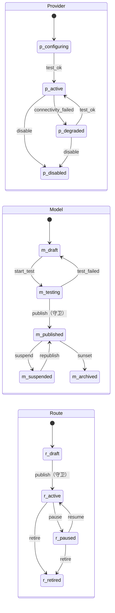
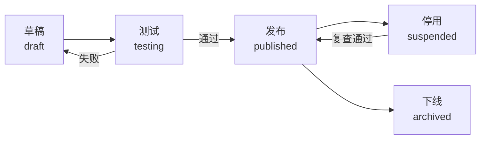
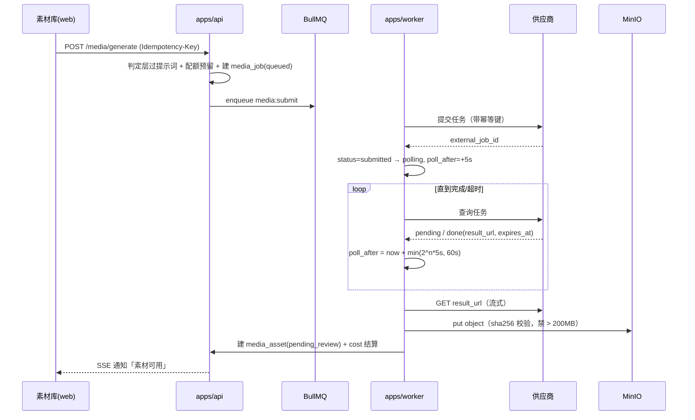

# 07 · 模型管理规范（Provider / Model / Route）

| 项 | 内容 |
|---|---|
| 编号 | 07 |
| 用途 | 定义多供应商模型网关的配置对象、可见性判定、用途路由与降级、配额与计量、图片/视频异步任务、命名映射、后台配置流程与「改配置下个请求即生效」的实现机制。 |
| 读者 | 后端 `packages/registry`、`apps/api` 模型网关、管理员（配置页）；运维（成本与熔断） |
| 依赖 | `00` §3.2/§7/§12/§19.3；`06` §4.1（`provider`/`model`/`model_route`/`credential_ref`/`model_call_log` 字段与约束）；`09` §6（`purpose=embed`）；`11`（写入门）；`12`（`/models`、`/routes` 接口） |
| 状态 | 草案 v0.1 · 2026-10-20 · **待评审**。四个图片模型的 `external_model_id` 待供应商控制台确认（`00` §20 第 2 条），本文只给登记规则与占位。 |

---

## 0. 定位与不变量

`packages/registry` 是**唯一**决定「这次调用该打到哪个供应商、哪个模型、用什么参数、算多少钱」的模块。调用方（文案、判定、素材、知识库）只传 `purpose`，不传 `model_id`。

五条不变量（违反即事故，任何代码评审可据此驳回）：

| # | 不变量 |
|---|---|
| I1 | 前台可见的模型 ⊆ `published` ∪ 通过四条可见性判定；未发布的模型永不出现在任何下拉/路由结果里 |
| I2 | 任何一次调用都落一行 `model_call_log`（模型、参数、用量、成本、耗时、失败原因）；无日志的调用视为未发生 |
| I3 | 降级只能沿 `model_route.fallback_ids`，不得跨 `purpose`、不得跳到未发布模型、不得超过 3 跳 |
| I4 | 价格是数据：历史成本只认 `model_call_log.price_snapshot`，改价不回写历史 |
| I5 | 配额判定在读路径之前完成；宁可拒绝对话，不可透支预算 |

---

## 1. 三层对象与职责边界

| 层 | 表 | 一行代表 | 谁维护 | 变更审批 |
|---|---|---|---|---|
| Provider | `provider` | 一个可调用账号（厂商 + 凭据 + 限额） | admin | 自带审计，不需业务审批 |
| Model | `model` | 一个具体模型 + 参数 Schema + 价格 | admin | 需「测试通过」才能发布 |
| Route | `model_route` | 某 scope × 某 purpose 的首选模型与降级链 | admin | 需引用模型均已发布 |

层间基数：`provider 1—N model`，`model 1—N model_route`（同一模型可被多个 scope/purpose 引用），`model 1—N model_call_log`。

凭据：`provider.auth_ref` **只存名称**，实体在 `credential_ref`，密钥本体在 DSH 凭据（`dsh-credentials`，只报「是否已配置」，从不返回值，见 `00` 附录 A）。`provider` 表没有也不允许出现 key/secret 列。

---

## 2. 字段（管理视角；物理约束见 `06` §4.1）

### 2.1 Provider

| 字段 | 类型 | 必填 | 管理含义 | 变更影响 |
|---|---|---|---|---|
| `name` | text | Y | 内部稳定标识（不随厂商改名） | 被 `model.provider_id` 引用，改名需迁移 |
| `kind` | text | Y | `text`/`image`/`video`/`embedding` | 决定可挂哪些 `capability` 的模型 |
| `vendor` | text | Y | 厂商标识，仅展示 | 无 |
| `base_url` | text | N | 网关/兼容地址 | 下个请求生效 |
| `auth_ref` | text | Y | 指向 `credential_ref.name` | 下个请求生效（无需重启，见 §11） |
| `auth_scheme` | text | Y | 注入方式 | 下个请求生效 |
| `timeout_ms` | integer | Y | 单请求超时 | 下个请求生效；降级阈值随之变化 |
| `max_concurrency` | smallint | Y | 并发信号量 | 下个请求生效 |
| `rate_limit` | jsonb | Y | `{rpm,tpm,concurrency,daily_calls}` | 与 `model.rate_limit` **取严** |
| `status` | text | Y | 生命周期 | 见 §3.2 |
| `connectivity` | text | Y | 最近测试结果 | 影响可见性规则 R1 |
| `balance_micro_cny` | bigint | N | 余额（厂商提供时） | 低于阈值告警 |

`rate_limit` 结构（JSON）：`{"rpm":600,"tpm":200000,"concurrency":8,"daily_calls":20000}`；缺省键表示不限制。限流值分三层来源，**实际生效 = min(provider, model, route.quota)**。

### 2.2 Model

| 字段 | 类型 | 必填 | 管理含义 | 校验 |
|---|---|---|---|---|
| `name` | text | Y | 内部短名（命名规则见 §8） | 唯一、不可改 |
| `external_model_id` | text | Y | 厂商控制台原值，逐字符保真 | 唯一（同 provider）；发布后**不可改**，只能新建行 |
| `display_name` | text | Y | 前台中文名 | 可改 |
| `capability` | text | Y | 能力类型 | 与 `provider.kind` 兼容（§2.4） |
| `purpose_support` | text[] | Y | 可承接用途 | ⊂ 六用途，非空才能发布 |
| `params_schema` | jsonb | Y | 调用参数 JSON Schema | meta-schema 校验 + 拒绝 `additionalProperties:true` |
| `default_params` | jsonb | Y | 默认参数 | 必须通过自身 `params_schema` |
| `price` | jsonb | Y | 计价单（§7.1） | 结构校验；数值 ≥ 0 |
| `rate_limit` | jsonb | N | 模型级限流 | 同 provider |
| `context_tokens` | integer | 条件 | 文本/重排必填 | >0 |
| `embed_dim` | smallint | 条件 | 嵌入必填 | 1..8192；与 `kb_chunk` 维度一致（`09` §7.1） |
| `status` | text | Y | 生命周期 | 见 §3.3 |
| `published_at` / `published_by` | timestamptz/uuid | N | 发布留痕 | 发布时自动写 |

### 2.3 Route

| 字段 | 类型 | 必填 | 管理含义 |
|---|---|---|---|
| `scope_type` | text | Y | `org`/`role`/`user` |
| `scope_role_id` / `scope_user_id` | uuid | 条件 | scope 为 role/user 时二选一 |
| `purpose` | text | Y | 六用途之一 |
| `model_id` | uuid | Y | 首选模型（必须已发布） |
| `fallback_ids` | uuid[] | N | 降级链，顺序即优先级，≤3 |
| `priority` | integer | Y | 同 scope 同 purpose 下越小越优先 |
| `quota` | jsonb | N | §7.2 |
| `status` | text | Y | `draft`/`active`/`paused`/`retired` |

### 2.4 capability × purpose 兼容矩阵

| capability \ purpose | `copy` | `judge` | `image` | `video` | `embed` | `rerank` |
|---|---|---|---|---|---|---|
| `text` | ✅ | ✅ | — | — | — | 可选 |
| `image` | — | — | ✅ | — | — | — |
| `video` | — | — | — | ✅ | — | — |
| `embedding` | — | — | — | — | ✅ | — |
| `rerank` | — | — | — | — | — | ✅ |

路由解析时必须同时满足 `model.capability` 兼容 且 `purpose ∈ model.purpose_support`。**跨类降级禁止**（`video → image`、`image → text` 一律拒绝）：返回 `route_exhausted`，由上层按业务降级（例如视频任务转「人工上传」）。

---

## 3. 状态机

### 3.1 三层生命周期总览



### 3.2 Provider 状态

| 起点 | 事件 | 终点 | 守卫 / 副作用 | 执行者 |
|---|---|---|---|---|
| `configuring` | test_ok | `active` | 连通性测试成功（HTTP 200 + 鉴权通过 + 延迟 < `timeout_ms`）；`connectivity='ok'` | admin |
| `configuring`/`active` | test_failed | `configuring` / `degraded` | `connectivity='failed'`，`last_error_code` 落库 | 系统 |
| `active` | connectivity_failed | `degraded` | 连续 3 次调用失败或测试失败；**不立刻下线**（避免抖动），仅退出可见性候选 | 系统 |
| `degraded` | test_ok | `active` | 一次探测成功即恢复 | 系统/admin |
| `active`/`degraded` | disable | `disabled` | 引用该 provider 的 model 全部自动 `suspended`（级联，写审计） | admin |

### 3.3 Model 状态

| 起点 | 事件 | 终点 | 守卫 / 副作用 | 执行者 |
|---|---|---|---|---|
| — | create | `draft` | `params_schema` 通过 meta-schema；`price` 结构合法 | admin |
| `draft` | start_test | `testing` | 允许临时调用（不受 I1 限制，但打 `test` 标记，不计入配额） | admin |
| `testing` | test_failed | `draft` | 记录失败原因（`429`/`401`/`404 model not found`/输出 Schema 不符） | 系统 |
| `testing` | publish | `published` | **守卫**：24h 内有成功测试；`params_schema` 合法；`price` 有值；`purpose_support` 非空；`provider.status='active'`；`credential_ref.status='active'`；`embed_dim` 与知识库一致（`embed` 用途） | admin |
| `published` | suspend | `suspended` | 立即退出路由候选；已排队任务不重路由（§11 边界） | admin/系统 |
| `suspended` | republish | `published` | 同发布守卫 | admin |
| `published`/`suspended` | sunset | `archived` | 到达 `sunset_at` 或人工下线；被 `active` route 引用时禁止归档 | admin |

### 3.4 Route 状态

| 起点 | 事件 | 终点 | 守卫 | 执行者 |
|---|---|---|---|---|
| `draft` | publish | `active` | `model_id` 与 `fallback_ids` 全部 `published`；无同 `(scope_type, scope, purpose, priority)` 冲突；`quota` 结构合法 | admin |
| `active` | pause | `paused` | 解析时跳过该 route；若某 `(scope,purpose)` 无任何 `active` route → 该用途在解析时返回 `no_route`（配置页红色告警） | admin |
| `paused` | resume | `active` | 同发布守卫 | admin |
| `active`/`paused` | retire | `retired` | 终态；引用它的历史日志保留 | admin |

**发布门禁（route 层）**：同一 `(org, scope_type, scope_id, purpose)` 下必须恰好有一条 `priority=1` 的 `active` 路由作为主路由，否则发布页给出阻断错误 `route_no_primary`。

---

## 4. 前台可见性：四条判定规则

`00` §7.2 的四条规则，逐条给出可执行判定与失败码。

| 规则 | 条件 | 数据来源 | 不满足时 | 失败码 |
|---|---|---|---|---|
| **R1** 凭据可用且连通 | `provider.auth_ref` 非空、`credential_ref.status='active'`、`provider.connectivity='ok'`、`provider.status IN ('active')` | `provider` + `credential_ref` | 模型隐藏 | `provider_unavailable` |
| **R2** 模型已发布且参数合法 | `model.status='published'` 且 `published_at <= now()` 且 `params_schema` 通过 meta-schema 且 `default_params` 通过 `params_schema` | `model` | 模型隐藏 | `model_not_published` |
| **R3** 路由命中当前 scope 且角色未被禁 | 存在 `model_route.status='active'`、`purpose` 匹配、`effective_from<=now()<coalesce(effective_to,'infinity')`、scope ∈ {user=当前用户, role ∈ 当前用户角色, org} | `model_route` + 当前 principal | 该用途不出现 | `no_route` |
| **R4** 角色 × 用途有权 | `role_purpose_matrix[role][purpose] = allow`（下表） | 代码内矩阵（`packages/registry/src/policy.ts`），随版本发布 | 隐藏或置灰 | `role_forbidden` |

角色 × 用途矩阵（与 `00` §6.1 三档对齐；`admin` 继承 `operator` 全部）：

| 角色 | copy | judge | image | video | embed | rerank |
|---|---|---|---|---|---|---|
| `viewer` | 只读查看历史 | — | — | — | — | — |
| `operator` | ✅ | ✅（触发判定，不参与终审） | ✅ | ✅ | — | — |
| `admin` | ✅ | ✅ | ✅ | ✅ | ✅ | ✅ |

`viewer` 可以在「模型与供应商管理」页看到**已发布模型的名称与价格档位**（只读），但不可发起调用；这一条是页面可见，不是路由可见，二者不要混。

### 4.1 判定伪代码

```ts
// packages/registry/src/visibility.ts
type Purpose = 'copy' | 'judge' | 'image' | 'video' | 'embed' | 'rerank';
type Role = 'viewer' | 'operator' | 'admin';
interface Principal { orgId: number; userId: string; roles: Role[]; }

interface VisibilityCtx {
  provider: ProviderRow; credential: CredentialRefRow;
  model: ModelRow; route: ModelRouteRow; principal: Principal;
  now: Date;
}

const ROLE_PURPOSE: Record<Role, ReadonlySet<Purpose>> = {
  viewer:   new Set([]),
  operator: new Set(['copy', 'judge', 'image', 'video']),
  admin:    new Set(['copy', 'judge', 'image', 'video', 'embed', 'rerank']),
};

const CAPABILITY_OK: Record<ModelRow['capability'], ReadonlySet<Purpose>> = {
  text:      new Set(['copy', 'judge', 'rerank']),
  image:     new Set(['image']),
  video:     new Set(['video']),
  embedding: new Set(['embed']),
  rerank:    new Set(['rerank']),
};

/** R2 的 Schema 合法性：只在发布时算一次并缓存标记，读路径读列不重算 */
function modelParamsValid(model: ModelRow): boolean {
  return model.status === 'published'
      && model.paramsSchemaOk === true
      && model.defaultParamsValid === true;
}

/** 四条规则全为真才可见；返回失败码用于页面提示与日志 */
export function checkVisibility(c: VisibilityCtx): { visible: boolean; code?: string } {
  // R1 —— 凭据 + 连通
  if (!c.provider.authRef) return { visible: false, code: 'provider_unavailable' };
  if (c.credential.status !== 'active') return { visible: false, code: 'provider_unavailable' };
  if (c.provider.status !== 'active') return { visible: false, code: 'provider_unavailable' };
  if (c.provider.connectivity !== 'ok') return { visible: false, code: 'provider_unavailable' };

  // R2 —— 已发布 + 参数合法
  if (!modelParamsValid(c.model)) return { visible: false, code: 'model_not_published' };
  if (c.model.publishedAt && c.model.publishedAt > c.now) {
    return { visible: false, code: 'model_not_published' };
  }

  // R3 —— 路由命中 scope 且生效窗口覆盖当前时刻
  const inWindow = (!c.route.effectiveFrom || c.route.effectiveFrom <= c.now)
                && (!c.route.effectiveTo   || c.now < c.route.effectiveTo);
  const scopeHit = c.route.scopeType === 'org'
    || (c.route.scopeType === 'user' && c.route.scopeUserId === c.principal.userId)
    || (c.route.scopeType === 'role' && c.principal.roles.includes(c.route.scopeRoleCode!));
  if (c.route.status !== 'active' || !inWindow || !scopeHit) {
    return { visible: false, code: 'no_route' };
  }

  // R4 —— 角色 × 用途
  const allowed = c.principal.roles.some((r) => ROLE_PURPOSE[r].has(c.route.purpose));
  if (!allowed) return { visible: false, code: 'role_forbidden' };

  // 附加一致性（不属于可见性四规则，但同表判定，若不符视为配置缺陷）
  const capOk = CAPABILITY_OK[c.model.capability].has(c.route.purpose)
             && c.model.purposeSupport.includes(c.route.purpose);
  if (!capOk) return { visible: false, code: 'model_purpose_mismatch' };

  return { visible: true };
}
```

**SQL 视图（非新表）**：配置页与下拉用同一份判定，避免「页面能看、调用失败」：

```sql
CREATE VIEW v_visible_model AS
SELECT r.id AS route_id, r.purpose, r.priority, r.scope_type, r.scope_role_id, r.scope_user_id,
       m.id AS model_id, m.name, m.display_name, m.capability, m.price, m.embed_dim,
       p.id AS provider_id, p.kind AS provider_kind
FROM model_route r
JOIN model m  ON m.id = r.model_id AND m.archived_at IS NULL
JOIN provider p ON p.id = m.provider_id AND p.archived_at IS NULL
JOIN credential_ref c ON c.org_id = p.org_id AND c.name = p.auth_ref AND c.archived_at IS NULL
WHERE r.status = 'active' AND r.archived_at IS NULL
  AND m.status = 'published'
  AND p.status = 'active' AND p.connectivity = 'ok'
  AND c.status = 'active'
  AND (r.effective_from IS NULL OR r.effective_from <= now())
  AND (r.effective_to   IS NULL OR now() < r.effective_to);
-- R4 由应用层按 principal.roles 过滤（角色不在 DB 的 route 行上，是策略不是数据）
```

---

## 5. purpose 与路由优先级

### 5.1 purpose 枚举（六值，不增不减）

| purpose | 语义 | 典型调用方 | 允许的 capability | 超时 | 降级容忍 |
|---|---|---|---|---|---|
| `copy` | 文案生成/改写 | 文案工作台、素材提示词扩写 | `text` | 60s | 可降级到同 capability 更小模型 |
| `judge` | L2 语义裁决（`08`） | 判断层 | `text` | 20s | **仅降级一次**；再失败即升级人工 |
| `image` | 图片生成/编辑 | 素材库 | `image` | 300s（异步） | 可降级；失败回人工 |
| `video` | 视频生成 | 素材库短视频样片 | `video` | 1800s（异步） | 可降级；成本上限严格 |
| `embed` | 文本嵌入 | 知识库（`09` §6） | `embedding` | 30s | **不降级**（维度/语义不一致会污染索引） |
| `rerank` | 重排（可选） | 知识库（`09` §9） | `rerank`/`text` | 10s | 直接跳过重排（不算失败） |

`embed` 不降级的理由：跨模型向量不可比，降级会让同一索引混入不同空间的向量。`embed` 故障时知识库走关键词降级（`09` §11），而不是换模型。

### 5.2 路由解析顺序（优先级）

```
1) scope 精度：user(0) > role(1) > org(2)
2) 同 scope 内：priority 升序（1 最优先）
3) 同 priority（不应存在，发布门禁已拦）：updated_at 降序（最新配置赢）
4) 候选序列 = [model_id, ...fallback_ids]（最多 4 个候选）
5) 逐候选过 6 道闸（见 §5.3），第一个全过者胜出
6) 全失败 → route_exhausted；按 purpose 策略处理（judge 升级人工、copy 降级模板、media 转人工上传）
```

### 5.3 resolveRoute 伪代码

```ts
// packages/registry/src/resolve.ts
interface CallContext {
  orgId: number; principal: Principal; purpose: Purpose;
  requestId: string; estimate: { tokensIn: number; tokensOut: number; images?: number; seconds?: number };
}

interface RouteDecision {
  routeId: string; modelId: string; providerId: string;
  params: Record<string, unknown>;
  degraded: boolean; fallbackFrom?: string;
  reason: 'primary' | 'fallback' | 'quota_fallback';
}

export async function resolveRoute(ctx: CallContext): Promise<RouteDecision> {
  const now = new Date();

  // 0) 全局闸：kill switch（读 Redis 快照，§11 缓存策略）
  if (await switches.isBlocked(ctx.orgId, 'model', ctx.purpose)) {
    throw new GatewayError('kill_switch_blocked', { purpose: ctx.purpose });
  }

  // 1) 取候选路由：DB 已按 scope 精度 + priority 排序（一条 SQL，见 §5.4）
  const routes = await repo.loadRoutes(ctx.orgId, ctx.purpose, ctx.principal, now);
  if (routes.length === 0) throw new GatewayError('no_route', { purpose: ctx.purpose });

  for (const route of routes) {
    // 2) R1..R4（复用 §4.1 的 checkVisibility，一次查全 join 行）
    const v = checkVisibility(route.visibilityCtx);
    if (!v.visible) {
      meter.recordSkip({ requestId: ctx.requestId, routeId: route.id, code: v.code });
      continue;
    }

    // 3) 候选链：首选 + 降级
    for (const [idx, modelId] of [route.modelId, ...route.fallbackIds].entries()) {
      const model = await repo.getModel(modelId);

      // 4) 熔断（Redis，键含 config_version；改配置不粘旧熔断，见 §11）
      if (await breaker.isOpen(model.id, model.configVersion)) {
        meter.recordSkip({ requestId: ctx.requestId, modelId, code: 'circuit_open' });
        continue;
      }

      // 5) 配额（三层取严；先估价再预留）
      const quota = await quota.reserve({
        orgId: ctx.orgId, routeId: route.id, modelId: model.id,
        estimate: ctx.estimate, limits: minLimits(route.quota, model.rateLimit, model.provider.rateLimit),
      });
      if (!quota.ok) {
        // 超配额允许「降级到更便宜且仍有配额的候选」，但必须在 decision 里标注
        meter.recordSkip({ requestId: ctx.requestId, modelId, code: 'quota_exceeded' });
        continue;
      }

      // 6) 参数合成：模型默认值 → 路由覆盖 → 调用方覆盖（调用方不得覆盖价格相关/安全参数）
      const params = mergeParams(model.defaultParams, route.paramOverride, ctx.callParams, model.paramsSchema);

      return {
        routeId: route.id, modelId: model.id, providerId: model.providerId,
        params, degraded: idx > 0, fallbackFrom: idx > 0 ? route.modelId : undefined,
        reason: idx > 0 ? (quota.reason === 'quota' ? 'quota_fallback' : 'fallback') : 'primary',
      };
    }
  }

  throw new GatewayError('route_exhausted', { purpose: ctx.purpose });
}
```

### 5.4 候选查询（单条 SQL，避免 N+1）

```sql
WITH ranked AS (
  SELECT r.*,
         CASE r.scope_type WHEN 'user' THEN 0 WHEN 'role' THEN 1 ELSE 2 END AS scope_rank
  FROM model_route r
  WHERE r.org_id = $1 AND r.purpose = $2 AND r.status = 'active' AND r.archived_at IS NULL
    AND (r.scope_type = 'org'
      OR (r.scope_type = 'user' AND r.scope_user_id = $3)
      OR (r.scope_type = 'role' AND r.scope_role_id = ANY($4::uuid[])))
    AND (r.effective_from IS NULL OR r.effective_from <= now())
    AND (r.effective_to   IS NULL OR now() < r.effective_to)
)
SELECT * FROM ranked
ORDER BY scope_rank, priority, updated_at DESC
LIMIT 20;
```

---

## 6. 降级链

### 6.1 触发与不触发

| 情形 | 是否降级 | 说明 |
|---|---|---|
| 连接超时 / 读超时 | ✅ | 计入熔断失败 |
| 上游 5xx（含网关 502/503） | ✅ | 指数退避重试 1 次后再降 |
| 429 限流（退避后仍 429） | ✅ | 重试 1 次，`Retry-After` 遵从 |
| 配额超限（route/model/provider 任一层） | ✅（仅当候选更便宜且有配额） | 记 `quota_fallback`；不允许「降级后更贵」 |
| 熔断打开 | ✅ | 直接跳下一个候选 |
| 401/403 鉴权失败 | ❌ | 配置错误，立即 `provider_unavailable` 并告警 |
| 404 model not found | ❌ | 配置错误（`external_model_id` 漂移），停用该 model |
| 400 参数非法 | ❌ | 代码/参数缺陷，不重试不降级 |
| 内容审核拒绝（content policy） | ❌ | 换模型绕过审核是违规行为，禁止 |
| 输出 Schema 不符（`judge`/`copy` 结构化输出） | 1 次同模型修复重试 → 仍失败 ✅降一级 | 见 `08` §8 的无证据升级 |

### 6.2 降级规则

| # | 规则 | 强制点 |
|---|---|---|
| D1 | 只沿 `fallback_ids`，顺序固定，≤3 跳（4 候选） | `resolveRoute` |
| D2 | 不跨 purpose、不跨 capability（§2.4） | `checkVisibility` |
| D3 | 不降级到 `suspended`/非 `published` 模型 | `checkVisibility` |
| D4 | `judge` 用途全程只允许 1 次降级；第二次失败即 `escalate`（`08` §8） | 调用方预算参数 |
| D5 | `embed` 不降级（§5.1） | `resolveRoute` 硬编码例外 |
| D6 | 每次降级写 `model_call_log.fallback_from_model_id` + `audit_log(action='model.fallback')` | 网关出口 |
| D7 | 1 小时内同一 `(route, purpose)` 降级 ≥ 3 次 → P2 告警；≥ 10 次 → P1 并考虑暂停主模型 | 告警规则 |
| D8 | 降级不改变计费口径：按**实际使用**的模型价格计费，不按主模型价格 | 计量模块 |

### 6.3 熔断

| 项 | 取值 | 说明 |
|---|---|---|
| 统计窗口 | 60s 滑动 | Redis ZSET / 计数器 |
| 打开条件 | 失败率 ≥ 50% 且样本 ≥ 10，或连续 5 次超时 | 两个条件任一 |
| 打开时长 | 60s | 期间该 `(model, config_version)` 直接跳过 |
| 半开 | 1 个探针请求 | 成功即闭合，失败重新打开（指数退避 ×2，上限 600s） |
| 键 | `cb:{model_id}:{config_version}` | **含配置版本**：管理员改超时/参数后，旧熔断不粘新配置（§11） |
| 用户可见 | 调用方只看到 `degraded=true` 或 `route_exhausted` | 不向业务页面暴露供应商名 |

---

## 7. 配额与计量

### 7.1 计价单 `model.price` 结构（微元/单位）

```json
{
  "version": 1,
  "currency": "CNY",
  "unit": "micro_cny",
  "text": {
    "input_per_1k": 2000,
    "output_per_1k": 8000,
    "cached_input_per_1k": 500
  },
  "image": {
    "per_image": 300000,
    "tiers": [
      { "max_pixels": 1048576, "per_image": 150000 },
      { "max_pixels": 4194304, "per_image": 300000 }
    ]
  },
  "video": {
    "per_second": 250000,
    "min_charge_seconds": 5
  },
  "embed": { "input_per_1k": 100 },
  "rerank": { "per_1k_docs": 5000 },
  "note": "数值为占位示例，上线前以供应商控制台账单为准；变更须升 price_version 并写审计"
}
```

约束：只填该 `capability` 需要的段（其余可缺省）；不允许负值；`price_version` 变更必写 `audit_log(action='model.price_change')`，并在配置页 diff 展示涨跌。

### 7.2 配额 `quota`（可出现在 `model_route.quota`、`model.rate_limit`、`provider.rate_limit`）

| 键 | 单位 | 语义 | 超限行为 |
|---|---|---|---|
| `rpm` | 次/分 | 请求数 | 429 + 降级候选 |
| `tpm` | token/分 | 文本吞吐（估） | 429 + 降级到更小模型 |
| `concurrency` | 个 | 并发请求 | 排队（≤2s）后 429 |
| `daily_calls` | 次/日 | 日调用上限 | 直接拒（不降级到更贵） |
| `daily_cost_micro_cny` | 微元/日 | 日成本上限 | 直接拒 + P1 告警 |
| `monthly_cost_micro_cny` | 微元/月 | 月预算 | 直接拒 + 财务告警 |

生效值 = `min(provider.rate_limit, model.rate_limit, route.quota)`，缺键视为不限制。Redis 键：`q:{org}:{scope}:{purpose}:{yyyymmdd}:{calls|cost|tokens}`，TTL 48h；并发用 `INCR/DECR` 信号量（带 60s 自动过期兜底，防进程崩溃泄漏配额）。

### 7.3 计量公式（唯一实现：`packages/registry/src/metering.ts`）

| 计费单位 | 公式（全部整数运算，结果单位 micro-CNY） | 说明 |
|---|---|---|
| 文本 | `ceil(in/1000 * P_in) + ceil(out/1000 * P_out) + ceil(cached/1000 * P_cached)` | 分别向上取整到微元；`cached` 若计价单未提供则按 `P_in` 计 |
| 图片 | `Σ tier(per_image)`（按实际像素命中档位），数量 = `image_count` | 多张逐张累加；批次优惠不建模（如需，用 `per_image` 折价） |
| 视频 | `ceil(max(seconds, min_charge_seconds) * 10) / 10 * P_second` → 即按 0.1s 粒度 | `seconds` 取供应商回传值，缺失时按请求参数 |
| 嵌入 | `ceil(tokens/1000 * P_embed)` | `tokens` 优先供应商回传，否则 tokenizer 估算并标 `estimated` |
| 重排 | `ceil(docs/1000 * P_rerank)` | `docs` = 送排文档数 |
| 固定请求费 | `per_request`（可选段） | 若存在则叠加 |

聚合与对账：
- 每次调用写 `model_call_log.cost_micro_cny`；日报 `scripts/cost-rollup` 按 `(biz_date, model, purpose, subject_type, sku)` 汇总，输出到报表页（不落新表，直接 SQL 聚合）。
- 与供应商账单对账：`|Σ local_cost − bill| / bill > 2%` → P2 告警；差因必须归类为「估算 token / 阶梯价 / 汇率无关（单币种）/ 退款」之一。
- 预算告警阈值：日预算 80% 提醒、100% 拒绝；月预算同上。`00` §16「单件媒体成本」= `sum(media_asset.cost_micro_cny) / 产出件数`。

---

## 8. 模型命名映射规则

### 8.1 三层命名

| 层 | 字段 | 规则 | 例 | 可变性 |
|---|---|---|---|---|
| 内部短名 | `model.name` | `^<cap>.<vendor>.<family>.<major>[.<variant>]$`，全小写，`.` 分隔，≤64 字符；`cap ∈ {txt,img,vid,emb,rrk}` | `img.seedream.v3` | **不可改**（改名 = 新行 + 迁移引用） |
| 厂商真值 | `model.external_model_id` | 控制台原值**逐字符保真**（含 `/`、`-preview`、日期后缀） | `doubao-seedream-3-0-t2i-250415` | **发布后不可改**；厂商换版本 = 新建 model 行 |
| 展示名 | `model.display_name` | `中文名 · 版本`，不得含厂商内部代号 | `即梦 3.0 · 图片生成` | 可改（只影响展示） |

### 8.2 别名登记（口头名 → 内部名）

业务口头名（如「那个 4.0 的图」「快手的视频模型」）**不进代码**，登记在 `packages/registry/src/aliases.ts`（版本化文件，随 PR 评审）：

```ts
export const MODEL_ALIASES = {
  // 用户口头称呼 -> 内部 name；仅用于搜索与配置页联想，不参与路由
  'seedream':    'img.seedream.v3',
  '即梦':        'img.seedream.v3',
  '万相':        'img.wanx.v1',
  '可灵':        'vid.kling.v1',
  'deepseek':    'txt.deepseek.chat.3',
} as const;
```

规则：① 别名不得与 `model.name` 冲突；② 一个别名只能指向一个内部名；③ 别名解析失败不报错（搜索降级为模糊匹配）；④ 别名不写库、不进路由逻辑。

### 8.3 首批四个图片模型的登记方式（占位）

`00` §20 第 2 条：实际 `model id` 以供应商控制台为准，命名映射先留空。登记动作固定为三步：

1. 建 `provider`（`kind='image'`，`auth_ref` 指向已在 DSH 设置的凭据名）→ 跑 `POST /providers/:id/test`；
2. 建 4 条 `model`（`name` 依次 `img.providerA.model1` … `img.providerD.model4`，`external_model_id` 填控制台真值，`capability='image'`，`status='draft'`）；
3. 每条跑一次最小探测（1 张 512×512、`seed` 固定）→ 通过后 `publish`；4 条都发布后建 `model_route(purpose='image', priority=1..4)`。

四个模型可以来自同一 provider（不同 `external_model_id`），也可以跨 provider；路由优先级由**质量/成本/稳定性**决定，配置页记录决策理由（`model.notes`）。

### 8.4 命名相关的禁止项

| 禁止 | 原因 |
|---|---|
| 同一 `external_model_id` 建两行 | 成本与配额会分裂统计（唯一约束已拦） |
| 一行承载两个厂商模型（如用 `|` 拼接） | 降级链与计量会错 |
| 用展示名做路由键 | 展示名可变，路由必须稳定 |
| 把参数差异（温度/尺寸）建成不同 model 行 | 参数属 `default_params`/调用参数，属 route 覆盖 |
| 发布后修改 `external_model_id` | 历史日志无法归因（配置页禁用该输入框） |

---

## 9. 后台配置流程（草稿 → 测试 → 发布 → 停用）

### 9.1 流程与门禁



| 步 | 操作 | 操作者 | 前置 | 系统动作 | 校验 | 失败处理 |
|---|---|---|---|---|---|---|
| 1 草稿 | 建 provider / model / route | admin | 凭据已在 DSH 设置（页面只显示「已配置」） | 不写 `published_at`；route 不可被解析（`draft`） | `params_schema` meta-schema；`price` 结构；`purpose_support` 与 `capability` 兼容 | 表单就地报错，不落库 |
| 2 测试 | `POST /providers/:id/test`、`POST /models/:id/test` | admin | provider `configuring`/`active` | 连通性探测 + 1 次最小真实调用；结果写 `connectivity`/`last_check_*`；`model.status='testing'` | ① HTTP 2xx ② 鉴权通过 ③ 延迟 < `timeout_ms` ④ 输出符合 `params_schema` 与期望结构 | 记录 `error_code`；model 回 `draft`；页面给出可执行原因（密钥/额度/模型名/地域） |
| 3 发布 | `POST /models/:id/publish`、`POST /routes` | admin | 24h 内测试成功；route 引用模型均 `published` | 写 `published_at`/`published_by`；`pg_notify('registry_changed')`；清缓存 | §3.3/§3.4 全部守卫 + 主路由存在性 | 阻断并返回 `publish_blocked` + 未满足项清单 |
| 4 停用 | `POST /models/:id/suspend`、`PATCH /routes/:id` | admin | — | `status='suspended'`/`paused`；`pg_notify` | 若该 `(scope,purpose)` 将无可用路由 → 二次确认 | 拒绝时提示「请先配置替代路由」 |
| 5 下线 | `POST /models/:id/archive` | admin | 无 `active` route 引用；`sunset_at` 已到或人工确认 | 归档；历史日志保留 | 引用检查 | 阻断并列出引用清单 |

所有步骤写 `audit_log`（`action ∈ model.create|test|publish|suspend|price_change|route.publish|…`，含 before/after/diff）。

### 9.2 页面（对应 `00` §14.2 第 10 页）

三个 tab：**Provider**（凭据状态、连通性、余额、限额）、**Model**（参数 Schema 表单、价格、测试按钮、发布状态）、**Route**（按 purpose 的矩阵视图：行=scope，列=purpose，格=模型+降级链；冲突与缺口红色标注）。页面只读调用 `v_visible_model` 的同一判定结果，不允许前端另写一套规则。

### 9.3 回滚

配置回滚 = 状态回退（`suspended → published`）或新建一条 route 指向旧模型；**不物理删除**任何行。价格回滚 = 新增 `price` 版本（`price_version+1`），历史成本不动（I4）。

---

## 10. 图片与视频的异步任务模型

### 10.1 统一走 `media_job`

图片：多数同步或短轮询；视频：提交 → 轮询 → 取回 URL。两者**统一**落 `media_job`（`06` §4.4.2），差别只在超时与轮询间隔。同步完成的图片也必须写一条已完成的 `media_job` + `model_call_log`——否则成本与素材脱钩（I2）。

### 10.2 提交 → 轮询 → 取回 → 落 MinIO



### 10.3 关键参数

| 项 | 图片 | 视频 | 依据 |
|---|---|---|---|
| 首轮轮询 | +5s | +15s | 供应商典型时延 |
| 退避 | `min(2^n × 5s, 60s)` | `min(2^n × 15s, 120s)` | 防打爆查询接口 |
| 总超时 | 10 min | 90 min | 超时 `failed(manual)` |
| 并发 | 按 route 配额 | 按 route 配额，默认 ≤ 2 | 视频成本高 |
| 单件上限 | 20 张/任务 | 1 个/任务 | 防误操作爆量 |
| 结果 URL | 需 `https` 且 host ∈ provider 白名单 | 同 | 防 SSRF |
| 下载上限 | 30 MB | 500 MB | 防磁盘打满 |
| 存储 | `dssaas-media` 版本化桶 | 同 | `00` §3.1 |
| 标注 | AIGC 可见标识烧录 + 元数据 | 同 + 首帧封面 | `00` §12 |

### 10.4 幂等与计费一致性

- 提交幂等：`(org_id, idempotency_key)` 唯一（`06` §4.4.2）；重复请求返回既有 `media_job`，**不再向供应商提交**。
- 重试幂等：复用 `external_job_id` 先查后提，避免供应商侧重复计费；跨供应商重试必须新建 job（新幂等键）。
- 成本：`estimated_cost_micro_cny` 在提交前算（配额用），`cost_micro_cny` 在成功/失败（供应商计费失败也计费时）落定；差额 > 20% 记 `cost_estimate_drift` 指标。
- 失败分类：`retryable`（超时/5xx/URL 过期）→ 退避重试 ≤3 次；`manual`（审核拒绝/参数错）→ 工作台待办；`permanent`（模型下线）→ 停用该 model 并告警。

### 10.5 与 DSH 的边界

DSH 不处理音视频（`00` 附录 A：`dsh-attachment` 明示「音频和视频暂无专门处理」）。因此转码、抽帧、分片上传、AIGC 标识烧录全部由自建 worker 完成（`ffmpeg` 放入 worker 镜像），不调用 DSH 的附件能力。

---

## 11. 为什么「管理员改配置，下个请求即生效」

结论：因为**配置是数据，不是启动参数**；且所有缓存都以「配置版本」为键并有一个极短的上界。

| # | 机制 | 位置 | 失效上界 |
|---|---|---|---|
| M1 | `resolveRoute()` 每请求执行 **SQL 查询**（§5.4），无进程内权威单例 | `packages/registry` | 0（立即） |
| M2 | 配置读取缓存键 = `(org_id, purpose, scope, registry_version)`；`registry_version` 来自 `max(updated_at)` 或 `pg_notify` 计数 | 进程内 LRU | ≤ 1s（TTL 1s 兜底） |
| M3 | 写配置事务提交后 `NOTIFY registry_changed`；所有 api/worker 实例 `LISTEN` 后清本地缓存 | Postgres `LISTEN/NOTIFY` | 毫秒级；丢通知时退化为 M2 的 1s |
| M4 | 凭据按请求解析：`dsh-llm-pi-ai` 的 profile 与凭据**按请求解析**（`00` §3.2 已核实），密钥轮换不需要重启 | DSH | 下个请求 |
| M5 | 价格在调用前读最新 `model.price` 并写入 `price_snapshot` | 计量模块 | 下个请求 |
| M6 | 熔断键含 `config_version`，改超时/参数后旧熔断不粘新配置 | Redis | 下个请求 |
| M7 | kill switch 以 Redis 快照 + DB 真源双读，DB 变更多播 | 网关入口 | ≤ 1s |

**不需要重启的清单**：provider 的 `base_url`/`timeout_ms`/`max_concurrency`/`rate_limit`/`auth_ref`、model 的 `price`/`default_params`/`rate_limit`/`status`、route 的 `model_id`/`fallback_ids`/`priority`/`quota`/`status`。

**需要迁移或重建、不能热改的清单**（配置页对这些字段只读或二次确认）：

| 项 | 原因 | 替代操作 |
|---|---|---|
| `model.name` | 被日志与代码引用；改名断历史 | 新建 model + 迁移 route |
| `model.external_model_id` | 厂商真值，改了就是另一个模型 | 新建 model 行 |
| `embed_dim` | 向量列维度固定（`vector(1024)`），改维度索引失效 | 新建维度 + 全量重建（`09` §7.5） |
| `model.capability` | 影响兼容矩阵与历史统计 | 新建 model 行 |
| `purpose` 语义 | 六用途是契约 | 改 `08`/`09` 文档与代码 |

**明确不生效的边界（设计如此，不是缺陷）**：
1. **已入队/已提交的任务**（`workflow_run`、`media_job`）在提交时已固化 `model_id` 与 `params` 快照 —— 这样重放可复现、成本可对账。要切新模型，走「取消 + 重新提交」。
2. **历史日志**不受改价影响（`price_snapshot`）。
3. **已发布 listing** 与模型配置无关。

---

## 12. 接口与错误码

### 12.1 接口（对齐 `00` §14.1 前缀 `/api`）

| 方法 | 路径 | 说明 | 权限 |
|---|---|---|---|
| GET | `/models` | 前台可用模型（走 §4 判定 + `v_visible_model`） | 登录用户 |
| POST | `/providers` | 建 provider | admin |
| POST | `/providers/:id/test` | 连通性测试 | admin |
| POST | `/models` | 建 model（`draft`） | admin |
| POST | `/models/:id/test` | 最小真实调用 | admin |
| POST | `/models/:id/publish` | 发布（守卫见 §3.3） | admin |
| POST | `/models/:id/suspend` | 停用 | admin |
| GET | `/routes?purpose=` | 路由矩阵 | admin |
| POST | `/routes` | 建/改 route（发布态） | admin |
| GET | `/usage?from=&to=` | 用量与成本（`model_call_log` 聚合） | admin |

写操作统一带 `Idempotency-Key`（`00` §14.1）。

### 12.2 错误码

| 码 | HTTP | 含义 | 可执行下一步 |
|---|---|---|---|
| `no_route` | 503 | 该用途无 active 路由 | 配置页建路由 |
| `route_exhausted` | 503 | 候选链全部不可用 | 查熔断/配额/配置；judge 用途升级人工 |
| `quota_exceeded` | 429 | 配额耗尽 | 调配额或等窗口；写预算告警 |
| `provider_unavailable` | 503 | 凭据/连通性失败 | 重建凭据并测试 |
| `model_not_published` | 422 | 引用未发布模型 | 先发布模型 |
| `model_purpose_mismatch` | 422 | capability 与 purpose 不兼容 | 修 `purpose_support` |
| `role_forbidden` | 403 | 角色 × 用途无权 | 提权审批 |
| `kill_switch_blocked` | 423 | 全局/范围停写 | 查 kill switch 原因 |
| `publish_blocked` | 409 | 发布守卫未过 | 按返回的未满足项清单处理 |
| `schema_invalid` | 502 | 模型输出不符 Schema | 重试 1 次 → 升级 |

---

## 13. 验收与测试用例（M2 判据）

| # | 用例 | 期望 |
|---|---|---|
| 1 | 后台建 provider+model，未发布时 `GET /models` | 不出现 |
| 2 | 发布后同一用户 `GET /models` | 出现，且 `purpose` 匹配 |
| 3 | 断开凭据（`credential_ref.status='revoked'`） | 立即消失（R1），`/models` 返回无该模型 |
| 4 | 角色 `viewer` 调用 `copy` | `403 role_forbidden` |
| 5 | `operator` 调用 `embed` | `403 role_forbidden` |
| 6 | 主模型 500，配置了 fallback | 成功且 `degraded=true`、`fallback_from_model_id` 正确 |
| 7 | 主模型 400 参数错 | 不降级，直接失败 |
| 8 | 主模型 429×2 | 降级到 fallback |
| 9 | `judge` 连续两次降级失败 | 第 2 次后 `escalate`，不再尝试第 3 个 |
| 10 | `embed` 主模型故障 | 不降级，返回 `route_exhausted`，知识库走关键词（`09` §11） |
| 11 | 配额 `daily_cost` 用尽 | 拒且不降级到更贵模型；告警触发 |
| 12 | 改 `timeout_ms` 后立即调用 | 新超时生效（≤1s 内） |
| 13 | 改 `price` 后新调用 | 新价计费；旧 `model_call_log` 成本不变 |
| 14 | 同一 `Idempotency-Key` 提交两次图片任务 | 只建 1 个 `media_job`，只向供应商提交 1 次 |
| 15 | 供应商返回过期 URL | `failed(retryable)` 后重试成功，成本不重复计 |
| 16 | 视频超 90min | `failed(manual)`，保留 `external_job_id`，工作台待办 |
| 17 | `judge` 输出不符 Schema | 同模型修复 1 次；再失败升级人工（`08` §8） |

---

## 14. 与其他文档的接口

| 相关文档 | 本文定义 | 需对方对齐 |
|---|---|---|
| `06` 领域模型 | 复用其 `provider`/`model`/`model_route`/`credential_ref`/`model_call_log` 字段与 CHECK | 本文不重复物理定义；`price` 结构在本文 §7.1，需回填 `06` §9 的接口表 |
| `08` 判断层 | `purpose='judge'` 的超时、降级只 1 次、Schema 失败重试 1 次 | 08 的「无证据升级」需与 D4 一致 |
| `09` 知识库 | `purpose='embed'`/`rerank` 不降级、`embed_dim` 一致性、`price.embed` 计费 | 09 的维度常量、重排触发条件 |
| `10` 素材管线 | `media_job` 全生命周期、轮询参数、MinIO 落库、AIGC 标识 | 10 的变体与样片决策流程 |
| `11` 写入门 | 模型不直写平台；`model_call_log` 是成本唯一来源 | 11 的任务幂等与本文 media_job 幂等的关系 |
| `12` OpenAPI | §12.1 接口与 §12.2 错误码 | 12 需收录 `price`/`quota` 的 Schema |
| `19` 属性映射 | 图片模型生成属性图时不得产出属性「事实值」（只出图） | 19 的属性值仍来自平台字典 |
