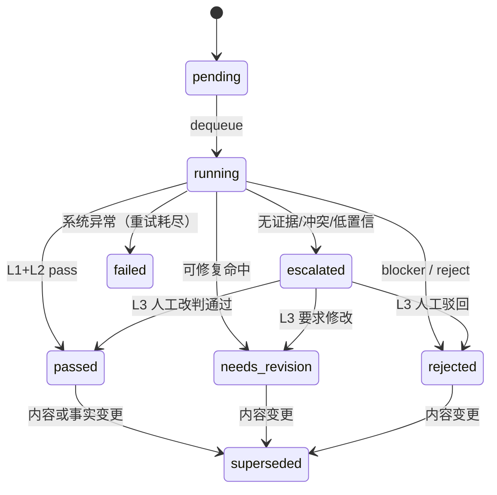
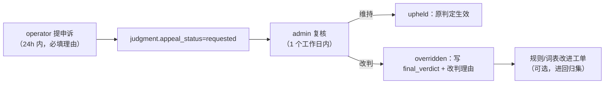
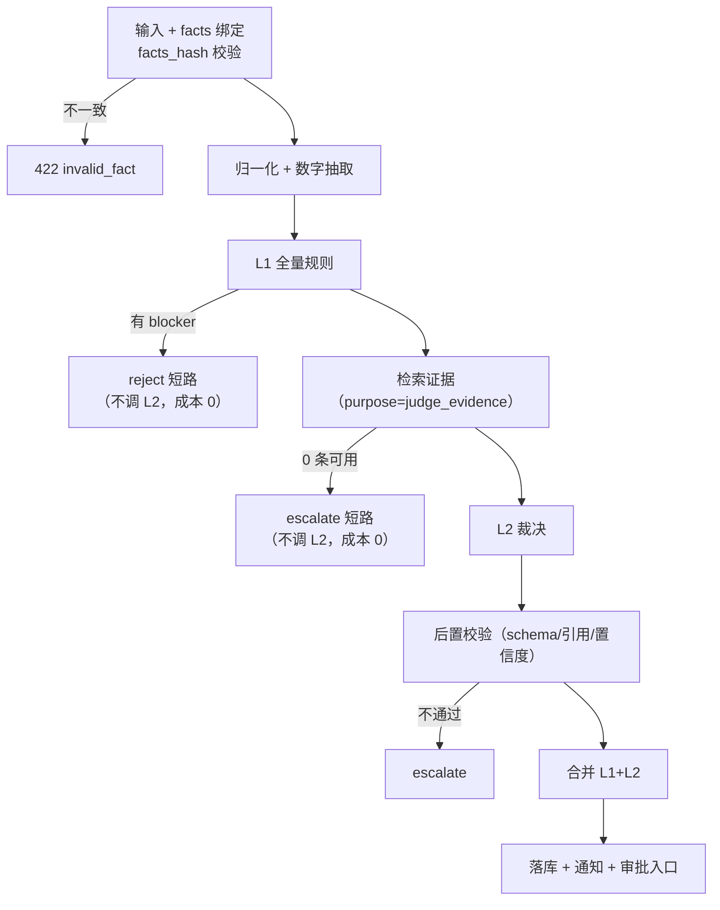

# 08 · 判断层规范

| 项 | 内容 |
|---|---|
| 编号 | 08 |
| 用途 | 定义三段闸门（L1 规则 / L2 LLM 裁决 / L3 人工）的规则集、禁限词策略、硬事实校验、L2 的 JSON Schema 与提示词结构、无证据升级、成本限流、判定记录与申诉、调用顺序与短路条件。 |
| 读者 | `packages/judge-rules`、`apps/api` 判定编排、运营（修复建议）、审核（申诉复核）、测试（黄金集） |
| 依赖 | `00` §10/§16/§17；`06` §4.3.2（`judgment` 字段）、§6（强类型事实）、§7（事实源单一化）；`07` §5.1（`purpose=judge`）、§6（降级）；`09` §10（引用结构）、§12（分域权限）；`19`（属性与尺码口径） |
| 状态 | 草案 v0.1 · 2026-10-20 · **待评审**。平台专属阈值（标题长度、图片规范）以 `01`/`02` 侦察报告为最终来源，本文以配置项引用，不硬编码平台数字。 |

---

## 0. 三段闸门与不可越界的三条线

| 层 | 做什么 | 不做什么 | 成本 | 留存 |
|---|---|---|---|---|
| **L1 规则** | 确定性检查：禁限词、结构与格式、硬事实一致性、资质与政策引用、平台必填 | 不做语义理解、不做"意思差不多"判断 | 近 0（<50ms） | 规则 ID + 命中位置 |
| **L2 LLM 裁决** | 语义灰区：夸大宣传、场景与季节匹配、尺码话术、售后承诺越界、语气与合规边界 | **不产生事实、不改写事实、不单独放行写操作** | 低（低价档 + 缓存 + 预算） | 完整输入输出 + 证据 + 模型版本 |
| **L3 人工** | 一切平台写操作；L2 升级项；申诉复核 | 不替代 L1（人也会漏看数字） | 人工工时 | 审批人、时间、diff |

三条不可越界的线（对应 `00` §10 原则）：

1. **硬事实不许模型生成**：价格、库存、成分、尺码、政策只能来自主数据/平台同步/知识库（带版本）。模型只能改写措辞（字段级落法见 `06` §7）。
2. **模型永不单独放行**：`verdict='pass'` 只是"允许进入下一环"，写操作仍必须过 L3 审批与写入门（`11`）。
3. **无引用不判断**：L2 输入无证据 → 不调用模型，直接升级 L3；L2 输出的结论无有效引用 → 视为无效输出，升级 L3（§8）。

---

## 1. 判定对象与输入契约

### 1.1 `content_type` 与平台

判定入口固定为 `POST /api/judgments`，请求体（`JudgmentRequestV1`）：

| 字段 | 类型 | 必填 | 说明 |
|---|---|---|---|
| `subject_type` | enum | Y | `content_draft`/`message`/`media_asset`/`listing`/`quote`/`kb_answer` |
| `subject_id` | uuid | Y | 被判定对象 |
| `platform` | enum | Y | `pdd`/`1688` |
| `content_type` | enum | Y | `title`/`selling_point`/`detail`/`faq`/`reply`/`quote`/`video_script`/`image_text` |
| `text` | text | Y | 待判文本（≤20000 字符；超长按段落分批，见 §11.4） |
| `facts` | object | Y | `FactEnvelopeV1`（`06` §6.5）；**不接受空 facts** |
| `platform_ctx` | object | N | `{category_code, activity: {active, name}, listing_status}` |
| `as_of` | timestamptz | N | 判定基准时刻，默认 `now()`；用于复判与申诉 |

硬前置：`facts.facts_hash` 必须与当前主数据一致；不一致直接 `422 invalid_fact`（不进入判断，因为判断基于过期事实没有意义）。政策类语句必须有 `facts.items[key='policy']` 且 `source='kb'`。

### 1.2 判定范围（按内容类型）

| content_type | 必查 L1 域 | 可选 L2 主题 |
|---|---|---|
| `title` | LEX、TXT、PRC、PDD/ALI | 夸大、类目错配、极限词语境 |
| `selling_point` | LEX、CLM、CMP、SIZE | 场景与季节匹配、功效暗示 |
| `detail` | 全部 L1 域 | 售后承诺越界、场景匹配、尺码话术 |
| `faq` | LEX、POL、PRC、STK | 政策口径一致性、承诺越界 |
| `reply` | LEX、REP、POL、PRC、STK | 语气、承诺边界、纠纷激化风险 |
| `quote` | LEX、PRC、ALI、POL | 报价条件完整性、账期与 MOQ 表述 |
| `video_script` | LEX、CLM、TXT | 场景与实拍一致性、功效暗示 |
| `image_text` | LEX、IMG、CLM | 图内文字合规、AIGC 标识 |

---

## 2. 判定结果模型

一次判定 = 一条 `judgment` 行（`06` §4.3.2）。合并后的对外结构：

```json
{
  "judgment_id": "uuid",
  "status": "passed",
  "verdict": "needs_revision",
  "severity": "high",
  "reason": "含绝对化用语且价格表述与主数据不一致",
  "repair_hint": "删除“全网最低”；将“99 元”改为 129 元或删除价格",
  "evidence_refs": [],
  "l1": {
    "hits": [
      { "rule_id": "L1-LEX-001", "severity": "blocker", "field": "title", "span": [0, 6],
        "matched": "全网最低", "suggestion": "删除极限词" }
    ],
    "blocked": true,
    "cost_micro_cny": 0
  },
  "l2": null,
  "versions": { "rule_set": "rules@1.4.0", "lexicon": "lexicon@1.2.0", "prompt": "judge@1.3.0" },
  "cost_micro_cny": 0,
  "short_circuit": "L1_BLOCKER"
}
```

`verdict` 取值与语义（与 `06` `ck_verdict` 一致）：

| verdict | 含义 | 后续动作 |
|---|---|---|
| `pass` | 通过，可进入审批 | 提交 L3 审批（写操作仍需人审） |
| `needs_revision` | 可修复，改后再判 | 回到草稿，展示 `repair_hint` |
| `reject` | 不可修复（违禁/虚假事实） | 终止本次发布，记录原因 |
| `escalate` | 无法判定/证据不足/冲突 | 转 L3 人工，不得自动放行 |

`severity` → 处置（`info`/`low`/`medium`/`high`/`blocker`）：

| severity | 处置 |
|---|---|
| `blocker` | L1 直接 `reject` 并短路，不调 L2；不得申诉（只能改内容重判） |
| `high` | 至少 `needs_revision`；L2 不得降级为 pass |
| `medium` | 至少 `needs_revision`（可由人工在 L3 批准并留痕，标注"已知风险"） |
| `low` | 可 `pass`，但保留命中记录供抽检 |
| `info` | 纯提示，不影响 verdict |

---

## 3. 规则引擎契约

### 3.1 规则描述符（`packages/judge-rules/rules/*.json`）

```json
{
  "id": "L1-PRC-001",
  "version": "1.4.0",
  "title": "价格数字必须与主数据一致",
  "platforms": ["pdd", "1688"],
  "content_types": ["title", "selling_point", "detail", "faq", "reply", "quote"],
  "severity": "blocker",
  "kind": "numeric_fact",
  "params": { "fact_key": "price", "unit": "micro_cny", "tolerance": 0 },
  "logic": "extract_numeric_claims(text, ['元','块','RMB']) 逐个与 facts.items[key='price'].value 比较；任一不等即命中",
  "suggestion": "删除价格数字，或改为与主数据一致的价格；价格只能由商品库维护",
  "source": "00 §10 + §18 事实源单一化",
  "since": "2026-10-20"
}
```

### 3.2 执行契约

| 项 | 要求 |
|---|---|
| 纯函数 | 规则只接收 `(text, facts, platform_ctx, config)`，**禁止网络/DB 调用**（事实由编排层预先装入） |
| 确定性 | 相同输入必得相同输出；禁止随机、禁止时间依赖（用 `as_of` 注入） |
| 时延 | 单规则 P99 < 5ms；全部 L1 P99 < 50ms（5000 字以内） |
| 可定位 | 命中必须给 `field` + `span`（字符偏移）+ `matched` 原文，供前端高亮 |
| 失败即放行？ | **不**。规则内部异常 → 该条记 `error`，整体 `escalate`（不允许"规则崩了就放行"） |
| 版本 | 规则集整体一个 `rules@x.y.z`；单规则改行为必须升次版本号 |

### 3.3 L1 输出结构（`judgment.l1_result`）

```json
{
  "rule_set_version": "rules@1.4.0",
  "lexicon_version": "lexicon@1.2.0",
  "evaluated": 52,
  "skipped": [],
  "hits": [
    { "rule_id": "L1-LEX-006", "severity": "blocker", "field": "detail",
      "span": [120, 134], "matched": "加微信下单立减", "suggestion": "删除站外引流表述" }
  ],
  "errors": [],
  "duration_ms": 18,
  "blocked": true
}
```

---

## 4. L1 规则集清单

平台列 `ALL` = 双平台；`PDD`/`1688` = 单平台。严重度与处置见 §2。所有阈值（标题长度等）取自 `packages/judge-rules/config/platform_rules@x.y.json`，该文件的值必须来自 `01`/`02` 侦察报告，不得凭记忆填写。

### 4.1 词面与结构（LEX / TXT）

| 规则 ID | 适用平台 | 适用内容类型 | 判定逻辑 | 严重度 | 修复建议 |
|---|---|---|---|---|---|
| `L1-LEX-001` | ALL | title, selling_point, detail, faq, video_script, image_text | 命中极限词族（最/第一/顶级/极致/唯一/首个/国家级/全网最低/绝无仅有），排除白名单与上下文豁免（"最近""最后一天""最高温"） | blocker | 删除极限词，改为可验证的客观表述（如"加厚 320g"） |
| `L1-LEX-002` | ALL | 全部 | 命中医疗/功效词（治疗、消炎、抗癌、降血压、减肥、丰胸、祛痘、杀菌率 99%） | blocker | 删除功效宣称；功能性描述改为面料物理指标 |
| `L1-LEX-003` | ALL | 全部 | 无检测报告支撑的绝对承诺（100% 不掉色、零甲醛、永不缩水、绝对不起球） | high | 改为"经检测色牢度 4 级"等可验证表述，或删除 |
| `L1-LEX-004` | ALL | title, selling_point, detail | 贬低竞品/比较性绝对表述（比某品牌好、吊打、秒杀同行） | medium | 改为自身参数陈述 |
| `L1-LEX-005` | ALL | 全部 | 出现联系方式或引流（微信/QQ/手机号/二维码文字/加 V/私信我） | blocker | 删除；客服沟通走平台通道 |
| `L1-LEX-006` | ALL | 全部 | 引导站外交易（私下转账、线下付款、绕过平台下单） | blocker | 删除；报价与成交走平台 |
| `L1-LEX-007` | ALL | 全部 | 平台敏感词（刷单、返现、好评返现、内部渠道、原单、尾单、高仿、复刻） | blocker | 删除 |
| `L1-LEX-008` | ALL | title, selling_point, detail, image_text | 出现第三方品牌词且 `facts` 无该品牌授权记录 | high | 删除品牌词，或补充授权资质后重判 |
| `L1-LEX-009` | ALL | title, selling_point, detail, faq | 价格欺诈表述（原价、专柜价、吊牌价）但 `facts` 无对应历史价依据 | high | 删除划线价表述，或提供历史成交依据 |
| `L1-LEX-010` | ALL | 全部 | 违禁/迷信/涉活体表述（开光、药用、活体动物、走私） | medium | 删除 |
| `L1-TXT-001` | ALL | title | 标题长度超出 `config.title_max_chars[platform][category]`，或含禁用字符（emoji、全角空格连续、`【】`嵌套） | medium | 按平台标题规范裁剪；去除表情符号 |
| `L1-TXT-002` | ALL | title, selling_point | 词堆砌：同一词出现 >3 次，或连续重复 ≥3 次 | medium | 改写为自然语句，保留 1 次核心词 |
| `L1-TXT-003` | ALL | title, selling_point, detail | 出现与 `platform_ctx.category_code` 无关的类目词（跨类目蹭流量） | high | 删除跨类目词 |
| `L1-TXT-004` | PDD | detail | 必填模块缺失（卖点 ≥3 条、详情 ≥1 张尺码表图引用、FAQ 若启用则 ≥3 条） | medium | 补齐模块后重判 |
| `L1-TXT-005` | ALL | 全部 | 单位与格式不统一（cm/厘米混用、% 与"百分之"混用、价格缺"元"） | low | 统一为 cm / % / 元 |
| `L1-TXT-006` | 1688 | quote, detail | 报价缺少有效期或 MOQ 或阶梯价说明 | high | 补"报价有效期""起批量""阶梯价"三要素 |

### 4.2 硬事实（PRC / STK / CMP / SIZE / POL / QUA）

| 规则 ID | 适用平台 | 适用内容类型 | 判定逻辑 | 严重度 | 修复建议 |
|---|---|---|---|---|---|
| `L1-PRC-001` | ALL | 全部（含 reply/quote） | 文本抽取到的每个价格数字，换算为 micro-CNY 后必须等于 `facts.price`（或命中 `price_tiers` 的某一档）；容差 0 | blocker | 删除价格数字或改为主数据价格；价格只在商品库维护 |
| `L1-PRC-002` | ALL | title, selling_point, detail | 同时出现售价与促销价时，`promo <= price` 且折扣表述（如"5 折"）与 `promo/price` 计算值相差 ≤ 0.05 折 | high | 修正促销价或折扣表述 |
| `L1-PRC-003` | ALL | title, detail | "XX 元起"必须等于该商品 `active` SKU 的最低 `price_micro_cny` | blocker | 改为实际最低价，或删除"起" |
| `L1-PRC-004` | 1688 | detail, quote | 阶梯价校验：`min_qty` 严格递增、`price` 单调不增、首档 `min_qty == product_sku.min_order_qty`、末档无上限 | high | 修正阶梯价档位（见 `06` §6.4 `x-rules`） |
| `L1-PRC-005` | ALL | 全部 | 出现外币符号/单位（$、USD、¥ 与"元"混排）或"面议""私聊报价"（可发布内容中） | medium | 统一人民币"元"；报价走结构化报价单 |
| `L1-PRC-006` | ALL | title, detail | 出现"原价/划线价"时，`facts` 必须含 `price_history` 依据（近 30 天最低成交价 ≥ 划线价） | high | 删除划线价，或补充历史成交记录 |
| `L1-STK-001` | ALL | 全部 | 文本中的"现货 N 件/库存 N"必须 ≤ `facts.stock`；"充足/无限"等表述一律命中 | high | 改为不承诺数量，或与库存一致 |
| `L1-STK-002` | ALL | 全部 | 出现"预售/定制/7 天发货"时必须与 `facts.lead_time` 和 `stock=0` 一致；无预售设置却说预售价命中 | high | 补预售设置或改发货时效表述 |
| `L1-CMP-001` | ALL | selling_point, detail, faq | 文本中每个"成分 + 百分比"必须与 `facts.composition` 逐项完全一致（材料名归一化后比对，容差 0） | blocker | 按面料成分表改写，或删除百分比 |
| `L1-CMP-002` | ALL | 全部 | 成分名称不在纤维词表（`06` §6.2 `$defs.fiber_name`）内，或用俗称（"涤纶"→须写"聚酯纤维"） | medium | 用标准纤维名称替换 |
| `L1-CMP-003` | ALL | detail | 出现"主料/里料/辅料"标注时，须与 `fabric_composition.role` 对应；未标注却只列一个成分时提示补齐 | low | 补齐面料角色标注 |
| `L1-CMP-004` | ALL | 全部 | 特殊宣称（纯棉、100% 桑蚕丝、无荧光剂、A 类婴幼儿）必须被 `facts.composition` 或检测报告支撑 | blocker | 删除宣称或补检测报告 |
| `L1-SIZE-001` | ALL | detail, faq, reply | 尺码建议中的身高/体重区间必须落在目标 `size_chart` 行的 `recommend_*` 区间内（±0cm/±0kg）；推荐结论必须指向存在的 `size_code` | blocker | 按尺码表改写建议 |
| `L1-SIZE-002` | ALL | detail | 文案引用的部位数值（衣长/胸围/肩宽/袖长/腰围/臀围/下摆等）必须与 `size_chart.measurements` 逐项一致（±0cm） | blocker | 按尺码表改写；尺码表图由数据渲染 |
| `L1-SIZE-003` | ALL | detail | 部位集合按品类：上装须含 胸围+衣长；下装须含 腰围+裤长；连衣裙须含 胸围+裙长；缺项即命中（品类由 `category_code` 判定） | high | 补齐该品类必测部位 |
| `L1-SIZE-004` | ALL | detail, listing | 码集一致：`size_chart`（`status='effective'`）的 `size_code` 集合必须 ⊇ 该商品 `active` SKU 的 `size_code` 集合 | high | 补尺码行或下线无尺码数据的 SKU |
| `L1-SIZE-005` | ALL | detail | 均码/单码商品（`size_system='one_size'`）不得出现多码选择建议 | medium | 删除多码建议，改为"均码适配说明" |
| `L1-POL-001` | ALL | detail, faq, reply | 出现退换/售后/保修表述时，`facts` 必须含 `key='policy'` 的 `kb` 引用，且引用片段为 `kb_document(domain='policy', status='active')`、`effective_to` 未过 | blocker | 引用有效政策原文；无引用则删除政策表述 |
| `L1-POL-002` | ALL | 全部 | 时效承诺（发货 ≤N 天、到货 ≤N 天、退款 ≤N 天）必须落在政策配置区间内，且不得优于 `facts.lead_time` | high | 改为政策允许的时效 |
| `L1-POL-003` | ALL | 全部 | 平台规则外的额外义务承诺（终身保修、无条件退款、假一赔十） | high | 删除或改为平台标准话术 |
| `L1-POL-004` | ALL | detail, faq | "包邮/运费险"必须与运费模板配置一致（`platform_ctx.shipping`） | medium | 修正包邮范围表述 |
| `L1-QUA-001` | ALL | listing, detail | 类目资质有效期必须覆盖 `as_of`；任一必填资质过期或缺失即命中（`platform_category.qualification_requirements`） | blocker | 更新资质后重新提交 |
| `L1-QUA-002` | ALL | listing | 资质必填项齐全（检测报告/授权/备案号），且附件 `media_asset.status='approved'` | high | 补齐资质附件 |

### 4.3 素材与图内文字（IMG）

| 规则 ID | 适用平台 | 适用内容类型 | 判定逻辑 | 严重度 | 修复建议 |
|---|---|---|---|---|---|
| `L1-IMG-001` | ALL | listing, image_text | 主图（`product.main_asset_id` 或 listing 首位图）的 `source='ai_generated'` → 命中（`00` §12：不用 AI 图替代实拍主图） | blocker | 换回实拍主图；AI 图放场景图位 |
| `L1-IMG-002` | ALL | image_text | `source='ai_generated'` 的素材必须 `aigc_labeled=true` 且有可见标识 | blocker | 添加 AIGC 标识后重新生成变体 |
| `L1-IMG-003` | ALL | image_text | 图内文字检测：出现联系方式、二维码、极限词、价格与主数据不一致、文字占比超 `config.image_text_ratio_max` | high | 重做图内文字 |

### 4.4 平台专属（PDD / 1688）

| 规则 ID | 适用平台 | 适用内容类型 | 判定逻辑 | 严重度 | 修复建议 |
|---|---|---|---|---|---|
| `L1-PDD-001` | PDD | title, listing | 标题中的价格/规格与 SKU 绑定后的价格/规格不一致（标题写"2 件套"但 SKU 是单件） | high | 标题与 SKU 对齐 |
| `L1-PDD-002` | PDD | listing, detail | 命中活动字段（活动价/活动库存/活动时间）而未走 C 级审批 | blocker | 撤回活动表述，走 C 级审批流程 |
| `L1-PDD-003` | PDD | listing | 平台必填属性缺失（依 `platform_category.required_attrs`）或属性值未 `verified` | high | 补齐属性映射（`06` §4.2.6） |
| `L1-ALI-001` | 1688 | quote, detail | 起批量、阶梯价、代发能力表述三者不一致（如说"支持一件代发"但 `min_order_qty>1` 且未开代发） | high | 对齐起批与代发设置 |
| `L1-ALI-002` | 1688 | detail, faq | 出现零售专属承诺（"七天无理由"未在政策中约定、"包退包换"） | high | 按 1688 政策口径改写 |
| `L1-ALI-003` | 1688 | quote | 报价缺少有效期 / MOQ / 阶梯说明 / 是否含税 / 运费承担方（五项任缺） | high | 补齐报价五要素 |

### 4.5 客服回复（REP）

| 规则 ID | 适用平台 | 适用内容类型 | 判定逻辑 | 严重度 | 修复建议 |
|---|---|---|---|---|---|
| `L1-REP-001` | ALL | reply | 回复含未审批的补偿承诺（赔付金额、补发、退款比例、"我赔你"） | high | 改为"帮您申请"，补偿额度走审批 |
| `L1-REP-002` | ALL | reply | 索要敏感信息（身份证、银行卡、验证码、密码） | blocker | 立即阻断；仅走平台售后流程 |
| `L1-REP-003` | ALL | reply | 引导站外沟通/交易（微信、电话、二维码） | blocker | 删除；留在平台会话内 |
| `L1-REP-004` | ALL | reply | 意图未覆盖：回复未包含与 `conversation.kind` 对应的关键要素（售后须含处理路径，物流须含时效，询盘须含价格或报价单） | medium | 补关键要素（规则粗判，语义交 L2） |

**规则集总量**：52 条（LEX 10、TXT 6、PRC 6、STK 2、CMP 4、SIZE 5、POL 4、QUA 2、IMG 3、PDD 3、ALI 3、REP 4）。评审时以 `rules@x.y.z` 的文件清单为准，本表是设计与验收基线。

---

## 5. 禁限词策略

### 5.1 分层词表

| 层 | 含义 | 命中后果 | 维护人 | 例 |
|---|---|---|---|---|
| `L0` 法定/平台绝对禁词 | 违法或平台明令禁止 | `blocker` + 短路 | 法务/运营 + 平台公告 | 治疗、抗癌、刷单、高仿 |
| `L1` 高危 | 高风险但可有条件使用 | `high`，可申诉 | 运营负责人 | 100% 不掉色、原单、专柜价 |
| `L2` 提示 | 需人工确认语境 | `medium`/`low` | 运营 | 最、第一、顶级 |
| `L3` 白名单/豁免 | 合法用法 | 不命中 | admin + 审计 | 品牌名含敏感字、"最近"、"最高温 30℃" |

### 5.2 词条结构（`packages/judge-rules/lexicon/lexicon@x.y.z.json`）

```json
{
  "version": "1.2.0",
  "entries": [
    {
      "id": "LEX-0007",
      "term": "全网最低",
      "layer": "L0",
      "platforms": ["pdd", "1688"],
      "content_types": ["title", "selling_point", "detail"],
      "match": "contains",
      "variants": ["全网最低价", "全*网*最*低"],
      "exempt_patterns": [],
      "suggestion": "删除极限词，改为客观参数",
      "source": "广告法第九条 + 平台规则摘要",
      "effective_from": "2026-10-01"
    }
  ]
}
```

`match ∈ {exact, contains, regex, pinyin, variant}`；`exempt_patterns` 为该词条的上下文豁免正则（如 `最` 在 `最近|最后|最高温` 中豁免，但 `最好` 不豁免）。

### 5.3 归一化（匹配前必做，顺序固定）

| 步骤 | 变换 | 例 |
|---|---|---|
| N1 | 全角→半角、去除零宽字符 | `１００％` → `100%` |
| N2 | 大小写统一、繁→简 | `臺灣` → `台湾` |
| N3 | 数字变体归一 | `一百%`、`１００%` → `100%` |
| N4 | 符号/空格插入消除（保留语义分隔） | `最 低`、`最*低`、`最-低` → `最低` |
| N5 | 形近字/拼音映射（仅对 `match=pinyin` 或 `variant` 词条） | `zui di` → `最低` |
| N6 | emoji 与图文符号剔除 | `🔥最低🔥` → `最低` |

归一化后匹配，但**命中位置映射回原文偏移**（前端高亮必须对得上原文）。

### 5.4 匹配算法

多模式匹配用 Aho-Corasick（构建期由词表生成自动机，词表版本即自动机版本），`regex` 类词条另跑一组预编译正则；对 `最/第一` 这类高频字，先做**上下文窗口判定**（前后 6 字内是否命中豁免模式），再决定是否命中。

复杂度：O(文本长度 + 命中数)，5000 字文本 P99 < 3ms。

### 5.5 词表治理

| 环节 | 规则 |
|---|---|
| 新增 | 必须写 `source`（法条/平台公告/客诉案例）与 `suggestion`；无来源不合并 |
| 变更流程 | 草稿 → **影子运行**（7 天，只记录不拦截）→ 生效 → 观察 7 天；影子期指标：新增命中量、误杀申诉率 |
| 灰度 | 按平台/内容类型分批生效（`effective_from` + 范围字段） |
| 回滚 | 词表版本化文件，回退 = 切版本 + 重建自动机（≤1min） |
| 禁止 | 禁止用模型批量扩写词表（会被提示注入污染）；模型只能**建议候选**，必须人工确认并写来源 |
| 豁免 | 仅 admin 可加 `L3` 白名单，带有效期与理由，写 `audit_log`；到期自动失效 |
| 误杀申诉 | 申诉成立 → 加 `exempt_patterns` 或降层 → 词表升版本 → 回归黄金集 |

---

## 6. 硬事实校验清单

### 6.1 五类硬事实的比对规则（容差 0，除注明外）

| 事实 | 事实源（唯一） | 抽取目标 | 比对方法 | 容差 | 失败严重度 |
|---|---|---|---|---|---|
| **价格** | `product_sku.price_micro_cny` / `promo_price_micro_cny` / `price_tiers` | 文本中所有"数字+元/块"，含"X 元起"、区间"99-129 元" | 单位归一为 micro-CNY；逐个与允许值集合比对；区间端点都必须在集合内 | 0 | blocker |
| **库存** | `product_sku.stock_qty` | "现货 N 件/库存 N/仅剩 N" | 抽取 N 与 `stock_qty` 比较；出现"充足/无限"即失败 | 0（N ≤ stock） | high |
| **成分** | `fabric_composition.materials` | "材料名 + 百分比"对 | 材料名归一（俗称→标准名）；百分比整数比对；集合必须等于事实集合（不是子集） | 0 | blocker |
| **尺码** | `size_chart.measurements` + `recommend_*` | 部位数值（cm）、身高/体重建议区间 | 数值逐项等值；区间必须被 `recommend_*` 覆盖 | 0 | blocker |
| **政策** | `kb_document(domain='policy', status='active')` 的切片 | 退换/时效/包邮/保修表述 | L1 只验"是否引用 + 引用是否有效 + 关键时效是否越界"；语义一致性交 L2（须引用同一片段） | 0（数值）/语义交 L2 | blocker（无引用）/ high（越界） |

### 6.2 数字抽取（`packages/judge-rules/src/extract.ts`）

```ts
const UNIT_TABLE = {
  '元': { kind: 'money', toMicro: (n: number) => Math.round(n * 1_000_000) },
  '块': { kind: 'money', toMicro: (n: number) => Math.round(n * 1_000_000) },
  'cm': { kind: 'length_cm', toCm: (n: number) => n },
  '厘米': { kind: 'length_cm', toCm: (n: number) => n },
  '%': { kind: 'percent', toPercent: (n: number) => n },
  'g': { kind: 'weight_g', toG: (n: number) => n },
  '克': { kind: 'weight_g', toG: (n: number) => n },
  'kg': { kind: 'weight_g', toG: (n: number) => n * 1000 },
  '件': { kind: 'count', toCount: (n: number) => n },
  '天': { kind: 'days', toDays: (n: number) => n },
} as const;

// 抽取模式：数字 + 可选范围 + 单位；范围两端都产出 claim
const CLAIM_RE = /(\d+(?:\.\d+)?)\s*(?:[-~至到]\s*(\d+(?:\.\d+)?))?\s*(元|块|cm|厘米|%|g|克|kg|件|天)/g;

export interface Claim {
  field: 'text'; span: [number, number]; raw: string;
  kind: keyof typeof UNIT_TABLE extends never ? never : string;
  values: number[];        // 归一后的值（范围时为两个）
  unit: string;
}

export function extractClaims(text: string): Claim[] { /* 全量匹配 + 间隔合并 + 去重 */ }

/** 价格校验：所有 money 类 claim 必须 ∈ 允许集合 */
export function checkPrice(claims: Claim[], allowedMicro: bigint[]): Hit[] {
  return claims
    .filter((c) => c.kind === 'money')
    .filter((c) => c.values.some((v) => !allowedMicro.includes(BigInt(Math.round(v * 1e6)))))
    .map((c) => ({ rule_id: 'L1-PRC-001', severity: 'blocker', span: c.span, matched: c.raw }));
}
```

边界处理（必须覆盖，进单测）：

| 情形 | 处理 |
|---|---|
| "99 元起" | 与最低 SKU 价比对（`L1-PRC-003`） |
| "99-129 元" | 两端都必须是存在的 SKU 价（允许集合） |
| "99 元 2 件" | 单价 = 99/2，仍按 99 与"2 件"分别校验数量与价格；组合价须等于某 SKU 组合，否则命中 |
| "满 199 减 20" | 属于营销规则，不由 L1 判价格，但须在 `platform_ctx.promotions` 中存在，否则 `L1-PRC-005` |
| 数字后无单位（"99"） | 不抽为价格（避免误判尺码/型号），但若同句出现"元"则按价格处理 |
| 中文数字（"九九元"） | 先经 N3 归一；仍无法归一则 `escalate`（不猜） |

### 6.3 政策引用校验（`L1-POL-001` 落地）

```sql
-- 判定时由编排层预取：该内容引用的政策切片必须有效
SELECT c.id, c.document_id, d.version_no, c.content, d.effective_from, d.effective_to
FROM kb_chunk c JOIN kb_document d ON d.id = c.document_id
WHERE c.id = ANY($1::uuid[])
  AND d.domain = 'policy' AND d.status = 'active' AND c.status = 'active'
  AND d.effective_from <= $2 AND (d.effective_to IS NULL OR $2 < d.effective_to);
```

编排层要求：政策类表述的 `facts.items[key='policy'].source='kb'` 且 `source_id` 命中上表；否则 `L1-POL-001` 命中（blocker）。

---

## 7. L2 LLM 裁决

### 7.1 输出 JSON Schema（全文，`JudgmentV1`）

存放于 `packages/judge-rules/schema/judgment-v1.json`，同时用于：① 提示词内嵌；② 输出校验（ajv 2020-12）；③ 失败重试的修复目标。

```json
{
  "$schema": "https://json-schema.org/draft/2020-12/schema",
  "$id": "https://dssaas.local/schema/judgment/v1.json",
  "title": "JudgmentV1",
  "type": "object",
  "additionalProperties": false,
  "required": ["verdict", "severity", "reason", "evidence_refs", "repair_hint"],
  "properties": {
    "verdict": { "enum": ["pass", "needs_revision", "reject", "escalate"] },
    "severity": { "enum": ["info", "low", "medium", "high", "blocker"] },
    "reason": { "type": "string", "minLength": 1, "maxLength": 1000 },
    "repair_hint": { "type": "string", "minLength": 1, "maxLength": 500 },
    "evidence_refs": {
      "type": "array",
      "minItems": 0,
      "maxItems": 8,
      "items": { "$ref": "#/$defs/evidence" }
    },
    "claims": {
      "type": "array",
      "maxItems": 20,
      "items": {
        "type": "object",
        "additionalProperties": false,
        "required": ["text", "topic", "supported"],
        "properties": {
          "text": { "type": "string", "minLength": 1, "maxLength": 120 },
          "topic": {
            "enum": ["price", "stock", "composition", "size", "policy",
                     "qualification", "claim", "platform_rule"]
          },
          "supported": { "type": "boolean" }
        }
      }
    },
    "confidence": { "type": "number", "minimum": 0, "maximum": 1 },
    "checked_rule_ids": {
      "type": "array",
      "maxItems": 60,
      "items": { "type": "string", "pattern": "^L1-[A-Z]{2,4}-[0-9]{3}$" }
    },
    "policy_topics": {
      "type": "array",
      "maxItems": 8,
      "items": {
        "enum": ["price", "stock", "composition", "size", "policy",
                 "qualification", "claim", "platform_rule"]
      }
    }
  },
  "$defs": {
    "evidence": {
      "type": "object",
      "additionalProperties": false,
      "required": ["doc_id", "chunk_id", "doc_version", "quote"],
      "properties": {
        "doc_id": { "type": "string", "format": "uuid" },
        "chunk_id": { "type": "string", "format": "uuid" },
        "doc_version": { "type": "integer", "minimum": 1 },
        "quote": { "type": "string", "minLength": 4, "maxLength": 200 },
        "effective_from": { "type": ["string", "null"], "format": "date-time" }
      }
    }
  }
}
```

约束说明（Schema 表达不了、由校验器补的）：

| 约束 | 校验方式 |
|---|---|
| `evidence_refs` 中每个 `chunk_id` 必须来自本次提供的证据清单 | 服务端白名单比对 |
| `quote` 必须是该 `chunk.content` 的连续子串（去空白后） | `content.replace(/\s/g,'').includes(quote.replace(/\s/g,''))` |
| `verdict ∈ {reject, needs_revision}` 时 `evidence_refs` 至少 1 条 | 服务端后置校验（否则 `escalate`） |
| `verdict='pass'` 时 `severity ∈ {info, low}` | 服务端后置校验 |
| `confidence < 0.6` | 强制 `escalate` |

### 7.2 提示词结构（`prompts/judge@1.3.0.md`）

六段固定结构，缺一段即视为提示词缺陷（CI 校验模板占位符齐全）：

| 段 | 内容 | 长度预算 |
|---|---|---|
| P1 角色与禁令 | 你是服装电商文案合规判定器；不产生事实、不改写事实、不臆测 | ≤ 300 token |
| P2 输入定义 | 逐字段解释 `platform/content_type/text/l1_hits/evidence/facts` | ≤ 250 token |
| P3 证据使用要求 | 只能引用给定证据；`reject`/`needs_revision` 必带引用；引用须逐字摘录；无证据→`escalate` | ≤ 400 token |
| P4 判定标准 | 各 content_type 的关注点清单（由规则集生成，非手写） | ≤ 800 token |
| P5 输出契约 | 仅输出 JSON；附 `JudgmentV1` Schema 全文；禁止 markdown/解释 | ≤ 1200 token |
| P6 示例 | 2 正例（pass / needs_revision）+ 1 反例（escalate） | ≤ 600 token |

模板正文（`{{...}}` 为注入位）：

```text
[P1 角色与禁令]
你是服装电商内容合规判定器，服务拼多多（零售）与 1688（批发）双平台。
硬性禁令：
1) 你不产生、不推断任何事实。价格、库存、成分、尺码、退换政策只能来自 <facts> 与 <evidence>。
2) 你只判断语义与合规边界；数值一致性已由规则层完成，你不得推翻规则层的硬事实结论。
3) 不确定时必须输出 verdict="escalate"，禁止猜测。
4) 禁止输出任何解释性文字、markdown、代码块，只能输出一个 JSON 对象。

[P2 输入定义]
<platform>{{platform}}</platform>
<content_type>{{content_type}}</content_type>
<l1_hits>{{l1_hits_json}}</l1_hits>
<facts>{{facts_json}}</facts>
<evidence>{{evidence_block}}</evidence>
<text>{{content_text}}</text>

[P3 证据使用要求]
- evidence 每条形如：[E1] doc_id=... chunk_id=... version=... effective_from=... | 原文片段
- 你只能在 evidence_refs 中引用 <evidence> 里出现的条目，且 quote 必须逐字摘自该条原文（可截断，但须连续）。
- verdict 为 "reject" 或 "needs_revision" 时，evidence_refs 至少 1 条且必须直接支撑结论。
- 若 <evidence> 为空，或所有证据都与本次文本无关，输出 verdict="escalate"，severity="high"，并在 reason 说明"无可用证据"。
- 不得引用 <l1_hits> 作为证据（规则命中不是外部证据）。

[P4 判定标准]
{{criteria_by_content_type}}

[P5 输出契约]
只输出符合以下 JSON Schema 的单个 JSON 对象：
{{judgment_schema_json}}

[P6 示例]
（略，见 prompts/examples/）
```

`evidence_block` 的构造（每条形如）：

```text
[E1] doc_id=3f... chunk_id=9a... version=3 effective_from=2026-09-01T00:00:00Z
原文：七天无理由退货，买家承担退回运费；质量问题由卖家承担往返运费。
```

### 7.3 输出约束与后置校验流水线

```ts
async function l2Judge(input: JudgeInput): Promise<L2Result> {
  const raw = await gateway.call({
    purpose: 'judge',
    params: { temperature: 0, top_p: 1, max_output_tokens: 800, response_format: 'json_object' },
    prompt: renderPrompt('judge@1.3.0', input),
  });

  let out = parseJsonLoose(raw);                     // 容忍 ```json 围栏
  if (!out || !validate(out, JudgmentV1)) {
    out = await repairOnce(raw, validate.errors);    // 附错误清单再要一次
    if (!out || !validate(out, JudgmentV1)) return { escalate: 'schema_invalid' };
  }
  if (!refsResolvable(out.evidence_refs, input.evidence)) return { escalate: 'unresolvable_evidence' };
  if (['reject', 'needs_revision'].includes(out.verdict) && out.evidence_refs.length === 0) {
    return { escalate: 'missing_evidence' };
  }
  if (out.confidence !== undefined && out.confidence < 0.6) return { escalate: 'low_confidence' };
  return { ok: out, cost: raw.cost_micro_cny, modelCallId: raw.id, promptVersion: 'judge@1.3.0' };
}
```

温度固定 0、`top_p=1`、`response_format=json_object`（供应商支持时）；不支持则用"仅输出 JSON"约束 + 宽松解析 + 修复重试。

---

## 8. 无证据时的升级规则

`00` §10：L2 输出必须带证据引用，无引用不进入判断，直接升级 L3。落地为 7 条可判定规则（命中任一即 `escalate`）：

| # | 条件 | 判定位置 | 结果 | 成本 |
|---|---|---|---|---|
| E1 | 检索阶段无可用证据（有效切片 0 条，或全部被 ACL 过滤） | 编排层（**调模型之前**） | `escalate`，`reason='no_evidence_available'`，**不调用 L2** | 0 |
| E2 | 输出 `verdict ∈ {reject, needs_revision}` 但 `evidence_refs` 为空 | 后置校验 | `escalate`，`reason='missing_evidence'`（先修复重试 1 次，仍空则升级） | 1 次 |
| E3 | 引用不可解析：`chunk_id` 不在本次证据集、`doc_id` 不存在、`doc_version` 与当前不一致、文档已过期/被替代 | 后置校验 | `escalate`，`reason='unresolvable_evidence'` | 0 |
| E4 | 引用与原文不符：`quote` 不是片段连续子串 | 后置校验 | 该引用作废；全部作废 → `escalate`，`reason='quote_mismatch'` | 0 |
| E5 | 输出不符 Schema / JSON 无法解析 | 后置校验（含 1 次修复重试） | `escalate`，`reason='schema_invalid'` | 1 次 |
| E6 | `confidence < 0.6`（若模型给出） | 后置校验 | `escalate`，`reason='low_confidence'` | 0 |
| E7 | 事实冲突：L2 引用/结论与 L1 硬事实或主数据矛盾 | 合并阶段 | 以主数据为准；`escalate`，`reason='fact_conflict'`，并挂 `invalid_fact` 标记 | 0 |

升级动作（统一）：

1. `judgment.status='escalated'`、`escalated=true`、`verdict='escalate'`、`severity` 取不低于 `high`；
2. 在工作台「审批中心」生成 L3 待办，`sla_due_at = now + 4h`（客服回复类 +15min，见 `18`）；
3. 通知责任人（角色 `operator` 起，`admin` 兜底）；
4. 不自动 `pass`，不自动发布；L3 决定后写 `judgment.reviewed_by/at` 与 `final_verdict`；
5. 升级率进日报，连续 3 天 > 15% 触发规则/知识库质量评审（§12）。

---

## 9. 成本与限流

### 9.1 成本预算

| 项 | 值 | 说明 |
|---|---|---|
| 单次判定 token 上限 | in ≤ 3000（system 900 + evidence 1500 + text 600）/ out ≤ 800 | 超长文本分批（§11.4） |
| 单次判定成本上限 | `config.judge_max_cost_micro_cny = 20000`（0.02 元） | 超限即 `escalate`（不静默超支） |
| 单条内容 L2 调用次数 | ≤ 2（1 次 + 1 次修复重试） | 防循环 |
| 降级 | 依 `07` D4：judge 全程仅 1 次降级，再失败即升级 | — |
| 日预算 | `judge` purpose 的 `daily_cost_micro_cny`（route 配额，`07` §7.2） | 80% 提醒、100% 拒绝并升级 |

### 9.2 缓存（省钱的唯一正确姿势）

缓存键：

```text
sha256(
  platform + '|' + content_type + '|' +
  normalize(text) + '|' +
  facts.facts_hash + '|' +
  rule_set_version + '|' + lexicon_version + '|' + prompt_version + '|' +
  sorted(evidence.chunk_id + '@' + doc_version) + '|' +
  as_of 日期（精确到天）
)
```

- 命中：直接复用 `verdict/severity/reason/repair_hint/evidence_refs`，`judgment.model_call_id` 置空、`cost_micro_cny=0`、`status` 同结果；写 `cache_hit=true` 到 `l2_result` 便于统计。
- TTL 7 天；事实或证据或版本任一变化 → 键变，自然失效。
- 只缓存 `pass`/`needs_revision`（结果确定），**不缓存 `escalate`**（升级项必须每次重判）。
- 目标命中率 ≥ 35%（上线 4 周后评估），低于则检查是否 facts_hash 抖动。

### 9.3 限流

| 限流点 | 值 | 超限行为 |
|---|---|---|
| 全局 `judge` RPM | 由 route 配额定 | 429 → 队列（≤10s）→ 仍失败则 escalate |
| 并发 | ≤ 4 | 排队；排队 > 10s 视为系统繁忙，escalate |
| 单用户/单 SKU | 60 次/小时 | 429，提示"稍后再试或转人工" |
| 批量判定 | 队列串行（BullMQ `judge:batch`，并发 2） | 大促前预跑，避免实时阻塞 |

成本记账：每次 L2 调用落 `model_call_log`（`purpose='judge'`、`subject_type='judgment'`），`judgment.cost_micro_cny` 同步写入；对账以 `model_call_log` 为准。

---

## 10. 判定记录与申诉

### 10.1 `judgment` 状态机



| 起点 | 事件 | 终点 | 守卫 / 副作用 | 执行者 |
|---|---|---|---|---|
| — | create | `pending` | 先做 facts_hash 与引用有效性前置校验 | api |
| `pending` | dequeue | `running` | 抢锁；超时 90s 视为 `failed` | worker |
| `running` | pass | `passed` | L1 无 ≥medium 命中且 L2 pass（或 L2 未调用且无灰区） | worker |
| `running` | needs_revision | `needs_revision` | 合并规则见 §11.3 | worker |
| `running` | reject | `rejected` | blocker 或 L2 reject | worker |
| `running` | escalate | `escalated` | 命中 §8 任一 E 规则 | worker |
| `running` | fail | `failed` | 重试 2 次仍异常；告警 | worker |
| `escalated` | l3_pass / l3_reject / l3_revise | `passed` / `rejected` / `needs_revision` | 必须填 `reviewed_by`、`reviewed_at`、`final_verdict`、备注 | admin/operator |
| 非终态 | supersede | `superseded` | 内容/事实/版本变更后旧判定作废（保留可追溯） | 系统 |

### 10.2 记录内容（审计要求）

每次判定必须可还原：输入文本 hash、`facts_hash`、证据清单（chunk_id + 版本）、L1 全量命中（含未中规则数与跳过的规则）、L2 原始输出、模型与版本、成本、耗时、短路原因、合并后的 verdict。`judgment` 行 + `model_call_log` 行 + `audit_log` 行（`action='judgment.create'`）三者用 `request_id` 串联。

### 10.3 申诉流程



| 项 | 规则 |
|---|---|
| 谁可申诉 | `operator` 起（`viewer` 不可）；不可申诉自己的审批结果（回避） |
| 时限 | 判定后 24h 内；超时不受理 |
| 次数 | 同一 `judgment` 最多 1 次；同一内容再判后可再申诉 |
| 材料 | `appeal_reason` 必填（≥10 字）+ 可附证据引用（kb 片段/平台规则原文） |
| 复核人 | `admin`，且非原判定发起人；C 级/涉价格政策的申诉需第二人复核 |
| 结论 | `upheld`（维持）/`overridden`（改判）；改判写 `final_verdict` 与理由，原 `judgment` 行不删不改写 |
| 留痕 | `appealed_by/at`、`reviewed_by/at`、`appeal_status`、`audit_log(action='judgment.appeal')` |
| 不可申诉 | `severity='blocker'` 的法定/平台禁词命中（只能改内容重判） |
| 沉淀 | 每月统计申诉率与改判率；改判样本进黄金集，词表/规则随之升版本 |

---

## 11. 调用顺序与短路条件

### 11.1 编排顺序（固定，不可调换）



顺序的理由：① L1 最便宜，先砍掉确定性错误；② 硬事实结论不可被模型推翻，所以必须先于 L2；③ 无证据时调模型必然是幻觉，**先查证据再花钱**；④ L2 只处理灰区，输入已收敛。

### 11.2 短路条件（穷举）

| # | 条件 | 短路到 | 是否调 L2 | 记录 |
|---|---|---|---|---|
| S1 | `facts_hash` 与主数据不一致 | `422 invalid_fact` | 否 | `audit_log` |
| S2 | L1 命中任一 `severity='blocker'` | `rejected` | 否 | `l1_result.blocked=true` |
| S3 | 检索无可用证据（E1） | `escalated` | 否 | `degrade_reason='no_evidence'` |
| S4 | L1 无命中且内容类型为确定性类型（`title` 且无 CLM 风险词） → 可选跳 L2 | `passed`（标记 `l2_skipped`） | 否（仅当 `config.skip_l2_for_clean_title=true`） | 抽检队列 |
| S5 | 配额/预算不足以完成一次 L2 | `escalated` | 否 | `reason='budget'` |
| S6 | kill switch `block_model` 或 `judge` purpose 停用 | `escalated` | 否 | 告警 |

> S4 默认**关闭**：`title` 也可能含语义违规，只有在黄金集证明漏判率 ≤0.5% 后才允许开启（§12 门禁）。

### 11.3 合并规则（L1 + L2 → 最终 verdict）

| L1 最高严重度 | L2 verdict | 合并结果 | 理由 |
|---|---|---|---|
| `blocker` | （未调用） | `reject` | 硬违禁 |
| `high` | `pass` | `needs_revision` | 硬事实/高危命中不可被模型降级 |
| `high` | `needs_revision` / `reject` | `needs_revision` / `reject` | 取更严 |
| `medium` | `pass` | `needs_revision` | 同上（可由 L3 带风险批准） |
| `medium` | `escalate` | `escalate` | 升级优先 |
| `low` / `info` / 无 | `pass` | `pass` | 正常通过 |
| `low` / `info` / 无 | `needs_revision` / `reject` | 同 L2 | 模型发现语义问题 |
| 任意 | `escalate` | `escalate` | 升级永远优先于 pass |

最终 `severity = max(L1.severity, L2.severity, E 规则的 high)`；`verdict` 按上表，不允许出现"L1 blocker 但最终 pass"。

### 11.4 超长文本

| 长度 | 处理 |
|---|---|
| ≤ 8000 字 | 单次 L1 + 单次 L2 |
| 8000–20000 字 | L1 全文；L2 按段落切 ≤ 3 片，每片独立判，合并取最严；任一片 escalate 则整体 escalate |
| > 20000 字 | 拒收 `413`，要求拆分内容（详情页按模块提交） |

分段时每片必须带同一 `facts` 与同一证据集；引用跨片时保留原 `chunk_id`。

---

## 12. 版本、回归与上线门禁

### 12.1 版本四元组

一次判定的行为由四元组决定，任一变化都必须重跑回归：`rule_set_version`、`lexicon_version`、`prompt_version`、`model_id`（含 `params`）。

### 12.2 黄金集（对齐 `00` §17：≥50 条真实 SKU × 两平台）

| 维度 | 覆盖要求 |
|---|---|
| 平台 | 两平台各 ≥50% |
| 内容类型 | 8 类各 ≥10 条 |
| 标签 | 应通过 / 应修订 / 应拒绝 / 应升级，各 ≥10 条 |
| 难例 | 极限词语境（"最后一天"）、俗称成分（"涤纶"）、价格区间、政策引用缺失、AI 图当主图、1688 阶梯价错位 |

### 12.3 门禁指标（未达标不得发布）

| 指标 | 阈值 |
|---|---|
| 阻断类漏判率（blocker 被判 pass） | **0**（一票否决） |
| 硬事实漏判率（价格/成分/尺码/政策错误被判 pass） | **0** |
| 总体漏判率（应拒绝/修订但 pass） | ≤ 2% |
| 误杀率（应 pass 但被判 reject） | ≤ 3% |
| 升级率 | ≤ 15%（超了说明规则/证据不足） |
| 判定 P95 时延（L1+L2） | ≤ 8s |
| 单条平均成本 | ≤ `config.judge_avg_cost_budget` |

发布流程：改规则/词表/提示词 → 影子运行（记录不生效）→ 黄金集回归 → 灰度 10% 流量 24h → 全量。回滚 = 切回上一版本文件（≤1min），已产生的 `judgment` 保留其版本号。

---

## 13. 指标与告警

| 指标 | 定义 | 告警阈值 | 级别 |
|---|---|---|---|
| 通过率 | `passed / 总判定` | 日环比 ±20% | P2 |
| 修订率 | `needs_revision / 总` | > 40% | P2 |
| 升级率 | `escalated / 总` | > 15% 连续 3 天 | P1 |
| 申诉改判率 | `overridden / requested` | > 20% | P1（规则质量问题） |
| 事实冲突数 | `reason='fact_conflict'` | > 0 | P1 |
| 引用失败率 | `unresolvable_evidence + quote_mismatch` / 总 | > 5% | P1（知识库/提示词问题） |
| 缓存命中率 | `cache_hit / 可缓存` | < 25% | P3 |
| 单条成本 | `sum(cost)/count` | > 预算 120% | P2 |
| L1 耗时 | P99 | > 80ms | P3 |
| L2 超时率 | `timeout / calls` | > 3% | P2 |
| 规则命中 Top10 | 按 `rule_id` 计数 | 单条规则 > 30% 命中 | P3（规则过严/内容质量差） |

日报输出：通过/修订/拒绝/升级分布、Top 命中规则、Top 修复建议、成本、时延、申诉。周报附「改判样本 → 规则改进」闭环。

---

## 14. 与其他文档的接口

| 相关文档 | 本文定义 | 需对方对齐 |
|---|---|---|
| `00` 方案总纲 | §10 的三段闸门、§16 的事实错误率 0 容忍、§18 事实源单一化 | 本文不新增判据，只做可执行化 |
| `06` 领域模型 | 消费 `judgment` 全部字段、`verdict`/`severity` 枚举、`facts_hash` | §2 的 `severity→处置` 需回填到 `06` §2 说明列 |
| `07` 模型管理 | `purpose='judge'` 的超时 20s、降级仅 1 次、Schema 失败修复 1 次 | 07 的 D4 与本文 §9.1 一致 |
| `09` 知识库 | 依赖 §10 引用结构（`doc_id/chunk_id/doc_version/quote/effective_from`） | 09 §10 必须与本 Schema 的 `$defs.evidence` 完全一致；09 §12 的 ACL 决定 E1 的"可用证据" |
| `11` 写入门 | L2 `pass` 不等于放行；写操作仍需审批 + 门禁 | 11 的 `approval` 前置校验需调本文 §11.3 合并结果 |
| `12` OpenAPI | `POST /judgments`、`GET /judgments/:id`、`JudgmentV1`、`JudgmentRequestV1` | 12 收录 Schema 与错误码 |
| `13` 前端 | 命中高亮（`span`）、修复建议、升级原因、申诉入口 | 13 的文案工作台/审批中心交互 |
| `18` 客服实时性 | `reply` 类升级 SLA 15min、5 秒降级模板 | 18 的降级链不得绕过 judge（可跳过 L2 但必须过 L1-REP/LEX） |
| `19` 属性与尺码 | `L1-SIZE-003/004`、`L1-CMP-002` 依赖的词表与品类口径 | 19 提供 `category_code` → 部位集合映射 |
