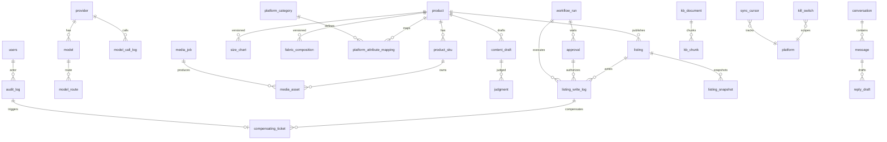

# 12 · 接口契约与数据模型

| 项 | 内容 |
|---|---|
| 编号 | 12 |
| 用途 | 定义 `/api` 全部 REST 端点（方法/路径、角色、请求/响应字段、错误码、幂等）、统一错误码与 HTTP 映射、分页与过滤、SSE 事件格式、`POST /agent/run` 语义、`request_id` 与幂等约定、ERD 与 06 数据字典的字段对齐 |
| 读者 | 前端（唯一消费者）、后端（api/worker/adapters）、测试（契约测试）、运维 |
| 依赖 | `00-方案总纲.md` §13 §14；`06-领域模型与数据字典`；`07-多供应商模型管理规范`；`10-素材与媒体管线规范`；`11-工作流与写入门规范`；`14-安全与权限设计` |
| 状态 | 草案 v1.0（2026-10-20）· 待批准 · 与总纲 v1.0 一致 |

**契约地位**：本文件是唯一人工契约源；机器可读的 `docs/openapi.yaml` 在 M1 由本文件生成，`Contract-Tests` 以 OpenAPI 为准。字段以本文件为准，前端不得自行发明字段。

---

## 1. 通用约定

| 项 | 约定 |
|---|---|
| 前缀 | 全部端点前缀 `/api`（对齐总纲 §14.1） |
| 契约版本 | 响应头 `X-Contract-Version: 1`；破坏性变更升到 `2` 并保留旧版 90 天（`/api` 默认最新，`X-Contract-Version: 1` 显式请求旧版） |
| 传输 | HTTPS only（内网 Compose 也走 caddy TLS）；JSON `application/json; charset=utf-8`；上传 `multipart/form-data` |
| 鉴权 | HttpOnly + Secure + SameSite=Lax 会话 Cookie；CSRF 双提交（`X-CSRF-Token` 头 + `csrf` Cookie 同源比对）；**不使用 Bearer token 给浏览器** |
| 角色 | `viewer < operator < admin` 三级（总纲 §6.1）。表内角色列写**最低要求**：`V`=三种角色都可读，`O`=operator/admin，`A`=仅 admin |
| 命名 | JSON 字段一律 `snake_case`，与数据库列同名（减少映射层，见 §11） |
| 时间 | ISO8601 UTC 到毫秒（`2026-10-20T06:00:00.000Z`）；前端按 `Asia/Shanghai` 渲染；时长字段单位 `_ms` |
| 金额 | 整数分，字段后缀 `_fen`（不使用浮点） |
| ID | UUIDv7 字符串；外部平台单号 `platform_*_id` 为字符串 |
| 布尔 | 真 `true`/`false`，禁止 `0/1`、`"yes"` |
| 空值 | 缺省字段不返回；显式空用 `null`（仅对"有过值后清空"的字段） |
| 请求头通用 | `X-Request-Id`（可选，缺失则服务端生成）、`Idempotency-Key`（写操作必填）、`If-Match`（乐观锁，值为 `version`）、`X-Contract-Version` |
| 响应头通用 | `X-Request-Id`（回显）、`X-Contract-Version`、`Idempotent-Replayed: true`（幂等回放）、`X-Total-Count`（仅列表且 `?with_total=1`）、`Retry-After`（限流/冲突） |

### 1.1 响应包络

成功：

```json
{ "request_id": "req_01J9Z...", "data": { }, "meta": { "next_cursor": "..." } }
```

失败：

```json
{
  "request_id": "req_01J9Z...",
  "error": {
    "code": "approval_stale",
    "message": "审批对象内容已变更，审批失效",
    "retryable": false,
    "next_action": "reopen_approval",
    "detail": { "approval_id": "01J...", "expected_hash": "ab12…", "actual_hash": "cd34…" }
  }
}
```

`next_action` 枚举：`retry_later` / `reopen_approval` / `fix_and_resubmit` / `create_compensation` / `contact_admin` / `login` / `none`。前端必须按 `next_action` 决定按钮，不得凭 `code` 猜。

---

## 2. 端点总览与计数

| 分组（总纲 §14.1） | 总纲原生 | 本规范扩展 | 小计 | 说明 |
|---|---|---|---|---|
| 认证 | 3 | 0 | 3 | — |
| 模型 | 6 | 5 | 11 | 补 provider/route 读取与编辑（模型管理页需要） |
| 商品 | 6 | 4 | 10 | 补创建/编辑、平台属性字典 |
| 内容 | 3 | 2 | 5 | 补草稿列表/详情 |
| 审批 | 2 | 3 | 5 | 补详情、批量、代理 |
| 上架 | 4 | 4 | 8 | 补列表/详情、C 级确认凭证、对账 |
| 素材 | 3 | 6 | 9 | 补 job 列表与取消、asset 列表/详情/复核、成本 |
| 客服 | 5 | 3 | 8 | 补话术模板与 1688 询盘报价 |
| 同步 | 2 | 0 | 2 | — |
| 知识 | 3 | 2 | 5 | 补文档列表/删除 |
| 治理 | 7 | 9 | 16 | `GET /dashboard/*` 实例化为 3 个；补 SSE 事件流、kill switch 管理、账号、补偿工单、死信重放 |
| Agent | 1 | 3 | 4 | 补 run 查询/事件流/取消 |
| **合计** | **45** | **41** | **86** | — |

> 扩展端点全部落在总纲已定义的 12 个分组内，**未新增分组**；扩展理由在每组首行注明。

---

## 3. 分组契约

字段记法：`name*:type` 必填；`name?:type` 可选；`[]` 数组；`a|b` 枚举；`{}` 嵌套对象。错误码见 §4。

### 3.1 认证（3）

| 端点 | 角色 | 请求字段 | 响应字段 | 错误码 | 幂等 |
|---|---|---|---|---|---|
| `POST /auth/login` | 公开 | `username*:string, password*:string, totp_code?:string` | `user{id,name,role}, csrf_token, expires_at, must_change_password:bool` | `validation_failed, unauthorized, locked, rate_limited` | 不需要（靠限流，5 次/分钟/IP） |
| `POST /auth/logout` | V | — | `ok:bool` | `unauthorized` | 不需要（天然幂等） |
| `GET /me` | V | query `include?:permissions,quotas,delegations` | `id, name, role, org_id, permissions[], delegations[{from,to,expires_at}], quotas{}` | `unauthorized` | 不需要 |

### 3.2 模型（11；扩展理由：模型管理页需要读取/编辑，总纲只给了创建与发布）

| 端点 | 角色 | 请求字段 | 响应字段 | 错误码 | 幂等 |
|---|---|---|---|---|---|
| `GET /models` | V | query `purpose?:copy\|judge\|image\|video\|embed\|rerank, capability?, status?, provider_id?, q?, cursor?, limit?` | `items[{id, provider_id, external_model_id, display_name, capability, status, price{input_fen_per_1k,output_fen_per_1k,image_fen_per_image,video_fen_per_sec}, rate_limit{}, published_at, visible:bool, visible_reason?}], next_cursor` | `unauthorized, validation_failed` | 不需要 |
| `GET /providers` | A | query `kind?, status?, cursor?` | `items[{id, kind, name, base_url, auth_ref_masked, region, status, connectivity{ok,latency_ms,checked_at}, balance_fen?}], next_cursor` | `forbidden, unauthorized` | 不需要 |
| `POST /providers` | A | `kind*:text\|image\|video\|embedding, name*:string, base_url*:string, auth_ref*:string, region?, timeout_ms?, rate_limit?{max,duration_ms}` | `id, status:"draft", connectivity:"unknown"` | `forbidden, validation_failed, conflict` | `IK` |
| `PATCH /providers/:id` | A | `name?, base_url?, auth_ref?, rate_limit?, status?:active\|disabled`，需 `If-Match: version` | `id, version, status` | `forbidden, not_found, conflict, validation_failed` | `IK` |
| `POST /providers/:id/test` | A | `model_id?:uuid` | `ok:bool, latency_ms, models_probed:int, error?{code,detail}` | `not_found, upstream_5xx` | 不需要（重复调用安全） |
| `POST /models` | A | `provider_id*, external_model_id*, display_name*, capability*, params_schema*:object, price*:object, rate_limit?:object, published_at?` | `id, status:"draft", version` | `forbidden, validation_failed, conflict` | `IK` |
| `PATCH /models/:id` | A | `display_name?, params_schema?, price?, rate_limit?, status?`，需 `If-Match` | `id, version, status` | `forbidden, not_found, conflict, validation_failed` | `IK` |
| `POST /models/:id/publish` | A | `publish*:bool, note?:string` | `id, status:"published"\|"retired", published_at` | `forbidden, conflict, invalid_fact`（`params_schema` 非法/价格缺失）, `not_found` | `IK` |
| `GET /routes` | A | query `purpose?, scope?, cursor?` | `items[{id, scope, scope_value, purpose, model_id, fallback_ids[], priority, quota{}, effective_at}], next_cursor` | `forbidden` | 不需要 |
| `POST /routes` | A | `scope*:org\|role\|user, scope_value?, purpose*, model_id*, fallback_ids*:uuid[], priority?, quota?{daily,max_per_sku,monthly_seconds}` | `id, effective_at` | `forbidden, validation_failed, conflict` | `IK` |
| `PATCH /routes/:id` | A | `model_id?, fallback_ids?, priority?, quota?, status?`，需 `If-Match` | `id, version, effective_at` | `forbidden, not_found, conflict` | `IK` |

> 生效规则（总纲 §7.2）：前台可见 = provider 已配 + 连通性通过 + `model.status=published` + `params_schema` 合法 + route 命中 + 角色未禁。`GET /models` 对 `V` 只返回 `visible=true` 的项；`A` 可见全部并带 `visible_reason`。

### 3.3 商品（10；扩展理由：手工建档与平台属性字典维护台）

| 端点 | 角色 | 请求字段 | 响应字段 | 错误码 | 幂等 |
|---|---|---|---|---|---|
| `GET /products` | V | query `q?, category_id?, platform?, status?, missing_fields?:bool, cursor?, limit?` | `items[{id, spu_code, name, category_id, fit, color_count, sku_count, platform_states{pdd,1688}, missing_fields[], size_chart_version, updated_at}], next_cursor` | `validation_failed` | 不需要 |
| `GET /products/:id` | V | query `include?:media,listings,qualifications` | `product{id,spu_code,name,category_id,fit,description}, skus[{id,color_id,size_code,fabric_id,sale_price_fen,stock}], size_chart{version,effective_at,rows[]}, fabric[{material,percent,note}], attributes[{platform,attr_path,internal_value,platform_value_id}], media_summary{counts}, listings[]` | `not_found` | 不需要 |
| `POST /products` | O | `spu_code*, name*, category_id*, fit*:slim\|regular\|loose, color_ids*:string[], skus*:[{color_id,size_code,fabric_id,sale_price_fen,stock}]` | `id, skus[{id}]` | `validation_failed, conflict, forbidden` | `IK` |
| `PATCH /products/:id` | O | `name?, category_id?, fit?, description?`，需 `If-Match` | `id, version` | `not_found, conflict, validation_failed` | `IK` |
| `POST /products/import` | O | multipart `file*:csv\|xlsx, dry_run?:bool, platform_scope?:pdd\|1688\|both` | `import_id, rows_total, rows_ok, rows_failed[{row,field,reason}], warnings[], dry_run` | `validation_failed, conflict, quota, payload_too_large` | `IK`（同文件 sha256 24h 内复用结果） |
| `PUT /products/:id/size-chart` | O | `rows*:[{size_code, measurements{衣长?,胸围?,肩宽?,袖长?,腰围?,臀围?,裤长?,大腿围?}, recommend_height_min?, max?, weight_min?, max?}], effective_at*, source*:import\|manual, note?` | `version, affected_skus:int, render_jobs[]` | `invalid_fact, validation_failed, conflict` | `IK` |
| `PUT /products/:id/fabric` | O | `items*:[{material*, percent*:int, note?}]`（合计必须 100） | `version, affected_skus:int` | `invalid_fact, validation_failed` | `IK` |
| `PUT /products/:id/attributes` | O | `platform*, mapping*:[{attr_path, internal_value, platform_value_id?, extra?}]` | `version, unmapped[]` | `invalid_fact, validation_failed` | `IK` |
| `GET /platform-attributes` | V | query `platform*, category_id?, q?` | `items[{platform, category_id, attr_path, name, type, required, enum_values[], mapped_count}], dictionary_version` | `validation_failed` | 不需要 |
| `PUT /platform-attributes` | A | `platform*, category_id*, attrs*:[{attr_path, name, type, required, enum_values[]}]` | `dictionary_version, conflicts[]` | `invalid_fact, conflict, forbidden` | `IK` |

> `PUT` 语义：整体替换该资源的当前有效版本；旧版本保留（`size_chart` 按 `effective_at` 多版本，`fabric` 按 `version`）。`invalid_fact` 用于"成分合计 ≠ 100""尺码缺必填列""价格与 SKU 不一致"等硬事实错误。

### 3.4 内容（5；扩展理由：文案工作台需要列表与详情回看）

| 端点 | 角色 | 请求字段 | 响应字段 | 错误码 | 幂等 |
|---|---|---|---|---|---|
| `GET /content/drafts` | V | query `product_id?, platform?, status?, created_by?, cursor?` | `items[{id, purpose, product_id, platform, status, verdict, updated_at, cost_fen}], next_cursor` | `validation_failed` | 不需要 |
| `GET /content/drafts/:id` | V | — | `draft{id,purpose,content,platform,status}, facts_refs[], judgments[], approvals[], versions[]` | `not_found` | 不需要 |
| `POST /content/drafts` | O | `purpose*:title\|selling_point\|detail\|faq\|short_post, product_id*, platform*, tone?, constraints{length?,keywords?,forbidden[]?}, facts_refs*:string[], model_id?` | `draft_id, content, fact_refs[], status:"drafted", judgment_pending:true` | `invalid_fact`（缺事实引用/引用不存在）, `quota, upstream_5xx, forbidden` | `IK` |
| `POST /judgments` | O | `draft_id*, stage*:L1\|L2\|L1+L2` | `judgment_id, verdict:pass\|revise\|block, severity, findings[{rule_id,message,evidence_refs[]}], repair_hint, cost_fen, latency_ms` | `invalid_fact, quota, upstream_5xx, not_found` | `IK` |
| `GET /judgments/:id` | V | — | `judgment{verdict,severity,reason,evidence_refs[],repair_hint,stage,model_id,cost_fen,created_at}` | `not_found` | 不需要 |

### 3.5 审批（5；扩展理由：审批中心需要详情、批量与代理）

| 端点 | 角色 | 请求字段 | 响应字段 | 错误码 | 幂等 |
|---|---|---|---|---|---|
| `GET /approvals` | V | query `status?, level?, platform?, action?, assignee?:me, overdue?:bool, batch_id?, cursor?, sort?:sla_due_at\|created_at` | `items[{id, object_type, object_id, action, level, platform, status, sla_due_at, overdue:bool, risk_notes[], impact_scope{}, requested_by, requested_at, batch_id}], meta{next_cursor, pending_count, oldest_wait_minutes}` | `validation_failed` | 不需要 |
| `GET /approvals/:id` | V | — | `approval{...全部字段}, object{current_platform_values}, diff[], facts_snapshot{}, history[{at,actor,action,comment}], allowed_decisions[]` | `not_found` | 不需要 |
| `POST /approvals/:id/decide` | O（C 级需 `A` 之一） | `decision*:approve\|approve_modified\|reject\|schedule, comment?, payload_patch?, scheduled_at?, window_start?, window_end?, confirm_token?` | `id, status, decided_at, write_result?{write_id,result,next_action}` | `approval_stale, forbidden`（四眼/越级）, `validation_failed, conflict, irreversible, upstream_5xx, kill_switch_on` | `IK`（键含 `decision`） |
| `POST /approvals/batch-decide` | O/A | `batch_id*, items*:[{approval_id, decision, comment?}], comment?` | `batch_id, results[{approval_id, ok, status?, error?}]` | `validation_failed, conflict, forbidden, quota` | `IK`（键 = `batch_id`） |
| `POST /approvals/:id/delegate` | A | `to_user_id*, reason*, expires_at*` | `id, on_behalf_of, delegations[]` | `forbidden, conflict, validation_failed` | `IK` |

> C 级审批：`approve` 不直接执行写，而是返回 `status=approved` + 待执行凭证；真正执行由 `POST /listings/publish` 携带 `approval_id` + `confirm_token` 完成（11 §6.4 双人）。

### 3.6 上架（8；扩展理由：需要分页列表、快照详情、C 级凭证与 `publish_unknown` 对账）

| 端点 | 角色 | 请求字段 | 响应字段 | 错误码 | 幂等 |
|---|---|---|---|---|---|
| `GET /listings` | V | query `platform?, state?, product_id?, run_id?, cursor?` | `items[{id, platform, product_id, sku_ids[], state, phase, level, last_write_at, price_fen, main_image_id, pending_run_id?}], next_cursor` | `validation_failed` | 不需要 |
| `GET /listings/:id` | V | query `include?:snapshot,writes,approvals` | `listing{...}, published_snapshot{snapshot_hash,captured_at,source,fields{}}, write_log[], approvals[], reconciliation{state,checked_at}` | `not_found` | 不需要 |
| `POST /listings/publish` | O | `product_id*, platform*, sku_ids*:uuid[], approval_id*, mode*:dry_run\|canary\|full, media_plan{main_image_id, gallery_ids[], size_chart_asset_id?, video_asset_id?}, scheduled_at?` | `run_id, write_id, level:A\|B\|C, result:success\|failed\|uncertain, platform_listing_id?, snapshot_ref, next_action?` | `approval_required, approval_stale, forbidden, invalid_fact, irreversible, platform_reject, quota, rate_limited, kill_switch_on, upstream_5xx, conflict` | `IK`（含 `platform+action+payload` 哈希） |
| `POST /listings/rollback` | O | `platform*, listing_id*, write_id*, expected_current_hash*, reason*` | `write_id, restored_fields[], changes[]` | `irreversible`（B/C）, `conflict`（现值已漂移/有后续写）, `approval_required, not_found` | `IK` |
| `POST /listings/stop-loss` | O | `platform*, listing_id*, action*:offline\|exit_activity\|update_stock\|compensate_message\|create_ticket, reason*, approval_id?, confirm_token?, payload?{stock?, message_template_id?}` | `ticket_id?, run_id?, platform_confirmed:bool, next_action` | `approval_required, irreversible, kill_switch_on, upstream_5xx, conflict` | `IK` |
| `POST /listings/batch` | O | `platform*, action*:offline\|price\|stock\|publish, items*:[{listing_id, fields?{price_fen?,stock?,main_image_id?}}], approval_id*, mode*:dry_run\|full` | `batch_id, accepted[], rejected[{listing_id,code,message}], run_ids[]` | `validation_failed, quota, conflict, forbidden, kill_switch_on, irreversible` | `IK`（键 = `batch_id`） |
| `POST /listings/:id/confirm-token` | O | `action*, payload_hash*, write_id?` | `confirm_token, expires_at, level` | `forbidden, conflict, not_found` | `IK`（同 payload 复用未过期 token） |
| `POST /listings/:id/reconcile` | O | — | `state:published\|not_published\|unknown, matches_local:bool, diffs[], checked_at` | `upstream_5xx, not_found, kill_switch_on` | 不需要（只读，可重复） |

> `mode=dry_run`：走完 S1–S5 与 payload 构造，不调用平台；返回将要发送的规范化 payload 校验结果。`mode=canary`：仅写 1 个 SKU 并等待回执，成功后再由调用方发起 `full`。

### 3.7 素材（9；扩展理由：素材库需要 job 列表/取消、asset 列表/详情/复核与成本看板）

| 端点 | 角色 | 请求字段 | 响应字段 | 错误码 | 幂等 |
|---|---|---|---|---|---|
| `POST /media/generate` | O | `kind*:ai_scene\|model_replace\|ai_short_video\|concept, purpose*:image\|video, sku_id*, reference_asset_id?（kind≠concept 时必填）, provider_id?, model_id?, params*{prompt, negative_prompt?, size, seed?, count?}, variant_policy?{keys[]}` | `job_id, status, deduped:bool, poll_after, cost_reserved_fen` | `invalid_fact`（`kind=main_shot` 或参考图非实拍）, `quota, kill_switch_on, validation_failed, forbidden` | `IK` + 10 分钟 `dedupe_key` |
| `GET /media/jobs` | V | query `status?, kind?, sku_id?, created_by?, cursor?` | `items[{id,kind,status,attempt,poll_count,poll_after,cost_reserved_fen,cost_actual_fen,last_error{code,detail},result_asset_id}], next_cursor` | `validation_failed` | 不需要 |
| `GET /media/jobs/:id` | V | — | `id, kind, status, attempt, poll_count, poll_after, deadline_at, cost_reserved_fen, cost_actual_fen, last_error{}, provider_job_id, result_asset_id, provider_cancel_supported` | `not_found` | 不需要 |
| `POST /media/jobs/:id/cancel` | O | `reason?` | `id, status, cancel_noop:bool, cost_actual_fen` | `not_found, conflict`（已 `succeeded` 返回 409） | `IK`（对终态重复取消返回 200） |
| `POST /media/upload` | O | multipart `file*, kind*:main_shot\|white_bg\|fabric_detail\|product_video, sku_id?, license_ref?, watermark?:bool` | `asset_id, variant_keys[], sha256, bytes, width, height` | `validation_failed, quota, payload_too_large, unsupported_media_type` | `IK`（同 sha256 复用） |
| `GET /media/assets` | V | query `kind?, sku_id?, review_status?, status?, aigc?:bool, cursor?` | `items[{id,kind,source,is_aigc,width,height,review_status,status,thumb_url,cost_fen,created_at}], next_cursor` | `validation_failed` | 不需要 |
| `GET /media/assets/:id` | V | query `sign?:bool` | `asset{...全部字段}, variants[{key,url,width,height,bytes}], relations{listings[],drafts[]}, signed_url?` | `not_found` | 不需要 |
| `POST /media/assets/:id/review` | O | `result*:passed\|failed, reason_code?（10 §10.2 枚举）, note?` | `review_status, updated_drafts[], quarantined:bool` | `forbidden, conflict, validation_failed, not_found` | `IK` |
| `GET /media/cost` | V | query `group_by*:sku\|kind\|provider\|day, from*, to*` | `items[{key, images:int, video_seconds:int, provider_fen, labor_fen, storage_fen, total_fen}], total_fen, currency:"CNY"` | `validation_failed` | 不需要 |

### 3.8 客服（8；扩展理由：话术模板维护 + 1688 询盘报价）

| 端点 | 角色 | 请求字段 | 响应字段 | 错误码 | 幂等 |
|---|---|---|---|---|---|
| `GET /conversations` | V | query `platform?, status?:open\|pending\|closed, assignee?:me, unread?:bool, cursor?` | `items[{id, platform, buyer_nick, last_message_at, unread_count, sla_due_at, status, draft_state:none\|generating\|ready\|degraded, assignee}], next_cursor` | `validation_failed` | 不需要 |
| `GET /conversations/:id` | V | query `messages_after?, limit?:100` | `conversation{...}, buyer{tags[], order_refs[]}, messages[{id,direction,text,status,created_at,platform_msg_id}], drafts[], suggested_templates[]` | `not_found` | 不需要 |
| `POST /replies/draft` | O | `conversation_id*, intent?, tone?, fact_refs*:string[], deadline_ms?:5000` | `draft_id, text, degraded:bool, degraded_reason?:timeout\|model_error\|quota, latency_ms, expires_at` | `quota, upstream_5xx, conflict, not_found` | `IK`（同会话 10s 内复用） |
| `POST /replies/send` | O | `conversation_id*, platform*, text*, draft_id?, approval_id*, msg_key*` | `message_id, status:sent\|sending, platform_msg_id?, deduped:bool` | `approval_required, approval_stale, conflict`（重复发送）, `platform_reject, kill_switch_on, upstream_5xx` | `IK`（= `msg_key`，11 §5.5） |
| `POST /clipboard/push` | O | `text*, conversation_id?` | `pushed:true, chars:int` | `validation_failed, forbidden`（内容超长/含敏感指令） | 不需要 |
| `GET /reply-templates` | V | query `intent?, platform?, q?` | `items[{id,name,intent,text,platform,status,version,approved_at}]` | `validation_failed` | 不需要 |
| `POST /reply-templates` | O | `name*, intent*, text*, platform?` | `id, version, status:"draft"` | `validation_failed, forbidden, conflict` | `IK` |
| `POST /inquiries/:id/quote` | O | `platform*:"1688", sku_ids*:uuid[], price_tiers*:[{min_qty*, price_fen*}], min_order_qty*, lead_time_days?, approval_id*, msg_key*` | `quote_id, status:"sent"\|"sending", platform_quote_id?, deduped:bool` | `approval_required, approval_stale, irreversible, platform_reject, conflict, kill_switch_on, upstream_5xx` | `IK`（= `msg_key`，C 级不可逆） |

> 剪贴板助手边界（总纲 §1.3 / §17）：`POST /clipboard/push` 只返回文本，**不做 DOM 注入、不做按键模拟**；前端仅写系统剪贴板。

### 3.9 同步（2）

| 端点 | 角色 | 请求字段 | 响应字段 | 错误码 | 幂等 |
|---|---|---|---|---|---|
| `POST /sync/:platform` | O | `scope*:products\|orders\|messages\|categories, since?, cursor?` | `sync_id, started_at, accepted:bool` | `forbidden, conflict`（同平台同 scope 已在跑）, `upstream_5xx, kill_switch_on` | `IK`（键含 platform+scope+since） |
| `GET /sync/status` | V | query `platform?` | `items[{platform, scope, status:idle\|running\|failed, last_success_at, cursor, lag_seconds, errors[]}], stale:bool` | `validation_failed` | 不需要 |

### 3.10 知识（5；扩展理由：文档列表与归档需要）

| 端点 | 角色 | 请求字段 | 响应字段 | 错误码 | 幂等 |
|---|---|---|---|---|---|
| `GET /kb/search` | V | query `q*, k?:10, domain?, as_of?` | `hits[{chunk_id, document_id, title, snippet, score, version, effective_at, source_ref}], degraded:bool, took_ms` | `validation_failed` | 不需要 |
| `GET /kb/documents` | V | query `domain?, status?, q?, cursor?` | `items[{id,title,domain,version,chunks,effective_at,status,updated_at}], next_cursor` | `validation_failed` | 不需要 |
| `POST /kb/documents` | O | multipart `file*, title*, domain*, effective_at?, source_ref?` | `document_id, chunks:int, version` | `validation_failed, quota, payload_too_large` | `IK`（同 sha256 复用） |
| `POST /kb/reindex` | A | `scope*:all\|document, document_id?` | `job_id, queued_chunks` | `forbidden, conflict, not_found` | `IK` |
| `DELETE /kb/documents/:id` | A | `reason*` | `archived_at` | `forbidden, conflict`（被审批/草稿引用中）, `not_found` | `IK` |

### 3.11 治理（16；扩展理由：`GET /dashboard/*` 实例化为 3 个端点；异常处置与账号管理需要可操作端点）

| 端点 | 角色 | 请求字段 | 响应字段 | 错误码 | 幂等 |
|---|---|---|---|---|---|
| `GET /dashboard/overview` | V | query `date?` | `todos{approvals,rejected_listings,failed_runs}, alerts[{level,code,message,at}], today{listed,replied,media_jobs,cost_fen}, backlog{approvals,oldest_wait_minutes}` | `validation_failed` | 不需要 |
| `GET /dashboard/ops` | V | query `from*, to*, platform?` | `series[{metric,points[{ts,value}]}], tables{platform_success_rate, dead_letters, kill_switch_events, sla_breaches}` | `validation_failed` | 不需要 |
| `GET /dashboard/cost` | V | query `from*, to*, group_by?:sku\|model\|provider\|day` | `items[{key,cost_fen,provider_fen,labor_fen,storage_fen}], total_fen, budget{used_pct,remaining_fen}` | `validation_failed` | 不需要 |
| `GET /audit` | A | query `actor?, action?, resource_type?, resource_id?, irreversible?:bool, from?, to?, cursor?` | `items[{id,at,actor,actor_role,action,resource_type,resource_id,level,irreversible,approval_id,request_id,before_hash,after_hash,ticket_id}], next_cursor` | `forbidden, validation_failed` | 不需要 |
| `GET /kill-switches` | V | query `status?:on\|off, scope_type?` | `items[{id,scope_type,scope_value,mode,task_types[],status,reason,created_by,effective_at,expires_at}], active_blocks[]` | `validation_failed` | 不需要 |
| `POST /kill-switch` | O（C 级影响面需 A 确认） | `scope_type*:global\|platform\|platform_task\|category\|provider\|listing, scope_value*, mode*:block\|drain, task_types*:publish\|price\|stock\|message\|media\|sync\|batch[], reason*, expires_at?` | `id, status:"on", effective_at` | `forbidden, validation_failed, conflict` | `IK` |
| `PATCH /kill-switches/:id` | A | `status*:"off", reason*`，需 `If-Match` | `id, status, released_at` | `forbidden, conflict, not_found` | `IK` |
| `GET /events/stream` | V | query `topics?:message,approval,media,kill_switch,sla`；SSE | `text/event-stream`（§7） | `unauthorized, forbidden` | 不需要（可重连） |
| `GET /users` | A | query `role?, status?, cursor?` | `items[{id,username,name,role,status,totp_enabled,last_login_at,delegations[]}], next_cursor` | `forbidden` | 不需要 |
| `POST /users` | A | `username*, name*, role*:viewer\|operator\|admin, totp_required*:bool` | `id, initial_password_once:string, must_change_password:true` | `forbidden, conflict, validation_failed` | `IK` |
| `PATCH /users/:id` | A | `name?, role?, status?:active\|disabled, reset_totp?:bool`，需 `If-Match` | `id, version, role, status` | `forbidden`（不能降级最后一个 admin/不能自降）, `conflict, validation_failed` | `IK` |
| `GET /compensating-tickets` | V | query `status?, level?, owner?, overdue?:bool, cursor?` | `items[{id,level,action,platform,resource_id,status,owner,sla_due_at,impact_scope{},created_at}], next_cursor` | `forbidden?（V 可读）` | 不需要 |
| `POST /compensating-tickets/:id/actions` | O/A（`waive` 仅 A） | `action*:assign\|mitigate\|verify\|close\|waive\|escalate, payload{owner?, action_taken?, evidence_refs[]?, note?, waive_reason?}` | `id, status, next_due_at, history[]` | `forbidden, conflict, validation_failed, not_found` | `IK` |
| `POST /workflow-runs/:id/replay` | A | `reason*, confirm*:true` | `run_id, attempt_seq, status` | `forbidden, conflict`（不满足 11 §4.5 六条）, `kill_switch_on, not_found` | `IK` |
| `GET /health` | 公开（内网） | — | `status:ok\|degraded\|down, checks{db,redis,minio,dsh_host,platforms[]}, version, build, uptime_s` | — | 不需要 |
| `GET /metrics` | A | query `format?:prometheus` | `text/plain`（Prometheus 指标） | `forbidden` | 不需要 |

### 3.12 Agent（4；扩展理由：流式需要事件流端点，取消与查询是长任务的必要能力）

| 端点 | 角色 | 请求字段 | 响应字段 | 错误码 | 幂等 |
|---|---|---|---|---|---|
| `POST /agent/run` | O | `intent*, context{page,object_type?,object_id?}, input{text?,params{}}, stream*:bool, timeout_ms?, tools_allow?:string[], confirm_irreversible?:false` | `202`：`run_id, status:"queued", sse_url, expires_at, concurrency_remaining` | `forbidden, quota, conflict`（并发超限）, `upstream_5xx, dsh_unavailable, kill_switch_on` | `IK`（双击不产生两个 run） |
| `GET /agent/runs/:id` | V | — | `run_id, status:queued\|running\|succeeded\|failed\|cancelled\|timeout, intent, steps[{seq,name,status,started_at,ended_at,summary}], output{text?,artifacts[]}, error{}, tokens{in,out}, cost_fen, started_at, ended_at` | `not_found` | 不需要 |
| `GET /agent/runs/:id/events` | V | query `last_event_id?`；SSE | `text/event-stream`（§7） | `not_found, forbidden` | 不需要（可重连） |
| `POST /agent/runs/:id/cancel` | O | `reason?` | `run_id, status:"cancelled", partial_output_ref?` | `conflict`（终态返回 200 + 当前状态，不报错）, `not_found` | `IK`（重复取消幂等） |

---

## 4. 统一错误码与 HTTP 映射

| code | HTTP | retryable | 触发条件 | 前端必须做的事 | 落补偿 |
|---|---|---|---|---|---|
| `unauthorized` | 401 | 否 | 未登录/会话过期 | 跳登录，保留 `return_url` | 否 |
| `forbidden` | 403 | 否 | 角色不足、四眼不满足、越权资源 | 显示"无权限 + 申请路径"，隐藏按钮 | 否 |
| `not_found` | 404 | 否 | 资源不存在或已归档 | 显示空态 | 否 |
| `validation_failed` | 422 | 否 | 字段缺失/格式错/枚举非法 | 字段级报错，聚焦第一个错误 | 否 |
| `invalid_fact` | 422 | 否 | 价格/成分/尺码/政策/资质与主数据不一致；AI 替代主图；尺码表版本不一致 | 跳转到主数据修复区，列出缺失/冲突字段 | 否 |
| `approval_required` | 428 | 否 | 缺少 `approval_id` 或审批未建 | 打开"提交审批"流程 | 否 |
| `approval_stale` | 409 | 否 | 审批过期 / `payload_hash` 与当前内容不符 / 已被他人决策 | 提示"内容已变更，重新审批"，一键重开 | 否 |
| `irreversible` | 409 | 否 | 对 B/C 动作请求回滚；缺 `confirm_token`；C 级批量越限 | 显示红色不可逆提示 + "去止损/建工单" | 是（若已发生写） |
| `conflict` | 409 | 视 `detail.sub` | 乐观锁版本冲突、并发锁、重复请求、状态不允许、`publish_unknown` 未对账 | 刷新数据后重试；`sub=unknown` 时先"一键对账" | 视情况 |
| `idempotency_conflict` | 409 | 否 | 同 `Idempotency-Key` 不同 payload | 提示"内容已变化"，生成新键重试 | 否 |
| `rate_limited` | 429 | 是 | 平台或本地令牌桶限流 | 倒计时 + 自动重试（尊重 `Retry-After`） | 否 |
| `quota` | 429 | 否（当日） | 模型/媒体/批量/并发配额耗尽 | 显示配额用量与"申请提额" | 否 |
| `locked` | 423 | 否 | 账号锁定（连续登录失败） | 提示解锁方式 | 否 |
| `platform_reject` | 422 | 否（`detail.repairable=true` 可修） | 平台业务驳回 | 展示 `repair_hints[]`，跳"修复后重提" | 否（B/C 已发生写则建工单） |
| `upstream_5xx` | 502 | 是 | 平台/供应商 5xx、超时、连接失败 | 自动重试 + 顶部"平台不稳定"横幅 | 否 |
| `dsh_unavailable` | 503 | 是 | 中心 DSH Host 不可达 | 降级为"模板/人工"，提示稍后重试 | 否 |
| `kill_switch_on` | 503 | 否 | kill switch 命中（含 fail-closed `guard=unavailable`） | 顶部常驻横幅 + 禁用写按钮 | 否 |
| `audit_failed` | 503 | 是 | 审计写失败（outbox 未 flush） | 提示"操作未确认，请稍后核对"，禁止重复提交 | 是 |
| `timeout` | 504 | 是 | 网关/上游超时 | 显示"结果未知"，触发对账 | 视情况 |
| `method_not_allowed` | 405 | 否 | 方法错 | 开发期错误 | 否 |
| `payload_too_large` | 413 | 否 | 上传超限（图 20MB/视频 500MB/导入 50MB） | 提示压缩或分批 | 否 |
| `unsupported_media_type` | 415 | 否 | MIME 不符 | 提示允许格式 | 否 |

**总纲 7 个错误码的落位**：`platform_reject`、`quota`、`invalid_fact`、`approval_required`、`irreversible`、`upstream_5xx`、`conflict` 全部保留且语义一致；其余为工程必需补充。

---

## 5. 分页与过滤

| 项 | 约定 |
|---|---|
| 分页 | **游标分页**，不使用 offset。请求 `?cursor=<opaque>&limit=20`；响应 `meta.next_cursor`（`null` 表示结束） |
| 游标 | 不透明 base64，内含 `(created_at, id)`；不得由前端构造；跨排序字段时游标失效返回 `validation_failed` |
| `limit` | 默认 20，最大 100；超限返回 422 |
| 总数 | 默认不算；`?with_total=1` 时返回 `X-Total-Count`（大表限用于 ≤ 10 万行） |
| 排序 | `?sort=field` 或 `-field`（降序）；白名单字段，非白名单返回 422 |
| 过滤 | 简单字段用查询参数；复杂条件（多状态、区间）用逗号表示 OR：`?status=pending,escalated`；区间用 `field_from`/`field_to` |
| 搜索 | `?q=` 走服务端全文（商品名/昵称/标题），不做前端过滤大列表 |
| 时间过滤 | `from`/`to` 为 ISO8601；服务端按 UTC 比较 |
| 空结果 | `200` + `items: []` + `next_cursor: null`（不返回 404） |

---

## 6. 幂等键与 `request_id`

| 项 | 约定 |
|---|---|
| `Idempotency-Key` | 写操作必填（表内 `IK`）；长度 16–128，字符 `[A-Za-z0-9._:-]`；缺失返回 `validation_failed`（`detail.field=Idempotency-Key`） |
| 服务端键 | 服务端在客户端键外再套一层 `write_key = sha256(platform+action+canonical(payload))`（11 §5.1），两层都查重 |
| 作用域 | `(org_id, key)` 唯一；窗口 24 小时（消息/步骤类 7 天） |
| 回放 | 同键同 payload → 返回缓存响应 + `Idempotent-Replayed: true`（状态码与原响应一致） |
| 冲突 | 同键不同 payload → `409 idempotency_conflict`；同键 `in_flight` → `409 conflict` + `Retry-After: 2` |
| `X-Request-Id` | 客户端可传（建议 UUIDv7）；缺失服务端生成 `req_` + ulid；全链路写入 `audit_log.request_id`、`model_call_log.request_id`、平台调用日志 |
| 贯穿范围 | HTTP → api → BullMQ job payload → worker → adapter → edge-proxy → 平台请求头/日志；日志检索以 `request_id` 为一等键 |
| 响应 | 所有响应回显 `X-Request-Id`；`error.detail` 中若含平台原始单号，字段名 `platform_request_id` |
| 追踪关联 | `run_id`、`write_id`、`approval_id`、`job_id`、`ticket_id` 都进审计，任一可反查 `request_id` |

---

## 7. SSE 事件格式

### 7.1 传输约定

| 项 | 约定 |
|---|---|
| 端点 | `GET /events/stream`（系统事件：消息/审批/媒体/kill switch/SLA）；`GET /agent/runs/:id/events`（单次 agent 运行） |
| 头 | `Content-Type: text/event-stream; charset=utf-8`、`Cache-Control: no-cache, no-transform`、`Connection: keep-alive`、`X-Accel-Buffering: no` |
| 帧格式 | `event: <type>` / `id: <event_id>` / `data: <json>`，空行分隔；首帧 `retry: 3000` |
| 心跳 | 每 15 秒一行注释 `: hb 2026-10-20T06:00:15Z`（不计入事件） |
| 事件 id | `{stream_id}-{seq}`（如 `01J9Z...-000042`），单调递增 |
| 断线续传 | 重连带 `Last-Event-ID` 头或 `?last_event_id=`；服务端从 Redis Stream 回放（保留 ≥ 5 分钟 / 500 条）；缺口过大 → 发 `event: resync` + 全量快照，前端整体刷新 |
| 背压 | 单连接缓冲 > 1000 条或客户端 30s 未消费 → 断开并由前端重连；不丢事件（Redis Stream 保留） |
| 鉴权 | 同会话 Cookie；SSE 不能带自定义头时用 Cookie + CSRF 不适用（只读 GET） |
| 降级 | 连续 3 次重连失败 → 前端切轮询（列表 5s，详情 3s）+ 顶部"实时连接中断"横幅；恢复后自动切回 |

### 7.2 事件信封（data 内固定字段）

```json
{
  "event_id": "01J9Z...-000042",
  "type": "message.new",
  "seq": 42,
  "ts": "2026-10-20T06:00:15.120Z",
  "org_id": 1,
  "request_id": "req_01J9Z...",
  "payload": { }
}
```

### 7.3 事件类型

| type | 通道 | payload 关键字段 | 前端动作 |
|---|---|---|---|
| `hello` | both | `stream_id, server_time, heartbeat_s` | 建连确认，显示"实时已连接" |
| `run.queued` | agent | `run_id, position` | 进度条初始化 |
| `run.started` | agent | `run_id, model_id, started_at` | 显示"生成中" |
| `run.step` | agent | `run_id, seq, name, status:running\|done\|failed, summary` | 步骤条更新 |
| `run.delta` | agent | `run_id, seq, text` | 流式追加（打字机） |
| `run.tool_call` | agent | `run_id, tool, args_summary` | 显示"正在检索/生成" |
| `run.tool_result` | agent | `run_id, tool, ok, summary` | 折叠展示工具结果 |
| `run.need_input` | agent | `run_id, question, options[]` | 内嵌追问输入 |
| `run.finished` | agent | `run_id, output{text,artifacts[]}, tokens{}, cost_fen, duration_ms` | 替换为最终结果 |
| `run.error` | agent | `run_id, code, message, retryable, next_action` | 错误态 + 重试按钮 |
| `message.new` | system | `conversation_id, platform, buyer_nick, preview, sla_due_at` | **秒级提醒**：列表置顶、声音、角标 +1 |
| `message.updated` | system | `conversation_id, message_id, status:sent\|failed\|read` | 更新气泡状态 |
| `approval.created` | system | `approval_id, level, action, object_id, sla_due_at` | 审批中心角标 + 若 C 级则红色 toast |
| `approval.decided` | system | `approval_id, decision, by, at` | 列表移除/更新 |
| `sla.warning` | system | `kind:approval\|message, id, due_at, level` | 黄色/红色高亮 + 提醒 |
| `media.job` | system | `job_id, kind, status, poll_after, result_asset_id?` | 素材库卡片状态更新（替代轮询） |
| `kill_switch.changed` | system | `id, scope_type, scope_value, mode, status, by` | 全局横幅显示/隐藏；禁用写按钮 |
| `sync.stale` | system | `platform, scope, lag_seconds` | 平台连接页黄条 |
| `resync` | both | `reason, snapshot_url?` | 丢弃本地增量，整体刷新 |
| `heartbeat` | — | 不发送独立事件（用注释行） | — |

### 7.4 agent 流示例

```
retry: 3000

event: hello
id: run01J9Z-000000
data: {"event_id":"run01J9Z-000000","type":"hello","seq":0,"ts":"2026-10-20T06:00:00.000Z","org_id":1,"request_id":"req_01J9Z","payload":{"stream_id":"run01J9Z","heartbeat_s":15}}

event: run.step
id: run01J9Z-000001
data: {"event_id":"run01J9Z-000001","type":"run.step","seq":1,"ts":"2026-10-20T06:00:00.400Z","org_id":1,"request_id":"req_01J9Z","payload":{"run_id":"01J9Z","seq":1,"name":"kb.search","status":"running"}}

event: run.delta
id: run01J9Z-000002
data: {"event_id":"run01J9Z-000002","type":"run.delta","seq":2,"ts":"2026-10-20T06:00:01.100Z","org_id":1,"request_id":"req_01J9Z","payload":{"run_id":"01J9Z","seq":2,"text":"这款是纯棉"}}

: hb 2026-10-20T06:00:15Z
```

---

## 8. `POST /agent/run` 语义

### 8.1 请求

```json
{
  "intent": "content.draft",
  "context": { "page": "copy_workbench", "object_type": "product", "object_id": "01J9Z..." },
  "input": { "text": "给这款风衣写拼多多标题，突出防风", "params": { "platform": "pdd", "length_max": 60 } },
  "stream": true,
  "timeout_ms": 120000,
  "tools_allow": ["kb.search", "product.read", "content.draft"],
  "confirm_irreversible": false
}
```

| 字段 | 约束 |
|---|---|
| `intent` | 白名单枚举（`content.draft`、`content.rewrite`、`product.qa`、`support.suggest`、`inquiry.quote_draft`、`listing.diagnose`）；非白名单 422 |
| `context` | 只允许业务上下文键（`page/object_type/object_id`），不得传文件路径、URL、SQL |
| `input.params` | 按 intent 的 JSON Schema 校验；不接受"直接改价/直接发送"等越权参数 |
| `stream` | `true` 走 SSE；`false` 走轮询 `GET /agent/runs/:id`（≤ 30s 的小任务） |
| `timeout_ms` | 默认 120000，最大 600000；超时按 `timeout` 终态 |
| `tools_allow` | 只能收窄 preset 的工具集，不能扩权；越权项直接忽略并记审计 |
| `confirm_irreversible` | 必须为 `false`；agent **永不直接写平台**（总纲 §3.2），只能产出待审批产物 |

### 8.2 响应（202）

```json
{
  "request_id": "req_01J9Z...",
  "data": {
    "run_id": "01J9Z...",
    "status": "queued",
    "sse_url": "/api/agent/runs/01J9Z.../events",
    "expires_at": "2026-10-20T06:10:00.000Z",
    "concurrency_remaining": 1
  }
}
```

### 8.3 并发、超时与取消

| 项 | 规则 |
|---|---|
| 并发 | 单用户 2、全局 8；超出 `409 conflict` + `Retry-After: 5`；`concurrency_remaining` 回显 |
| 排队 | 全局满则 `queued`（最多 30 个），超过直接 429 `quota` |
| 取消 | `POST /agent/runs/:id/cancel` → 向 DSH Remote 发 `AbortSignal`；**在下一步边界停止**（≤ 2s）；已产生 token 的成本照记 |
| 取消后产物 | `output.partial=true`，`partial_output_ref` 指向可读的中间结果；**不写业务表**（除非调用方显式再提交审批） |
| 取消幂等 | 终态（`succeeded/failed/cancelled/timeout`）重复取消 → `200` + 当前状态，不报错 |
| 超时 | 到 `timeout_ms` 强制 abort，`status=timeout`，SSE 发 `run.error{code:"timeout"}` |
| 断连 | SSE 断开不取消 run；客户端重连带 `Last-Event-ID` 续传；run 结果保留 30 分钟 |
| 失败 | `status=failed` + `error{code,retryable,next_action}`；`dsh_unavailable` 时前端降级为模板/手工 |
| 审计 | 每次 run 落 `model_call_log`（模型、tokens、成本）与 `audit_log`（`action=agent.run`，`irreversible=false`） |

---

## 9. 数据模型

### 9.1 ERD（核心 22 张表）



### 9.2 表清单与契约归属（对齐总纲 §13.1 的 30 张表；本规范补 8 张：`listing_snapshot`、`listing_write_log`、`reply_draft`、`reply_template` 四张业务中间表 + `idempotency_key`、`cost_ledger`、`events_outbox`、`workflow_dead_letter` 四张支撑表）

> 下表部分行合写多张表（如 `users/roles/memberships`），合计覆盖总纲 30 张 + 本规范 8 张 = 38 张。

| 分组 | 表 | 主键 | 关键状态/枚举 | 主要端点 |
|---|---|---|---|---|
| 供应商与模型 | `provider` | id | `status: draft\|active\|disabled` | 3.2 |
| | `model` | id | `status: draft\|published\|retired`；`capability` | 3.2 |
| | `model_route` | id | `scope/purpose/priority` | 3.2 |
| | `credential_ref` | id | 只存引用，不存密钥 | 3.2（`auth_ref`） |
| | `model_call_log` | id | `purpose/outcome` | 内部（`GET /dashboard/cost`） |
| 商品 | `product` | id | `status: draft\|active\|archived` | 3.3 |
| | `product_sku` | id | `(color_id,size_code,fabric_id)` 唯一 | 3.3 |
| | `size_chart` | id | 多版本 `(product_id, version)` | 3.3 |
| | `fabric_composition` | id | 百分比合计 100 | 3.3 |
| | `platform_category` | id | `platform+category_id` | 3.3 |
| | `platform_attribute_mapping` | id | `mapping_version` | 3.3 |
| 内容 | `content_draft` | id | `status: drafted\|judged\|revise\|approved\|published` | 3.4 |
| | `judgment` | id | `stage: L1\|L2`；`verdict` | 3.4 |
| 素材 | `media_asset` | id | 10 §3.1（`review_status/status`） | 3.7 |
| | `media_job` | id | 10 §5.1（11 态） | 3.7 |
| 平台 | `listing` | id | `state/phase`（11 §3.3） | 3.6 |
| | `listing_snapshot` | id | `snapshot_hash` 唯一 | 3.6 |
| | `listing_write_log` | id | `level:A\|B\|C`；`restored_from_snapshot` | 3.6 |
| | `sync_cursor` | id | `(platform,scope)` 唯一 | 3.9 |
| 客服 | `conversation` | id | `status: open\|pending\|closed` | 3.8 |
| | `message` | id | `status: sending\|sent\|failed` | 3.8 |
| | `reply_draft` | id | `degraded:bool` | 3.8 |
| | `reply_template` | id | `status: draft\|approved\|retired` | 3.8 |
| 流程 | `workflow_run` | id | 14 态 + `phase` | 3.6 / 3.11（重放） |
| | `approval` | id | 8 态（11 §6.4） | 3.5 |
| | `compensating_ticket` | id | 8 态（11 §8.1） | 3.11 |
| | `kill_switch` | id | `status: on\|off`；`mode` | 3.11 |
| 治理 | `users` / `roles` / `memberships` | id | 角色三档 | 3.1 / 3.11 |
| | `audit_log` | id | `irreversible:bool` | 3.11 |
| 知识 | `kb_document` / `kb_chunk` / `kb_query_log` | id | `status/version` | 3.10 |
| 支撑（本规范新增） | `idempotency_key` | key | 11 §5.3 | 全局 |
| | `cost_ledger` | id | 10 §9.2 | 3.7 |
| | `events_outbox` | id | SSE 事件源（事务外投） | 3.11（`/events/stream`） |
| | `workflow_dead_letter` | id | 11 §4.4 | 3.11（重放） |

### 9.3 公共字段（所有业务表强制）

| 字段 | 类型 | 约束 |
|---|---|---|
| `id` | uuid | PK，UUIDv7（时间有序，减少索引碎片） |
| `org_id` | int | `NOT NULL DEFAULT 1` |
| `created_at` / `updated_at` | timestamptz | `NOT NULL DEFAULT now()`；`updated_at` 由触发器维护 |
| `created_by` | uuid | 可空（系统动作填 `system` 哨兵 uuid） |
| `version` | int | `NOT NULL DEFAULT 1`，乐观锁；接口 `If-Match` 对应 |
| `archived_at` | timestamptz | 软删；列表默认过滤 |

### 9.4 索引（与总纲 §13.1 对齐 + 本规范补充）

| 表 | 索引 | 用途 |
|---|---|---|
| `listing` | `(platform, state)` | 列表与批量 |
| `workflow_run` | `(state)`、`(phase, updated_at)` | 调度与看板 |
| `approval` | `(status, sla_due_at)`、`(object_type, object_id, action, payload_hash) WHERE status='pending'` | SLA 与去重 |
| `media_job` | `(status, poll_after)`、`(provider_id, provider_job_id) UNIQUE` | 轮询与防重复提交 |
| `media_asset` | `(org_id, sha256, variant_key) UNIQUE`、`(sku_id, kind)` | 去重与关联 |
| `conversation` | `(platform, last_message_at DESC)` | 客服列表 |
| `message` | `(conversation_id, created_at DESC)`、`(platform_msg_id) UNIQUE` | 会话与去重 |
| `audit_log` | `(created_at DESC)`、`(resource_type, resource_id)`、`(irreversible) WHERE irreversible` | 检索与合规 |
| `idempotency_key` | `(key) UNIQUE`、`(expires_at)` | 幂等与清理 |
| `kb_chunk` | HNSW `(embedding vector_cosine_ops)` | 向量检索 |

---

## 10. 与 06 数据字典的字段对齐

> 现状：`06-领域模型与数据字典` 尚未产出（总纲 §21.1 列为待产出）。本规范以总纲 §13.1/§13.2 为基线定义字段，06 产出后按本节规则机械对齐，差异记入 §10.3。

### 10.1 对齐规则（06 必须遵守）

| # | 规则 |
|---|---|
| A1 | 表名、列名与本文件 §9.2 完全一致；06 只允许**增加**列（并在 06 标注"12 未列"），不允许改名 |
| A2 | JSON 字段名 = 数据库列名（`snake_case`），前端不做 camelCase 转换；类型映射见 §10.2 |
| A3 | 枚举值以本文件与 10/11 为准；06 新增枚举值必须同步本文件与 `packages/core/src/enums.ts` |
| A4 | 金额一律 `_fen: int`；比率用 `_ratio: numeric(6,4)`；时间 `timestamptz` |
| A5 | 公共字段（§9.3）不可缺省；新增表必须带 `version` 与 `archived_at` |
| A6 | 外键命名 `{table}_id`；引用 `users` 的字段统一 `created_by`/`decided_by`/`owner` |
| A7 | 06 的字段说明必须写出"是否可写接口返回"（可写/只读/内部） |

### 10.2 类型映射

| DB | JSON | 前端 TS | 说明 |
|---|---|---|---|
| `uuid` | string | `string` | 不转 number |
| `text` / `varchar` | string | `string` | — |
| `int` / `bigint` | number | `number` | `bigint` 超 2^53 才转 string |
| `numeric(12,2)` 金额 | number（分） | `number` | 禁止用字符串金额 |
| `numeric(6,4)` 比率 | number | `number` | — |
| `boolean` | boolean | `boolean` | — |
| `timestamptz` | string（ISO8601 UTC） | `string` | 渲染层转时区 |
| `jsonb` | object | `Record<string, unknown>` + zod 校验 | 必须给 schema |
| `enum`（PG enum） | string | 字面量联合 | 与 `enums.ts` 同源 |
| `text[]` | string[] | `string[]` | — |
| `vector(1536)` | 不返回 | — | 仅内部检索使用 |

### 10.3 字段对齐表（关键 18 张表，逐字段核对）

| 表 | 字段 | 类型 | 约束/取值 | 暴露端点 | 对齐状态 |
|---|---|---|---|---|---|
| `product` | `spu_code` | text | 唯一（org 内） | 3.3 | 与 00 §13.1 一致 |
| | `category_id` | uuid | → `platform_category` 的内部类目 | 3.3 | 待 06 确认类目表归属 |
| | `fit` | enum | `slim\|regular\|loose` | 3.3 | **12 定义**（00 未列，06 需接纳） |
| `product_sku` | `color_id` / `size_code` / `fabric_id` | text | 三元组唯一（00 §13.2） | 3.3 | 一致 |
| | `sale_price_fen` | int | ≥ 0 | 3.3 | **12 命名**（金额后缀规则） |
| `size_chart` | `measurements` | jsonb | 键为中文测量项；值 int（cm） | 3.3 | 一致（00 §13.2 示例） |
| | `recommend_height_min/max` | int | 成对出现 | 3.3 | 一致 |
| | `effective_at` | timestamptz | 多版本生效点 | 3.3 | **12 补充**（00 说"多版本带生效日期"，未给字段名） |
| `fabric_composition` | `material` / `percent` / `note` | text/int/text | `percent` 合计 100 | 3.3 | 一致 |
| `platform_attribute_mapping` | `attr_path` / `internal_value` / `platform_value_id` / `extra` | text/jsonb | — | 3.3 | 一致 |
| `content_draft` | `facts_refs` | jsonb | 事实来源 id 列表（非空） | 3.4 | **12 补充**（事实源单一化的落点） |
| `judgment` | `verdict` / `severity` / `evidence_refs` / `repair_hint` | enum/jsonb | 固定 schema（00 §10 L2） | 3.4 | 一致 |
| `media_asset` | `kind` / `is_aigc` / `aigc_label` / `review_status` | enum/bool/jsonb | 见 10 §3.1 | 3.7 | **10 定义**，06 需接纳 |
| `media_job` | `status` / `poll_after` / `cost_reserved_fen` | enum/ts/int | 见 10 §5.1 | 3.7 | **10 定义** |
| `listing` | `published_snapshot` | jsonb | 写前快照（00 §9.2） | 3.6 | 一致 |
| | `phase` | enum | 11 §3.3（11 值） | 3.6 | **11 定义** |
| | `state` | enum | `draft\|online\|offline\|rejected\|unknown` | 3.6 | **12 补充**（平台侧状态） |
| `approval` | `payload_hash` | char(64) | 绑定内容（11 §6.4） | 3.5 | **11 定义** |
| | `level` / `sla_due_at` / `on_behalf_of` | enum/ts/uuid | — | 3.5 | **11 定义** |
| `workflow_run` | `status` / `phase` | enum | 14 态 + 11 相位 | 3.6 / 3.11 | **11 定义** |
| `message` | `msg_key` | char(64) | 唯一（去重，11 §5.5） | 3.8 | **12 补充** |
| | `platform_msg_id` | text | 唯一（幂等） | 3.8 | 一致 |
| `audit_log` | `irreversible` / `ticket_id` / `request_id` | bool/uuid/text | 00 §6.2 | 3.11 | 一致 |
| `compensating_ticket` | `audit_log_id` | uuid | 唯一（FK） | 3.11 | **11 定义** |
| `kill_switch` | `scope_type` / `scope_value` / `mode` / `task_types` | text/jsonb | 11 §9.1 | 3.11 | **11 定义** |
| `model` | `params_schema` / `price` / `rate_limit` | jsonb | 00 §7.1 | 3.2 | 一致 |
| `idempotency_key` | `key` / `layer` / `request_hash` / `response_body` | char/jsonb | 11 §5.3 | 全局 | **12 新增支撑表** |

### 10.4 待 06 对齐的差异项（06 产出时必须回答）

| # | 问题 | 当前临时决策 |
|---|---|---|
| 1 | `platform_category` 是平台类目还是内部类目 | 二者合一（`platform + category_id` + 内部映射），06 不得拆成两表 |
| 2 | `product.color_id` 的色卡主数据表 | 暂用 `platform_attribute_mapping` 承载色卡映射，06 若建 `color_card` 需保留 `color_id` 语义 |
| 3 | `model_release`（肖像授权，10 §3.1 `license_ref`）归哪张表 | 暂并在素材域，06 产出时定表名 |
| 4 | `media_job` 与 `model_call_log` 的关系 | 一对多（一次 job 可能多次模型调用），成本以 `media_job` 归集、明细落 `model_call_log` |
| 5 | `reply_draft` 是否独立于 `content_draft` | 独立（客服场景字段不同：`degraded`、`expires_at`） |
| 6 | `listing_snapshot` 独立表还是 `listing.published_snapshot` 列 | 两者都有：列存最近一次，表存历史（审计需要对账） |

---

## 11. 契约测试与变更流程

| 环节 | 要求 |
|---|---|
| 契约测试 | 以 `docs/openapi.yaml` 生成请求/响应 schema 断言；每个端点至少 1 条成功 + 1 条主错误路径 |
| 幂等回归 | 每个 `IK` 端点：同键重放、同键异 payload、并发 in_flight 三个用例 |
| 错误码回归 | §4 每个 code 至少一个真实触发用例 |
| SSE 回归 | 建连、心跳、断线续传、`resync`、降级轮询切换 |
| 漂移检查 | CI 比对 `openapi.yaml` 与本文件的端点集合/字段集合，不一致即失败 |
| 变更流程 | 破坏性变更 → `X-Contract-Version` +1 + 迁移说明 + 前端同步；新增字段（可选）不升版本 |
| 禁止 | 前端调用 OpenAPI 之外的路径；后端返回未在契约中的错误码；`data` 里嵌套非 schema 字段 |

---

## 12. 验收清单

| # | 判据 | 方法 |
|---|---|---|
| 1 | 86 个端点全部有方法/角色/请求/响应/错误码/幂等六要素 | 本文件自检 + OpenAPI 覆盖率 100% |
| 2 | 总纲 §14.1 的 45 个原生端点一个不落 | 端点清单 diff |
| 3 | 每个写端点缺 `Idempotency-Key` 返回 422 | 契约测试 |
| 4 | 同键重放返回 `Idempotent-Replayed: true` 且不重复写 | 集成测试 |
| 5 | 每个错误码都有真实触发路径与 `next_action` | 错误码矩阵测试 |
| 6 | 分页游标不可伪造、不可跨排序复用 | 篡改游标测试 |
| 7 | SSE 断线 5 分钟内可续传；缺口大时 `resync` | 断网/重连注入 |
| 8 | `POST /agent/run` 取消在 2s 内生效且不产生业务写入 | 长任务取消测试 |
| 9 | `request_id` 从 HTTP 贯穿到平台调用日志 | 抽样 20 笔对账 |
| 10 | 前端类型由 OpenAPI 生成，无手写重复定义 | `packages/core` 生成脚本 |
| 11 | 06 对齐表 18 张表逐字段可核对 | 评审 06 时执行 |
| 12 | ERD 与实际迁移一致（表/关系数） | `prisma migrate diff` + ERD 脚本 |

---

## 13. 未决项

| # | 事项 | 假设 | 阻塞点 |
|---|---|---|---|
| 1 | 平台是否支持外部请求号 | 默认不支持，靠 L3 键 + 写后核对 | 01/02 侦察确认 |
| 2 | `GET /metrics` 是否走内网独立端口 | 默认同端口 + admin 鉴权 | 部署安全评审 |
| 3 | SSE 连接数上限 | 默认每用户 3 条（事件流 1 + agent run 2） | 压测后定 |
| 4 | `X-Contract-Version` 是否需要灰度并存两版 | 默认需要，保留 90 天 | M4 前定 |
| 5 | 06 产出时间 | 默认 M1 内，与本文件对齐一次 | 影响字段冻结 |
