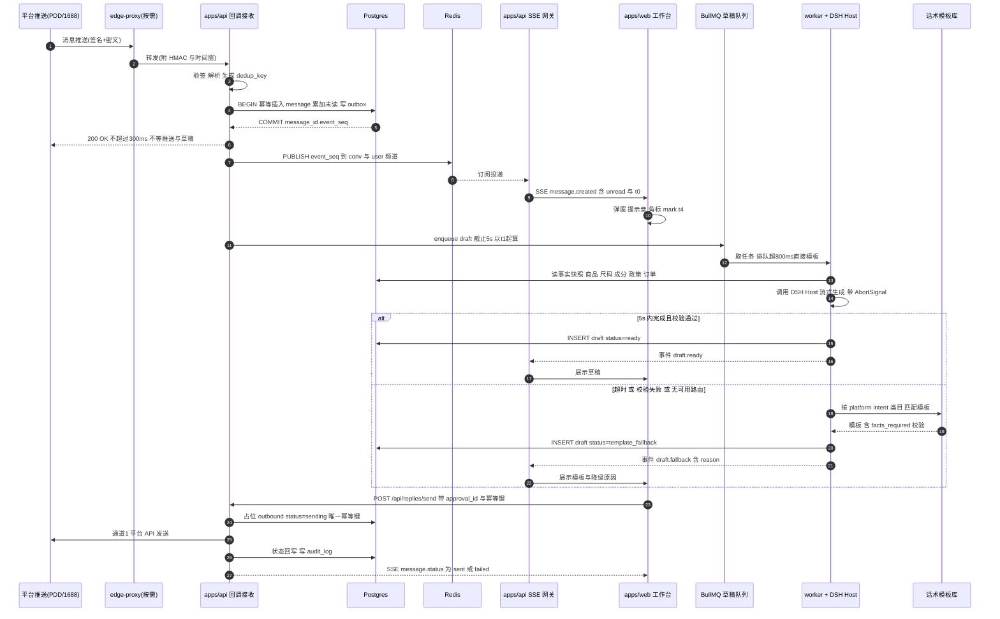

# 18 · 客服实时性与降级链规范

| 项 | 内容 |
|---|---|
| 编号 | DSSAAS-DOC-18 |
| 用途 | 定义客服/询盘消息从平台入站、落库、SSE 推送、工作台弹窗、草稿生成到发送落库的完整实时链路，以及每一级的降级分支、边界与验收口径 |
| 读者 | 后端（`apps/api`、`apps/worker`）、前端（`apps/web`）、客服与运营负责人、测试、运维值班 |
| 依赖 | `docs/00` §1.2 §2.2 §9.3 §14 §16 §19；`docs/01`、`docs/02`（平台能力与考核口径回填）；`docs/08`（判断层）；`docs/11`（写入门）；`docs/12`（接口契约）；`docs/17`（入口与 Agent 驱动）；`docs/19`（尺码/成分事实源） |
| 状态 | 待评审 · M5 施工基线（2026-10-20） |
| 版本 | 1.0 |

> **全篇口径**：本文出现的任何平台时限、接口能力、服务分算法，**未经 `docs/01`/`docs/02` 现场核验一律视为未核实**。未核实的数字只出现在 `platform_policy_parameter` 表中作为"严格假设"，不写进代码常量、不写进对客话术、不用于考核处罚（见 §9）。

---

## 0. 计时点、硬指标与降级链总表

### 0.1 计时点定义（全链路统一，禁止各模块自定义）

| 记号 | 定义 | 取值方式 | 备注 |
|---|---|---|---|
| `t0` | 平台回调到达 `apps/api` 的服务器时刻 | socket 接收时刻与 `X-Request-Start` 取较早者；容器内 NTP 同步，偏差 > 500ms 告警 | 全链路唯一基准，随 SSE 帧下发给前端 |
| `t1` | 消息事务提交时刻 | `message` 插入 + `conversation` 未读累加 + `outbox_event` 同事务 commit | 落库成功才算"已接收" |
| `t2` | 事件发布完成时刻 | `PUBLISH` 返回或 outbox dispatcher 消费完成 | 最多一次重试，重复由 `event_seq` 去重 |
| `t3` | SSE 帧写出时刻 | 服务端 socket flush 完成 | 含在 t0→t4 内 |
| `t4` | 工作台弹窗可见时刻 | 前端 `performance.mark('t4')`，与 `t0` 同基准（已扣客户端时钟差） | 换算方式：`t4 - t0`，不使用本地 `Date.now()` 差值硬算 |
| `t5` | 草稿任务入队时刻 | BullMQ `job.timestamp` | 正常应 ≈ `t1` + 20ms |
| `t6` | 草稿可用时刻 | `draft` 行 `status in ('ready','template_fallback')` 落库并推送完成 | 5 秒硬约束的对象 |

### 0.2 硬指标（SLO，超限即缺陷，不做"尽力而为"解释）

| 指标 | 定义 | 目标 | 超限动作 |
|---|---|---|---|
| 回执时延 | `t0 → HTTP 200` | P99 ≤ 300ms，硬上限 800ms | 记 `webhook_slow_total`；连续 3 次告警；> 1s 视为缺陷单 |
| 落库时延 | `t0 → t1` | P95 ≤ 120ms，P99 ≤ 250ms | 慢查询告警，检查 `message` 索引与锁等待 |
| 发布时延 | `t1 → t2` | P99 ≤ 50ms | Redis 延迟告警；outbox 积压 > 100 告警 |
| 提醒送达 | `t0 → t4` | P95 ≤ 800ms，P99 ≤ 2000ms（"秒级"） | 告警 + 当班复盘；> 5s 记事故 |
| 草稿可用 | `t0 → t6` | **100% ≤ 5000ms**（含降级） | 任一超 5s 即缺陷：须有 `draft.timeout_violation` 指标并归因 |
| 草稿降级率 | `status=template_fallback` 数 / 草稿请求数 | 监控项，目标 < 5%/日 | 连续 3 日超标 → 排查模型路由与队列 |
| 出站重复 | 同一 `outbound_idempotency_key` 产生 2 条平台消息 | **0** | 安全缺陷，立即熔断该通道 |
| 误发率 | 判定为错误的消息数 / 发送总数 | **0 容忍** | 事故流程 + 审计追责 |

> 监控 `t0 → t4` 的**平台侧延迟**（平台消息时间戳 → `t0`）只观测不设 SLO：该段由平台推送机制决定，不可控，但必须记录，用于判断"是平台推送慢还是我们慢"。

### 0.3 五级降级链（本规范的核心，逐级必须可实现）

| 环节 | L0 正常 | L1 一级降级 | L2 二级降级 | L3 兜底 | 触发条件 | 用户可见提示 |
|---|---|---|---|---|---|---|
| 入站 | 平台回调实时推送 | 定时增量拉取（60s，靠 `sync_cursor`） | 手动"立即同步"按钮 | 事故公告 + 人工在平台后台查看 | 回调 5 分钟无任何消息且平台支持查询 | "同步延迟，正在补偿" |
| 推送 | SSE 长连接 | 20s 轮询 | 页内红条 + 标题闪烁 | 邮件/IM webhook 通知值班 | SSE 连续 3 次连接失败 | "实时通道中断，已切换轮询（延迟 ≤ 20s）" |
| 草稿 | 主 route 模型 | 备用 route（一次切换，预算内） | 话术模板（规则匹配） | 人工手写（模板占位 + 空文本） | 5s 截止、路由不可用、校验失败 | "已切换话术模板（原因：超时/无可用模型/校验未过）" |
| 事实查询 | pgvector + 主数据 | 关键词检索（标"低置信"） | 静态 FAQ 卡（带版本号） | 只输出"需人工确认" | 嵌入或向量库不可用 | 置信度标签 + 来源链接 |
| 发送 | 官方 API 直发 | 网页内复制 + 登记 | 本地剪贴板助手 | 平台后台人工发送 + 回填登记 | API 未获批、熔断、连续失败 | 通道标记 + 切换原因 |
| 模板库 | PG 主表读取 | 进程内缓存（5 分钟） | 镜像内置最小模板集（20 条） | — | 模板库不可用或超时 | 模板版本号（内置集标 `builtin`） |

**降级铁律**：降级只能降低"自动化的程度"，不能降低"事实的准确性与审批的严格性"。任何降级路径都不得跳过写入门、去重、审计（§5、§7）。

### 0.4 术语

| 术语 | 含义 |
|---|---|
| 占位（`sending`） | 调用平台前的出站记录，唯一幂等键已落库，防止并发/重复发送 |
| 慢草稿（`late`） | 5s 后仍返回的模型结果，不推送、不自动展示，仅详情可查 |
| `handed_off` | 已把文案交给人工通道（网页内/剪贴板），系统**无法确认**是否真的发出 |
| `unconfirmed` | 人工通道 20 分钟内未回填"已发送"的状态，进对账队列 |
| 未读补偿 | 断线重连或页面回到前台时，以 Postgres 为准重建未读与漏推消息 |
| 严格假设 | 平台口径未核实时，内部取最保守值的参数记录 |

---

## 1. 消息入站链路

### 1.1 参与者与拓扑

| 参与者 | 职责 | 部署 | 关键约束 |
|---|---|---|---|
| 平台推送 | 拼多多/1688 消息回调 | 平台侧 | 会重试、可能重复、可能乱序；超时未 200 即重推 |
| `edge-proxy` | 指定机房时的转发 + 签名 + 时间窗 + 报文留档 | 按需，独立主机 | 只转发，不做业务判断；不落业务数据 |
| `apps/api` 回调接收 | 验签、解析、幂等落库、快速 ACK | 中心侧 | 单请求内不做模型调用、不做平台回查 |
| Postgres | 消息与未读的唯一事实源 | 中心侧 | 事务内完成"消息 + 未读 + outbox" |
| Redis | pub/sub 扇出 + BullMQ 队列 | 中心侧 | 可丢（可重建），不是事实源 |
| SSE 网关 | 长连接管理、断线补偿、事件重放 | 与 api 同进程 | 多实例时靠 Redis 扇出，不做粘性会话依赖 |
| `apps/web` | 弹窗、角标、草稿编辑、发送 | 浏览器 | 断线自动重连；所有状态以服务端为准 |
| `apps/worker` + 中心 DSH Host | 草稿生成、事实快照装配 | 同镜像另进程 | 带 `AbortSignal`，硬截止 5s |
| 话术模板库 | 降级模板与意图规则 | Postgres 表 | 版本化、带生效日期 |

### 1.2 入站时序图



### 1.3 回调接收的实现要求

| 项 | 要求 | 失败处理 |
|---|---|---|
| 传输 | 仅 HTTPS；`edge-proxy` 到中心用双向证书 + HMAC + 时间窗 | 证书/签名异常直接拒绝并告警 |
| 验签 | 按 adapter 实现平台签名算法；密钥来自 DSH 凭据引用，不落配置文件 | 验签失败回 401，**不重试**，记 `webhook_sig_fail` |
| 时间窗 | 平台时间戳与服务器偏差 > 300s 拒绝（防重放） | 回 401 + 记录原始时间戳 |
| 体积 | 请求体上限 1MB；超限 413 | 告警并人工核查 |
| 原始报文 | 加密存 MinIO `webhook-raw/{platform}/{yyyy}/{mm}/{dd}/{message_id}.json.gz`，保留 7 天 | 存失败不阻断主流程，但记指标 |
| ACK 语义 | **事务提交成功即 200**；`deduped=true` 同样 200；DB 不可用回 503 让平台重试 | 不得在 200 之后再抛业务错 |
| 幂等 | 唯一键 `(platform, conversation_id, platform_message_id)` | 冲突即视为重复，200 + 不产生新行 |
| 顺序 | 不假设有序；展示按 `platform_sent_at`，同时刻按 `platform_message_id` | 乱序不纠正存储，只在读路径排序 |
| 回查 | 回调只带最小字段时，允许一次平台回查补齐（预算 300ms，超时则先落库后由 worker 补齐） | 补齐失败置 `payload_incomplete`，工作台标注 |

### 1.4 落库事务（唯一写法）

```sql
BEGIN;
-- 1) 幂等插入；无返回行即重复回调
INSERT INTO message (id, org_id, platform, conversation_id, platform_message_id,
                     direction, sender_role, content_type, content, platform_sent_at,
                     raw_object_key, created_at)
VALUES ($1,$2,$3,$4,$5,'in','buyer',$6,$7,$8,$9, now())
ON CONFLICT (platform, conversation_id, platform_message_id) DO NOTHING
RETURNING id, event_seq;

-- 2) 新消息才累加未读并更新会话活跃时间（原子，不做读-改-写）
UPDATE conversation
   SET last_message_at = GREATEST(last_message_at, $8),
       unread_count    = unread_count + 1,
       last_inbound_at = now()
 WHERE id = $4
 RETURNING unread_count;

-- 3) 同事务写 outbox，保证"落库了但没推送"可被补偿
INSERT INTO outbox_event (topic, aggregate_id, payload, created_at)
VALUES ('message.created', $4, $10, now());
COMMIT;
```

要求：

1. **提交后才 PUBLISH**。推送通路为 `outbox_event` + `pg_notify` 双保险：`pg_notify` 负责低延迟，outbox dispatcher（≤ 50ms 轮询）负责"通知丢了也能补"。
2. 未读计数只允许 `unread_count = unread_count + 1` 的原子更新，禁止"先 SELECT 再 UPDATE"。
3. 已读回写用 `UPDATE message SET read_at=now() WHERE id = ANY($1) AND read_at IS NULL`，同时 `conversation.unread_count = GREATEST(0, unread_count - $n)`。
4. 每 5 分钟跑一次对账任务：`unread_count` 与 `count(message where direction='in' and read_at is null)` 比对，不一致写 `drift_log` 并以 SQL 结果为准修正（只修计数，不改消息）。

### 1.5 入站数据表关键字段

| 表 | 关键字段 | 说明 |
|---|---|---|
| `conversation` | `id, platform, platform_conversation_id, buyer_ref, assignee_id, status, last_message_at, last_inbound_at, unread_count, biz_line` | `biz_line ∈ {pdd_retail, 1688_wholesale}`；`buyer_ref` 存平台侧标识的哈希，不存昵称明文 |
| `message` | `id, conversation_id, platform_message_id, direction, sender_role, content_type, content, platform_sent_at, event_seq, read_at, raw_object_key` | `event_seq` 来自全局序列，作为 SSE `id` 用于断线重放 |
| `outbox_event` | `id, topic, aggregate_id, payload, attempts, published_at` | 至少一次投递；消费端按 `event_seq` 幂等 |
| `event_log` | `event_seq, user_id, topic, payload, created_at` | 只保留 7 天，供 `Last-Event-ID` 重放；过期后返回 `resync` |
| `drift_log` | `id, kind, detail, detected_at, fixed_at` | 未读漂移、事件丢失、乱序异常的取证记录 |

## 2. 秒级提醒的实现要求

> 目标见 §0.2：`t0 → t4` P95 ≤ 800ms、P99 ≤ 2000ms。下列参数全部落 `sse_config` 表并随版本留痕，禁止散落在代码里。

### 2.1 SSE 连接保活

| 项 | 取值 | 说明 / 失败处理 |
|---|---|---|
| 建连鉴权 | `GET /api/stream?ticket=`；cookie 先换一次性 ticket（30s、单次、绑定 `user_id + Origin`） | ticket 失效回 401，刷新后再连；**不重试旧 ticket**；`sse_auth_fail_total` |
| 响应头 | `text/event-stream`、`Cache-Control: no-cache, no-transform`、`X-Accel-Buffering: no` | 缺 `no-transform` 会被 CDN 聚合缓冲，`t3→t4` 成批抖动 |
| 心跳 | 每 **15s** 发注释帧 `: hb <server_ts>`；不入 `event_log`、不占 `event_seq`、不触发前端业务逻辑 | 写失败即关连接；`sse_hb_lag_ms` 观测事件循环是否阻塞 |
| 空闲回收 | 服务端每 10s 巡检 `last_write_at`，超 **45s**（3× 心跳）主动关闭 | 原因 `idle_timeout`，不计异常 |
| 客户端重连 | 首帧下发 `retry: 3000`；退避 3/6/12/24/30s，抖动 ±20% | 60s 内重连成功则**不重置**退避（防抖动风暴）；连续 3 次失败 → 切 20s 轮询（§0.3 L1） |
| 心跳丢失 | 客户端 30s 未收到任何帧 → 主动 `close()` 并重连 | 轮询期间横幅提示"实时通道中断，延迟 ≤ 20s" |
| 代理约束 | Nginx `proxy_read_timeout 75s`；Caddy `flush_interval -1`；任何中间层 idle > 60s | 写入 `docs/03` 部署核验表；代理提前断记 `upstream_close`，不告警 |
| 连接上限 | 单用户 ≤ **6** 条（多标签/多设备），超出关最旧 | `sse_conn_evict_total`；注册表 Redis `sse:conn:{uid}`，心跳续期 TTL 45s |
| 背压 | 单连接待写 > 200 帧或 > 512KB → 断开该连接，让客户端走重放 | `sse_backpressure_close_total`；有损断开优于阻塞全站 |
| 无连接时 | 事件只进 `event_log`，不推送；工作台打开时按 §2.3 补偿 | 在线状态读注册表，**不得**据此丢弃事件 |

### 2.2 断线重连与 Last-Event-ID 重放语义

| 项 | 规则 |
|---|---|
| 事件 id | `id: <event_seq>`，取自 Postgres 全局序列（跨会话唯一、严格递增）；禁用会话内序号或时间戳 |
| 重放查询 | `WHERE event_seq > $last AND event_seq <= $max AND user_id = $uid ORDER BY event_seq ASC LIMIT 500` |
| 重放上限 | 单次 ≤ 500 帧；触顶说明积压异常 → 发 `resync`，不继续补 |
| 空洞检测 | 首帧 `event_seq > last + 1` → `event: resync`，`reason ∈ {gap, expired, unknown_id, ahead}` |
| 过期 | `event_log` 保留 **7 天**（§1.5）；超期或 `last_event_id` 非法/超前 → `resync` |
| `resync` 语义 | 前端清空增量队列与已见集合 → 丢弃本地未读 → 拉 §2.3 快照 → 恢复增量；**不得**自动"补发已读" |
| 顺序 | 单连接内按 `event_seq` 升序写；重放与实时事件在同一流上衔接，靠 `event_seq` 单调保证顺序 |
| 去重 | 前端环形缓冲 `seen_event_seq`（最近 2000）；重复帧丢弃并记 `sse_dup_event_dropped_total` |
| 幂等 | 事件处理必须"设状态"而非"累加"；未读以服务端 `unread_count` 为准，前端累加仅乐观显示 |
| 兜底 | 重放只覆盖消息/草稿/状态；**审批与发送结果必须接口回查**，不得只依赖事件 |
| 留痕 | 每次连接写 `sse_session_log`（`connect_at`、`last_event_id`、`replayed`、`gap`、`resync_reason`），保留 30 天 |

### 2.3 未读补偿与多标签页去重

连接建立（首次 / 重连 / `resync` / 回前台）必须做一次快照对齐：

| # | 规则 |
|---|---|
| 1 | `GET /api/conversations/unread-snapshot` 返回 `snapshot_event_seq`、`server_ts`、`total_unread`、各会话 `unread_count`（≤ 200 会话，超出分页并标 `partial`） |
| 2 | 合并：`event_seq ≤ snapshot_event_seq` 丢弃（已含在快照）；`>` 才应用增量；快照后到达的事件不得把已归零的未读加回 |
| 3 | 快照失败：保留本地计数并标 `unread_stale`，30s 重试 ×3，仍失败提示"未读可能不准"；**不阻塞** SSE 连接 |
| 4 | 回前台：`visibilitychange → visible` 且隐藏 > 30s → 重拉快照 + 必要时重连；休眠唤醒同此 |
| 5 | 已读：打开会话即 `POST /read`（幂等，带 `last_read_message_id`）；本地先减，失败按快照对账；禁止只减不报 |
| 6 | 多标签：`navigator.locks` 选 leader（Fallback：BroadcastChannel 3s 心跳）；**仅 leader 建 SSE** 并扇出，弹窗/提示音只在 leader |
| 7 | 换主：leader 60s 无心跳 → 重选，新 leader 用本地 `last_event_id` 续连；旧 leader 复活必须自降 follower 且断开 SSE |
| 8 | 多设备：不跨设备去重，各自 leader 各自提醒；服务端按连接计量 |

> 未读是服务端事实（§1.4），角标允许 ≤ 2s 乐观偏差，超出即缺陷；禁止把 `unread_count` 做成纯前端状态。

## 3. 草稿生成 5 秒硬超时

> 5s 是**缺陷线**不是目标：任一草稿 `t0 → t6 > 5000ms` 必须有 `fallback_reason` 并进入归因看板（§0.2）。

### 3.1 超时判定点与分段预算

`T_deadline = t1 + 5000ms`，由 `apps/api` 在入队时算好写入 job（绝对 epoch）；worker **不得重算**（重算会把队列等待洗掉）。

| 段 | 预算 | 判定点 / 超限动作 |
|---|---|---|
| 排队 + 取任务 | 800ms | 取到任务时 `now ≥ T_deadline − 500ms` → 直接模板（`queue_backpressure`），不调模型 |
| 事实快照 | 400ms | 商品/尺码/成分/政策/订单总超时；缺关键事实 → 模板（`facts_missing`）；缺非关键 → 继续但标 `facts_degraded` |
| 模型生成 | 2700ms | `AbortSignal.timeout(remaining)` 传 DSH Host Remote；首 token > 1200ms 记 `slow_first_token`；abort 后结果**丢弃** |
| L1 + L2 校验 | 300ms | 校验超时按最严处理：无法校验即不通过 → 模板（`judge_reject`） |
| 落库 + 推送 | 300ms | 失败重试 1 次，仍失败写 `drift_log` + 前端提示"草稿生成失败，请手写" |
| 机动余量 | 500ms | 吸收 GC/网络抖动，**不得**被前面各段借用 |
| 软截止 | `T_deadline − 700ms` | 模型未完则后台并行预取模板（不阻塞、不推送）；模型若在硬截止前完成则用模型结果 |
| 迟到结果 | `t6 > 5000ms` | 落 `draft.status='late'`，不推送不自动展示，仅详情可查；已有 fallback 时以 fallback 为准 |
| 计时双轨 | `t1` / `t5` | 对外 SLO 用 `t1`，内部诊断用 `t5`；`t5 − t1 > 20ms` 记 `enqueue_lag` |

### 3.2 并发上限与背压

| 层 | 上限 | 超限动作 |
|---|---|---|
| worker 草稿并发 | 8（`DRAFT_CONCURRENCY`） | 排队；同时检查 800ms 排队预算是否已被吃掉 |
| 单会话 | 1 | 新消息到达取消旧任务（`draft.superseded`）；旧任务已产出则保留为 `late` |
| 单用户 | 2 | 第 3 条起排队并显示"生成中" |
| route / provider 速率 | 按 `model.rate_limit` | **不排队**，立即模板（`route_error`），避免拖到 5s |
| 队列深度 | > 200 | 全局熔断草稿 60s，全部模板 + 告警；半开 30s 放 1 条 |
| route 熔断 | 连续 5 次超时/5xx | 该 route 打开 60s 直接模板，半开探测成功才恢复；不影响备用 route |
| 配额 | `model_route.quota` | 超配额降级到 fallback route；无 fallback → 模板 |
| 总原则 | 宁可降级，不可超时 | 任何等待一旦使 `T_deadline` 不可能达成，立即按当前最优产出降级 |

### 3.3 超时后的降级路径：话术模板库选择规则

选择必须**确定性、可复现、可解释**（记录候选与落选原因），不允许随机或"取最新一条"。

| 序 | 维度 / 项 | 规则 |
|---|---|---|
| 1 | 平台 + 业务线 | `platform`、`biz_line` 精确匹配；不放宽，无候选即落内置集 |
| 2 | 意图 | `intent` 必须命中（售前/尺码/物流/退换/售后/报价/起批/unknown）；`unknown` 无候选才退 `general` |
| 3 | 类目 | 同类目 → 父类目 → 空类目通用模板 |
| 4 | 最近使用 | 7 天 `usage_count DESC` → `last_used_at DESC` → `priority DESC`（防老模板霸榜） |
| 5 | 版本与排序 | 同分取 `version DESC`；排序式 `ORDER BY (category_id=$cat) DESC, specificity DESC, usage_7d DESC, last_used_at DESC NULLS LAST, priority DESC, version DESC, id` |
| 6 | 生效过滤 | `status='active' AND effective_from <= now() AND (effective_to IS NULL OR effective_to > now())` |
| 7 | 占位白名单 | 仅商品名/尺码/成分/洗护/物流时效/退换政策/SKU 属性；**禁价格变量**（除主数据注入且带版本） |
| 8 | 占位失败 | 任一 `{{...}}` 解析失败 → 该模板不可用；连续 3 条不可用 → 取无占位符模板 |
| 9 | 合规过滤 | 过 L1 禁限词、绝对化用语、站外导流、未核实时效承诺；不过则顺延 |
| 10 | 兜底与留痕 | 镜像内置 20 条 `builtin`（不依赖 PG）；落 `template_id`、`template_version`、`selection_trace`（候选 + 落选原因，≤ 2KB） |

### 3.4 降级后的可观测记录

| 项 | 要求 |
|---|---|
| 状态枚举 | `draft.status ∈ {ready, template_fallback, late, failed}`；`fallback_reason ∈ {timeout, queue_backpressure, no_route, route_error, judge_reject, facts_missing, circuit_open}` |
| 计时字段 | 每行记 `t1`/`t5`/`t6`/`latency_ms`/`queue_wait_ms`/`deadline_ms`；`latency_ms > 5000` 必带 reason |
| 指标 | `draft_total{status}`、`draft_fallback_total{reason}`、`draft_latency_ms`（桶到 6000）、`draft_timeout_violation_total`、`draft_late_total`、`draft_superseded_total` |
| 日志 | 每条一行结构化日志：`request_id, conversation_id, message_id, model_id, route_id, tokens, cost_micro_cny, fallback_reason` |
| 审计边界 | 降级本身**不写** `audit_log`（非写操作），但 reason 必须可查；"发送"必写审计（§4） |
| 告警与复盘 | 5s 违约 1 次即告警；降级率 > 5% 连续 3 日；`queue_backpressure` > 20% 持续 10 分钟；每周评审 top 3 原因并关单 |

## 4. 三条发送通道

> 通道只决定"谁来点发送"，**不改变**审批、幂等、去重与留痕（§0.3 铁律）。三条通道共用同一条 `outbound` 行与同一幂等键（§6.1）：换通道 ≠ 新消息。

| 通道 / 场景 | 适用条件 | 切换与动作 | 失败处理（用户可见） |
|---|---|---|---|
| `api` 官方消息 API | 接口权限已获批 + `approval` 有效且 `target_hash` 未变 + 幂等键占位成功 + kill switch 关闭 | 默认最高优先；写入门调用，回执落 `platform_message_id` | 见下四行，按失败分类处理 |
| `clipboard` 本地剪贴板助手 | helper 已装且协议匹配；无 API 权限时默认 | 写入系统剪贴板 → 人工在平台窗口粘贴 → 状态 `handed_off` | 见 §5；失败退 `web_manual` |
| `web_manual` 网页内发送 | 无 API 权限、平台禁止自动发送、临时熔断、用户显式选择 | **仅展示与留痕**：打开平台会话 + 回填登记 | 无系统失败概念，靠人工回填 |
| 启动态判定 | 权限未获批 → `clipboard`；helper 缺失 → `web_manual` | 通道徽标常驻工作台 | 首次使用时引导安装 helper |
| API 可重试失败 | 超时 / 5xx / 限流 | 指数退避重试 ≤ 2 次（1s、3s）→ 仍失败则熔断该平台 5 分钟后转 `clipboard` | 横幅"已切换剪贴板，原因：接口连续失败" |
| API 超时且可能已送达 | 连接中断、无响应 | 置 `unknown`，**禁止自动换通道重发**，转人工核对（§6.2） | "结果未知，请到平台后台确认后再操作" |
| API 不可重试 / 平台拒绝 | 鉴权失效、会话不存在、内容违规、参数被拒 | `failed_permanent` + `error_class` + 修复项工单，转 `clipboard` | 红色错误 + 展示平台原文错误码 + 可执行修复建议 |
| 熔断与切回 | `closed → open(5min) → half_open(1 次探测)` | 半开失败 → `open` 15min，退避翻倍上限 60min；切回 `api` 仅影响后续消息，**不重发**失败那条 | 平台连接页展示熔断状态与剩余时间 |
| 人工通道回填 | `clipboard` / `web_manual` 发出后 | 20 分钟未回填 → `unconfirmed` 进对账队列 + 组长提醒；可"标记已发送/未发送" | 待确认徽标 + 通道徽标 + "本通道无法确认送达" |
| 通道留痕 | 每次切换与每次尝试 | 写 `channel_switch_log`、`outbound.channel`、`outbound_attempt`（含 `request_id`） | 报表按通道拆成功率/误发率/未回填率 |

## 5. 剪贴板助手的边界与安全约束

> 助手是"改写剪贴板"的最小工具，不是自动化发送器。越界即安全缺陷（`00` §17 专项测试：无 DOM 注入、无按键模拟）。

| 类别 / 项 | 允许与约定 | 禁止 / 失败提示 |
|---|---|---|
| 剪贴板 | 仅 `writeText` 写入**纯文本**（当前一条文案） | 读取剪贴板、监听变化、解析其他应用内容 |
| DOM | 不加载、不注入平台页面 | 注入/修改 DOM、`contenteditable` 赋值、向平台控件 `dispatchEvent` |
| 键盘与鼠标 | 无任何输入注入 | `SendInput`、`keybd_event`、CDP `Input.dispatchKeyEvent`、模拟点击 |
| 窗口与屏幕 | 无 | `EnumWindows`/`FindWindow`、焦点切换、UI Automation、识别"发送"按钮、截屏/录屏/OCR/上传画面 |
| 网络 | 仅 `127.0.0.1:{port}` 回环 | 任何外连、遥测上传、明文 token 落日志 |
| 进程 | 普通用户态托盘程序 | 驱动、系统服务、DLL 注入、API Hook、默认开机自启 |
| 数据 | 仅 `outbound_id`、渲染后 `content`、`channel` | 会话历史、附件、买家信息明文、其他业务数据 |
| 安装与签名 | 单文件托盘程序（扩展可选）；EV 代码签名 + SHA-256；仅公司内部设备 | 验签不过拒绝安装；不对外分发 |
| 通信与协议 | `127.0.0.1:48765` 回环；握手发一次性 token（30min、绑定 `Origin`）；`helper_protocol=v1`，先探 `/health` | 401 → 静默重握手 1 次，仍失败提示重启；版本不匹配 → 提示升级并退 `web_manual` |
| 升级 | 启动查 `/api/clipboard/helper/version`，低于 `min_supported` 强制升级，升级包验签 | 升级失败保留旧版可用；强制升级期间允许手动复制 |
| 卸载 | 清理注册表项与临时文件，不留开机项 | 网页检测不到 helper → 自动退 `web_manual` |
| 写入超时 | 800ms 未返回即判失败，**不重试第二次**（防覆盖用户剪贴板） | "剪贴板被占用，请手动复制" + 只读文本框（可全选） |
| 权限拒绝 | `navigator.clipboard` 需用户手势 | 提示点击后重试或手动复制 |
| 审计 | `audit_log.action='clipboard.push'`：`request_id, outbound_id, message_id, content_sha256, content_len, channel, helper_version, protocol, result, error_code` | 只存哈希与引用，**不存剪贴板全文**（全文在 `message` 表） |

> 日统计 C3 占比 / 失败率 / 未回填率；每周抽 20 条与平台侧人工对账，差异进 `drift_log`。

## 6. 消息去重与并发

### 6.1 `outbound_idempotency_key` 构造

```
key = sha256_hex("v1|" + platform + "|" + conversation_id + "|" +
                 reply_to_platform_message_id + "|" + content_sha256 + "|" +
                 approval_target_hash)
```

| 规则 | 说明 |
|---|---|
| 不含字段 | **不含**通道、时间、操作人、模型 id——保证"重试/换通道"不产生第二次发送语义 |
| 内容规范化 | 去首尾空白、全角转半角、换行统一 `\n`、模板变量已渲染；规范函数版本进 `v1` 前缀，改版即换前缀 |
| 无回复对象 | 主动消息 `reply_to_platform_message_id` 取常量 `none` |
| 重复内容 | 同 key 已 `sent` 且间隔 < 24h → 提示"与 X 天前内容相同"，确认后追加 `\|dup:{nonce}` 生成新 key 并写审计 |
| 计算位置 | **服务端计算**，不接受前端传入（防伪造/误用）；前端只传 `message_id` 与渲染后内容 |
| 层级 | `key` 定位唯一 `outbound` 行；`attempt_key = hash(key + channel + attempt_no)` 仅用于平台调用级幂等 |

### 6.2 发送中占位、状态机与平台重复回调

```sql
INSERT INTO outbound (id, platform, conversation_id, outbound_idempotency_key, status, channel)
VALUES ($1,$2,$3,$4,'sending','api')
ON CONFLICT (platform, outbound_idempotency_key) DO NOTHING
RETURNING id, status;
```

返回 `0` 行时读现有行：`sending`/`sent` → 200 + `deduped=true` + 现有状态（前端提示"发送中/已发送，未重复发送"）；`failed_*` → 同一行 `attempt_no+1` 重试；`handed_off`/`unconfirmed`/`unknown` → 409，人工确认后才可再发。状态更新一律条件更新 `WHERE id=$1 AND status=$expected`，影响 0 行即并发冲突回 409；唯一约束 `uq_outbound_semantic (platform, outbound_idempotency_key)`。

| 状态 / 场景 | 含义与守卫 | 可否再发 / 处理 |
|---|---|---|
| `approved` | 审批通过待发；`target_hash` 有效、kill switch 关闭 | 可发 |
| `sending` | 已占位、调用中 | 否（同 key 幂等） |
| `sent` | 平台确认成功，回执含平台 `message_id` | 否 |
| `failed_retryable` | 超时/5xx/限流且未达重试上限 | 可重试（同一行） |
| `failed_permanent` | 鉴权/会话/内容违规 | 需改内容 → 新 key |
| `unknown` | `sending` 超 120s 无回执 | **否**，人工核对后置 `sent`/`failed_*` |
| `handed_off` / `unconfirmed` | 人工通道已交 / 20min 未回填 | 否，需核对 |
| 平台重复回调 | 唯一 `(platform, conversation_id, platform_message_id, direction='out')` | 只更新状态，不新建；回调早于响应时先建 `sent` 再按 id 合并 |
| 回调内容与本地不一致 | 平台可能改写/降级 | 写 `drift_log` + 告警，页面标差异，不静默覆盖 |
| 前端双击 / 键盘重复 | 点击即禁用；300ms 内重复忽略；Enter 需在 textarea 且非 Shift | "发送中"状态来自服务端，不用本地布尔 |
| 多标签页 | 服务端唯一键兜底 | follower 收 `deduped` 后同步按钮状态 |
| 并发压测 | 20 并发同 key | 平台调用必须为 1（§9 用例） |

## 7. 拼多多与 1688 两条业务线的差异处理

> 共用主数据、模型网关、素材管线、写入门与审计；**会话模型、模板、字段、指标、审批策略各一套**（`00` §2.2）。差异只允许落在 `biz_line = pdd_retail | 1688_wholesale` 分支，禁止用 `if platform` 散落判断。

| 维度 | 拼多多（`pdd_retail`，消费者会话） | 1688（`1688_wholesale`，询盘/报价） |
|---|---|---|
| 会话模型 | 单买家 ↔ 店铺客服；一个买家可多会话；以订单/售后为主线 | 询盘：采购商（公司 + 联系人）↔ 业务员；**一个询盘可含多 SKU、多轮报价**，报价有有效期 |
| 通道 | 飞鸽/商家客服（消费者） | 旺旺（分销商/批发商） |
| 模板族 | 售前咨询、尺码推荐、物流查询、退换、售后安抚、催付 | 询盘开场、报价单、起批量、阶梯价、代发、样品、账期、交期 |
| 必填事实 | 订单号、物流单号、退款原因、尺码/身高体重建议（来自 `size_chart`） | 起批量、阶梯价、含税与否、运费承担、交期、代发能力、样品政策 |
| 价格结构 | 单一售价 + 促销价（到分） | 起批价 + 阶梯价 + 区间价；报价单结构见下 |
| 建议字段 | `buyer_ref`（平台标识哈希，不存昵称明文） | 增加 `company_ref`、`contact_ref`（同样哈希），报价含 `quote_no`、`valid_until` |
| 指标 | 首次响应、回复时效、转化率、客单价、退款率 | 询盘量、报价成交率、起批达成率、返单率、样品转化 |
| 审批重点 | 价格与主图最敏感；补发/补偿话术需审批 | 报价与起批条件最敏感；账期、代发承诺必须审批 |
| 时效考核 | 口径待核实（§8） | 口径待核实（§8）；询盘常有单独响应口径，不得与 PDD 共用阈值 |
| 禁止 | 站外导流、绝对化用语、未经核实承诺 | 同上 + 线下交易引导、虚假货源/产能表述 |

**1688 报价单载荷**（存 `message.content_type='quote'` 的结构化子对象，不新增表）：

```json
{ "quote_no": "Q-20261020-001", "valid_until": "2026-10-27",
  "items": [{"sku_code": "TS-A0101-BK-M", "qty_tier": [{"min_qty": 2, "unit_price_micro_cny": 99000000},
                                                     {"min_qty": 50, "unit_price_micro_cny": 89000000}]}],
  "tax_included": true, "shipping_payer": "buyer", "lead_time_days": 7,
  "drop_ship": true, "sample_policy": "支持 1 件样品，运费买家承担" }
```

## 8. 考核口径未核实时的设计原则

> 平台回复时效、服务分算法、处罚规则**一律以 `docs/01`/`docs/02` 现场核验为准**；核验前按本节执行，核验后按 §8.3 清单逐项调整。

| 原则 / 场景 | 执行要求 |
|---|---|
| P1 按最严执行 | 多个候选口径取**最严**；定义含糊时按"对我方最不利"解释；宁可提醒过早，不可判超时 |
| P2 不依赖未证实数字 | 代码零字面量：所有平台时限读 `platform_policy_parameter`；参数缺失取 `strict_value`；两者皆缺失抛 `policy_unknown` 并落到 `internal_strict` 兜底表（内部 SLA，非平台口径） |
| P3 参数可回滚 | 口径确认只改数据不改代码；改后 1 个工作日内跑回归并同步看板、话术、培训材料 |
| 最严判定：回复时限 | 候选 3 分钟 / 5 分钟 → 取 3 分钟；提醒点在 `deadline − 30s` |
| 最严判定：计时起点 | 候选"客服首读"/"买家发出" → 取**买家发出**（与 `t0` 对齐） |
| 最严判定：自动回复是否计入 | 候选"计入"/"不计入" → 取**计入**；模板降级发送同样计入 |
| 最严判定：扣分粒度 | 候选"按会话"/"按条" → 取**按条** |
| 最严判定：考核时段 | 候选"工作时间"/"全天" → 取**全天** |
| 最严判定：超时后果不明 | 按"有扣分"处理，不按"无影响"处理 |
| 展示约束 | 界面显示"口径未核实（严格假设）"徽标，hover 给出 `source_doc`；报表标 `assumption=true` |
| 使用约束 | 未核实口径**不得**写进对客话术、不得用于绩效处罚、不得写进合同或对外承诺 |
| 参数表字段 | `platform_policy_parameter(param_key, platform, value_num, unit, status ∈ {strict_assumption, verified, deprecated}, strict_value, source_doc, source_url, verified_at, verified_by, effective_from/to)` |

**口径确认后的调整点清单**（逐项关单，缺一项视为口径未落地）：

| # | 调整项 | 位置 | 动作 |
|---|---|---|---|
| 1 | 参数行 | `platform_policy_parameter` | `status → verified`，回填 `source_url`/`verified_at` |
| 2 | SLO 与告警阈值 | 本文 §0.2、监控规则 | 按实测口径重算 `t0→t4`、草稿降级率阈值 |
| 3 | 提醒提前量 | §8 最严判定行、模板 `deadline_remind` | 按新口径调整提前 30s/60s |
| 4 | 模板话术 | 话术模板库（含时效承诺的条目） | 去掉或改写未核实承诺，版本 +1 |
| 5 | 指标分子分母 | `00` §16、看板 | 会话语义/询盘语义分开重算 |
| 6 | 培训与值班 | 客服手册、SLA 责任表 | 同步口径变化点 |
| 7 | 回归用例 | §9 清单 | 新增/更新对应用例并留档 |
| 8 | 公告与漂移 | `contract_version`、变更工单 | 口径变更视同契约变更，走灰度 |

## 9. 验收与测试清单（可勾选）

**9.1 实时性**

- [ ] 断开网络 30s 后恢复：SSE 自动重连，`Last-Event-ID` 重放无重复无丢失，`resync` 仅在空洞/过期时出现
- [ ] 心跳：前端 45s 内至少收到 1 个 `: hb`；代理 75s 不中断；心跳不写 `event_log`
- [ ] 未读补偿：人为改坏前端未读数 → 重连/回前台后 2s 内被快照纠正；快照失败时显示"未读可能不准"
- [ ] 多标签页：开 3 个标签仅 1 条 SSE（服务端连接数 = 1），弹窗/提示音只出现 1 次
- [ ] `t0→t4`：100 条压测消息 P95 ≤ 800ms、P99 ≤ 2000ms，报告留档

**9.2 草稿与降级链**

- [ ] 模型人为延迟 6s：草稿在 5s 内以模板返回，`fallback_reason=timeout`，6s 结果落 `late` 且不覆盖
- [ ] 队列积压至 200 条：触发熔断，全部走模板，恢复后自动半开
- [ ] 模板选择：同平台同意图同类目下，按"最近使用 → priority → version"命中并可复现（`selection_trace` 可解释）
- [ ] 占位符缺事实：含 `{{尺码}}` 的模板被跳过并顺延，最终无占位符模板兜底
- [ ] 内置模板集：断开 Postgres 模板表后仍能出 20 条 `builtin` 模板
- [ ] 任一草稿 > 5s 均有 reason 且进归因看板；`latency_ms>5000` 集合为空（或已归因）

**9.3 发送通道与剪贴板**

- [ ] API 通道：无 `approval` 调用被拒（`approval_required`）；`target_hash` 变更后原审批失效
- [ ] API 超时：状态为 `unknown`，再次点击发送被拒（409），核对后可人工置位
- [ ] API 连续失败：5 分钟内进入 `open`，界面提示切换剪贴板，切回需半开成功
- [ ] 剪贴板：只写不读；进程监视确认无 `SendInput`/`SetForegroundWindow`/截屏 API 调用
- [ ] helper 未启动/版本过低：500ms 内提示并退 `web_manual`，不重复写入剪贴板
- [ ] 审计：`clipboard.push` 有 `content_sha256` 无全文；20 分钟未回填进对账队列

**9.4 去重、并发与双业务线**

- [ ] 20 并发同一 `outbound_idempotency_key` → 平台调用 1 次，其余返回 `deduped=true`
- [ ] 双击/多标签页重复点击 → 仅 1 条 `sent`；重复回调不产生第二条消息
- [ ] 换通道重发（API 失败后剪贴板）：仍是同一 `outbound` 行，不判为第二条消息
- [ ] 拼多多会话与 1688 询盘各自模板/字段/指标：同一商品两条线的草稿不串模板
- [ ] 1688 报价单：`quote` 载荷通过结构校验，`min_qty`/阶梯价单调，`valid_until` 必填

**9.5 口径与演练**

- [ ] 未核实口径的界面徽标、报表 `assumption=true` 全部生效；对客话术库无未核实时限表述
- [ ] `platform_policy_parameter` 缺失关键参数时走 `strict_value`/`internal_strict` 并告警
- [ ] 故障注入（回调重复/乱序/慢、Redis 抖动、模板库不可用、模型全挂）后系统仍满足 §0.2 硬指标
- [ ] kill switch 演练：停用草稿生成与 API 发送后，工作台自动落到模板 + 剪贴板，恢复后可继续
